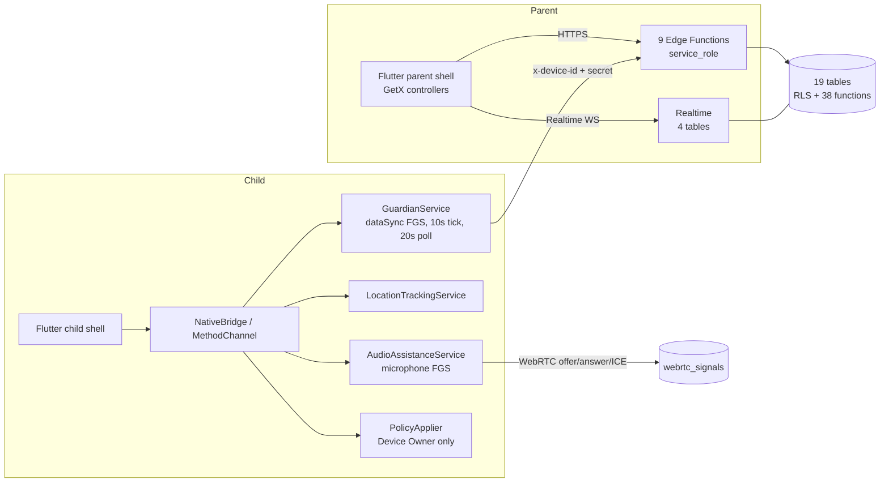

# 00 — Executive summary

**Subject:** `D:\parentcontrol_app` — Flutter + Android + Supabase parental-control app
**Reference product:** AirDroid Parental Control (official feature overview)
**Audit type:** read-only technical, functional, architectural, UI/UX, security and parity audit
**Date:** 2026-10-30
**Deliverables:** this document plus `01`–`12` in `audit/`, built from 10 disjoint sub-audits whose
raw findings are retained in `audit/_work/`.

---

## 1. Method and constraints honoured

| Constraint | How it was met |
|---|---|
| Read-only | No source, migration, config, hosted object, secret or record was modified. Every write-like action was refused or skipped. |
| Supabase **web dashboard only** | All hosted inspection was done in the browser: dashboard SQL Editor with `SELECT`/catalogue queries only, plus the Code/Settings/Logs/Auth pages. The Supabase CLI was never invoked, installed or used as a fallback. |
| No deployment | The fixed `remote-session` function was **not** deployed, even though it is the top finding. |
| Evidence separation | Every claim is tagged code (C), automated test (T), runtime (R) or deployment (D). A feature is called verified only with C+T+R. |
| Honest gaps | Items that could not be inspected are marked **BLOCKED — ACCESS REQUIRED** or **BLOCKED — DASHBOARD ACCESS REQUIRED**; none is counted as a pass. |
| Fixed vocabulary | The ten approved status strings are used verbatim in `01`; no percentage scores anywhere. |

Ten sub-agents covered disjoint areas: Flutter architecture, UI/UX/IA, Android native, local backend,
hosted Supabase (sole owner of the browser), security/reliability/platform, and four feature-inventory
fragments (family/dashboard/alerts, camera/screen/audio, controls/monitoring, web/location).

---

## 2. Bottom line

The product is **an audio-assistance + location + usage + app-suspension app**, not a general
parental-control suite. Of AirDroid's 19 categories it has real, runtime-proven parity in **one**
(one-way audio) and strong partial parity in **four** (family/device, location, geofence, app
management). Eight categories are entirely absent.

The single most consequential fact in this audit is **deployment drift, not design failure**: the
database schema, RLS, SQL functions and repository HEAD all implement a correct parent-controlled
session lifetime, while the **deployed `remote-session` Edge Function is still the old 30-minute
build**. That one stale function is why every long session dies mid-call (reproduced on 2026-10-29),
why the 15-minute endurance test failed, and why the parent UI's "Until you end the session" promise
is false today.

The second most consequential fact is **claim inflation in the client**: "Request video" is offered
with no camera foreground-service type (background capture is impossible on targetSdk 36), and
"enforcement" can be reported as succeeded while zero apps are suspended (Device Owner absent).

---

## 3. Scope in numbers

| Measure | Count |
|---|---|
| AirDroid categories audited | 19 + 1 "Additional" group = **20 groups** |
| Features / subfeatures inventoried | **242** |
| Flutter source files (`lib/`) | 140 |
| Routes registered | 26 (zero navigation guards) |
| Kotlin files | 20 |
| Supabase base tables | 19 (all RLS-enabled) |
| RLS policies | 22 (100 % `authenticated`; zero `anon`) |
| SQL functions | 38 (all `SECURITY DEFINER`) |
| Triggers | 8 (+1 on `auth.users`) |
| Migrations | 10 |
| Edge Functions deployed | 9 |
| Realtime publication members | 4 tables |
| Storage buckets | 0 |
| pg_cron jobs | 0 (extension not installed) |
| Flutter test files | 38 |
| Integration test files | 4 |
| Deno test files | 5 |
| SQL suites | 12 (+2 race runners) |
| Kotlin test files | 4 |
| Stage-8 runtime evidence files | 68 |

---

## 4. Status distribution (computed from `01`)

| Status | Rows |
|---|---|
| FULLY IMPLEMENTED — VERIFIED | **28** |
| IMPLEMENTED — PARTIALLY VERIFIED | **53** |
| PARTIALLY IMPLEMENTED | **30** |
| UI ONLY | **0** |
| BACKEND ONLY | **2** |
| CODE EXISTS — NOT TESTED | **13** |
| BROKEN | **2** |
| MISSING | **111** |
| BLOCKED — ACCESS REQUIRED | **0** |
| NOT APPLICABLE | **3** |
| **Total** | **242** |

Priorities: **P0 17**, P1 79, P2 107, P3 37, unprioritized 2.

Two things to read from this table:

- **Zero `UI ONLY`.** The team did not ship decorative screens — everything on screen has at least a
  code path behind it. That is better than most apps at this stage.
- **111 missing vs 28 verified.** Less than 12 % of the inventoried surface is proven end-to-end.
  That is the honest denominator for any "we're close to AirDroid" claim.

---

## 5. Category scorecard (condensed)

| Where the app is strong | Status |
|---|---|
| **Family & device management** (17 rows) | 9 fully verified; only broken row is online/offline presence |
| **One-way audio** (20 rows) | 15 fully verified — the only media feature with packet-level runtime proof |
| **Geofence** (11) | 8 partially verified — server evaluation real, parent UX manual |
| **Location** (12) | 7 partially verified — fixes stored, no map/route |
| **App management** (13) | 7 partially verified — inventory real, enforcement Device-Owner-gated |

| Where parity does not exist | Status |
|---|---|
| Screen mirroring (13), Notifications (10), Social detection (13), Image detection (10), Website restrictions (14), Browsing history (10) | **all MISSING** |
| Calls & SMS (10) | 9 missing, 1 not applicable (platform-restricted) |
| Web time limits (2) | iOS-only reference; Android equivalent absent |
| Today's Event / Dashboard (13) | 6 missing; no event feed, no trend, no push |
| Instant Block (13), Downtime (13) | Code exists but inert without Device Owner; never executed |

---

## 6. Architecture at a glance

Full diagrams and sequence flows (pairing, command, media, location, realtime) are in
`03_EXISTING_PROJECT_ARCHITECTURE.md`; module inventory in `04_FOLDER_STRUCTURE_AND_MODULE_MAP.md`.

Key structural facts:

- **One Flutter codebase, two roles**, split by `profiles.role`; 26 routes with **no route guards**
  (authorization is enforced per-call, not per-navigation).
- **Two foreground services** on the child (guardian + audio), one location service.
- **All state writes go through Edge Functions** with the service key; the only client-written table
  is `webrtc_signals` (plus `safe_zones` CRUD).
- **No push channel anywhere** — every "realtime" experience is polling or an open-socket subscription
  that dies with the app.

---

## 7. Local vs hosted — the 8-area comparison

Required comparison, summarised here; full detail in `06_BACKEND_DATABASE_RLS_AUDIT.md`.

| Area | Verdict | Detail |
|---|---|---|
| **Database schema** | **IN SYNC** | 19 tables, columns, constraints, partial-unique invariants and triggers all present and matching `supabase/migrations/`. Nullable `expires_at` and the pending-only expiry check are live. |
| **RLS** | **IN SYNC** | 22 policies, all `authenticated`; signaling policies are the post-fix shape (no `expires_at` test). Zero `anon` grants. |
| **SQL functions** | **IN SYNC** | 38 functions; bodies of the lifetime-critical ones (`request_remote_session`, transition guard, `expire_stale_sessions`) match HEAD. All revoked from `anon`/`authenticated`. |
| **Edge Functions** | **OUTDATED (1 of 9 confirmed)** | `remote-session` is the pre-fix bundle (`Q=30*60*1e3`, 410 on `active`/`ice`). The other eight were compared only by deploy timestamp ("2–4 days ago"), not byte-level — **BLOCKED** for full comparison. |
| **Realtime** | **IN SYNC** | Same four publication members, all at replica identity default. No hosted-only additions. |
| **Storage** | **IN SYNC / UNUSED** | Zero buckets on both sides; no storage policy applies. |
| **Authentication** | **IN SYNC** | Email auth only, verified-email required, JWT 3600 s, ECC P-256 signing keys. No hosted-only users or providers. |
| **Cron** | **MISSING on both** | pg_cron not installed; no `cron.job`. `cron` Edge Function exists but no scheduler is configured anywhere visible — its caller is **BLOCKED — DASHBOARD ACCESS REQUIRED**. |

No hosted object exists that is absent from the repository. The only divergence is the stale
`remote-session` deployment, and it is the top defect in this audit.

---

## 8. Top risks

| # | Risk | Severity | Evidence |
|---|---|---|---|
| 1 | Every audio session is killed by the deployed 30-minute deadline mid-call; UI denies it | **Critical** | Reproduced 2026-10-29 12:16:38Z; all 35 ended hosted sessions carry a 30-min TTL |
| 2 | No bound or watchdog on consented sessions; an orphaned row blocks the device indefinitely and no scheduler exists to reap it | High | F5 left a row `active`; pg_cron absent; `expire_stale_sessions` only touches `requested` |
| 3 | "Request video" cannot work in background (no `camera` FGS type) and has never been run on hardware | High | Manifest; zero video sessions in stage 8 |
| 4 | "Enforced" can be reported while zero apps are suspended; blocking/downtime require Device Owner with no provisioning path | High | `PolicyApplier` clears targets and only appends an error; ack maps success to `enforced` |
| 5 | Any non-owner parent can irreversibly purge family location/usage history; `safe_zones` still has a client DELETE | High | `family-admin/index.ts`; RLS policy list |
| 6 | No account deletion, no data export, no enforced retention — Play/GDPR blockers | Medium | No `deleteUser` anywhere; purge is manual and covers two tables |

---

## 9. What must happen next, in order

1. **Deploy the fixed `remote-session`** (owner approval required — deliberately not done here).
   One deploy removes the only reproduced mid-call teardown.
2. **Make enforcement truthful**: acks must prove "suspended N of M"; server sets `enforced` only when
   the applied set matches; decide Device Owner vs Accessibility vs descope, and remove claims where
   nothing is enforced.
3. **Fix destructive authorization**: owner-only purge, remove `safe_zones` client DELETE, re-check
   membership inside the `SECURITY DEFINER` RPCs.
4. **Reliability**: TURN relay, guardian watchdog, durable scheduling (WorkManager/AlarmManager), push
   or an explicit "no push" limitation, bounded session lifetime.
5. **Parity wave 1** (highest value per unit of work): notifications listener, Today's Event feed,
   map/route history, website filtering via `VpnService`.
6. **Parity wave 2**: screen mirroring (MediaProjection), completed camera path, image detection,
   calls/SMS (subject to Play policy).
7. **Product hygiene**: navigation cleanup (`/parent/settings` dead route, duplicated Requests), copy
   corrections, l10n, accessibility, release signing (currently the **debug keystore**).

Sequencing rationale and per-item effort are in `10_GAP_ANALYSIS_AND_PRIORITIES.md`; the target
architecture that supports those steps is in `11_RECOMMENDED_TARGET_ARCHITECTURE.md`.

---

## 10. What this audit could not prove

| Item | Status |
|---|---|
| Kotlin unit suite result | **BLOCKED — ACCESS REQUIRED** (cross-drive Gradle; zero tests executed) |
| SQL suite green status | **BLOCKED — ACCESS REQUIRED** (not executed; no historical pass row) |
| Byte-level parity for 8 of 9 Edge Functions | **BLOCKED — DASHBOARD ACCESS REQUIRED** (compared by timestamp only) |
| External scheduler for the `cron` function | **BLOCKED — DASHBOARD ACCESS REQUIRED** |
| Human audibility of the audio session | **BLOCKED — ACCESS REQUIRED** (no listener; evidence is RTP counters) |
| Repository visibility of the configured GitHub remote | **BLOCKED — ACCESS REQUIRED** |
| Video, screen mirroring, notifications, web filtering at runtime | Not applicable — no code, or no run |

Historical automated results (2026-10-29, **not re-run**): Flutter `275 passed, 0 failed`; `flutter
analyze` clean; Deno `47 passed`; Kotlin blocked. Details and the evidence-tier method are in
`12_TEST_EVIDENCE_AND_UNVERIFIED_FEATURES.md`.

---

## 11. Reading guide

| Document | Read it for |
|---|---|
| `01_COMPLETE_FEATURE_INVENTORY.md` | The 242-row master table with per-feature evidence, status, priority |
| `02_AIRDROID_FEATURE_COMPARISON.md` | Category-by-category parity against AirDroid, claims vs reality |
| `03_EXISTING_PROJECT_ARCHITECTURE.md` | System diagrams and the 11 core flows |
| `04_FOLDER_STRUCTURE_AND_MODULE_MAP.md` | Module ownership, file counts, structural red flags |
| `05_UI_UX_NAVIGATION_AUDIT.md` | Parent/child IA, 12 concrete navigation defects, accessibility |
| `06_BACKEND_DATABASE_RLS_AUDIT.md` | Hosted inventory, 8-area comparison, RLS/security findings |
| `07_ANDROID_NATIVE_CAPABILITY_AUDIT.md` | Permissions, services, enforcement reality, OEM constraints |
| `08_SECURITY_PRIVACY_RELIABILITY_AUDIT.md` | 14 findings (1 Critical, 3 High), privacy lifecycle, reliability posture |
| `09_PLATFORM_FEASIBILITY_MATRIX.md` | Which AirDroid capabilities are achievable on Android, and how |
| `10_GAP_ANALYSIS_AND_PRIORITIES.md` | 4 P0 root causes behind 17 P0 rows; P1/P2/P3 plan |
| `11_RECOMMENDED_TARGET_ARCHITECTURE.md` | Target Flutter/Android/backend structure and sequencing |
| `12_TEST_EVIDENCE_AND_UNVERIFIED_FEATURES.md` | Test inventory, historical results, the 13 untested and 2 broken features |

**One-sentence conclusion:** the backend design is sound and the audio path genuinely works, but a
single undeployed function currently breaks it, most claimed restrictions cannot be enforced on a
normal Android install, and eight of AirDroid's nineteen categories have no implementation at all.