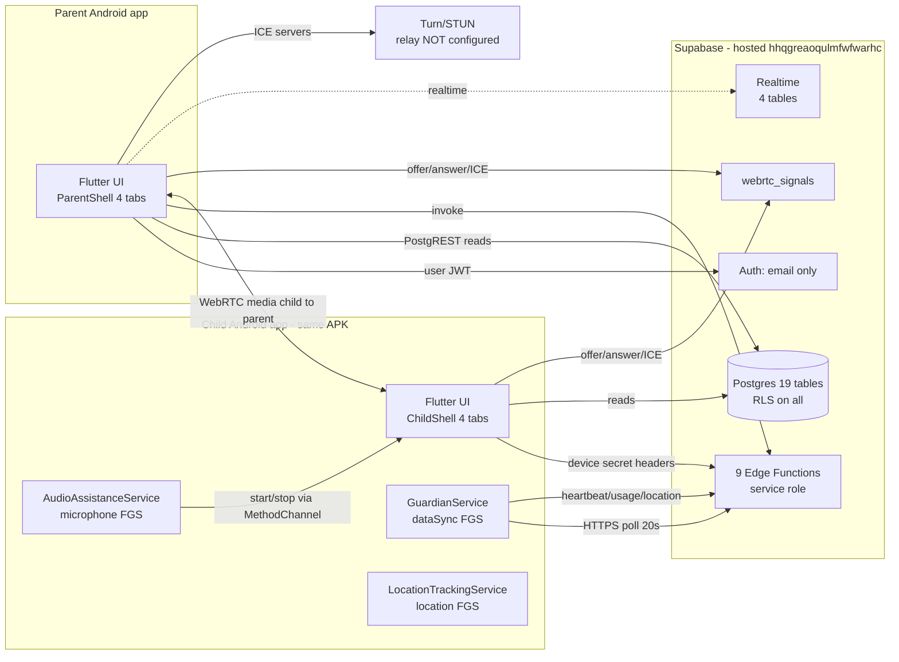
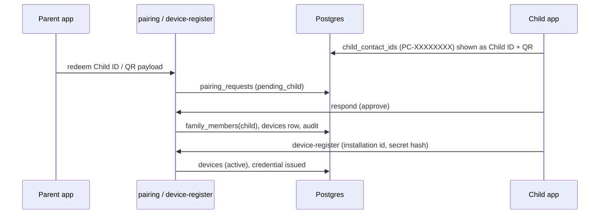

# 03 — Existing project architecture

Scope: repository at `D:\parentcontrol_app`, audited 2026-10-30. Evidence: `audit/_work/s1-flutter-architecture.md` (Flutter), `s3-android-native.md` (native), `s4-backend-local.md` + `s5-hosted-supabase.md` (backend). This document describes what exists; it does not propose changes (see `11_RECOMMENDED_TARGET_ARCHITECTURE.md`).

## 1. System shape

Three tiers, plus the Android platform:



Key structural facts:

- **One APK, two roles.** Role is chosen at `/role-selection` and locked server-side (`profiles.role`, `auth-bootstrap`). There is no separate child build.
- **Flutter owns UI/state only.** `lib/data` is the only layer that talks to Supabase or the platform channel; `features/*` hold controllers. 140 Dart files.
- **Android owns capture, background execution, policy application and device identity.** 20 Kotlin files. The Flutter engine is process-scoped and cached, so a service can outlive the Activity (`MainActivity.kt:26-50`).
- **Hosted backend is the source of truth.** `anon` has no table grants; all writes except `webrtc_signals` and `safe_zones` go through Edge Functions with the service key (`audit/_work/s5-hosted-supabase.md` §2.2).

## 2. Startup and role routing

1. `main.dart` initializes bindings, `SupabaseService.init()` (fail-soft) and registers repositories permanently (`lib/app/bindings/repository_binding.dart`).
2. If compile-time `SUPABASE_URL`/key are missing, `/configuration` is the only route and its "check again" cannot succeed (`lib/features/configuration/configuration_page.dart`).
3. Splash resolves the session, then `auth_session_flow.dart` maps the account to `/parent`, `/parent/family-setup`, `/child` or `/role-selection`.
4. **There are no route guards.** All 26 routes are open; safety rests on server RLS/Edge-Function checks plus fail-closed argument handling in `ChildSessionBinding` and `RemoteSessionBinding` (`lib/app/routes/app_pages.dart:56-186`; `s1` §2.4).

## 3. Parent-child pairing and device registration



- Pairing supports invite code, permanent Child ID and QR (`lib/features/pairing`, `supabase/functions/pairing`). The server enforces the parent/child role and family membership.
- Device identity is a 32-byte secret in `EncryptedSharedPreferences`, hashed server-side (`devices.secret_hash`), sent as `x-device-id`/`x-device-secret` over HTTPS only (`SecureStore.kt`, `DeviceHttpClient.kt`).
- One active device per child and one active child family are enforced by partial unique indexes (`devices_one_active_per_child`, `family_members_one_active_child_family`).

## 4. Command and policy flow

1. Parent saves a policy (`app_restrictions`, `screen_time`) → Edge Function writes `device_policies` (versioned JSONB) and/or a `device_commands` row (`apply_policy`).
2. `GuardianService` polls commands every 20 s with backoff to 300 s (`GuardianService.kt:195-212`), applies them on a 60 s tick (`:184-193`), and acks with `succeeded`/`failed`.
3. `PolicyApplier` enforces only via `DevicePolicyManager.setPackagesSuspended`, gated on `isDeviceOwnerApp()` (`PolicyApplier.kt:94-101,236-244`). Without Device Owner it clears the target set and reports the error — but the ack can still be recorded as `succeeded` when the error list is empty (`:137`), and `device-command` then flips `enforcement_status` to `enforced` on any successful ack (`supabase/functions/device-command/index.ts:318-351`).
4. There is no push channel. Delivery depends on the child process and its FGS surviving; `BootReceiver` refuses to start the FGS on API ≥ 35 (`BootReceiver.kt:31-37`).

## 5. Microphone session flow (the only media path with runtime proof)

```mermaid
sequenceDiagram
  participant P as Parent app
  participant EF as remote-session
  participant DB as Postgres
  participant C as Child app
  participant S as AudioAssistanceService
  P->>EF: request (kind=audio)
  EF->>DB: remote_sessions(requested, 10-min pending deadline)
  C->>EF: accept (consent_recorded)
  EF->>DB: status=accepted, accepted_at, expires_at=?
  C->>C: Join gate (second confirmation)
  C->>S: start mic FGS (POST_NOTIFICATIONS + RECORD_AUDIO gates)
  C->>DB: webrtc_signals offer
  P->>DB: answer + ICE
  P<->C: SRTP one-way child to parent (host/srflx only)
  P->>EF: end (parent only)
  EF->>DB: status=ended, audit session_ended
  S->>C: stop capture, notification removed
```

- Consent is double-gated: server records `consent_recorded` on accept, and the child UI requires a second "Join now" before `getUserMedia` (`remote_session_controller.dart:657-708,1521-1536`).
- Media is **one-way child → parent**, parent is the sole offerer; ICE has `host`/`srflx` only because no TURN is configured (`s7` / `docs/runtime-mic-test-report.md`).
- Liveness is RTP-based, not badge-based; the parent UI shows `DEBUG RTP in/out`.
- Lifetime at HEAD is parent-controlled (`expires_at` null on accept); the **deployed** function still stamps +30 min and returns 410 — see `06_BACKEND_DATABASE_RLS_AUDIT.md` §4 and F1.

## 6. Realtime and notifications

- Three realtime uses exist in Dart: session state, signaling, alerts. Publication members: `device_commands`, `remote_sessions`, `safety_alerts`, `webrtc_signals`; all at default replica identity, so UPDATE fan-out carries only the PK.
- **No push transport exists.** No FCM dependency, no local-notification delivery; the parent's notification toggles are local preferences only (`settings_body.dart:108-144`). Alerts are seen when the app polls/realtime-connects.

## 7. Location, geofence and telemetry

- Child: `LocationTrackingService` (GPS+NETWORK, FGS, `START_STICKY`, started from child UI only) → `LiveState` → guardian upload every 20 s (`GuardianService.kt:458-491`). `ACCESS_BACKGROUND_LOCATION` is declared but never requested (`NativeBridge.kt:455-497`).
- Server: `device-telemetry` validates the fix, stores `location_events`, and evaluates safe zones by haversine on each accepted upload, writing `geofence_enter/exit` only on a state flip (`supabase/functions/device-telemetry/index.ts:274-352`).
- Parent: coordinate list, no map SDK; no route/trip reconstruction.
- The Flutter `LocationRepository.uploadLocation` has zero call sites — uploads are native-only (`s1` §2.6).

## 8. Data model (hosted, verified)

19 tables, all RLS-enabled: `profiles`, `families`, `family_members`, `devices`, `child_contact_ids`, `device_pairing_tokens`, `pairing_requests`, `pairing_attempts`, `device_commands`, `device_policies`, `device_apps`, `usage_daily`, `location_events`, `safe_zones`, `safe_zone_states`, `safety_alerts`, `remote_sessions`, `webrtc_signals`, `audit_logs`.

Integrity features that matter architecturally: versioned policies with ack state; idempotency keys on commands; partial unique indexes for one-active-device/one-family; `audit_logs` append-only trigger; session transition guard; nullable `expires_at` with a pending-only expiry CHECK.

## 9. Cross-cutting weaknesses (architectural, not cosmetic)

| Area | State | Consequence |
|---|---|---|
| Observability | no logging/crash/analytics calls anywhere | F2/F6-class failures are only diagnosable from device logs and DB rows |
| Offline | banners + error mapping; no cache/queue/retry | writes are lost, not deferred (e.g. all but the last pending location fix) |
| Push | absent | commands/alerts depend on a polling FGS being alive |
| Enforcement | Device-Owner-only suspension | app blocking/downtime/schedules are inert on a normal install |
| Scheduling | no `pg_cron`; no WorkManager/AlarmManager | server sweeps and reboot recovery depend on external callers or the user opening the app |
| Localization/a11y | no l10n framework, zero `Semantics` | English-only, weak TalkBack support |
| Secrets in client | anon key + device secret in app storage | expected for this design, but no certificate pinning; auth callback is a custom scheme |

## 10. Deployment divergence (critical)

The hosted **database** is at the latest migration (nullable expiry, new guard, pending-only sweep, signaling RLS without `expires_at`), but the hosted **`remote-session` Edge Function is the pre-fix build**: it writes `expires_at = accepted_at + 30 min`, force-expires accepted sessions with 410, and still lets a non-parent participant end a session (`audit/_work/s5-hosted-supabase.md` §2.10). The client and UI already promise "Until you end the session". This single stale artifact is the biggest architectural risk in the system because it silently kills live audio.