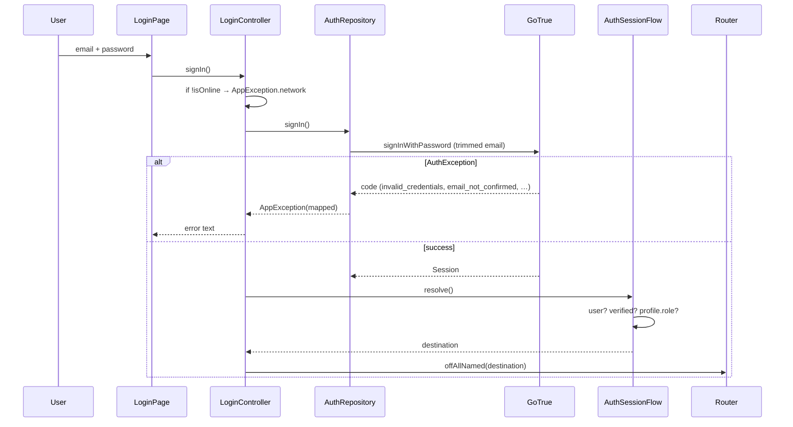
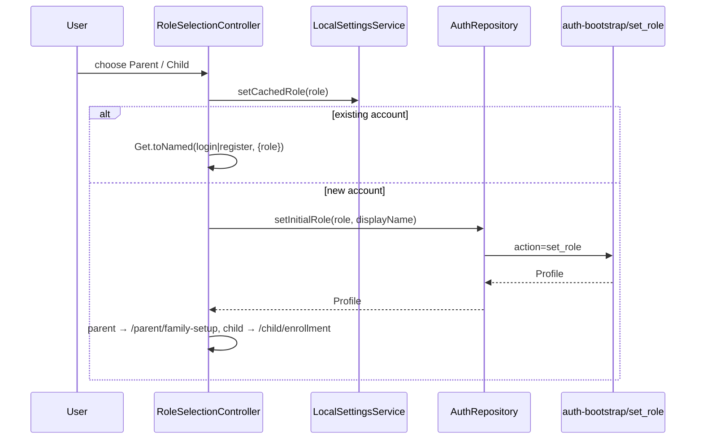
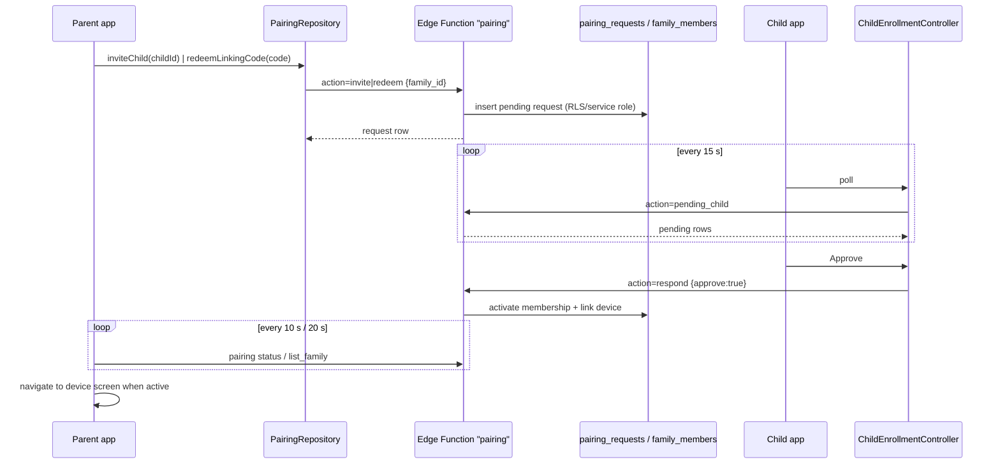
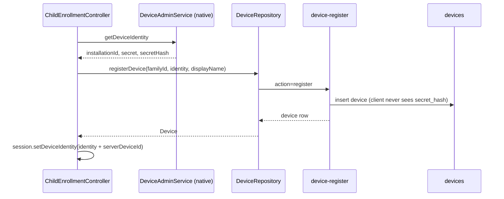
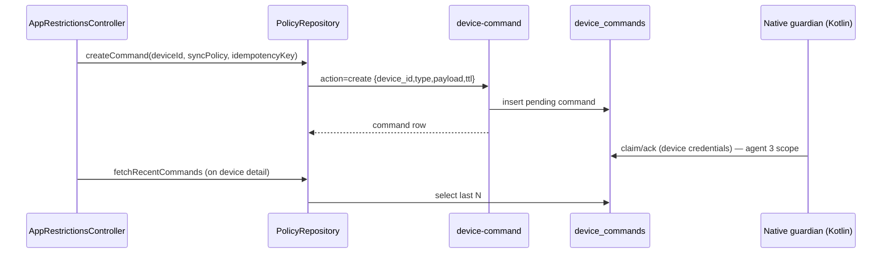
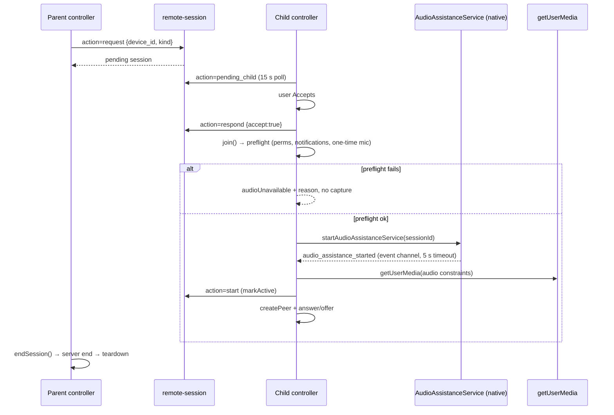
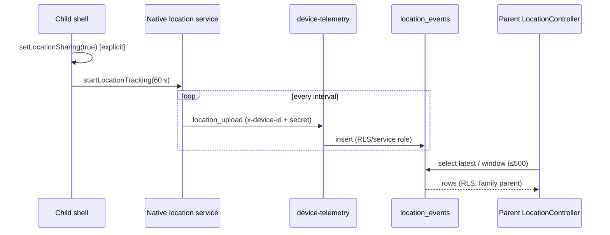
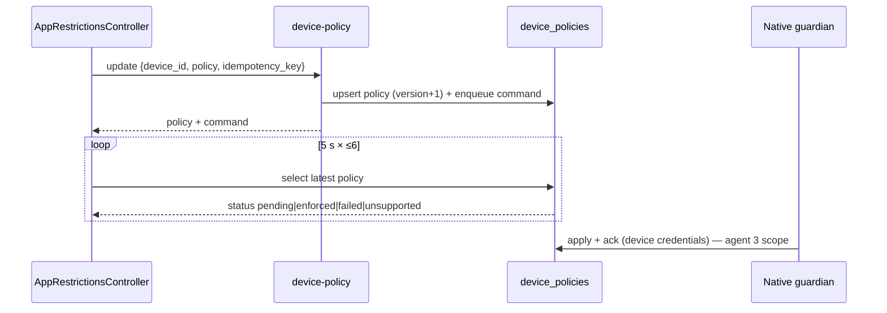

# Flutter architecture findings

Read-only audit of the Flutter client and Dart data layer at `HEAD 2a0209f` (2026-10-29).
No repository file was created, modified, deleted, formatted or executed during this audit
(no `flutter`/`dart`/`gradle`/Supabase CLI invocations). The only file written is this report.
Kotlin internals are agent 3's scope; SQL/RLS/Edge Function internals are agent 4's scope;
visual design and UX copy are out of scope here. Where this report touches those areas it
states only what the Dart side sends or receives, and marks the counterpart as an assumption.

Status vocabulary used exactly as defined in `audit/_work/AUDIT_BRIEF.md`.

---

## 1. Scope actually covered

### 1.1 Files read

Full reads:

- Bootstrap/plumbing: `lib/main.dart`, `lib/app/app.dart`, `lib/app/routes/app_routes.dart`,
  `lib/app/routes/app_pages.dart`, `lib/app/bindings/repository_binding.dart`,
  `lib/core/config/env.dart`, `lib/core/errors/app_exception.dart`.
- Services: `lib/data/services/supabase_service.dart`, `edge_api.dart`, `session_service.dart`,
  `local_settings_service.dart`, `connectivity_service.dart`, `device_admin_service.dart`.
- Contracts and all 10 repositories: `lib/data/repositories/repository_contracts.dart`,
  `supabase_auth_repository.dart`, `supabase_family_repository.dart`,
  `supabase_pairing_repository.dart`, `supabase_device_repository.dart`,
  `supabase_policy_repository.dart`, `supabase_usage_repository.dart`,
  `supabase_location_repository.dart`, `supabase_alert_repository.dart`,
  `supabase_remote_session_repository.dart`, `supabase_audit_repository.dart`.
- Models: `lib/data/models/account.dart`, `device.dart`, `pairing.dart`, `remote_session.dart`,
  `telemetry.dart`, `audit.dart`, `models.dart`.
- Auth/role/shell: `lib/features/auth/auth_session_flow.dart`,
  `controllers/{splash,login,register,verify_email}_controller.dart`,
  `lib/features/role_selection/controllers/role_selection_controller.dart`,
  `lib/features/parent_shell/*`, `lib/features/child/child_session_binding.dart`,
  `lib/features/child/controllers/{child_shell,child_enrollment,child_requests}_controller.dart`.
- Remote assistance: `lib/features/remote_assistance/remote_session_controller.dart` (2,581 lines),
  `remote_session_registry.dart`, `remote_session_binding.dart`,
  `remote_assistance_binding.dart`, `remote_assistance_controller.dart`.
- Pairing, family, devices, policy, location, alerts, audit, settings controllers:
  `lib/features/pairing/controllers/*`, `pairing_qr_payload.dart`,
  `lib/features/family/controllers/*`, `lib/features/devices/*_controller.dart`,
  `lib/features/app_restrictions/app_restrictions_controller.dart`,
  `lib/features/screen_time/screen_time_controller.dart`,
  `lib/features/location/location_controller.dart`, `safe_zones_controller.dart`,
  `safety_alerts_controller.dart`, `audit_logs_controller.dart`,
  `parent_settings_controller.dart`, `lib/features/child/services/child_preferences.dart`,
  `lib/features/configuration/configuration_page.dart`, `lib/core/utils/validators.dart`,
  `pubspec.yaml`.

Grep-level verification (read-only) across the whole tree for: `Get.put`/`lazyPut`/`find`,
`Get.toNamed`/`offAllNamed`, `arguments:`, `Timer.periodic`, `.channel(`,
`WidgetsBindingObserver`, `debugPrint|developer.log|print(`, `.tr(|supportedLocales`,
`featureFlag`, `applyPolicy|acknowledgeCommand|uploadUsage|uploadLocation`,
`refreshSession|authStateChanges`, `getInitialLink|uriLinkStream|detectSessionInUri`.

### 1.2 Measurements

| Measurement | Command (read-only) | Result |
|---|---|---|
| Dart files under `lib/` | `find lib -type f \| wc -l` | **140** |
| Feature files under `lib/features/` | `find lib/features -type f \| wc -l` | 95 |
| Unit/widget test files | `find test -type f -name "*.dart" \| wc -l` | 39 |
| Integration test files | `find integration_test -type f` | 4 |
| Realtime channels in Dart | `grep -rn "\.channel(" lib` | 3 |
| `Timer.periodic` sites | `grep -rn "Timer.periodic" lib` | 14 |
| Route guards / middleware | `grep -rn "middlewares\|GetMiddleware" lib` | **0** |
| Logging calls | `grep -rn "debugPrint\|developer.log\|print(" lib` | **0** |
| Localization hooks | `grep -rn "\.tr(\|supportedLocales\|localizationsDelegates" lib pubspec.yaml` | **0** |
| Feature-flag references | `grep -rn "featureFlag\|remoteConfig" lib` | **0** |
| Deep-link handlers | `grep -rn "getInitialLink\|uriLinkStream\|detectSessionInUri" lib pubspec.yaml` | **0** |

### 1.3 Runtime context consulted (not re-derived)

- `docs/runtime-mic-test-report.md` — proves three live media sessions, parent-End semantics,
  background/lock survival, and records F1 (hosted 30-minute expiry) and F6 (misleading
  signaling banner). Automated-check table: Flutter `275 passed`, `analyze` clean, Kotlin
  suite blocked by mixed drive roots (`docs/runtime-mic-test-report.md:241-244`).
- `docs/runtime-device-matrix.md` — Pixel 9a AVD parent vs. realme RMX2161 child, family `demo`.
- `docs/runtime-failure-analysis.md` — F0–F6, E1.

### 1.4 Explicitly not audited here

Kotlin service/method-channel implementation, SQL/RLS/Edge Function bodies, visual design,
screen-level widget composition beyond confirming which controller a route binds.

---

## 2. Findings

### 2.1 `lib/` structure, responsibilities and file counts

```
lib/                                 140 files
├── main.dart                          1  bootstrap + DI order
├── app/                               4
│   ├── app.dart                       1  GetMaterialApp (no locale/navigator config)
│   ├── bindings/repository_binding..  1  registers 10 repositories permanently
│   └── routes/                        2  route constants (26) + GetPage table
├── core/                             16
│   ├── config/env.dart                1  compile-time config + backend validation
│   ├── errors/app_exception.dart      1  AppErrorCodes + AppException.from()
│   ├── theme/app_theme.dart           1  light theme
│   ├── utils/                         3  json_utils, validators, formatters
│   └── widgets/                      10  shared presentational widgets
├── data/                             24
│   ├── models/                        7  account, device, pairing, remote_session,
│   │                                     telemetry, audit, barrel
│   ├── repositories/                 11  contracts + 10 Supabase implementations
│   └── services/                      6  supabase, edge_api, session, local_settings,
│                                         connectivity, device_admin
└── features/                         95
    ├── app_restrictions/              3  draft policy editor (parent)
    ├── audit_logs/                    3  audit read / retention / purge
    ├── auth/                         15  splash, login, register, verify-email + flow
    ├── child/                        20  shell, enrollment, requests, session, 4 tabs
    ├── configuration/                 1  unconfigured-build gate screen
    ├── dashboard/                     2  parent dashboard tab
    ├── devices/                       6  device list + detail (revoke/recover/commands)
    ├── family/                        6  family setup, members, unlink
    ├── location/                      3  latest + history
    ├── pairing/                       7  redeem/invite + requests + QR parser
    ├── parent_shell/                  3  4-tab parent shell
    ├── remote_assistance/             7  request list, session engine, registry, bindings
    ├── role_selection/                3  parent/child choice, lock mode
    ├── safe_zones/                    3  CRUD for safe zones
    ├── safety_alerts/                 5  alerts list + realtime
    ├── screen_time/                   3  usage display + limit/bedtime
    └── settings/                      5  parent settings
```

`lib/features/child/views/`, `lib/core/`, `lib/data/` and `lib/features/` contain no files
(empty or barrel-free directories). There is no `lib/routes/` — routing lives in
`lib/app/routes/` (`lib/app/routes/app_routes.dart:1-32`,
`lib/app/routes/app_pages.dart:55-187`). There is no `lib/l10n/`, no `lib/analytics/`,
no `lib/logging/`.

Module-to-responsibility summary: `app/` owns startup and navigation only; `core/` is
domain-free utilities plus compile-time config; `data/` is the only place that talks to
Supabase and the platform channel; `features/*` hold one controller (plus views) per screen
family and never construct an HTTP/Supabase client directly.

---

### 2.2 Bootstrap sequence and startup gates

`main()` (`lib/main.dart:14-38`) is strictly ordered and awaited:

1. `WidgetsFlutterBinding.ensureInitialized()` (`lib/main.dart:15`).
2. `LocalSettingsService().init()` as a **permanent** service (`lib/main.dart:17-20`); reads
   SharedPreferences keys `cached_role`, `active_family_id`, `last_sync_at`,
   `notifications_enabled`, `location_sharing_enabled`, `child_contact_id_<userId>`
   (`lib/data/services/local_settings_service.dart:7-12`).
3. `SupabaseService().init()` as permanent (`lib/main.dart:21-24`). This **never throws**:
   it stores `_initError` for unconfigured builds (`supabase_service.dart:16-26`) or a
   `backend_init_failed` for a rejected `Supabase.initialize` (`:34-40`). `client` throws the
   stored exception (`:44-49`), and `authStateChanges` degrades to an empty stream
   (`:53-56`).
4. `EdgeApi(supabase)` (`lib/main.dart:25`) — the single Edge Function transport
   (`lib/data/services/edge_api.dart:19-49`).
5. `SessionService()` (`lib/main.dart:26`) — display-only state, no persistence
   (`lib/data/services/session_service.dart:11-24`).
6. `ConnectivityService().init()` (`lib/main.dart:27-30`) — one subscription, `isOnline`
   reactive flag (`lib/data/services/connectivity_service.dart:7-28`).
7. `DeviceAdminService()` (`lib/main.dart:31`) — method channel + event channel wrapper
   (`lib/data/services/device_admin_service.dart:17-37`).
8. `RepositoryBinding().dependencies()` (`lib/main.dart:32`) — 10 repositories bound by
   interface, all `permanent: true` (`lib/app/bindings/repository_binding.dart:23-62`).
9. `RemoteSessionRegistry()` permanent (`lib/main.dart:35`) — app-scoped owner of the live
   session controller, deliberately outside route lifetimes (`lib/main.dart:33-35`).
10. `runApp(const ParentControlApp())` (`lib/main.dart:37`).

`GetMaterialApp` sets `initialRoute: AppRoutes.splash`, `getPages`, a 240 ms cupertino
transition, and nothing else (`lib/app/app.dart:14-22`). In particular there is **no**
`navigatorKey`, **no** `localizationsDelegates`/`supportedLocales`, **no** `builder` for
global banners/dialogs, and no `onGenerateRoute`/unknown-route handler.

Startup gate order in `SplashController.resolve()` (`lib/features/auth/controllers/splash_controller.dart:66-97`):

1. `!_supabase.isConfigured` → `/configuration` (`:71-75`).
2. `!_supabase.isReady` → surfaces `initError`, stays on splash (`:76-80`).
3. offline (`!ConnectivityService.isOnline`) → `AppException.network()`, stays on splash
   (`:81-84`).
4. `AuthSessionFlow.resolve()` → server-state destination (`:85`), then `_leave()` cancels the
   auth subscription **before** navigation (`:88`, `:101-106`), then `openDestination`
   (`:89`).

Splash also re-runs `resolve()` on an auth-state change (`:53-62`) and on connectivity
restoration when an error is showing (`:48-52`), both guarded by `_hasNavigated`.

```
sequenceDiagram
  participant M as main()
  participant LS as LocalSettingsService
  participant SB as SupabaseService
  participant SP as SplashController
  participant AF as AuthSessionFlow
  participant R as Router (GetX)
  M->>LS: init() [await, permanent]
  M->>SB: init() [await, never throws]
  M->>M: EdgeApi, SessionService, Connectivity, DeviceAdmin, repos, registry
  M->>R: runApp → initialRoute "/"
  SP->>SB: isConfigured? / isReady?
  alt not configured
    SP->>R: offAllNamed("/configuration")
  else not ready or offline
    SP-->>SP: error state + retry (stays on splash)
  else ready
    SP->>AF: resolve()
    AF->>SB: currentUserId / emailConfirmedAt / profiles
    AF-->>SP: destination
    SP->>SP: _leave() cancels auth subscription
    SP->>R: offAllNamed(destination)
  end
```

**Finding S1-01 — startup is fail-soft but silent.** No stage of bootstrap reports to any
sink: zero `debugPrint`/`developer.log` calls exist in `lib/`, and non-UI failures are stored
as `AppException` values only. `SupabaseService.init()` swallowing configuration errors into
`_initError` (`supabase_service.dart:16-40`) is the right call for UX, but there is no
diagnostic channel at all (see S1-13).

**Finding S1-02 — the configuration gate is a terminal state by construction.** On an
unconfigured build, `SplashController` routes to `/configuration` (`splash_controller.dart:71-75`).
That screen offers "check again", which re-runs `SupabaseService.init()`
(`lib/features/configuration/configuration_page.dart:29-42`). Because the values come from
`String.fromEnvironment` (`lib/core/config/env.dart:15-16`), they are frozen at compile time,
so re-running `init()` cannot change `isConfigured`; the retry can never succeed on the path
that reaches this screen. The gate is correct as a refusal to run, but the recovery affordance
is dead logic. Status: `IMPLEMENTED — PARTIALLY VERIFIED` (gate), retry `BROKEN` in effect.

**Finding S1-03 — e-mail verification deep link is not handled at app level.** The build
declares `authRedirectUrl = 'parentcontrol://auth-callback'` (`env.dart:13`) and passes it to
`signUp` (`supabase_auth_repository.dart:70-75`) and `resend` (`:100-104`), but no Flutter
deep-link API is used anywhere (`getInitialLink`, `uriLinkStream`, `detectSessionInUri`: 0
hits; no `uni_links`/`app_links` dependency in `pubspec.yaml:30-47`). Any session extraction
from the callback URI is therefore delegated to `supabase_flutter` defaults — or requires
native handling (agent 3). The in-app path instead polls `refreshSession()` when the user taps
"already verified" (`supabase_auth_repository.dart:110-121`), which is the path runtime
evidence would have used. Status: `CODE EXISTS — NOT TESTED`; deep-link arrival
`(assumption)`.

---

### 2.3 Dependency injection and GetX bindings

Global/permanent services (created before `runApp`): `LocalSettingsService`, `SupabaseService`,
`EdgeApi`, `SessionService`, `ConnectivityService`, `DeviceAdminService`,
`RemoteSessionRegistry` (`lib/main.dart:17-35`). Repositories are permanent and keyed by
abstract type (`lib/app/bindings/repository_binding.dart:23-62`).

| Repository (interface) | Binding | Backend surface used |
|---|---|---|
| `AuthRepository` | `repository_binding.dart:26` | GoTrue + `profiles` + `auth-bootstrap` |
| `FamilyRepository` | `:30` | `family_members`, `families` + `auth-bootstrap`, `family-admin` |
| `PairingRepository` | `:34` | `pairing` Edge Function |
| `DeviceRepository` | `:38` | `devices`, `device_apps` + `device-register`, `family-admin`, `device-telemetry` |
| `PolicyRepository` | `:42` | `device_policies`, `device_commands` + `device-policy`, `device-command` |
| `UsageRepository` | `:46` | `usage_daily` + `device-telemetry` |
| `LocationRepository` | `:50` | `location_events`, `safe_zones` + `device-telemetry` |
| `AlertRepository` | `:54` | `safety_alerts` (read + realtime) + `family-admin` |
| `RemoteSessionRepository` | `:58` | `remote_sessions`, `webrtc_signals` + `remote-session` |
| `AuditRepository` | `:62` | `audit_logs` + `family-admin` |

Per-route bindings use `Get.lazyPut` and locate repositories/services via `Get.find` (e.g.
`lib/features/auth/login_binding.dart:11-18`, `lib/features/child/child_shell_binding.dart:13-23`).
Most feature controllers are `fenix: true` (e.g.
`lib/features/remote_assistance/remote_assistance_binding.dart:9-19`), so GetX recreates them
after disposal.

Two deliberate deviations:

- `/configuration` has **no binding** (`lib/app/routes/app_pages.dart:62-65`); the page is a
  `StatefulWidget` reading `Env` and `Get.find<SupabaseService>()` directly
  (`configuration_page.dart:33`, `:66`).
- `/child/restrictions` reuses `ChildShellBinding` and the page is
  `GetView<ChildShellController>` (`lib/app/routes/app_pages.dart:171-175`,
  `lib/features/child/child_restrictions_page.dart:12`). It is a child screen that resolves an
  already-loaded shell controller; if it is ever pushed without the shell in memory, GetX
  throws rather than falling back. Status: `IMPLEMENTED — PARTIALLY VERIFIED`.

**Finding S1-04 — DI is coherent, but there is no per-feature scoping.** Everything that
matters is permanent: 10 repositories, 7 services and the session registry outlive every
route. There is no disposal of repository-level subscriptions because there are none; the only
long-lived reactive objects are the registry, `SessionService` and `ConnectivityService`.
Consequence: correctness depends on controllers clearing their own timers/subscriptions in
`onClose` (they do, see 2.5), not on container scoping.

---

### 2.4 Route table, arguments and guards

All 26 routes are declared as const strings (`lib/app/routes/app_routes.dart:4-30`) and mapped
1:1 in `AppPages.routes` (`lib/app/routes/app_pages.dart:56-186`).

| # | Route | Page (app_pages) | Binding | Arguments actually passed | Entry points |
|---|---|---|---|---|---|
| 1 | `/` | `SplashPage` `:57-61` | `SplashBinding` | none | `initialRoute` `app.dart:18`; config page `configuration_page.dart:37` |
| 2 | `/configuration` | `ConfigurationPage` `:62-65` | **none** | none | `splash_controller.dart:73` |
| 3 | `/role-selection` | `RoleSelectionPage` `:66-70` | `RoleSelectionBinding` | `{mode:'lock'}` (`auth_session_flow.dart:109`) | auth flow; sign-out `parent_settings_controller.dart:190`, `child_shell_controller.dart:1108` |
| 4 | `/auth/login` | `LoginPage` `:71-75` | `LoginBinding` | `{email}` (`verify_email_controller.dart:165`), `{role}` (`register_page.dart:194-196`) | verify-email, register |
| 5 | `/auth/register` | `RegisterPage` `:76-80` | `RegisterBinding` | `{role}` (`login_page.dart:166-168`, `role_selection_controller.dart:98-100`) | login, role selection |
| 6 | `/auth/verify-email` | `VerifyEmailPage` `:81-85` | `VerifyEmailBinding` | `{email}` (`auth_session_flow.dart:106`) | auth flow |
| 7 | `/parent` | `ParentShellPage` `:86-90` | `ParentShellBinding` | none | auth flow; `family_setup_controller.dart:99` |
| 8 | `/parent/family-setup` | `FamilySetupPage` `:91-95` | `FamilySetupBinding` | none | auth flow |
| 9 | `/parent/family` | `FamilyPage` `:96-100` | `FamilyBinding` | `{familyId}` (`parent_dashboard_tab.dart:119,173`; `settings_body.dart:99`; `pairing_redeem_page.dart:85`) | dashboard, settings, redeem |
| 10 | `/parent/pairing/redeem` | `PairingRedeemPage` `:101-105` | `PairingRedeemBinding` | `{familyId}` (`parent_dashboard_tab.dart:183`; `pairing_requests_page.dart:55`) | dashboard, requests |
| 11 | `/parent/pairing/requests` | `PairingRequestsPage` `:106-110` | `PairingRequestsBinding` | `{familyId}` (`family_page.dart:44`) | family |
| 12 | `/parent/devices/detail` | `DeviceDetailPage` `:111-115` | `DeviceDetailBinding` | `{deviceId}` (`parent_dashboard_tab.dart:299`; `settings_body.dart:323`) | dashboard, settings |
| 13 | `/parent/app-restrictions` | `AppRestrictionsPage` `:116-120` | `AppRestrictionsBinding` | `{deviceId}` (`device_detail_page.dart:427`) | device detail |
| 14 | `/parent/screen-time` | `ScreenTimePage` `:121-125` | `ScreenTimeBinding` | `{deviceId}` (`device_detail_page.dart:435`) | device detail |
| 15 | `/parent/location` | `LocationPage` `:126-130` | `LocationBinding` | `{deviceId, familyId}` (`device_detail_page.dart:443`) | device detail |
| 16 | `/parent/safe-zones` | `SafeZonesPage` `:131-135` | `SafeZonesBinding` | `{familyId, deviceId}` (`device_detail_page.dart:451`) | device detail |
| 17 | `/parent/alerts` | `SafetyAlertsPage` `:136-140` | `SafetyAlertsBinding` | `{familyId}` (`parent_dashboard_tab.dart:193`; `device_detail_page.dart:457`) | dashboard, device detail |
| 18 | `/parent/assistance` | `RemoteAssistancePage` `:141-145` | `RemoteAssistanceBinding` | `{deviceId}` (`device_detail_page.dart:467`) | device detail |
| 19 | `/parent/assistance/session` | `RemoteSessionPage` `:146-150` | `RemoteSessionBinding` | `{sessionId, role:'parent'}` (`remote_assistance_page.dart:213,222`) | assistance list |
| 20 | `/parent/audit` | `AuditLogsPage` `:151-155` | `AuditLogsBinding` | `{familyId}` (`settings_body.dart:176`; `family_page.dart:52`) | settings, family |
| 21 | `/parent/settings` | `ParentSettingsPage` `:156-160` | `ParentSettingsBinding` | none | parent shell tab |
| 22 | `/child` | `ChildShellPage` `:161-165` | `ChildShellBinding` | none | auth flow |
| 23 | `/child/enrollment` | `ChildEnrollmentPage` `:166-170` | `ChildEnrollmentBinding` | none | role selection `role_selection_controller.dart:159`; requests `child_requests_controller.dart:143`; home tab `child_home_tab.dart:230,291` |
| 24 | `/child/restrictions` | `ChildRestrictionsPage` `:171-175` | `ChildShellBinding` (reused) | none | home tab `:335,491`; rules tab `:120`; settings tab `:260` |
| 25 | `/child/session` | `ChildSessionPage` `:176-180` | `ChildSessionBinding` | `{sessionId, role:'child'}` (`child_requests_controller.dart:194`; `child_shell_controller.dart:415`) | requests, child shell |
| 26 | `/child/requests` | `ChildRequestsPage` `:181-185` | `ChildRequestsBinding` | none | home tab `:239,470,500`; requests tab `:76,96,131,143` |

**Finding S1-05 — there are no route guards, middleware or redirects anywhere.** Zero
`middlewares:` entries in `app_pages.dart` (`:56-186`) and zero `GetMiddleware` subclasses in
`lib/` (grep: 0 hits). All authorization is (a) server-side (RLS + Edge Function caller
checks) and (b) defensive argument handling in the two session bindings:

- `ChildSessionBinding`: anything not exactly `role == 'child'` yields `sessionId = ''` and
  `role = 'parent'`, so the screen can neither load nor capture
  (`lib/features/child/child_session_binding.dart:11-27`).
- `RemoteSessionBinding`: unknown/missing role resolves to literal `'view-only'`, which
  `isViewOnly` treats as not-mic-capable (`lib/features/remote_assistance/remote_session_binding.dart:42-50`,
  `remote_session_controller.dart:255-258`).

Consequence: a user who deep-links `/parent` while signed out sees the parent shell and every
repository call fails with `unauthorized` (mapped from `AuthException`, e.g.
`supabase_device_repository.dart` `_guard`). It is safe but not graceful; there is no
"unauthorized ⇒ redirect to login" policy anywhere. Status: `MISSING` (guards), safe by
backend enforcement.

**Finding S1-06 — route arguments are informational, never trusted for identity.** Every
argument is an id/role hint re-validated against loaded server rows: `deviceId` is checked
through `fetchDevice` (family-scoped read, `supabase_device_repository.dart:43-56`), `familyId`
through `fetchFamily` (`supabase_family_repository.dart:86-106`), session `role` through the
bindings above. Only `role` and `sessionId` affect capability, and both fail closed. Status:
`IMPLEMENTED — VERIFIED` (code-level).

---

### 2.5 State management

Pattern: one GetX controller per screen family; `Rxn<T>`/`RxList<T>`/`RxBool` observables;
`onInit` starts work, `onClose` cancels; `Get.find` inside pages. There is no global store, no
BLoC/Riverpod, no immutable state layer. Server state is re-fetched rather than normalized.

| Controller | File | Observables (representative) | Timers / subscriptions | `onClose` |
|---|---|---|---|---|
| `SplashController` | `auth/controllers/splash_controller.dart` | `isResolving`, `error` `:36` | auth stream `:53-62`, `ever(isOnline)` `:48-52` | cancels both `:108-116` |
| `LoginController` | `auth/controllers/login_controller.dart` | `error` `:33`, form fields | none | — |
| `RoleSelectionController` | `role_selection/controllers/…:44-177` | `error`, `cachedRole`, `_roleSubmitted` | none | — |
| `VerifyEmailController` | `auth/controllers/verify_email_controller.dart` | email/cooldown/error | 1 s cooldown `:212` | cancels `:212` scope |
| `ParentShellController` | `parent_shell/parent_shell_controller.dart:4-10` | `tabIndex`, `tabCount = 4` | none | — |
| `DashboardController` | `dashboard/dashboard_controller.dart` | families/devices/alerts | 60 s refresh `:19,60` | cancels |
| `DevicesController` | `devices/devices_controller.dart` | device list | 60 s refresh `:18,53` | cancels |
| `DeviceDetailController` | `devices/device_detail_controller.dart` | device, policy, commands `:27` | none periodic | — |
| `AppRestrictionsController` | `app_restrictions/…:400-505` | draft/saved policy, `saving` | 5 s ack poll ×6 `:453-480` | cancels |
| `ScreenTimeController` | `screen_time/…:236-249,383` | usage rows, limit, bedtime | 5 s ack poll `:383` | cancels |
| `LocationController` | `location/location_controller.dart:79,98` | latest/history | none | — |
| `SafeZonesController` | `safe_zones/…` | zones, draft | none | — |
| `SafetyAlertsController` | `safety_alerts/…` | alerts | realtime stream `alert_repository.dart:60-143` | cancels stream |
| `AuditLogsController` | `audit_logs/…` | entries, retention | none | — |
| `ParentSettingsController` | `settings/parent_settings_controller.dart` | toggles `:33,79-80` | none | — |
| `PairingRedeemController` | `pairing/controllers/pairing_redeem_controller.dart` | request, status | 10 s status poll `:17,159-164` | cancels |
| `PairingRequestsController` | `pairing/controllers/pairing_requests_controller.dart` | requests | 20 s poll `:20,50` | cancels |
| `ChildEnrollmentController` | `child/controllers/child_enrollment_controller.dart` | pending, contact id, device | 15 s poll `:43,75` | cancels |
| `ChildRequestsController` | `child/controllers/child_requests_controller.dart` | requests, responding | 15 s poll `:25,45` | cancels |
| `ChildShellController` | `child/controllers/child_shell_controller.dart` | family, device, policy, session, capabilities, warnings | 20 s linked poll `:38,388-408`; native event stream `:718-740` | cancels `:1114-1121` |
| `RemoteAssistanceController` | `remote_assistance/remote_assistance_controller.dart:20-80` | sessions, requesting | none | — |
| `RemoteSessionController` | `remote_assistance/remote_session_controller.dart` (2,581 lines) | session, peer/media/status graph | 5 timers (see 2.8.7) | detach-only `:2467-2490` |
| `RemoteSessionRegistry` | `remote_assistance/remote_session_registry.dart:23-185` | active controller | `WidgetsBindingObserver` `:37-60` | releases controller `:129-146` |

Cross-cutting state: `SessionService` holds `profile`, `activeFamily`, `activeDevice`,
`deviceIdentity`, `userId/email/emailVerified` (`lib/data/services/session_service.dart:11-24`)
and is cleared on sign-out/splash (`:55`); `AuthSessionFlow.resolve()` explicitly drops all
four display rows before re-loading from server (`lib/features/auth/auth_session_flow.dart:44-52`),
which is the right invalidation discipline for a mutable singleton.

**Finding S1-07 — the mutable `SessionService` is a cache with no versioning.** Controllers
read `_session.activeFamily.value?.id` at call time (e.g.
`remote_assistance_controller.dart:27`), so a family switch mid-flow silently retargets
subsequent calls. Nothing observes `activeFamily` changes to cancel in-flight feature state.
Practical impact is limited because family switching only happens through settings
(`parent_settings_controller.dart:190` signs out to role selection) — status:
`IMPLEMENTED — PARTIALLY VERIFIED`, latent fragility.

**Finding S1-08 — session lifetime is decoupled from route lifetime, correctly.** The live
`RemoteSessionController` is owned by `RemoteSessionRegistry.acquire(sessionId, role)`
(`remote_session_binding.dart:15-27`), which is registered permanently in `main()`
(`main.dart:33-35`). `RemoteSessionController.onClose` performs **detach only** — it does not
tear down media or the native service (`remote_session_controller.dart:2467-2490`); teardown
happens on explicit `endSession()`/`withdrawConsent()` or in `_shutdown()`
(`:2269-2348`, `:2061-2101`, `:2577`). `reconcileAfterResume()` runs on app resume through the
registry's `WidgetsBindingObserver` (`remote_session_registry.dart:47-60`,
`remote_session_controller.dart:2511-2577`) and never re-opens the microphone without a fresh
user action. This is the single most carefully designed part of the client.

**Finding S1-09 — the registry is robust to duplicate acquires but silently replaces on role
change.** `acquire()` keys on `(sessionId, role)` and is fail-closed on an empty id
(`remote_session_registry.dart:68-99`; `remote_session_binding.dart:17-27`). A second acquire
for the same pair reuses the controller; a different role disposes the previous registration
(`:148-175`). Since `role` comes from route arguments, a malformed link that flips role from
`child` to `view-only` would dispose a live child controller — media would be detached, not
server-ended, and the native service keeps running until its heartbeat expires (45 s per the
Dart comment at `remote_session_controller.dart:2107-2110`). Status: `IMPLEMENTED — PARTIALLY
VERIFIED`; edge case not exercised.

**Finding S1-10 — polling is the dominant synchronization mechanism.** 14 `Timer.periodic`
sites: 5 s policy-ack polls (`app_restrictions_controller.dart:456`,
`screen_time_controller.dart:383`), 10 s pairing status (`pairing_redeem_controller.dart:164`),
15 s child enrollment/requests (`child_enrollment_controller.dart:75`,
`child_requests_controller.dart:45`), 20 s child shell (`child_shell_controller.dart:395`) and
pairing requests (`pairing_requests_controller.dart:50`), 60 s dashboard/devices
(`dashboard_controller.dart:60`, `devices_controller.dart:53`), plus five session timers
(`remote_session_controller.dart:1974,2114,2139,2450` and the 1 s ticker). Only three realtime
channels exist (2.8.8). Status: `IMPLEMENTED — VERIFIED` (code); battery/staleness tradeoffs
`(assumption)`.

---

### 2.6 Data layer

#### 2.6.1 Services

| Service | Responsibility | Key evidence |
|---|---|---|
| `SupabaseService` | Owns `Supabase.initialize`; `isConfigured`/`isReady`/`initError`; `client`, `currentUser`, `currentSession`, `authStateChanges`, `signOut` | `supabase_service.dart:7-62` |
| `EdgeApi` | Single Edge Function transport; `{ok,data}`/`{ok,error}` envelope; 30 s default timeout; status→code mapping; network mapping when status 0 | `edge_api.dart:19-49,59-90,113-118` |
| `SessionService` | Mutable display cache (profile/family/device/identity/user) | `session_service.dart:11-60` |
| `LocalSettingsService` | SharedPreferences; cached role, active family, last sync, toggles, per-user child contact cache; `clearOnSignOut()` keeps role | `local_settings_service.dart:7-90` |
| `ConnectivityService` | `connectivity_plus` flag only | `connectivity_service.dart:7-28` |
| `DeviceAdminService` | `MethodChannel('com.parentcontrol/native')` + `EventChannel('com.parentcontrol/native_events')`; identity, capabilities, apps, guardian/audio/location services, permissions, background sync config | `device_admin_service.dart:17-37,39-268` |

`EdgeApi._codeForStatus` maps 400/401/403/404/409/410/429 (`edge_api.dart:118-133`) and
prefers the server-supplied `code` over the HTTP status (`:113-115`). `AppException.from`
maps `TimeoutException`/`SocketException` (`lib/core/errors/app_exception.dart:73-76`).

#### 2.6.2 Repositories and backend touchpoints

| Repository | Reads (PostgREST, RLS) | Writes (Edge Function action) |
|---|---|---|
| Auth | `profiles` `:128-134` | GoTrue `signInWithPassword` `:50`, `signUp` `:70`, `resend` `:100`, `refreshSession` `:114`; `auth-bootstrap/set_role` `:153-159` |
| Family | `family_members` (+ `families`) `:54-148` | `auth-bootstrap/create_family` `:36`; `family-admin/update_retention` `:177` |
| Pairing | — | `pairing/{get_contact_id,invite,create,redeem,pending_child,list_family,respond,cancel,unlink}` `:42-204` |
| Device | `devices` (whitelisted columns `:11-19`), `device_apps` `:127` | `device-register/register` `:83`; `family-admin/{revoke_device,recover_device}` `:109,:118`; `device-telemetry/{apps_upload,heartbeat}` `:162,:191` |
| Policy | `device_policies`, `device_commands` `:30-31,69-74` | `device-policy/{update,create,ack}` `:40,:89,:125` |
| Usage | `usage_daily` `:27-47` | `device-telemetry/usage_upload` `:73-82` |
| Location | `location_events` (≤500) `:51-58`, `safe_zones` `:98-145` | `device-telemetry/location_upload` `:77-82`; safe zones written directly via PostgREST `:120-143` |
| Alert | `safety_alerts` (+`devices(display_name)`) `:30-35`; realtime channel `:70-111` | `family-admin/ack_alert` `:47-51` |
| Remote session | `remote_sessions` `:72,:91`; `webrtc_signals` replay `:310-318`; 3 realtime surfaces `:196-380` | `remote-session/{request,respond,start,end,ice,pending_child}` `:30-169`; `webrtc_signals.insert` `:184` |
| Audit | `audit_logs` `:21-27` | `family-admin/{update_retention,purge_data}` `:41-71` |

Two distinct authentication boundaries:

1. **User JWT.** Edge Function calls through `EdgeApi.invoke` use the Supabase client's
   current session (implicit in `functions.invoke`, `edge_api.dart:27-38`); reads use the
   same JWT against RLS.
2. **Device credentials.** Child-side telemetry attaches `identity.authHeaders()`
   (`x-device-id`/`x-device-secret`) to `device-telemetry` and `device-command/ack`
   (`supabase_usage_repository.dart:73-82`, `supabase_location_repository.dart:77-82`,
   `supabase_device_repository.dart:137-168,170-210`,
   `supabase_policy_repository.dart:125-134`). `DeviceIdentity.authHeaders()` throws a
   `StateError` until `serverDeviceId` is set (`lib/data/models/device.dart:735`), which
   repositories translate into `deviceNotTrusted`
   (`supabase_location_repository.dart:85-89`).

Column-level hygiene: the device read whitelist intentionally omits `secret_hash` and
`installation_id` (`supabase_device_repository.dart:11-19`), so the credential hash cannot be
read back into the client.

**Finding S1-11 — four Dart write paths are dead code.** `DeviceAdminService.applyPolicy`
(`device_admin_service.dart:87-95`), `PolicyRepository.acknowledgeCommand`
(`supabase_policy_repository.dart:111-143`), `UsageRepository.uploadUsage`
(`supabase_usage_repository.dart:53-84`) and `LocationRepository.uploadLocation`
(`supabase_location_repository.dart:71-93`) have **no call sites** in `lib/` outside their
definitions (grep over `lib` excluding repositories returned zero) and **no references** in
`test/` or `integration_test/`. Policy application, command acknowledgement and both telemetry
uploads are therefore performed exclusively by the native Kotlin side (agent 3's scope) via the
credentials handed over in `configureBackgroundSync` (`child_shell_controller.dart:599-605`).
Dart-only consequences: (a) the Flutter layer never learns whether a policy was applied, other
than by re-reading `device_policies`; (b) the two implementations can drift with no test
linking them; (c) these four methods are untested dead weight that still looks live in the
contracts. Status: `CODE EXISTS — NOT TESTED` (Dart paths), and `BACKEND ONLY` as an effective
capability split.

**Finding S1-12 — `createLinkingCode` is unreachable from the UI.** `PairingRepository.createLinkingCode`
exists (`supabase_pairing_repository.dart:72-88`) but has no caller; the redeem screen only
supports a Child ID (`v=2`) or a legacy 8-character code typed/scanned by the parent
(`pairing_redeem_controller.dart:93-100`). The QR parser understands both payload versions
(`lib/features/pairing/pairing_qr_payload.dart`), but the parent never generates the code that
`v=1` describes. Status: `PARTIALLY IMPLEMENTED` (asymmetry between contract and UI).

**Finding S1-13 — error mapping is duplicated per repository with divergent vocabularies.**
Each repository has its own `_mapError`/`_mapPostgrest` (`supabase_location_repository.dart:149-163`,
`supabase_alert_repository.dart:145-159`, `supabase_usage_repository.dart:111-131`,
`supabase_policy_repository.dart:145-160`, `supabase_auth_repository.dart` AuthException table).
The auth repository maps `email_not_confirmed`, `invalid_credentials`,
`user_already_exists`, `weak_password`, `same_password` plus `PGRST116`, `42501`, `23505`,
`23503`, `23502/23514/22P02` (`supabase_auth_repository.dart:24-28` and `_mapError`), while
data repositories only map `42501` and `PGRST116` and collapse everything else to `unknown`.
Same backend failure can therefore surface as `unknown` on one screen and a specific code on
another. Status: `IMPLEMENTED — VERIFIED` (behaviour), quality gap.

**Finding S1-14 — offline handling is banner-only; there is no cache, queue or repository-level
retry.** `ConnectivityService.isOnline` gates invite/redeem and login
(`pairing_redeem_controller.dart:83-88`, `login_controller.dart:37`), controllers surface
`AppException.network()` and keep the last known state
(`app_restrictions_controller.dart:474-475`), and every Edge call fails within 30 s
(`edge_api.dart:24`). No request is queued or replayed, no response is cached. The only
backoff in the client is the signaling retry inside the session controller
(`remote_session_controller.dart:82-86`: 1/2/4/8/16 s). Note that `connectivity_plus` reports
link presence, not reachability, so a captive/no-internet Wi-Fi shows "online" until the first
call fails. Status: `PARTIALLY IMPLEMENTED`.

**Finding S1-15 — list reads truncate silently.** Location history is capped at 500 rows
(`supabase_location_repository.dart:58`), alerts at 100 (`supabase_alert_repository.dart:29-35`),
recent commands at 10-20 (`supabase_policy_repository.dart:66`, `device_detail_controller.dart:107`).
None of these surfaces a "more results exist" signal or pagination, so a family with a long
history cannot reach older rows from the UI. Status: `PARTIALLY IMPLEMENTED`.

**Finding S1-16 — two different "location sharing" settings share a confusing name.** The
child's actual toggle is `ChildPreferences.locationSharingKey = 'child_location_sharing_enabled'`
(default **false**, `lib/features/child/services/child_preferences.dart:10-22`). The parent
settings screen reads `LocalSettingsService.locationSharingEnabled` (key
`location_sharing_enabled`, default **true**, `local_settings_service.dart:11,59`) and labels it
as a location *reminder* (`parent_settings_controller.dart:80`). Different keys, so no data
leak, but the names invite a future regression where a parent toggle flips child behavior.
Status: `IMPLEMENTED — VERIFIED` (no collision today).

#### 2.6.3 Models

- `Device`/`DevicePolicy`/`PolicyPayload`/`DeviceIdentity`/`DeviceCommand`/`DeviceCapabilities`
  in `lib/data/models/device.dart` (818 lines); command type and status wire mapping at
  `:438-549`; `Device.onlineWindow = 6 min` presence window; `authHeaders()` throws until
  registered.
- `RemoteSession` in `lib/data/models/remote_session.dart`: `expiresAt` nullable
  (`:106`), `isExpired` only meaningful while `requested` (`:120-126`), `isParentControlled`
  (`:128`), `isServerActive` (`:136`), `IceConfig(turnConfigured, warning, expiresAt)`
  (`:252-255`), `WebRtcSignal.sequence` (`:297-299`).
- `PairingRequest`/`PairingCode`, `UsageDaily`/`LocationFix`/`SafeZone`/`SafetyAlert`
  (`lib/data/models/pairing.dart`, `telemetry.dart`), `Profile`/`Family`/`FamilyMember`
  (`account.dart`), `AuditLogEntry` (`audit.dart`).
- Parsing is permissive (`jsonMap`, `jsonDateOr`, `jsonIntOr` in `lib/core/utils/json_utils.dart`)
  with `.fromJson` factories that never throw on a missing optional field. Required-field
  validation lives in the repositories instead (e.g. `_pairingRequest`
  `supabase_pairing_repository.dart:117-129`), so an incomplete server response becomes a
  typed `unknown` error rather than a cast crash. Status: `IMPLEMENTED — VERIFIED`.

---

### 2.7 Cross-cutting concerns

| Concern | Status | Evidence |
|---|---|---|
| Logging | `MISSING` | 0 `debugPrint`/`developer.log`/`print(` in `lib/`; no logging package in `pubspec.yaml:30-47` |
| Crash/error reporting | `MISSING` | no Sentry/Firebase/Crashlytics dependency; `main()` has no `FlutterError.onError`/`runZonedGuarded` (`main.dart:14-38`) |
| Analytics | `MISSING` | no analytics dependency or event call sites |
| Feature flags | `MISSING` | 0 hits for `featureFlag`/`remoteConfig`; configuration is compile-time only (`env.dart:15-17`) |
| Remote config / server-driven UI | `MISSING` | none |
| Localization | `MISSING` | 0 `.tr(`, no `supportedLocales`/delegates (`app.dart:14-22`); all strings hard-coded English; `intl` used only for date/number formatting (`core/utils/formatters.dart`) |
| Theming | present, single light theme | `app.dart:17`, `core/theme/app_theme.dart` |
| Notifications (in-app) | `IMPLEMENTED — PARTIALLY VERIFIED` | alerts list + private realtime channel (`supabase_alert_repository.dart:25-143`); no OS notification |
| Notifications (push/local) | `MISSING` | no `flutter_local_notifications`/FCM dependency; only permission checks for the mic FGS (`device_admin_service.dart:165-178`) |
| Background execution | `PARTIALLY IMPLEMENTED` (Dart side) | no Dart isolate/WorkManager; only `configureBackgroundSync`/`startGuardianService`/`startLocationTracking` handoff (`child_shell_controller.dart:599-665`) |
| App lifecycle observation | one observer only | `RemoteSessionRegistry` (`remote_session_registry.dart:23,47`) |
| Deep links | `CODE EXISTS — NOT TESTED` | redirect URL defined/passed (`env.dart:13`, `supabase_auth_repository.dart:73`), no handler (S1-03) |
| Connectivity | `IMPLEMENTED — VERIFIED` | `connectivity_service.dart:7-28`; used as a gate, not as a re-sync trigger outside splash (`splash_controller.dart:48-52`) |
| Client-side rate limiting | none | resend cooldown of 60 s is UI-only (`verify_email_controller.dart:212`) |

**Finding S1-17 — there is no observability at all.** With zero logging/reporting, a failure
like F2 (guardian poll stall, `docs/runtime-failure-analysis.md`) or F6 (banner while media is
live) can only be diagnosed from device logs and server rows, not from the app. Every
`AppException` is displayed and then discarded.

**Finding S1-18 — the "notifications" capability is in-app only, and the parent's toggle does
nothing functional.** `LocalSettingsService.notificationsEnabled`
(`local_settings_service.dart:55-57`) is read into `ParentSettingsController.notificationsEnabled`
(`parent_settings_controller.dart:79`) and written back, but no delivery path consults it: there
is no push channel and the in-app alerts list is always populated from
`safety_alerts` (`supabase_alert_repository.dart:25-42`). A parent who turns notifications off
still sees alerts; a parent who leaves them on receives nothing while the app is closed. Status:
`UI ONLY` (toggle), `MISSING` (delivery).

---

### 2.8 End-to-end flow traces

Each trace lists: UI entry → controller → repository/service → backend surface → sync →
error handling → security boundary. Status reflects the strongest evidence available.

#### 2.8.1 Auth / login and session restore

Entry: `LoginPage` → `LoginController.signIn` (`login_controller.dart:49`) →
`AuthRepository.signIn` → `signInWithPassword` (`supabase_auth_repository.dart:44-57`).
After success the controller re-resolves server state through `AuthSessionFlow.resolve()`
(`auth_session_flow.dart:35-80`) and navigates with `openDestination` (`:101-118`).

Restore path: cold start → `SplashController.resolve()` → `SupabaseService.currentUser`
(persisted session, package default) → `AuthSessionFlow.resolve()` → `emailConfirmedAt`
(`supabase_auth_repository.dart:36-38`) → `profiles` read (`:123-138`) → family read
(`supabase_family_repository.dart:54-84`) → destination.



- Error handling: AuthException/Postgrest mapped in `supabase_auth_repository.dart:24-28` and
  `_mapError`; wrong password and unverified e-mail produce distinct copy.
- Security boundary: user JWT only; the anon/publishable key is rejected at compile time if it
  looks privileged (`env.dart:51-53`).
- Token refresh: the app never configures `authOptions` (`supabase_service.dart:28-31`), so
  persistence/auto-refresh rely on `supabase_flutter` defaults; the only explicit
  `refreshSession()` is the e-mail verification check (`supabase_auth_repository.dart:114`).
  Status: `IMPLEMENTED — PARTIALLY VERIFIED` (login exercised at runtime in
  `docs/runtime-mic-test-report.md:3-8`; refresh not directly observed).

#### 2.8.2 Role selection and the role lock

Entry: `RoleSelectionPage` (route `/role-selection`, argument `{mode:'lock'}` from
`auth_session_flow.dart:109`) → `RoleSelectionController`.

1. `prepare(lockRequested:)` stores lock intent (`role_selection_controller.dart:52`).
2. "Continue" (existing account) → `_rememberAndOpen(..., register: false)` caches the role in
   SharedPreferences and opens `/auth/login` with `{role}` (`:72-101`).
3. "Create account" → same with `/auth/register` (`:69`, `:98-100`).
4. New-account role commit → `setInitialRole` (`:106-160`) → `auth-bootstrap/set_role`
   (`supabase_auth_repository.dart:153-159`), then route by server-confirmed role
   (`role_selection_controller.dart:157-159`).
5. `resume()` (`:177`) re-reads server state for accounts that navigated back.



- The role is a server field; the cached copy is a *hint* (`auth_session_flow.dart:57-63` reads
  the profile first and overwrites the cache).
- `_roleSubmitted` plus `_hasNavigated`-style guards prevent double submission
  (`role_selection_controller.dart:44`).
- `mode == 'lock'` is the only "guard" in the app: it hides the back affordance for accounts
  without a role. It is not enforced by the router.
- Status: `IMPLEMENTED — PARTIALLY VERIFIED` (controller tests exist;
  `test/features/role_selection/role_selection_controller_test.dart`; no runtime evidence of
  the lock mode in the docs reviewed).

#### 2.8.3 Parent ↔ child pairing

Entry points: parent `/parent/pairing/redeem` (args `{familyId}`) and
`/parent/pairing/requests`; child `/child/enrollment`.

Parent side:

1. `PairingRedeemController.redeem(input)` normalizes and validates (`validators.dart:4-62`),
   checks connectivity, then branches: Child ID (`PC…`) → `inviteChild`
   (`supabase_pairing_repository.dart:42-69`); 8-char code → `redeemLinkingCode`
   (`:91-115`). Both call the `pairing` function (`:206-220`).
2. On success the request row is displayed and polled every 10 s while pending
   (`pairing_redeem_controller.dart:114-165`).
3. `PairingRequestsController` lists family requests every 20 s
   (`pairing_requests_controller.dart:20-63`) and can cancel (`:111`).

Child side:

1. `ChildEnrollmentController.load()` reads families, pending requests (`:136`), and caches the
   child's contact id per user (`:140-203`, key `child_contact_id_<userId>`
   `local_settings_service.dart:12`).
2. `respondTo(request, approve:)` → `pairing/respond` (`:233-262`).
3. Polling every 15 s (`:43,75`) surfaces a new request without push.



- Errors: `_pairingRequest` rejects incomplete rows as `unknown`
  (`supabase_pairing_repository.dart:117-129`); `pairing_redeem_controller.dart:83-88` blocks
  offline attempts before the call.
- Security boundary: parent calls carry the user JWT and `family_id`; the child's approval is a
  separate authenticated call, so a parent cannot link a child unilaterally.
- Status: `IMPLEMENTED — PARTIALLY VERIFIED` (runtime pairing proven by the two linked accounts
  in `docs/runtime-mic-test-report.md:3-8`; the exact parent UX path there is not documented).

#### 2.8.4 Device registration (child)

Entry: child enrollment screen → `registerDevice()` (`child_enrollment_controller.dart:264-320`).

1. Native identity (`getIdentity`) supplies `installationId`, `secret`, `secretHash`
   (`device_admin_service.dart:45-67`); incomplete identity → `nativeError`.
2. `DeviceRepository.registerDevice` posts `{family_id, installation_id, secret_hash,
   display_name, platform, android_version, app_version}` to `device-register/register`
   (`supabase_device_repository.dart:72-103`).
3. The returned device id is stored on the session identity
   (`child_enrollment_controller.dart:313`), which is what later enables
   `identity.authHeaders()`.
4. Shell startup repeats this wiring: `_ensureIdentityAndSync` merges the native identity with
   the server device id and hands URL + publishable key + device id + secret + family id to the
   native guardian (`child_shell_controller.dart:570-615`).



- Security boundary: the secret is generated on-device and only its hash is sent; reads are
  column-whitelisted (`supabase_device_repository.dart:11-19`). The secret later crosses the
  method channel into native storage (`child_shell_controller.dart:599-605`) — storage strength
  is agent 3's scope.
- Errors: `AppException` from the function envelope; incomplete identity → `nativeError`;
  missing server id blocks telemetry with `deviceNotTrusted` (e.g.
  `supabase_usage_repository.dart:59-65`).
- Status: `IMPLEMENTED — PARTIALLY VERIFIED` (runtime: the child device is registered and
  heartbeating in the device matrix; `test/features/child/child_enrollment_controller_test.dart`).

#### 2.8.5 Remote command

Two Dart-visible paths; both end in `device_commands`.

1. Parent "Sync now" → `AppRestrictionsController.requestSync()`
   (`app_restrictions_controller.dart:430-451`) → `PolicyRepository.createCommand`
   (`supabase_policy_repository.dart:81-108`) → `device-command/create` with
   `{device_id, type:'sync_policy', payload:{}, idempotency_key: uuid.v4(), ttl_seconds:300}`.
2. Parent device detail reads `device_commands` (last 10) alongside the policy
   (`device_detail_controller.dart:96-115`) and renders status/age (`device_detail_page.dart:397-400`).

Child-side ack exists only as an unused Dart method (`acknowledgeCommand`,
`supabase_policy_repository.dart:111-143`); the effective ack path is native
(Finding S1-11).



- Errors: empty command in the response → `unknown`
  (`supabase_policy_repository.dart:100-107`); creation failures surface as `syncError`.
- Note: `requestSync` only enqueues; the UI copy correctly says the device applies on its next
  check-in (`app_restrictions_controller.dart:442-443`).
- Status: `PARTIALLY IMPLEMENTED` (no Dart consumer, no automated test, no runtime evidence in
  the docs reviewed).

#### 2.8.6 Microphone session (request → consent → capture → service → end)

Authoritative entry: parent `/parent/assistance` (`{deviceId}`) → `requestSession(kind)`
(`remote_assistance_controller.dart:68-90`) → `remote-session/request`
(`supabase_remote_session_repository.dart:30-47`) → `/parent/assistance/session`
(`remote_assistance_page.dart:211-214`).

Child entry: `/child/requests` → `respondTo`/`respond` (`child_requests_controller.dart:150-200`)
→ `remote-session/respond` (`:105-122`) → `/child/session` with `role:'child'`
(`:192-195`).

Capture start (child only): `RemoteSessionController.join()` (`:1003`) →
`_preflightChildCapture` (`:1281`) → `_startConfirmedAudioService` (`:1326`) →
`_captureUserMedia` (`:1493`) → peer + answer.



- Consent: a second on-device confirmation is required before capture
  (`docs/runtime-mic-test-report.md:86-87`); the Dart side cannot start the service without
  the preflight (`remote_session_controller.dart:1281-1326`).
- Service confirmation is event-based, not assumed: `_startConfirmedAudioService` waits for
  `audio_assistance_started` with a 5 s timeout and fails closed (`:1326-1404`).
- Heartbeat: 10 s `notifyAudioCaptureHeartbeat` keeps the FGS notification alive; the native
  side stops the service after 45 s of silence (`:2111-2125`, comment `:2107-2110`).
- Permission revocation: 2 s permission watch → `_terminateForFailure` (`:1972-2056`).
- Termination authority: parent-only `endSession()` with server confirmation before presenting
  "ended" (`:2269-2323`); child `withdrawConsent()` is **local only** and never calls the
  server (`:2057-2101`).
- Status: `IMPLEMENTED — PARTIALLY VERIFIED` (runtime PASS for capture/RTP/playback in
  `docs/runtime-mic-test-report.md:78-87`; human audibility explicitly not proven, `:36-39`).

#### 2.8.7 WebRTC signaling and media

Signaling transport: `remote_sessions` (state) + `webrtc_signals` (SDP/ICE rows).

```mermaid
sequenceDiagram
  participant P as Parent controller
  participant DB as webrtc_signals
  participant RT as Realtime (private channel)
  participant C as Child controller
  participant T as TURN/STUN config
  P->>DB: insert offer {sequence, gen}
  DB-->>RT: insert event (session_id filter)
  RT-->>C: signal row
  C->>DB: insert answer {sequence, gen}
  C->>DB: insert ICE candidates
  P->>DB: insert ICE candidates
  DB-->>RT: candidate events
  RT-->>P: child ICE
  RT-->>C: parent ICE
  Note over P,C: media flows peer-to-peer (SRTP), not through Supabase
  P->>DB: gen+1 offer on ICE restart; child answers
```

1. `sendSignal` inserts into `webrtc_signals` (`supabase_remote_session_repository.dart:171-195`).
2. `watchSignals(sessionId)` opens a private channel filtered on `session_id`, subscribes, and
   **replays stored rows ordered by `sequence`** to cover late joiners
   (`:223-321`). Duplicates are tolerated by the controller's id-based dedupe.
3. `watchSession`/`watchFamilySessions` observe `remote_sessions` INSERT/UPDATE
   (`:196-221`, `:323-380`).
4. ICE config is prefetched through `remote-session/ice` and refreshed when it expires in <30 s
   (`remote_session_controller.dart:739-757`, `:1942`).
5. Recovery: 3 s disconnect grace (`:1785`), then ICE restart with a `gen` bump
   (`:1837-1906`), capped at 20 s (`:80`), then `_exhaustIceRecovery`/`_pauseMediaAfterConnectionLoss`
   (`:1906-1958`) which keeps the session open and says so.
6. Liveness is RTP-based: `_sampleMediaStats` compares packet counters every 5 s
   (`:2134-2232`); `isMediaLive` reflects that, not the signaling state (`:302`).

- Security boundary: signals are rows behind RLS and a private realtime channel; the channel
  name includes the session id and a timestamp (`:230`), and no public broadcast channel is
  created.
- Known runtime contradiction: the parent banner "Live updates interrupted — End the session and
  retry" fires on channel error (`:797-822`, text) even while RTP flows — F6,
  `docs/runtime-failure-analysis.md`. This is a copy/UX defect rooted in treating signaling
  state as session health.
- TURN: `IceConfig.turnConfigured` is surfaced (`remote_session.dart:252-255`) but runtime shows
  `relay 0` candidates (`docs/runtime-mic-test-report.md:164-166`, F4) — relay paths unproven.
- Status: `IMPLEMENTED — PARTIALLY VERIFIED`.

#### 2.8.8 Realtime events

Three realtime surfaces, all private and all created per subscription with a unique topic:

| Surface | Topic | Events | Harness |
|---|---|---|---|
| Session state | `remote_sessions:…:<micros>` | INSERT/UPDATE on `remote_sessions` | `supabase_remote_session_repository.dart:323-380` |
| Signaling | `webrtc-signals:<sessionId>:<micros>` | INSERT on `webrtc_signals` + replay | `:223-321` |
| Alerts | `safety-alerts:<familyId>:<micros>` | INSERT/UPDATE on `safety_alerts` | `supabase_alert_repository.dart:60-143` |

Lifecycle: each is a broadcast `StreamController` that opens the channel on first listen and
unsubscribes/removes it on cancel (`alert_repository.dart:122-142`,
`remote_session_repository.dart:276-300`). Errors are converted into `AppException(network, …)`
stream errors, so a channel drop never throws into the widget tree.

Everything else is polled (Finding S1-10): family, devices, usage, location, pairing requests,
policy acknowledgements, child active session.

Status: `IMPLEMENTED — PARTIALLY VERIFIED` (alerts realtime is exercised only indirectly; the
session channel is proven to deliver by the offer/answer/ICE rows in
`docs/runtime-mic-test-report.md:30`).

#### 2.8.9 Notifications

There is no notification delivery path.

- In-app: `SafetyAlertsController` loads `safety_alerts` and merges realtime inserts/updates
  (`supabase_alert_repository.dart:25-143`); the parent alerts tab shows them.
- OS: the only notification is the mic FGS notification, owned by Kotlin; Dart merely checks
  `areNotificationsGranted()` before starting the service
  (`device_admin_service.dart:165-166`, `remote_session_controller.dart:1442-1464`) and requests
  the permission (`child_shell_controller.dart:856-870`).
- Preference: `notifications_enabled` is stored and displayed but never consulted for delivery
  (Finding S1-18).

Status: in-app `IMPLEMENTED — PARTIALLY VERIFIED`; push/local `MISSING`.

#### 2.8.10 Location

Read path (parent):

1. `/parent/location` (args `deviceId`, `familyId`) → `LocationController` →
   `fetchLatestLocation` (`location_events`, limit 1, `supabase_location_repository.dart:26-42`)
   and `fetchHistory` (window, ≤500, `:45-68`).
2. Safe zones are read/written directly against `safe_zones` (RLS-scoped)
   (`:96-147`).

Write path (child): the Dart method `uploadLocation` → `device-telemetry/location_upload`
exists (`:71-93`) but is never called (Finding S1-11); actual upload is native, driven by
`startLocationTracking(intervalSeconds: 60)` (`child_shell_controller.dart:648-650`), gated on
a child-visible opt-in (`child_home_tab.dart:402-412`) whose preference defaults to off
(`child_preferences.dart:10-22`).



- Errors: `deviceNotTrusted` when identity is unregistered (`:85-89`); `42501` →
  `forbidden`, `PGRST116` → `notFound` (`:149-163`).
- Security boundary: parent reads by RLS; child writes only with device credentials, never a
  user JWT alone (comment `:12-15`).
- Status: read path `IMPLEMENTED — PARTIALLY VERIFIED` (controller tests); end-to-end upload
  `BACKEND ONLY` from the Dart perspective; no runtime location evidence in the docs reviewed.

#### 2.8.11 App-policy enforcement

Dart's role is authoring and observation; enforcement is native.

1. Parent `AppRestrictionsController` builds a draft `PolicyPayload` (app rules, blocklists,
   screen-time limit, bedtime — `lib/data/models/device.dart:106`) and saves with a
   `uuid.v4()` idempotency key (`app_restrictions_controller.dart:389-412`) to
   `device-policy/update` (`supabase_policy_repository.dart:34-61`), receiving policy + command.
2. The screen polls `device_policies` every 5 s, up to 6 attempts, and stops when the status
   leaves `pending` (`app_restrictions_controller.dart:453-480`), describing honest states
   including "acknowledged but not enforced" (`:482-503`).
3. `DeviceAdminService.applyPolicy` (`device_admin_service.dart:87-95`) is **never invoked**;
   the policy is applied by the native guardian, which is configured with backend URL,
   publishable key, device id/secret and family id (`child_shell_controller.dart:599-605`).
4. Child shell only *reads* the policy for display (`child_shell_controller.dart:476-486`) and
   offers `verifyEnforcement()` only on a Device Owner device (`:502-568`, gated at `:107-108`).



- Errors: incomplete response → `unknown` (`supabase_policy_repository.dart:51-56`); UI keeps
  the saved draft and shows the last known status on poll failure
  (`app_restrictions_controller.dart:474-475`).
- Security boundary: parent JWT + `device_id`; the child cannot write policies (reads only).
  Device Owner gating is surfaced, not faked (`describePolicy` `unsupported` branch `:500-502`).
- Status: policy authoring `IMPLEMENTED — PARTIALLY VERIFIED`; enforcement from the Dart
  perspective `BACKEND ONLY` / `CODE EXISTS — NOT TESTED` (the unused `applyPolicy` is the
  seam). No runtime enforcement evidence in the docs reviewed.

---

### 2.9 Consolidated status

| Area | Status | Basis |
|---|---|---|
| Bootstrap + DI order | `IMPLEMENTED — PARTIALLY VERIFIED` | code; runtime app boots; no automated bootstrap test |
| Route table (26 routes) | `IMPLEMENTED — VERIFIED` | code only; every route has a page |
| Route guards / redirects | `MISSING` | 0 middleware; server-side enforcement only |
| Auth login + restore | `IMPLEMENTED — PARTIALLY VERIFIED` | code + runtime sign-in (`docs/runtime-mic-test-report.md:3-8`) |
| Token refresh | `IMPLEMENTED — PARTIALLY VERIFIED` | delegated to package defaults (`supabase_service.dart:28-31`) |
| Role selection | `IMPLEMENTED — PARTIALLY VERIFIED` | code + unit tests |
| Pairing | `IMPLEMENTED — PARTIALLY VERIFIED` | code + runtime linked accounts |
| Device registration | `IMPLEMENTED — PARTIALLY VERIFIED` | code + runtime registered device |
| Remote command | `PARTIALLY IMPLEMENTED` | create/read only; ack native-only; no test/runtime |
| Microphone session | `IMPLEMENTED — PARTIALLY VERIFIED` | runtime PASS for capture/RTP; audibility unproven |
| WebRTC signaling/media | `IMPLEMENTED — PARTIALLY VERIFIED` | runtime host/srflx; TURN `relay 0` |
| Realtime events | `IMPLEMENTED — PARTIALLY VERIFIED` | 3 private channels; only session path exercised |
| Notifications (in-app) | `IMPLEMENTED — PARTIALLY VERIFIED` | code; no runtime alert evidence |
| Notifications (push/local) | `MISSING` | no dependency, no delivery path |
| Location | read `IMPLEMENTED — PARTIALLY VERIFIED`; write `BACKEND ONLY` | dead Dart upload path |
| App-policy enforcement | `PARTIALLY IMPLEMENTED` | Dart authors/observes; applies natively; `applyPolicy` unused |
| Offline handling | `PARTIALLY IMPLEMENTED` | banner + error mapping; no cache/queue/retry |
| Logging / analytics / crash reporting | `MISSING` | zero call sites, no packages |
| Feature flags | `MISSING` | compile-time only |
| Localization | `MISSING` | no delegates, no `.tr(` |
| Background execution (Dart) | `PARTIALLY IMPLEMENTED` | native handoff only |
| Deep link for auth callback | `CODE EXISTS — NOT TESTED` | URL configured, no handler |

---

## 3. Evidence gaps / BLOCKED items

1. **No client observability ⇒ runtime claims cannot be reconstructed from the app.** Zero
   logging means any statement about controller behaviour at runtime must come from screenshots,
   `dumpsys`, or server rows. The docs reviewed cover auth, pairing, microphone sessions and
   session end; they do not cover role selection, policy enforcement, remote commands,
   location, alerts realtime, notifications, family retention/audit purge, or offline writes.
2. **Automated-test scope is uneven.** 39 unit/widget test files exist and the suite passed
   (`docs/runtime-mic-test-report.md:241`), but there are no tests for `main()` bootstrap, the
   route table, `EdgeApi` envelope/status mapping, `SupabaseService` init failure, or any
   repository beyond fakes in `test/features/auth/fakes.dart`. The 4 integration tests
   (`integration_test/*.dart`) have no recorded run in the docs I reviewed — status
   `CODE EXISTS — NOT TESTED`.
3. **Native boundary is unverifiable from Dart.** Whether `configureBackgroundSync` actually
   persists credentials, whether the guardian applies policies, and whether the FGS heartbeat
   deadline is 45 s are native facts. Dart comments assert them
   (`remote_session_controller.dart:2107-2110`, `device_admin_service.dart:121-132`); they are
   `(assumption)` here and belong to agent 3.
4. **Backend contract assumed from call sites.** Action names, `{ok,data}` envelope shape and
   status mapping are taken from the client (`edge_api.dart:40-56`,
   `supabase_remote_session_repository.dart`); server-side validation, idempotency and RLS are
   agent 4's scope.
5. **Token refresh and deep-link session detection are package behaviour.** Neither is
   configured or observed in code; status is `PARTIALLY VERIFIED` at best and rests on
   `supabase_flutter` defaults.
6. **Human audibility of the audio path is out of scope and unproven** — restated from
   `docs/runtime-mic-test-report.md:36-39`, not re-tested.
7. **BLOCKED (environment, inherited):** Kotlin unit tests cannot run on this Windows setup
   (mixed drive roots, `docs/runtime-mic-test-report.md:244`), so any native claim stays
   unverified in this audit. No Supabase CLI operation was performed, per the brief.
8. **Not measured:** battery/network cost of 14 polling timers, cold-start latency, memory of
   the 2,581-line session controller. Would need instrumentation that does not exist.

---

## 4. One-paragraph summary a reviewer can trust

The Flutter client is a conventional GetX application with a disciplined, server-authoritative
core and a surprisingly serious real-time media engine. Startup is deterministic and fail-soft
(`lib/main.dart:14-38`), all 26 routes are declared and bound (`lib/app/routes/app_pages.dart:56-186`),
and there are **no route guards at all** — safety rests entirely on backend authorization plus
fail-closed argument handling in the two session bindings
(`child_session_binding.dart:11-27`, `remote_session_binding.dart:42-50`). The data layer is
cleanly split between PostgREST reads behind RLS and Edge Function writes behind either a user
JWT or `x-device-id`/`x-device-secret` headers, with device secrets kept out of read projections
(`supabase_device_repository.dart:11-19`); however, four Dart write paths — `applyPolicy`,
`acknowledgeCommand`, `uploadUsage`, `uploadLocation` — are never called from the app or the
tests, so policy enforcement and telemetry are effectively native-only and the Dart contracts
are a drift risk. Synchronization is polling-first (14 timers) with only three private realtime
channels, and offline handling is limited to connectivity gates, error mapping and banners: no
cache, no queue, no repository retry. Cross-cutting infrastructure is absent rather than weak —
no logging, crash reporting, analytics, feature flags, localization or push notifications exist
anywhere. The remote-assistance controller is the exception in maturity: app-scoped lifetime via
`RemoteSessionRegistry`, consent-gated capture, event-confirmed foreground service, generation-
guarded signaling with stored-row replay, ICE restart with TURN refresh, RTP-based liveness and
parent-only server-confirmed termination, all evidenced at runtime — with the deployed backend's
30-minute expiry (F1) and the misleading "live updates interrupted" banner (F6) as the two
places where the client's correct design meets an inconsistent system. Nothing in this report
was inferred from the mere existence of a screen: each flow trace states whether the evidence is
code, tests, runtime documents, or an assumption.
