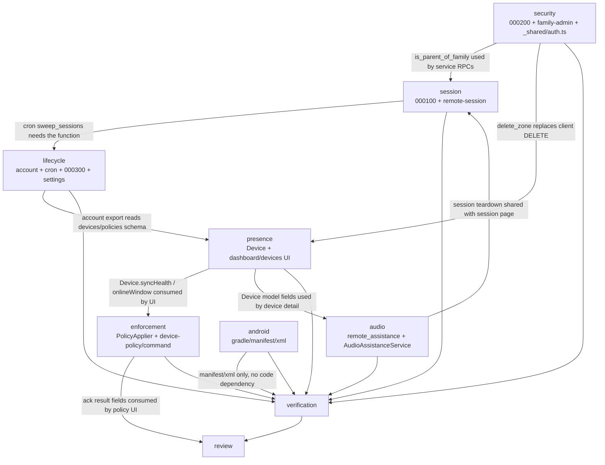

# Dependency map

Read direction: arrow = "depends on / is called by". Everything below is derived from source
(`lib/`, `supabase/functions/`, `supabase/migrations/`), not from intent.

## 1. Flutter → controllers → repositories → Edge Functions → tables

```mermaid
flowchart LR
  subgraph UI[Flutter feature modules]
    AUTH[auth<br/>login/register/verify/splash]
    ROLE[role_selection]
    FAM[family / family_setup]
    PAIR[pairing]
    DASH[dashboard]
    DEV[devices]
    RESTR[app_restrictions]
    ST[screen_time]
    LOC[location / safe_zones]
    ALERT[safety_alerts]
    ASSIST[remote_assistance]
    AUD[audit_logs]
    SET[settings]
  end

  subgraph CTRL[GetX controllers]
    C1[Login/Register/Verify/SplashController]
    C2[RoleSelectionController]
    C3[FamilyController / FamilySetupController]
    C4[PairingRedeem/RequestsController]
    C5[DashboardController]
    C6[DevicesController / DeviceDetailController]
    C7[AppRestrictionsController]
    C8[ScreenTimeController]
    C9[LocationController / SafeZonesController]
    C10[SafetyAlertsController]
    C11[RemoteAssistanceController / RemoteSessionController]
    C12[AuditLogsController]
    C13[ParentSettingsController]
  end

  subgraph REPO[Repositories]
    R_AUTH[SupabaseAuthRepository]
    R_FAM[SupabaseFamilyRepository]
    R_PAIR[SupabasePairingRepository]
    R_DEV[SupabaseDeviceRepository]
    R_POL[SupabasePolicyRepository]
    R_USE[SupabaseUsageRepository]
    R_LOC[SupabaseLocationRepository]
    R_AL[SupabaseAlertRepository]
    R_RS[SupabaseRemoteSessionRepository]
    R_AUD[SupabaseAuditRepository]
  end

  subgraph EF[Edge Functions]
    F_BOOT[auth-bootstrap]
    F_PAIR[pairing]
    F_REG[device-register]
    F_TEL[device-telemetry]
    F_POL[device-policy]
    F_CMD[device-command]
    F_ADM[family-admin]
    F_RS[remote-session]
    F_CRON[cron]
    F_ACC[account NEW]
  end

  subgraph DB[(Tables)]
    T1[profiles]
    T2[families / family_members]
    T3[devices]
    T4[pairing_requests / device_pairing_tokens / child_contact_ids / pairing_attempts]
    T5[device_policies]
    T6[device_commands]
    T7[device_apps]
    T8[usage_daily]
    T9[location_events]
    T10[safe_zones / safe_zone_states]
    T11[safety_alerts]
    T12[remote_sessions]
    T13[webrtc_signals]
    T14[audit_logs]
  end

  AUTH-->C1-->R_AUTH-->F_BOOT
  AUTH-->C1-->R_FAM-->F_BOOT
  ROLE-->C2-->R_AUTH
  FAM-->C3-->R_FAM-->F_ADM
  PAIR-->C4-->R_PAIR-->F_PAIR
  DASH-->C5-->R_DEV
  DEV-->C6-->R_DEV
  DEV-->C6-->R_POL
  RESTR-->C7-->R_POL-->F_POL
  RESTR-->C7-->F_CMD
  ST-->C8-->R_USE
  LOC-->C9-->R_LOC
  LOC-->C9-->F_ADM
  ALERT-->C10-->R_AL-->F_ADM
  ASSIST-->C11-->R_RS-->F_RS
  AUD-->C12-->R_AUD-->F_ADM
  SET-->C13-->F_ACC

  R_DEV-->F_REG
  R_DEV-->F_ADM
  R_FAM-->F_ADM
  R_POL-->F_POL
  R_POL-->F_CMD
  R_RS-->T12
  R_RS-->T13

  F_BOOT-->T1
  F_BOOT-->T2
  F_PAIR-->T2
  F_PAIR-->T4
  F_REG-->T3
  F_TEL-->T3
  F_TEL-->T7
  F_TEL-->T8
  F_TEL-->T9
  F_TEL-->T10
  F_TEL-->T11
  F_POL-->T5
  F_POL-->T6
  F_CMD-->T5
  F_CMD-->T6
  F_ADM-->T3
  F_ADM-->T10
  F_ADM-->T11
  F_RS-->T12
  F_RS-->T13
  F_CRON-->T12
  F_CRON-->T14
  F_ACC-->T1
  F_ACC-->T2
  F_ACC-->T3
  F_ACC-->T8
  F_ACC-->T9
  F_ACC-->T11
  F_ACC-->T14
```

Client-direct reads (PostgREST, never through an Edge Function): `devices`, `family_members`,
`families`, `profiles`, `device_policies`, `device_commands`, `device_apps`, `usage_daily`,
`location_events`, `safe_zones`, `safety_alerts`, `remote_sessions`, `audit_logs`. Client-direct
writes: `safe_zones` INSERT/UPDATE (DELETE removed in Phase 1) and `webrtc_signals` INSERT
(`api-contract.md` §3).

Android is reached only through `NativeBridge` MethodChannels (`NativeBridge.kt:194-198`) and the
`GuardianService` poll loop — no Dart code calls a native service directly.

## 2. Migration order and dependencies

Ten applied migrations plus three Phase 1 migrations. A migration may only reference objects
created by a lower number.

| # | Migration | Creates / changes | Depends on | Applied? |
|---|---|---|---|---|
| 1 | `20260101000000_core.sql` | 18 tables, indexes, partial-unique invariants, 8 triggers, `set_updated_at` | — | yes (hosted, per audit `06`) |
| 2 | `20260101000100_functions.sql` | 38 SQL functions incl. `request_remote_session`, `revoke_device`, `unlink_child`, `apply_policy_version`, `expire_stale_sessions`, `detect_offline_devices` | 1 (tables) | yes |
| 3 | `20260101000200_rls.sql` | 22 policies, `private.is_family_parent` / `is_family_member` / `shares_active_family`, `realtime_topic_allowed`, topic policy on `realtime.messages` | 1, 2 | yes |
| 4 | `20260101000300_service_role_grants.sql` | `anon` = zero grants; `authenticated` SELECT on 15 tables, INSERT `webrtc_signals`, DELETE `safe_zones` | 1, 3 | yes |
| 5 | `20260101000400_device_recovery.sql` | `private.request_device_recovery(uuid, uuid)` | 1, 2 | yes |
| 6 | `20260101000500_child_contact_ids.sql` | `child_contact_ids` table (19th table), service-only grants | 1 | yes |
| 7 | `20260101000600_atomic_pairing_invite.sql` | atomic invite/request RPCs | 1, 2, 6 | yes |
| 8 | `20261028000100_remote_session_concurrency.sql` | advisory lock + one-open-session guard inside `request_remote_session` | 2 | yes |
| 9 | `20261028000200_parent_controlled_session_lifetime.sql` | nullable `expires_at`, pending-only CHECK, transition guard, `expire_stale_sessions` limited to `requested` | 2, 8 | yes |
| 10 | `20261028000300_signaling_open_session.sql` | re-creates the two `webrtc_signals` policies without the deadline predicate | 3, 9 | yes |
| 11 | **`20261030000100_abandoned_session_sweep.sql` (NEW)** | `public.expire_abandoned_sessions(interval)`; service-role grant only | 1, 2, 9 (terminal semantics + nullable `expires_at`) | **no** |
| 12 | **`20261030000200_phase1_authorization.sql` (NEW)** | drops `safe_zones_delete_parent` + table DELETE grant; adds `private.is_parent_of_family(uuid,uuid)`; hardens the four service RPCs with `not_family_parent` 42501; revokes PUBLIC execute on two helpers; conditional unique index `webrtc_signals_session_sequence_uniq` | 1, 2, 3, 4, 5, 9, 10 (must see the re-created signaling policies) | **no** |
| 13 | **`20261030000300_retention_sweep.sql` (NEW)** | `public.run_retention_sweep() returns jsonb`; service-role only | 1 (tables + `audit_logs.event_type`), 2 | **no** |

Cross-dependency that is **not** a SQL dependency:

- **`cron` action `sweep_sessions` calls `expire_abandoned_sessions` from `…000100`.** The function
  edit (lifecycle) and the migration (session) are owned by different workstreams, so the deploy
  order is fixed: `20261030000100` must be applied **before** the new `cron` build is deployed.
  The same rule applies to `remote-session` `request`, which calls the sweep best-effort — it is
  written to tolerate the function being absent (`withAbandonedSweep`,
  `supabase/functions/remote-session/index.ts:117-130`), so a `remote-session` deploy that precedes
  the migration degrades to a no-op rather than failing.
- **`cron` action `retention_sweep` calls `run_retention_sweep` from `…000300`.** Same ordering rule;
  unlike the sweep this one is not tolerable-if-absent unless the `cron` handler returns a clean
  error, which the lifecycle workstream must ensure.
- **`…000200` and `…000300` are independent** of each other and of `…000100`; they may be applied in
  any order after `…000300`'s prerequisites.

## 3. Workstream blocking



Concrete blockers (ordered pairs, first must land before the second can be tested):

| Blocks | Blocked | Why | Mitigation |
|---|---|---|---|
| security `_shared/auth.ts` helpers | lifecycle `account` | `account` needs the same `requireUser`/owner checks; it must not fork a second auth helper | lifecycle imports the security-owned helper; if a new helper is needed, security adds it |
| security `000200` (`is_parent_of_family`) | session `request_remote_session` hardening | the hardened RPC (replaced inside `000200`) calls the new private helper; the Edge Function must not assume the old permissive RPC semantics | both migrations are local-only in Phase 1 and are applied together before any deploy |
| presence `Device.syncHealth` + `onlineWindow` | presence UI ("synced 3 min ago", "Sync stalled") | UI reads the derived getter | same workstream, model first, then widgets |
| presence `Device` model field changes | enforcement child-restrictions UI | `child_restrictions_page.dart` (enforcement) reads `Device` | additive getters only; no field removal |
| session `expire_abandoned_sessions` | lifecycle `cron` `sweep_sessions` | direct RPC call | write `cron` to fail cleanly if the function is missing |
| lifecycle `run_retention_sweep` | lifecycle `cron` `retention_sweep` | direct RPC call | same file ownership, one workstream |
| session `remote-session` request flow | audio `remote_session_controller` teardown | both touch session lifecycle signals (status only) | audio does not change protocol; session does not change controller |
| android `AndroidManifest.xml` | verification build | the only manifest editor | android owns it; no other workstream may add permissions |
| all workstreams | verification `flutter test` / `flutter build` | single build lock | verification runs once at the end |

Non-blocking but coupled: `device-command` ack (enforcement) writes `device_policies`; the parent UI
that displays "Applied to N of M apps" is also enforcement's. The presence device card renders
`enforcement_mode`, so a change to that string is a cross-workstream change requiring approval.