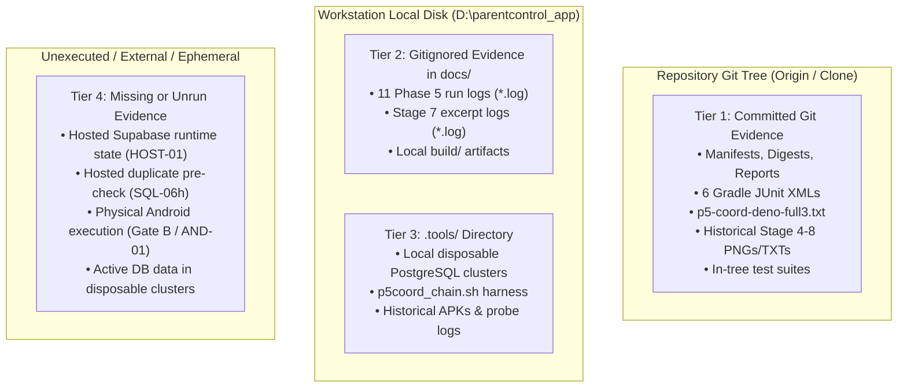
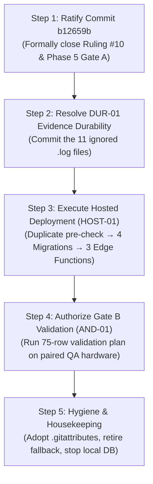

# PHASE 6 — Owner Decision Register & Governance Reconciliation

**Document Reference:** `docs/implementation/phase-6-owner-decision-register.md`  
**Date of Intake & Re-verification:** 2026-11-04  
**Author / Role:** Subagent 2: Governance & Decision Reconciler (Phase 6)  
**Caller / Coordinator ID:** `e0d3326c-5a13-4314-b902-7ea17d798c30`  
**Current HEAD:** `b12659b9795ba69499483a84750a33897dd7e08a` (`feat: implement GuardianService background sync and policy enforcement core`, committed Tue Nov 3 18:07:56 2026 +0530)  
**Working Tree Status:** Clean (`nothing to commit, working tree clean`)  

---

## 1. Executive Summary & Governance Baseline

Entering Phase 6, the Android-first Parental Control Application transitions from the local verification and hardening of Phase 5 into release readiness, deployment planning, and physical device validation. 

A rigorous governance audit of the repository reveals a critical transition between the close of Phase 5 and the current repository baseline:
1. **At Phase 5 Close (2026-11-03 ~17:50):** The working tree was left deliberately uncommitted at HEAD `953b337bb8e24a46dd5ddfdf7b281b2159d73c2d` with 73 modified/untracked files. The Phase 5 coordinator recorded a direct conflict (**CONF-01**) between **Owner Ruling #10** ("NO COMMIT — leave everything uncommitted") and **Owner Ruling #12** ("Commit selected evidence"), and escalated the resulting evidence durability gap (**DUR-01**) to the owner.
2. **Subsequent Action (2026-11-03 18:07:56 +0530):** Commit `b12659b9795ba69499483a84750a33897dd7e08a` was created directly on branch `main` by `anvikinnovations-cmyk <anvikinnovations@gmail.com>`. This commit staged and committed all 73 files that formed the Gate A deliverables.
3. **The Governance Reconciliation Result:** While commit `b12659b` de facto superseded the prohibition of Ruling #10, **Ruling #12 (EVD-01) and DUR-01 were only partially satisfied**. Because `.gitignore:22` (`*.log`) was active, standard staging silently ignored **11 of the 12 execution logs** prepared in `docs/evidence/phase5/logs/`. Consequently, the committed repository contains test suites, Kotlin/Dart implementations, migrations, and JUnit XMLs, but lacks the raw execution logs for Dart analysis, Flutter test runs, Gradle execution, and all 5 PostgreSQL migration test chain runs.

This register establishes the factual reconciliation of CONF-01 and DUR-01, categorizes all evidence across git and workstation storage, defines operating boundaries (permitted vs. prohibited actions), provides recommendations for owner tie-breaks, and catalogs all open owner decisions entering Phase 6/7.

---

## 2. Workstream B Analysis: CONF-01 & DUR-01 Reconciliation

### 2.1 Exact Conflict Formulation at Phase 5 Close

In `docs/implementation/phase-5-owner-decision-log.md` and `docs/implementation/phase-5-open-gaps.md`, two explicit owner rulings were placed in direct opposition:

| Ruling | Source Question | Owner Ruling | Intended Operational Effect |
|---|---|---|---|
| **Ruling #10 (Gate A git action)** | "Commit the Gate A changes, or leave them uncommitted for review?" | **"No commit."** | HEAD remains at `953b337`; no files added, committed, branched, or pushed. Everything left uncommitted in worktree/index. |
| **Ruling #12 (EVD-01 evidence durability)** | "Should the selected evidence (Gradle JUnit XML, logs, digests, exact commands) be committed, or accepted as workstation-only artifacts?" | **"Commit selected evidence."** | Selected test evidence must be committed to git so verification claims survive a `git clone` on another workstation. |

#### Dynamics of the Conflict:
- **Logical Impossibility:** Obeying Ruling #12 requires executing a `git commit` containing evidence files. Obeying Ruling #10 strictly forbids executing any `git commit`.
- **Integrity Trap:** Committing *only* `docs/evidence/phase5/` without committing the underlying code changes would anchor test results to commit `953b337`, where the tested code did not exist. Conversely, committing the code alongside the evidence directly violated Ruling #10.
- **Phase 5 Coordinator Resolution:** Guided by brief §3 ("Where a ruling conflicts with another, the conflict is recorded rather than resolved by the coordinator, and the stricter prohibition wins"), the coordinator obeyed Ruling #10:
  - Zero commits were created.
  - The evidence pack was prepared and staged in `docs/evidence/phase5/` (MANIFEST.md, 6 Gradle JUnit XML files, 12 logs, and 2 digest files).
  - The conflict was documented as **CONF-01** (`phase-5-open-gaps.md:26`), and the durability gap was documented as **DUR-01** (`phase-5-open-gaps.md:25`).

---

### 2.2 Post-Phase-5 Investigation: Commit `b12659b` on `main`

Approximately 18 minutes after the Phase 5 evidence manifest was finalized, a commit was created on `main`:

```text
commit b12659b9795ba69499483a84750a33897dd7e08a
Author:     anvikinnovations-cmyk <anvikinnovations@gmail.com>
AuthorDate: Tue Nov 3 18:07:56 2026 +0530
Commit:     anvikinnovations-cmyk <anvikinnovations@gmail.com>
CommitDate: Tue Nov 3 18:07:56 2026 +0530

    feat: implement GuardianService background sync and policy enforcement core
```

#### Detailed Breakdown of the 73 Files Committed:
`git show --stat b12659b` proves that this commit included **exactly the 73 files** that were modified or untracked at the close of Phase 5:

1. **Android Native Layer (4 files):**
   - `android/app/src/main/kotlin/com/parentcontrol/parent_control/EnforcementMode.kt` (New pure helper)
   - `android/app/src/main/kotlin/com/parentcontrol/parent_control/GuardianService.kt` (Delegated call site)
   - `android/app/src/main/kotlin/com/parentcontrol/parent_control/PolicyApplier.kt` (Delegated call site)
   - `android/app/src/test/kotlin/com/parentcontrol/parent_control/EnforcementModeTest.kt` (4 JVM test cases)
2. **Flutter / Dart Application Layer (8 files):**
   - Core controllers/views: `app_restrictions_controller.dart`, `account_privacy_repository.dart`, `export_result_dialog.dart`, `settings_body.dart`
   - Test suites: `policy_read_supersede_test.dart`, `account_privacy_controller_test.dart`, `export_result_dialog_test.dart`, `retention_scope_disclosure_test.dart`
3. **Supabase Edge Functions Layer (8 files):**
   - `_shared/error_mapping_test.ts`, `_shared/fake_postgrest.ts` (643-line test fake)
   - `account/index.ts`, `account/retention.ts`, `account/scope_test.ts`
   - `device-command/handler.ts`, `device-command/handler_test.ts`, `device-command/index.ts`
   - `family-admin/delete_zone_atomicity_test.ts`, `family-admin/index.ts`, `handler_wiring_test.ts`
4. **Supabase Database & Migrations Layer (6 files):**
   - `migrations/20261030000300_retention_sweep.sql` (Shape update + comment provenance)
   - `migrations/20261103000100_zone_delete_atomic_rpc.sql` (Atomic safe zone delete RPC)
   - `tests/71_phase1_rollback_privileges.sql`, `tests/74_sweep_indexes_and_repeatability.sql`, `tests/75_signaling_replay_index_duplicate_guard.sql`, `tests/76_zone_delete_atomic_rpc.sql`, `tests/README.md`
5. **Phase 1–5 Governance & Audit Documentation (37 files):**
   - Deliverables: `phase-4-report.md`, `phase-4-regression-matrix.md`, `phase-4-open-gaps.md`, `phase-4-owner-approval-register.md`, `phase-4-android-validation-plan.md`
   - Deliverables: `phase-5-report.md`, `phase-5-regression-matrix.md`, `phase-5-open-gaps.md`, `phase-5-owner-decision-log.md`, `phase-5-deployment-readiness.md`
   - Working memos & contracts: `_work/p4-*.md`, `api-contract.md`, `deployment/manifest.md`, proposals, audit reports.
6. **Evidence Directory (`docs/evidence/phase5/`) (10 files):**
   - `MANIFEST.md`
   - `tree-digest.txt`, `tree-digest-final.txt`
   - 6 Gradle JUnit XML files under `gradle-junit/`
   - 1 single log file: `logs/p5-coord-deno-full3.txt`

---

### 2.3 Impact Analysis: Ruling #10 vs. Ruling #12 & The Gitignore Trap

#### How Commit `b12659b` Interacts with Ruling #10:
Commit `b12659b` represents an unambiguous, de facto **override and supersession of Ruling #10**. By committing all 73 files of Phase 4 and 5, the repository owner (or authorized build committer) terminated the "leave everything uncommitted" status and established a clean working tree at `b12659b`.

#### How Commit `b12659b` Interacts with Ruling #12 & DUR-01:
Although `docs/evidence/phase5/` was included in the commit, **DUR-01 was NOT fully closed**. 
A crucial technical exclusion occurred during staging:
- Repository root `.gitignore`, line 22, specifies: `*.log`.
- When the commit was created, git honored `.gitignore`.
- Consequently, **11 out of the 12 log files** prepared in `docs/evidence/phase5/logs/` were excluded from the commit:
  - Only `p5-coord-deno-full3.txt` was tracked and committed (because it used the `.txt` extension).
  - The other 11 execution logs (`*.log`) remained untracked on the local disk.

#### Integrity Impact on Evidence Durability:
| Evidence File in `docs/evidence/phase5/` | On Disk? | In Git (`b12659b`)? | Status / Impact on Fresh Clone |
|---|---|---|---|
| `MANIFEST.md` | Yes | **Yes** | Fully durable |
| `tree-digest.txt` & `tree-digest-final.txt` | Yes | **Yes** | Fully durable |
| 6 JUnit XML files (`gradle-junit/*.xml`) | Yes | **Yes** | Fully durable (JVM test counts 39/39 verified) |
| `logs/p5-coord-deno-full3.txt` | Yes | **Yes** | Fully durable (Deno 150/150 passed verified) |
| `logs/p5-coord-dart-analyze-run2.log` | Yes | **NO (gitignored)** | Workstation-only. Fresh clone cannot verify analyzer exit 0. |
| `logs/p5-coord-flutter-run2.log` | Yes | **NO (gitignored)** | Workstation-only. Fresh clone cannot verify 408/408 Flutter tests. |
| `logs/p5-coord-gradle-run1.log` | Yes | **NO (gitignored)** | Workstation-only. Fresh clone cannot verify raw Gradle build task execution. |
| `logs/p5-coord-deno-negative.log` | Yes | **NO (gitignored)** | Workstation-only. Fresh clone cannot verify TEST-01 negative control. |
| `logs/p5-coord-deno-restored.log` | Yes | **NO (gitignored)** | Workstation-only. Fresh clone cannot verify Deno post-restore run. |
| `logs/p5-coord-deno-sql05.log` | Yes | **NO (gitignored)** | Workstation-only. Fresh clone cannot verify family-admin / wiring 17/17 run. |
| `logs/p5coord-chain-run5.log` | Yes | **NO (gitignored)** | Workstation-only. Fresh clone cannot verify 33-file SQL chain run 5. |
| `logs/p5coord-chain-run6.log` | Yes | **NO (gitignored)** | Workstation-only. Fresh clone cannot verify 33-file SQL chain run 6. |
| `logs/p5coord-chain-run9.log` | Yes | **NO (gitignored)** | Workstation-only. Fresh clone cannot verify 33-file SQL chain run 9. |
| `logs/p5coord-chain-run10.log` | Yes | **NO (gitignored)** | Workstation-only. Fresh clone cannot verify final closing SQL chain run 10. |
| `logs/p5coord-chain-negative3.log` | Yes | **NO (gitignored)** | Workstation-only. Fresh clone cannot verify SQL-05 negative control failure. |

**Conclusion on CONF-01 & DUR-01:**
- **CONF-01 is RESOLVED IN FACT** by commit `b12659b` superseding Ruling #10.
- **DUR-01 REMAINS PARTIALLY OPEN (P2)** because the 11 execution logs exist only on this workstation's disk.

---

## 3. Four-Tier Categorization of Evidence Assets

To provide absolute clarity on what is durable, what is workstation-local, and what is ephemeral, all evidence assets are categorized below:



### 3.1 Tier 1: Evidence Tracked & Committed in Git (Durable Across Clones)
These files are committed at HEAD (`b12659b`) and will survive a clean `git clone`:
- **Phase 5 Evidence Directory (`docs/evidence/phase5/`):**
  - `MANIFEST.md` (Detailed manifest of hashes, commands, and results)
  - `tree-digest.txt` (57-path baseline SHA-256 table: `4ee854c2...`)
  - `tree-digest-final.txt` (69-path closing SHA-256 table: `2bd6b310...`)
  - `gradle-junit/TEST-com.parentcontrol.parent_control.AudioAssistanceRecreationTest.xml`
  - `gradle-junit/TEST-com.parentcontrol.parent_control.AudioAssistanceSessionWatchdogTest.xml`
  - `gradle-junit/TEST-com.parentcontrol.parent_control.AudioAssistanceStartGateTest.xml`
  - `gradle-junit/TEST-com.parentcontrol.parent_control.AudioAssistanceStopIdempotenceTest.xml`
  - `gradle-junit/TEST-com.parentcontrol.parent_control.EnforcementModeTest.xml`
  - `gradle-junit/TEST-com.parentcontrol.parent_control.policy.PolicyEvaluatorTest.xml`
  - `logs/p5-coord-deno-full3.txt` (Deno test suite log: 150 passed, 0 failed)
- **Historical Stage 4–8 Media Evidence (`docs/evidence/`):**
  - 120+ committed screenshots (`.png`) and status summaries (`.txt`) documenting pairing, screen-sharing, audio assistance, device recovery, and session lifecycles across stages 4, 5, 6, 7, and 8.
- **In-Tree Executable Test Suites:**
  - Supabase SQL tests: `tests/71_phase1_rollback_privileges.sql`, `tests/74_sweep_indexes_and_repeatability.sql`, `tests/75_signaling_replay_index_duplicate_guard.sql`, `tests/76_zone_delete_atomic_rpc.sql`.
  - Deno Edge Function tests: `handler_test.ts`, `delete_zone_atomicity_test.ts`, `scope_test.ts`, `error_mapping_test.ts`, `handler_wiring_test.ts`.
  - Flutter / Dart tests: `policy_read_supersede_test.dart`, `retention_scope_disclosure_test.dart`, `account_privacy_controller_test.dart`, `export_result_dialog_test.dart`.
  - Android JVM test: `EnforcementModeTest.kt`.

### 3.2 Tier 2: Evidence Ignored by Git (Present on Workstation Disk Only)
These files exist on disk in `D:\parentcontrol_app\` but are excluded from git by `.gitignore` rules:
- **Phase 5 Run Logs (`docs/evidence/phase5/logs/*.log`, excluded by `.gitignore:22`):**
  - `p5-coord-dart-analyze-run2.log` (Dart analysis 0 issues)
  - `p5-coord-flutter-run2.log` (Flutter test 408 passed)
  - `p5-coord-gradle-run1.log` (Gradle testDebugUnitTest 39 passed)
  - `p5-coord-deno-negative.log` (Negative control N1, auth failures)
  - `p5-coord-deno-restored.log` (Deno test run post-restore)
  - `p5-coord-deno-sql05.log` (Deno family-admin tests)
  - `p5coord-chain-run5.log`, `run6.log`, `run9.log`, `run10.log` (Disposable PostgreSQL 33-file test runs)
  - `p5coord-chain-negative3.log` (Negative control N2, RPC atomicity abort)
- **Stage 7 Logs (`docs/evidence/stage7/logs/*.log`, excluded by `.gitignore:22`):**
  - `child-excerpt.log`, `parent-excerpt.log`
- **Compiler / Test Build Directories (`build/`):**
  - `build/app/test-results/testDebugUnitTest/*.xml` (The original JUnit source XMLs prior to copying)
  - Flutter build caches and test logs.

### 3.3 Tier 3: Evidence Existing Only in `.tools/` (Workstation Scratch / Disposable)
The entire `.tools/` directory is ignored by `.gitignore:16`. It holds 200+ MB of local scratch artifacts:
- **Local Disposable PostgreSQL 16 Clusters:**
  - Active cluster at `.tools/pgdata_p5rpc` (Port 55581), containing databases `p5rpc_full5`, `p5rpc_full6`, `p5rpc_full9`, `p5rpc_final1`, `p5rpc_neg*`.
  - Legacy stopped clusters: `pgdata_p5s`, `pgdata_p5shape`, `pgdata_p4f`, `pgdata_p3a`, `pgdata_p3b`, `pgdata_p2`, `pgdata`.
  - PostgreSQL 16.9 binary distribution (`.tools/pgsql16/`).
- **Harnesses & Runner Scripts:**
  - `.tools/p5coord_chain.sh` (The shell harness that constructed the 33-file migration and test chains).
- **Intermediate Verification Files & Audits:**
  - `.tools/p4f-chain.log`, `.tools/p4-end-status.txt`, `.tools/p4-digest-perfile-delivered.txt`.
  - Audit digests: `audit_sql.txt`, `audit_ts.txt`, `audit_dart.txt`, `tmp-rec-sortedbyhash.txt`.
  - Historical build APKs: `.tools/apk_arm64_childid.apk` (72.5 MB), `.tools/apk_final_scan/`.
  - Historical UI test runs: `.tools/ui_journey*.log`, `.tools/ui_state.png`.

### 3.4 Tier 4: Evidence Listed in Manifests but Unavailable, Unrun, or Ephemeral
Evidence items that are referenced in documentation or plans but have **never been collected or executed**:
- **Hosted Supabase Runtime State (HOST-01):**
  - No hosted verification exists. Zero migrations applied; zero Edge Functions deployed.
  - The last read-only dashboard observation occurred on 2026-10-30 (`_work/p4-hosted.md`).
- **Hosted Duplicate Pre-Check Execution (SQL-06h):**
  - The query `SELECT session_id, sequence, count(*) FROM webrtc_signals GROUP BY 1,2 HAVING count(*) > 1;` has never been run against hosted data.
- **Hosted Sweep EXPLAIN Verification (PERF-01h):**
  - The timing and buffer metrics for the batch delete shape were measured only on local disposable Postgres; no hosted `EXPLAIN (ANALYZE, BUFFERS)` has been performed.
- **Physical Android Hardware Execution (Gate B / AND-01 / GATE-B-01):**
  - The 75-row validation matrix in `phase-4-android-validation-plan.md` has 100% blank "Actual" and "Status" columns.
  - No hardware execution for force-stop, recents-swipe, mic FGS watchdog, or permission revoking has taken place.
- **Ephemeral State in Disposable Databases (GAP-ENV-01):**
  - The physical rows inside `.tools/pgdata_p5rpc` will vanish as soon as the cluster is stopped and cleaned up per manifest instructions.

---

## 4. Phase 6 Operational Boundaries: Permitted vs. Prohibited Actions

To prevent accidental breaches of owner intent, the operating boundaries for autonomous agents in Phase 6 are explicitly defined:

### 4.1 Actions Currently Permitted (Autonomous / Sandboxed)
Agents may execute the following actions without prompting the owner:
1. **Repository & Codebase Research:** Read, search, inspect, and analyze all source files, documentation, manifests, test suites, and git logs.
2. **Local Test Execution (Hermetic):**
   - Run Dart analysis (`dart analyze`).
   - Run Flutter unit and widget tests (`flutter test`).
   - Run Deno tests using local mocks/fakes (`deno test --allow-read supabase/functions/`).
   - Run Android JVM unit tests (`./gradlew :app:testDebugUnitTest`).
   - Run SQL test chains against local, disposable PostgreSQL instances in `.tools/`.
3. **Documentation & Artifact Authoring:** Create, update, and refine Phase 6 reports, regression matrices, open gap registers, deployment playbooks, and decision logs.
4. **Scratch Scripts:** Create temporary verification scripts in `.tools/` or artifact scratch directories.

### 4.2 Actions That Remain Strictly Prohibited (Owner Authorization Required)
The following actions are **BLOCKED** and must **NEVER** be performed without explicit written owner authorization:
1. **Hosted Supabase Modifications (Prohibited by Ruling #11 / HOST-01):**
   - Do NOT invoke `supabase db push`, `supabase functions deploy`, or execute SQL in the hosted dashboard.
   - Do NOT run write operations against the hosted production database.
2. **Device / Hardware / APK Execution (Prohibited by Ruling #9 / AND-01 / GATE-B-01):**
   - Do NOT build release or QA APKs for device installation.
   - Do NOT connect via `adb` or drive physical devices / emulators to execute the validation plan.
3. **Execution of De-Hardening Rollback Statements (Permanently Refused by Ruling #6 / SQL-01):**
   - Do NOT execute the quarantined rollback block from `20261030000200_phase1_authorization.sql:115-131`. R3 is permanently dead.
4. **Modifying Sweep Transaction Semantics (Refused by Ruling #3 / SQL-04):**
   - Do NOT convert `run_retention_sweep` into a PL/pgSQL procedure with intermediate `COMMIT` statements.
   - Do NOT install unapproved cron schedules or pg_cron extensions.
5. **Deleting Fallback Modules (GAP-RS-01):**
   - Do NOT delete `supabase/functions/family-admin/delete_zone_atomicity.ts`. It remains the reviewed quarantine fallback.
6. **Destructive Git Actions:**
   - Do NOT execute `git reset`, `git clean -fd`, `git restore`, or destructive checkouts that could discard workstation-local evidence logs or scratch tools.
   - Do NOT force-push to `main` or rewrite commit `b12659b`.

---

## 5. Recommended Resolution for the Owner (Tie-Break & Action Plan)

To systematically close the remaining governance gaps and transition into deployment and hardware validation, the following 5-step action plan is recommended:



### Step 1: Ratify Commit `b12659b` as Closing Gate A
- **Owner Action:** Provide explicit written confirmation ratifying commit `b12659b9795ba69499483a84750a33897dd7e08a` as the approved baseline for Phase 5 Gate A.
- **Result:** Formally closes CONF-01 and vacates Ruling #10.

### Step 2: Resolve DUR-01 (Commit the 11 Ignored Evidence Logs)
- **Problem:** `docs/evidence/phase5/logs/*.log` are gitignored.
- **Recommended Fix:** Unignore evidence logs specifically and commit them to git:
  ```bash
  # Option A: Force-add the existing 11 logs directly:
  git add -f docs/evidence/phase5/logs/*.log
  git commit -m "chore(evidence): commit Phase 5 verification logs for DUR-01 durability"
  
  # Option B: Add a negation rule to .gitignore to ensure future durability:
  # Append to .gitignore:
  # !docs/evidence/**/*.log
  ```
- **Result:** Fully closes DUR-01 (P2). All 20 files listed in `docs/evidence/phase5/MANIFEST.md` become durable across clones.

### Step 3: Authorize & Execute Hosted Deployment (HOST-01)
Execute the strictly ordered deployment playbook defined in `docs/implementation/deployment/manifest.md`:
1. **Pre-Apply Duplicate Check (SQL-06h):** Run the duplicate count query in the Supabase SQL Editor. Confirm duplicate count = 0.
2. **Apply Migrations in Strict Sequence:**
   - Apply `20261030000100_abandoned_session_sweep.sql` (Creates sweeper function & index).
   - Apply `20261030000200_phase1_authorization.sql` (Creates `private.is_parent_of_family`, removes DELETE from safe_zones, adds replay index).
   - Apply `20261030000300_retention_sweep.sql` (Creates `public.run_retention_sweep` with faster batch shape).
   - Apply `20261103000100_zone_delete_atomic_rpc.sql` (Creates `public.delete_safe_zone_audited`). *Must follow file 2.*
3. **Deploy Edge Functions in Sequence:**
   - Deploy `account` Edge Function.
   - Deploy `family-admin` Edge Function (Calls atomic RPC).
   - Deploy `device-command` Edge Function.
4. **Read-Only Verification:** Execute the combined post-apply check (`deployment/manifest.md` §4).
- **Result:** Fully closes HOST-01 (P1), SQL-06h (P2), and GAP-RS-01 (P2).

### Step 4: Authorize Gate B (AND-01 / GATE-B-01) Device Execution
- **Owner Action:** Authorize building the QA test APK and driving paired parent/child test hardware for the Phase 4 validation plan (`phase-4-android-validation-plan.md`).
- **Phasing:** Execute Section 7's advisory high-risk subset first (Pairing → Mic Consent & Foreground Service → Force-stop recovery → Swipe dismissal).
- **Result:** Closes GATE-B-01 (P1).

### Step 5: Housekeeping & Hygiene Approvals
- **Adopt `.gitattributes` (GAP-EOL-01):** Establish `* text=auto eol=lf` to prevent line-ending normalization discrepancies between Windows worktrees and git blobs.
- **Teardown Disposable Cluster (GAP-ENV-01):** Stop local Postgres on port 55581 (`pg_ctl -D .tools/pgdata_p5rpc stop -m fast`) and remove disposable test cluster data.

---

## 6. Comprehensive Owner Decision Register (Entering Phase 6/7)

The table below catalogs every open decision, governance ratification, and operational approval required from the owner entering Phase 6 and Phase 7:

| ID | Title / Scope | Severity / Impact | Current State | Options for Owner | Coordinator Recommendation |
|---|---|---|---|---|---|
| **DEC-01** | **CONF-01 & DUR-01 Ratification (Commit `b12659b` & 11 Logs)** | **P2** | `b12659b` committed 73 files; 11 evidence logs remain gitignored on disk. | **A (Recommended):** Ratify commit `b12659b` and force-commit the 11 `.log` files.<br/>**B:** Ratify `b12659b` and accept logs as workstation-only.<br/>**C:** Revert `b12659b` back to uncommitted state. | **Option A.** Closes DUR-01 permanently and provides 100% clone-verifiable evidence. |
| **DEC-02** | **HOST-01 Hosted Supabase Migration & Function Deployment** | **P1 (Blocker)** | 4 migrations and 3 Edge Functions have never been deployed to hosted production. | **A (Recommended):** Authorize staged deployment via Dashboard SQL Editor and CLI.<br/>**B:** Defer hosted deployment until after Android device validation.<br/>**C:** Cancel hosted deployment. | **Option A.** Release QA cannot occur against a production environment running pre-Phase-1 code. |
| **DEC-03** | **AND-01 / GATE-B-01 Android Device Execution Authorization** | **P1 (Blocker)** | Zero physical device execution. 75-row validation matrix is 100% unrun. | **A (Recommended):** Authorize execution of high-risk subset on paired QA devices.<br/>**B:** Authorize full 75-row matrix on emulator and hardware.<br/>**C:** Defer device execution. | **Option A.** Validates critical mic FGS, force-stop, and Kotlin EnforcementMode on hardware. |
| **DEC-04** | **SQL-06h Hosted WebRTC Duplicate Pre-Check Query** | **P2** | Pre-apply check for duplicate `(session_id, sequence)` has never been run on hosted DB. | **A (Recommended):** Owner executes SQL query in Supabase dashboard and reports count.<br/>**B:** Apply migration without check (risks failure if duplicates exist). | **Option A.** Mandatory safety gate before applying `20261030000200`. |
| **DEC-05** | **SCHED-01 Retention & Abandoned Session Scheduler** | **P2** | No pg_cron or external scheduler is active. Sweep functions run only on-demand. | **A (Recommended):** Authorize pg_cron or Supabase scheduled HTTP job for `cron` function.<br/>**B:** Leave sweeps on-demand (triggered by settings UI). | **Option A** post-deployment, once initial backlog size is verified. |
| **DEC-06** | **IDX-01 Redundant WebRTC Signals Index Cleanup** | **P3** | Non-unique index `webrtc_signals_session_sequence_idx` coexists with unique index. | **A (Recommended):** Approve a future migration to drop the redundant index.<br/>**B:** Retain the redundant index permanently. | **Option A.** Reclaims disk and write overhead once unique index is verified live. |
| **DEC-07** | **GAP-RS-01 / GAP-DEP-01 Fallback Module Retirement** | **P2 / P3** | `family-admin/delete_zone_atomicity.ts` is unwired in production; kept as reviewed fallback. | **A:** Retire and delete the module and its unused type import.<br/>**B (Recommended):** Retain module as reviewed fallback until hosted deployment is verified green. | **Option B.** Protects against catastrophic rollback needs during the first hosted apply. |
| **DEC-08** | **GAP-EOL-01 Repository Line Endings (`.gitattributes`)** | **P3** | `core.autocrlf=true` causes 7 files to differ between worktree bytes and git blobs. | **A (Recommended):** Add `.gitattributes` locking `eol=lf` across repo.<br/>**B:** Retain current behavior; accept checkout digest shifts. | **Option A.** Standardizes CI and developer workstations on Linux/Windows. |
| **DEC-09** | **GAP-ENV-01 Disposable PostgreSQL Cluster Teardown** | **P3** | Local PostgreSQL cluster on port 55581 remains active in `.tools/pgdata_p5rpc`. | **A (Recommended):** Stop cluster and delete data directory.<br/>**B:** Keep active for further local probe inspections. | **Option A.** Shuts down unnecessary background processes and reclaims ~500 MB disk. |
| **DEC-10** | **PERF-01h Hosted Sweep EXPLAIN ANALYZE Verification** | **P2** | Faster sweep shape verified locally; hosted query plan and buffer impact unmeasured. | **A (Recommended):** Run read-only EXPLAIN on hosted database post-apply.<br/>**B:** Skip hosted EXPLAIN; rely on local benchmarks. | **Option A.** Confirms index utilization on live PostgreSQL heap. |
| **DEC-11** | **GAP-EV-05 Phase 4 Stale Delivered-Tree Digest Correction** | **P2** | Phase 4 delivered digest was computed 1–2 minutes before last file write (4/29 hashes differ). | **A (Recommended):** Formally accept Phase 5's documented correction; do not rewrite Phase 4 history.<br/>**B:** Rewrite Phase 4 report. | **Option A.** Preserves immutable historical audit logs while acknowledging discrepancy. |

---

## 7. Status Sign-Off & Governance Record

- **Workstream Lead:** Subagent 2 (Governance & Decision Reconciler)
- **Status:** **COMPLETE & REGISTERED**
- **Next Operating Step:** Deliver analysis and register to Phase 6 Coordinator; await owner rulings on DEC-01, DEC-02, and DEC-03.
