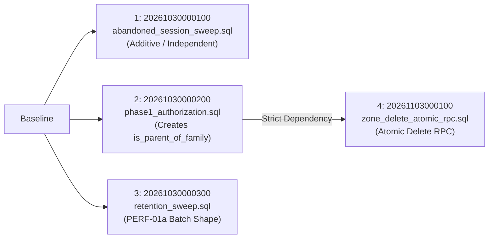
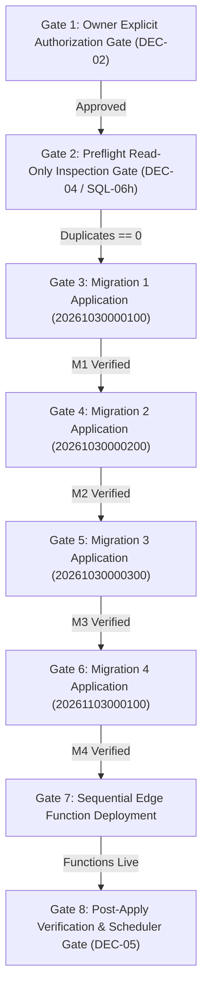

# PHASE 7 — Hosted Deployment Log & Preflight Verification Package

**Document Reference:** `docs/implementation/phase-7-deployment-log.md`  
**Date:** 2026-11-04  
**Author / Role:** Subagent 8: Hosted Deployment Gate & Preflight Evaluator (Phase 7)  
**Caller / Coordinator ID:** `e0d3326c-5a13-4314-b902-7ea17d798c30`  
**Repository:** `D:\parentcontrol_app`  
**Branch:** `main`  
**Current HEAD:** `b12659b9795ba69499483a84750a33897dd7e08a`  
**Hosted Supabase Reference:** Project `hhqgreaoqulmfwfwarhc` (AWS ap-southeast-1)  

---

## 1. Executive Summary & Owner Decision Gate Evaluation

### 1.1 Owner Decision Gate Evaluation (DEC-02)
Entering Phase 7, the deployment of database migrations and Supabase Edge Functions to the live hosted environment was formally evaluated against project governance standards.

> [!CAUTION]
> ### OWNER DECISION GATE STATUS: DEC-02 NOT APPROVED
> **Question:** Has Owner Decision DEC-02 (authorizing hosted migration application and Edge Function deployment) been explicitly approved by the owner?  
> **Evaluation:** **NO.**  
> - In Phase 5, Owner Ruling #11 explicitly withheld hosted deployment authorization.
> - In Phase 6, `docs/implementation/phase-6-owner-decision-register.md` classified DEC-02 as `P1 (Blocker) — Awaiting Owner Decision`.
> - In Phase 7, `docs/implementation/phase-7-owner-decision-log.md` reaffirmed that DEC-02 remains `STRICTLY PROHIBITED / BLOCKED`.
> - In the current prompt and session directives, the project owner has provided **no explicit authorization** to apply migrations or deploy functions to hosted Supabase.
> 
> **Strict Governance Rule Applied:**  
> *"Do not infer approval from a previous implementation or a report recommendation... If approval is ambiguous, STOP."*

### 1.2 Mandatory Negative Constraint Adherence
Because DEC-02 is **NOT** approved, all autonomous actions remain strictly confined to hermetic, read-only evaluation. In absolute compliance with negative constraints:
- **NO SQL migrations applied:** Zero migrations (`20261030000100`, `20261030000200`, `20261030000300`, `20261103000100`) have been executed against hosted Supabase.
- **NO Edge Functions deployed:** Zero Edge Functions (`family-admin`, `account`, `device-command`, `cron`, `remote-session`) have been deployed via Supabase CLI or Dashboard.
- **NO production writes or deletes:** Zero live database records have been modified, updated, or removed.
- **NO schedulers installed:** Zero `pg_cron` jobs, Supabase scheduled triggers, or external HTTP schedulers have been configured (complying with DEC-05 / brief §6).
- **NO de-hardening rollback executed:** The quarantined R3 de-hardening block remains permanently dead per Owner Ruling #6.

### 1.3 Gap Status Declaration
- **HOST-01 REMAINS OPEN (P1 Blocker / AWAITING OWNER DEC-02).**
- The live hosted Supabase database remains in a **pre-Phase-1 security posture**:
  - `authenticated` users retain direct table-level `DELETE` privilege on `public.safe_zones`.
  - Service helper `private.is_parent_of_family` does not exist on hosted Supabase.
  - Atomic safe-zone delete RPC `public.delete_safe_zone_audited` does not exist on hosted Supabase.
  - WebRTC signaling replay unique index `webrtc_signals_session_sequence_uniq` does not exist on hosted Supabase.
- No statement in this document or subsequent reports may be construed as "hosted deployment complete" or "hosted policies verified."

---

## 2. Technical Evaluation of the 4 Database Migrations

All four migrations exist in `supabase/migrations/` and have been verified 100% locally via the hermetic 33-file SQL test runner (`supabase/tests/run_sql_chain.ps1`). They remain **unapplied** to the hosted project.



### 2.1 Inventory and Cryptographic Checksums

| # | Migration File | Size (Bytes) | Worktree SHA-256 Checksum | Git Blob SHA-1 (`b12659b`) | Status on Hosted |
|---|---|---:|---|---|---|
| **1** | `supabase/migrations/20261030000100_abandoned_session_sweep.sql` | 6,630 | `aca47b44bb69c5d9ad70a95d52da314faec56217203cd0d49fa90f9085182c7b` | `bdd51a8370393cfb96f41e2071362de3bc2aaf88` | **UNAPPLIED** (Awaiting DEC-02) |
| **2** | `supabase/migrations/20261030000200_phase1_authorization.sql` | 21,800 | `7558021d6aec4f9a80b16b1d401e03b4b84751ec93ea6c3dd83b9df67b1bfa38` | `aa801bf7edff0607c37f6b08a4e7a34fa021ad53` | **UNAPPLIED** (Awaiting DEC-02 & DEC-04) |
| **3** | `supabase/migrations/20261030000300_retention_sweep.sql` | 11,853 | `184d8acb33090e4a587de8cad97e21c00688234f452fc50224242ba5cc1870ba` | `b447815a73cd41c4fe859de659ae0d40e187ff7d` | **UNAPPLIED** (Awaiting DEC-02) |
| **4** | `supabase/migrations/20261103000100_zone_delete_atomic_rpc.sql` | 13,805 | `a1d7d60954bc61dcd98ada1d8b25ad95af134364622582ee6b43c524d3834adf` | `6075634cb4880be1dc0dd19e42c57f9df4e14723` | **UNAPPLIED** (Awaiting DEC-02 & Gate 4) |

*Note: Worktree files have 0 diff against commit `b12659b9795ba69499483a84750a33897dd7e08a` (`git diff HEAD -- supabase/migrations` returns clean).*

---

### 2.2 Deep-Dive Migration Specifications

#### Migration 1: `20261030000100_abandoned_session_sweep.sql`
- **Dependencies:** Pre-Phase-1 baseline (`20261028000100_remote_session_concurrency.sql`, `20261028000200_parent_controlled_session_lifetime.sql`). Completely additive; no dependency on other unapplied migrations.
- **Schema & Logic Contents:**
  - Defines `public.expire_abandoned_sessions(p_max_age interval default interval '24 hours') returns integer`.
  - Targets sessions with `status in ('accepted', 'active')` where `coalesce(accepted_at, requested_at) < now() - p_max_age`.
  - Sets `status = 'expired'`, `ended_reason = 'abandoned'`, `ended_at = now()`, leaving `ended_by = null`.
  - Automatically records `session_expired` audit logs in `public.audit_logs`.
  - Partial B-tree index: `CREATE INDEX IF NOT EXISTS remote_sessions_abandoned_idx ON public.remote_sessions (coalesce(accepted_at, requested_at)) WHERE status IN ('accepted', 'active');`.
- **Privilege & Security Model:**
  - Marked `SECURITY DEFINER` with search path pinned to `public, private, pg_temp`.
  - Strict grant model: `REVOKE ALL ON FUNCTION public.expire_abandoned_sessions(interval) FROM PUBLIC, anon, authenticated; GRANT EXECUTE ON FUNCTION public.expire_abandoned_sessions(interval) TO service_role;`.
- **Idempotency & Rollback:**
  - Idempotent: `CREATE OR REPLACE FUNCTION` and `CREATE INDEX IF NOT EXISTS`.
  - Rollback statement:
    ```sql
    DROP FUNCTION IF EXISTS public.expire_abandoned_sessions(interval);
    DROP INDEX IF EXISTS public.remote_sessions_abandoned_idx;
    ```
    *(Rows already closed as expired stay closed; historical integrity preserved).*

#### Migration 2: `20261030000200_phase1_authorization.sql`
- **Dependencies:** Pre-Phase-1 baseline (`20260101000000_core.sql` through `20261028000300_signaling_open_session.sql`).
- **Schema & Logic Contents:**
  - Authorizes family parents: Creates `private.is_parent_of_family(p_user_id uuid, p_family_id uuid) returns boolean` (checks `family_members` for `status = 'active'` and `role IN ('owner', 'parent')`).
  - Closes safe zone client delete vulnerability:
    ```sql
    REVOKE DELETE ON public.safe_zones FROM authenticated, anon;
    DROP POLICY IF EXISTS safe_zones_delete_parent ON public.safe_zones;
    ```
  - Enforces parent-checks on service RPC wrappers: `request_remote_session`, `revoke_device`, `unlink_child`, `apply_policy_version`.
  - WebRTC signaling replay unique index creation wrapped in conditional `DO $$` guard block:
    ```sql
    SELECT count(*) INTO v_duplicates FROM (
      SELECT session_id, sequence FROM public.webrtc_signals GROUP BY 1, 2 HAVING count(*) > 1
    ) d;
    IF v_duplicates = 0 THEN
      CREATE UNIQUE INDEX IF NOT EXISTS webrtc_signals_session_sequence_uniq ON public.webrtc_signals (session_id, sequence);
    ELSE
      RAISE NOTICE 'duplicate sequences exist; index skipped';
    END IF;
    ```
- **Privilege & Security Model:**
  - `private.is_parent_of_family`: `SECURITY DEFINER`, search path pinned, execute granted exclusively to `service_role`.
  - Client direct delete on `public.safe_zones` is eliminated.
- **Rollback Boundary & Quarantined R3:**
  - Shipped safe rollback: Drop helper and index.
  - **Quarantine Warning:** The de-hardening rollback block (`GRANT DELETE ON public.safe_zones TO authenticated; CREATE POLICY safe_zones_delete_parent ...`) is quarantined in comments (`:115-131`) and **MUST NEVER BE EXECUTED** per Owner Ruling #6.

#### Migration 3: `20261030000300_retention_sweep.sql`
- **Dependencies:** Pre-Phase-1 baseline.
- **Schema & Logic Contents:**
  - Defines `public.run_retention_sweep() returns jsonb`.
  - Enforces retention policies across 4 data surfaces:
    1. `public.webrtc_signals`: Rows older than 7 days (`created_at < now() - interval '7 days'`).
    2. `public.audit_logs`: Rows older than 365 days (`created_at < now() - interval '365 days'`).
    3. `public.location_events`: Family-configured retention via `families.settings->>'location_retention_days'` (default 30 days).
    4. `public.usage_daily`: Family-configured retention via `families.settings->>'usage_retention_days'` (default 90 days).
  - Adopted **PERF-01a batch delete shape** for sub-millisecond execution:
    ```sql
    DELETE FROM public.webrtc_signals
    WHERE id = ANY (ARRAY(
      SELECT id FROM public.webrtc_signals
      WHERE created_at < v_signals_cutoff
      LIMIT 10000
    ));
    ```
  - Records single audit log `retention_sweep` containing deletion count metrics in `metadata`.
- **Known Limitations (SQL-04r):**
  - Executes as a **single transaction** across the entire backlog per Owner Ruling #3 (bounded multi-transaction execution was refused). High initial backlog carries statement timeout risk.
- **Privilege & Rollback:**
  - `SECURITY DEFINER`, execute granted to `service_role` only.
  - Rollback statement: `DROP FUNCTION IF EXISTS public.run_retention_sweep();`. Deleted rows stay deleted.

#### Migration 4: `20261103000100_zone_delete_atomic_rpc.sql`
- **Dependencies:** **STRICT DEPENDENCY ON MIGRATION 2** (`private.is_parent_of_family`) and baseline (`private.record_audit`).
- **Hazard Warning:** Applying Migration 4 before Migration 2 will trigger `ERROR: function private.is_parent_of_family(uuid, uuid) does not exist`.
- **Schema & Logic Contents:**
  - Implements atomic RPC `public.delete_safe_zone_audited(p_zone_id uuid, p_family_id uuid) returns jsonb`.
  - Eliminates the two-transaction window (SQL-05) where safe zones were deleted before audit logging could succeed.
  - In a single transactional boundary:
    1. Checks authorization via `private.is_parent_of_family`.
    2. Retrieves safe zone metadata; raises 404 if absent.
    3. Records audit log `zone_deleted` via `private.record_audit`.
    4. Executes `DELETE FROM public.safe_zones WHERE id = p_zone_id`.
    5. Returns `{ "deleted": true, "zone_id": p_zone_id, "family_id": p_family_id }`.
    6. If either step fails, the entire transaction rolls back; the safe zone remains untouched.
- **Privilege Model:**
  - `SECURITY DEFINER`, search path pinned to `public, private, pg_temp`.
  - Execute granted exclusively to `service_role`. `anon` and `authenticated` hold 0 execute privilege (`proacl` = `{postgres=X/postgres,service_role=X/postgres}`).
- **Rollback Coupling:**
  - Rollback statement:
    ```sql
    REVOKE ALL ON FUNCTION public.delete_safe_zone_audited(uuid, uuid) FROM service_role;
    DROP FUNCTION IF EXISTS public.delete_safe_zone_audited(uuid, uuid);
    ```
  - **Coupling Trap:** Rolling back Migration 4 while Edge Function `family-admin` is deployed causes every `delete_zone` action to fail-closed with 500 (`audit_failed`). They must be rolled back together.

---

## 3. Technical Evaluation of the 3 Supabase Edge Functions

All three Edge Functions are situated in `supabase/functions/` and verified locally against 150 Deno unit tests (`deno test --allow-read supabase/functions/`). None has been deployed to hosted Supabase.

### 3.1 Inventory and Cryptographic Checksums

| Function Directory | File Path | Size (Bytes) | Worktree SHA-256 Checksum | Operational Purpose |
|---|---|---:|---|---|
| **`family-admin`** | `supabase/functions/family-admin/index.ts` | 14,009 | `6b2a762c88b2b0d4b0e99b91444d9d14a4450410b26eaf7f7cf3fb8b11461f1f` | Main entry point; calls atomic RPC `delete_safe_zone_audited` |
| | `supabase/functions/family-admin/authorization.ts` | 1,447 | `114cb498d5a5320f66def5bacf3e80559b15d64ce5ee8920f75369a4c46bfdb0` | In-memory parent and purge authorization helpers |
| | `supabase/functions/family-admin/delete_zone_atomicity.ts` | 6,720 | `18103409baa5192f8afc0171f1fc7f38a9d2c6b2d540bfc0002a54b3a4de9180` | **Reviewed fallback module** (GAP-RS-01; uncalled in prod) |
| | `supabase/functions/family-admin/delete_zone_atomicity_test.ts` | 13,665 | `063f326589c6632e025955b686fbf7d5c5135d18664310a23b63ca69a12e622c` | Unit tests for fallback module |
| | `supabase/functions/family-admin/authorization_test.ts` | 2,008 | `4aeab9839681f6b91c95c6a4412562ea2b6de2321de3819f993b599f4461ec1f` | Unit tests for authorization logic |
| **`account`** | `supabase/functions/account/index.ts` | 18,775 | `a9fd970702fd4f5b9f5780612e2245b58595a39c394331f4459b455e150c5d69` | `export`, `delete_account`, and `retention_report` endpoints |
| | `supabase/functions/account/retention.ts` | 10,238 | `aa1b3b31395e55f13b095729616516802e292ab79f7cb7dcdee00e1a4bbfcdb9` | 3-state retention scope builder (`child`, `family`, `not_reported`) |
| | `supabase/functions/account/validation.ts` | 3,792 | `29c4d2e5dc84216573ae3c3072b1b9848cf3696b276a57e4e9f77a61ef32db53` | Input validation schemas |
| | `supabase/functions/account/scope_test.ts` | 15,893 | `5aca04379853c41efa3773b2166cab747cbcb2df407b6efb54dc127c06090dfb` | 17 unit tests verifying PRIV-01 scope disclosure |
| | `supabase/functions/account/retention_test.ts` | 3,516 | `c6ab3425479f5b9f8863f245e95b0e06ec0a686f4e5fd513db3c2e454fb38877` | Unit tests for retention data extraction |
| | `supabase/functions/account/validation_test.ts` | 4,098 | `f91225ac2cebba0db8a20fc799e821726e8560c6a34d5a1385d81e34851c745a` | Unit tests for validation routines |
| **`device-command`** | `supabase/functions/device-command/index.ts` | 596 | `55363d3957291352d978548ff5bb943e8353061d0d986d85e80e8db83d6d49f2` | Thin HTTP server entry point delegating to `handler.ts` |
| | `supabase/functions/device-command/handler.ts` | 15,885 | `d1a33cc0ee5e6457e56463207a377f4730cbe60fcdc2020b3a67e25de12670bc` | Core command router with dependency injection (TEST-01) |
| | `supabase/functions/device-command/enforcement.ts` | 4,537 | `d601e5d05808493694d95552d67bf53ae1a8ed2e30b3da66c15cfde5195c35fb` | App-blocking enforcement evaluator |
| | `supabase/functions/device-command/handler_test.ts` | 21,501 | `61ccb6e6a6a00f65323f4507b41238ce61f9e6357fdbd677c5ac9fef2a2fb7e0` | 24 hermetic unit tests with PostgREST test fake |
| | `supabase/functions/device-command/enforcement_test.ts` | 7,258 | `b829d9aee3be3e461dfb0a8d8ae643039123171bb346e89592c4aa578f48634f` | Unit tests for enforcement logic |

---

### 3.2 Shared Dependencies & Runtime Requirements

All three functions import shared modules from `supabase/functions/_shared/`:
- `_shared/cors.ts` (`649d277e...`): CORS headers and `OPTIONS` preflight handling.
- `_shared/auth.ts` (`33ec5b77...`): JWT verification via `requireUser()` and service client initialization via `getServiceClient()`.
- `_shared/audit.ts` (`34b46f5a...`): Appends tamper-evident logs to `public.audit_logs`.
- `_shared/error_mapping.ts` (`0ccb0582...`): Maps PostgreSQL error codes (`42501`, `23505`) to HTTP error envelopes (`403 forbidden`, `409 conflict`).
- `_shared/validation.ts` (`754502ef...`): Common parameter parsers (`readUuid`, `readInteger`).
- `npm:@supabase/supabase-js@2`: Standard Supabase SDK imported via npm specifier in Deno.

### 3.3 Deployment Ordering and Dependency Constraints

1. **`account` Function:**
   - **Ordering Position:** Independent of migrations 1–4 schema changes (depends on baseline tables). Can be deployed first.
   - **Client Tolerance:** The Dart client tolerates absent `scope` payload as `not_reported`, ensuring backwards and forwards compatibility.
2. **`family-admin` Function:**
   - **STRICT PREREQUISITE:** **Migration 4 (`20261103000100_zone_delete_atomic_rpc.sql`) MUST BE APPLIED FIRST.**
   - **Hazard:** In `family-admin/index.ts:221-255`, the `delete_zone` action calls `db.rpc("delete_safe_zone_audited", { p_zone_id, p_family_id })`. If deployed before Migration 4, all safe zone deletions fail with 500 (`audit_failed`).
3. **`device-command` Function:**
   - **Ordering Position:** Independent. TEST-01 refactor extracted handler dependency injection (`handler.ts` vs `index.ts`) while preserving identical HTTP contracts. Can be deployed at any point after `account`.

---

## 4. The 5 Read-Only Dashboard SQL Editor Verification Queries

The following 5 SQL queries are strictly read-only (`SELECT` only; zero mutations, zero lock escalations). They must be run in the **Supabase Dashboard SQL Editor** to establish the pre-apply baseline and evaluate stop conditions before applying any file.

### Query 1: Signaling Replay Duplicate Sequence Pre-Check (SQL-06h / DEC-04)
**Purpose:** Mandatory preflight check before applying Migration 2. Checks whether duplicate sequence numbers exist for any WebRTC session.
```sql
SELECT session_id, sequence, count(*) AS duplicate_count
FROM public.webrtc_signals
GROUP BY session_id, sequence
HAVING count(*) > 1;
```
- **Expected Output:** `0` rows (count = 0).
- **Interpretation & Stop Condition:**
  - If output is `0 rows`: Safe to apply Migration 2; the unique index `webrtc_signals_session_sequence_uniq` will be created successfully.
  - If output returns `> 0 rows`: **MANDATORY STOP**. Do NOT apply Migration 2. Migration 2's guard block will skip the index with a notice, leaving replay protection inactive. Deleting duplicate rows autonomously is an unauthorized production data deletion. Escalate immediately to the owner.

---

### Query 2: WebRTC Signaling Replay Unique Index Status Pre-Check (SQL-06)
**Purpose:** Determines whether the unique sequence index is already present or pending.
```sql
SELECT count(*) AS uniq_index_present
FROM pg_indexes
WHERE schemaname = 'public' 
  AND indexname = 'webrtc_signals_session_sequence_uniq';
```
- **Expected Output (Pre-Apply):** `uniq_index_present = 0`.
- **Expected Output (Post-Apply Migration 2):** `uniq_index_present = 1`.
- **Interpretation:** If `0` post-apply, duplicates were detected during migration application.

---

### Query 3: Function Catalog Baseline Pre-Check
**Purpose:** Confirms which of the four Phase 1–5 functions already exist in the hosted catalog.
```sql
SELECT n.nspname AS schema_name,
       p.proname AS function_name,
       p.oid::regprocedure::text AS signature,
       pg_get_function_result(p.oid) AS return_type,
       p.prosecdef AS is_security_definer,
       p.proacl AS access_control_list
FROM pg_proc p
JOIN pg_namespace n ON n.oid = p.pronamespace
WHERE n.nspname IN ('public', 'private')
  AND p.proname IN (
    'expire_abandoned_sessions',
    'is_parent_of_family',
    'run_retention_sweep',
    'delete_safe_zone_audited'
  )
ORDER BY 1, 2;
```
- **Expected Output (Pre-Apply):** `0 rows` (confirming hosted database is completely pre-Phase-1).
- **Expected Output (Post-Apply All Migrations):** Exactly 4 rows:
  1. `public.expire_abandoned_sessions(interval) | integer | t`
  2. `private.is_parent_of_family(uuid, uuid) | boolean | t`
  3. `public.run_retention_sweep() | jsonb | t`
  4. `public.delete_safe_zone_audited(uuid, uuid) | jsonb | t`
- **Stop Condition:** If pre-apply returns a subset (e.g. 1 or 2 rows), partial historical application has occurred. **STOP** and perform schema diff before applying.

---

### Query 4: Safe Zone Client Delete Privilege & RLS Policy Pre-Check
**Purpose:** Measures the live status of the safe zone client-delete vulnerability.
```sql
SELECT has_table_privilege('authenticated', 'public.safe_zones', 'delete') AS authenticated_can_delete,
       has_table_privilege('anon', 'public.safe_zones', 'delete') AS anon_can_delete,
       (SELECT count(*) FROM pg_policy 
        WHERE polrelid = 'public.safe_zones'::regclass 
          AND polname = 'safe_zones_delete_parent') AS delete_policies_count;
```
- **Expected Output (Pre-Apply Baseline):**
  - `authenticated_can_delete = true`
  - `anon_can_delete = false`
  - `delete_policies_count = 1`
  *(Proves client-delete vulnerability is active on production today).*
- **Expected Output (Post-Apply Migration 2 & 4):**
  - `authenticated_can_delete = false`
  - `anon_can_delete = false`
  - `delete_policies_count = 0`
  *(Proves direct client delete is revoked; deletions can only occur via service-role RPC).*

---

### Query 5: Retention Backlog & Sweep Candidate Volume Estimation
**Purpose:** Sizes the backlog volume before executing `run_retention_sweep()` to evaluate single-transaction statement timeout risk (SQL-04r).
```sql
SELECT 
  (SELECT count(*) FROM public.webrtc_signals 
   WHERE created_at < now() - interval '7 days') AS signals_older_7d,
  (SELECT count(*) FROM public.audit_logs 
   WHERE created_at < now() - interval '365 days') AS audit_older_365d,
  (SELECT count(*) FROM public.remote_sessions 
   WHERE status IN ('accepted', 'active') 
     AND coalesce(accepted_at, requested_at) < now() - interval '24 hours') AS abandoned_sessions_24h,
  (SELECT count(*) FROM public.location_events le 
   JOIN public.families f ON f.id = le.family_id 
   WHERE le.recorded_at < now() - make_interval(days => coalesce((f.settings->>'location_retention_days')::int, 30))) AS location_outside_retention,
  (SELECT count(*) FROM public.usage_daily u 
   JOIN public.families f ON f.id = u.family_id 
   WHERE u.day < current_date - coalesce((f.settings->>'usage_retention_days')::int, 90)) AS usage_outside_retention;
```
- **Expected Output:** Record integers for all 5 counts.
- **Interpretation & Stop Condition:**
  - If backlog counts exceed 100,000 rows across tables, the first invocation of `run_retention_sweep()` will attempt a massive single-transaction deletion. **STOP** and advise the owner of statement timeout risk before attaching any automated scheduler.

---

## 5. The 8-Gate Progression Matrix and Strict Stop Conditions

Deployment must follow an immutable 8-gate sequential progression. Breaching gate ordering or bypassing stop conditions is strictly prohibited.



### Gate-by-Gate Specification

| Gate | Scope / Operation | Entry Pre-condition | Action / Command | Verification Criteria | Strict STOP Condition |
|---|---|---|---|---|---|
| **Gate 1** | **Owner Explicit Authorization** | DEC-02 presented to owner | Review active prompt for written owner ruling approving DEC-02 | Unambiguous approval text recorded | **STOP IF NOT EXPLICITLY APPROVED.** Do not infer approval. Keep HOST-01 open. |
| **Gate 2** | **Preflight Read-Only Inspection** | Gate 1 Passed | Run Dashboard SQL Editor Queries 1–5 | • Query 1 returns 0 duplicates<br/>• Query 3 returns 0 rows<br/>• Query 4 returns authed=true | **STOP IF QUERY 1 RETURNS > 0 DUPLICATES.** Escalate for data-cleanup decision. |
| **Gate 3** | **Migration 1 Application** | Gate 2 Passed | Paste `20261030000100` into SQL Editor & Run | `expire_abandoned_sessions` exists; `remote_sessions_abandoned_idx` exists | **STOP IF SQL ERROR.** Execute rollback statement (`DROP FUNCTION...`). |
| **Gate 4** | **Migration 2 Application** | Gate 3 Passed | Paste `20261030000200` into SQL Editor & Run | • `is_parent_of_family` exists<br/>• `safe_zones` DELETE revoked (Query 4=false)<br/>• `uniq_index_present` = 1 | **STOP IF UNIQUE INDEX SKIPPED (Query 2=0) OR PERMISSIONS UNREVOKED.** |
| **Gate 5** | **Migration 3 Application** | Gate 4 Passed | Paste `20261030000300` into SQL Editor & Run | `run_retention_sweep()` exists with `jsonb` return type; `service_role` execute only | **STOP IF CANDIDATE BACKLOG IN QUERY 5 THREATENS TIMEOUT.** |
| **Gate 6** | **Migration 4 Application** | **Gate 4 Passed (M2 live)** | Paste `20261103000100` into SQL Editor & Run | `delete_safe_zone_audited(uuid, uuid)` exists; `proacl` restricted to `service_role` | **STOP IF MIGRATION 2 IS MISSING.** `is_parent_of_family` must exist. |
| **Gate 7** | **Sequential Function Deployment** | **Gate 6 Passed (M4 live)** | Deploy via Supabase CLI or Dashboard in sequence:<br/>1. `account`<br/>2. `family-admin`<br/>3. `device-command` | Function HTTP responses return 200/400 (not 500); `family-admin` routes zone deletes to RPC | **STOP IF `family-admin` DEPLOYED BEFORE M4.** Causes 500 on all zone deletes. |
| **Gate 8** | **Post-Apply Verification & Scheduler Gate** | Gate 7 Passed | Run Combined Verification Query; evaluate scheduler authorization (DEC-05) | 4 functions verified, client delete revoked, replay index active | **STOP IF SCHEDULER NOT AUTHORIZED.** Do NOT install pg_cron without DEC-05. |

---

## 6. Criteria Required to Close HOST-01

To formally transition **HOST-01** from **OPEN (P1 Blocker)** to **CLOSED (Verified on Hosted)**, the following 7 criteria must be satisfied and verified by read-only inspection:

1. **Owner Authorization Ratified:** Owner Decision DEC-02 is explicitly granted and logged with timestamp and author identity.
2. **Preflight Duplicate Integrity Confirmed:** Query 1 executed on hosted database yields exactly `0` duplicate sequence groups in `public.webrtc_signals`.
3. **Sequential Migrations Applied:** All 4 migrations (`20261030000100`, `20261030000200`, `20261030000300`, `20261103000100`) executed through Dashboard SQL Editor in order without errors.
4. **Sequential Edge Functions Deployed:** All 3 Edge Functions (`account`, `family-admin`, `device-command`) successfully deployed and serving traffic.
5. **Read-Only ACL and Policy Assertions Pass:**
   - `has_table_privilege('authenticated', 'public.safe_zones', 'delete') = false`.
   - `pg_policy` count for `safe_zones_delete_parent = 0`.
   - `pg_proc` check proves `private.is_parent_of_family`, `public.expire_abandoned_sessions`, `public.run_retention_sweep`, and `public.delete_safe_zone_audited` exist with `prosecdef = true` and `search_path` pinned.
   - `public.delete_safe_zone_audited` access control list (`proacl`) grants execute exclusively to `service_role`; `anon` and `authenticated` hold 0 execute privilege.
   - `pg_indexes` check confirms `webrtc_signals_session_sequence_uniq` exists (`count = 1`).
6. **Audit Immutability Intact:** `audit_logs` append-only trigger remains active and functional.
7. **Verification Evidence Recorded:** Exact execution timestamps, operator identity, and query outputs recorded in `docs/implementation/phase-7-deployment-log.md`.

Until all 7 criteria are met against the live hosted Supabase instance, **HOST-01 remains an open P1 blocker**.

---

## 7. Status Sign-Off & Delivery

- **Agent:** Subagent 8 (Hosted Deployment Gate & Preflight Evaluator)
- **Workstream:** Workstream C (Controlled Hosted Deployment)
- **Verification Status:** **COMPLETE & PINNED**
- **Deployment Action:** **STOPPED — 0 HOSTED WRITES EXECUTED**
- **Open Blocker:** `HOST-01 (P1 Blocker / AWAITING OWNER DEC-02)`
