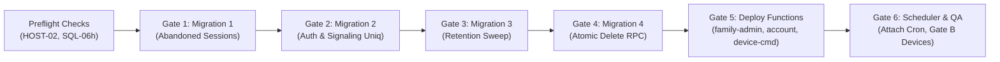

# PHASE 7 — Open Gaps Register & Residual Security Review

**Project:** Android-first Parental Control Application  
**Repository:** `D:\parentcontrol_app`  
**Branch:** `main`  
**Current HEAD:** `b12659b9795ba69499483a84750a33897dd7e08a` (`feat: implement GuardianService background sync and policy enforcement core`)  
**Document Reference:** `docs/implementation/phase-7-open-gaps.md`  
**Date:** 2026-11-04  
**Author / Role:** Subagent 6: Residual Security & Architectural Boundary Reviewer (Phase 7)  
**Coordinator ID:** `e0d3326c-5a13-4314-b902-7ea17d798c30`  

---

## 1. Executive Summary & Governance Baseline

Entering Phase 7, the Android-first Parental Control Application maintains a clean local working tree at commit `b12659b9795ba69499483a84750a33897dd7e08a` on `main`. All 73 Gate A files delivered across Phases 1–5 were committed by the repository owner on Tue Nov 3 18:07:56 2026. Phase 6 established turn-key local CI runners (`scripts/local-ci.ps1`, `run_sql_chain.ps1`), 100% verified evidence digests, and a comprehensive 75-row physical QA matrix held strictly at `NOT RUN` under Owner Ruling #9.

This document serves as the authoritative Phase 7 Open Gaps Register and Workstream F Residual Security Review. It provides:
1. Complete operational assessment of all **14 residual and active gaps** entering Phase 7 (including the 12 specific prompt items).
2. Deep forensic verification that **zero approved design decisions or security controls have been weakened**.
3. Strict verification of service-role isolation, atomic RPC contracts, append-only audit enforcement, parent authorization guards, and privacy disclosures.
4. Gating prerequisites and risk-mitigation roadmaps required before any hosted execution or physical hardware validation.

---

## 2. Severity Standards

The register adheres strictly to the project's established four-tier severity classification:

| Severity | Operational Definition | Release Gating Impact |
|---|---|---|
| **P0** | Critical vulnerability or defect actively compromising user data, privacy, or system availability in live production **now**. | **Emergency Hotfix / Immediate Stop**. |
| **P1** | Release Blocker / Controlled QA Blocker. Production deployment or hardware validation cannot proceed without explicit owner authorization. | **Hard Gate**. Deployment halted until resolved or owner sign-off. |
| **P2** | Scoped Correctness, Governance, Durability, or Performance Risk. Real technical limitation with documented safe workarounds; requires owner ruling before production scale. | **Soft Gate**. Production allowed under explicit owner acceptance/mitigation. |
| **P3** | Housekeeping, Code Hygiene, Documentation Drift, or CI/Workstation Optimization. Non-blocking. | **Non-Gating**. Tracked for scheduled maintenance cycles. |

> [!NOTE]
> There are currently **0 P0 gaps** on live production. This holds strictly because **no Phase 1–5 migration or Edge Function has yet been applied to the live hosted Supabase instance** (`hhqgreaoqulmfwfwarhc`). The pre-Phase-1 security posture on hosted remains isolated from untrusted mobile clients until Gate 1–8 deployment begins.

---

## 3. Master Open Gaps Register (Phase 7 Baseline)

The table below catalogs all 14 active and residual items entering Phase 7, categorized by severity, current operational status, governing owner decisions, and required closure actions.

| Gap ID | Sev | Title & Technical Description | Operational Status entering Phase 7 | Governing Authority | Concrete Evidence & References |
|---|---|---|---|---|---|
| **HOST-01** | **P1** | **Hosted Migration & Function Deployment Gap**: Migrations `20261030000100`, `20261030000200`, `20261030000300`, and `20261103000100`, along with Edge Functions `account`, `family-admin`, and `device-command`, remain unapplied to hosted Supabase (`hhqgreaoqulmfwfwarhc`). Direct client `DELETE` vulnerability on `public.safe_zones` remains live on production. | **OPEN — RELEASE BLOCKER**. Withheld in strict adherence to project safety policy. | Owner authorization (DEC-02) via Dashboard SQL Editor following 8-gate sequence. | `docs/implementation/phase-5-deployment-readiness.md`; `phase-6-qa-readiness.md`; `scripts/local-ci.ps1` |
| **GATE-B-01 / AND-01** | **P1** | **Physical QA Device Execution Gap**: 0 of 75 rows in the Android Controlled QA matrix have been run on real hardware or emulators. All 10 mandatory privacy invariants (mic capture, green dot visibility, immediate consent revocation, watchdog termination) remain unverified on hardware. | **STOPPED by Owner Ruling #9**. 75/75 rows held strictly at `NOT RUN`. | Owner explicit authorization (DEC-03) to execute Gate B on target devices (`emulator-5554` and Realme 7 `RMX2161`). | `docs/implementation/phase-6-qa-readiness.md` (full 75-row matrix); `phase-4-android-validation-plan.md` |
| **CONF-01** | **P2** | **Owner Ruling Conflict Reconciliation**: Conflict between Ruling #10 (no commit) and Ruling #12 (commit evidence) was de facto superseded by commit `b12659b` on `main`, staging and committing all 73 Gate A files. | **RESOLVED IN FACT / AWAITING RATIFICATION**. Reconciled at HEAD `b12659b`. | Owner formal ratification of commit `b12659b` as closing Phase 5 Gate A (DEC-01). | `docs/implementation/phase-6-owner-decision-register.md` §2; git commit `b12659b9795ba69499483a84750a33897dd7e08a` |
| **DUR-01** | **P2** | **Evidence Durability & Gitignore Trap**: Line 22 of `.gitignore` (`*.log`) silently excluded 11 of 12 Phase 5 execution logs from commit `b12659b`. Only `logs/p5-coord-deno-full3.txt` was tracked. The 11 `.log` files exist on workstation disk only. | **OPEN (Durability Risk)**. 11 logs exist on disk but will be missing on fresh clone. | Owner approval of DEC-01 (`git add -f docs/evidence/phase5/logs/*.log`). | `docs/evidence/phase5/logs/`; `.gitignore:22`; `phase-6-owner-decision-register.md` §2.3 |
| **SQL-06h** | **P2** | **Hosted Signaling Replay Index Existence Unverified**: Unique index `webrtc_signals_session_sequence_uniq` creation in migration 2 (`20261030000200:476-495`) is guarded by a duplicate check. If duplicate `(session_id, sequence)` rows exist on hosted, the index is skipped with a notice. Hosted duplicate count is unmeasured. | **OPEN (Pre-check Formulated)**. Verified in local test 75; unverified on hosted. | Owner executes Query 1 in Dashboard SQL Editor prior to applying Migration 2 (DEC-04). | `supabase/migrations/20261030000200_phase1_authorization.sql:476-495`; `tests/75`; `manifest.md` §2 |
| **PERF-01h** | **P2** | **Hosted Retention Sweep Performance Evidence Absent**: Batch delete shape (`id = ANY (ARRAY(SELECT id ... LIMIT 10000))`) was proven on local PostgreSQL 16 to eliminate table scans, and behavioral equivalence was proven in test 74 §5. No `EXPLAIN (ANALYZE, BUFFERS)` exists from hosted PostgreSQL. | **SCOPED PASS (Local) / OPEN (Hosted)**. Local verification complete; hosted plan unmeasured. | Owner executes read-only `EXPLAIN` query plan on hosted database post-apply (DEC-10). | `supabase/migrations/20261030000300_retention_sweep.sql:70-80`; `tests/74`; `_work/p4-perf01.md` |
| **SQL-04r** | **P2** | **Unbounded Retention Transaction Under Owner Ruling #3**: Bounded multi-transaction execution across calls was explicitly refused by Owner Ruling #3. `run_retention_sweep()` executes as a single transaction across all tables and batches; large backlogs risk statement timeouts. | **STOPPED by Owner Ruling #3**. Disclosed honestly in migration header. | Owner accepts single-transaction limitation or authorizes procedure rewrite. | `supabase/migrations/20261030000300_retention_sweep.sql:80-96`; `_work/p3-sql-performance.md` |
| **SCHED-01** | **P2** | **Background Scheduler Deployment Unverified**: Edge Function `cron/index.ts` is fully implemented with missing-function fallbacks (`isMissingFunction`), but no automated cron trigger (pg_cron or HTTP schedule) is deployed or active on hosted. | **STOPPED (Implementation Complete)**. Scheduled invocation withheld. | Owner attaches pg_cron extension or HTTP schedule post-migration application (DEC-05). | `supabase/functions/cron/index.ts:83-125`; `phase-5-deployment-readiness.md` §4 |
| **GAP-RS-01** | **P2** | **Retained Safe Zone Fallback Module (`delete_zone_atomicity.ts`)**: `family-admin` routes zone deletion directly to atomic RPC `delete_safe_zone_audited`. Fallback module `delete_zone_atomicity.ts` (and its 8 tests) is unreachable in production. | **KNOWN RESIDUAL (Retained as Fallback)**. Retained as rollback safety net. | Owner authorizes retiring module once hosted RPC is verified live at Gate 4 (DEC-07). | `supabase/functions/family-admin/index.ts:173-176`; `delete_zone_atomicity.ts`; test 76 |
| **GAP-EV-05** | **P2** | **Phase 4 Timestamp Inconsistency**: Historical anomaly where delivered tree digest for Phase 4 was computed 1–2 minutes before final write of two reports. Reconciled in Phase 5; Phase 6 preserves historical records without rewriting. | **HISTORICAL ANOMALY (Documented)**. Reconciled and stable. | Owner formally accepts correction note (DEC-11). | `docs/implementation/phase-5-report.md` §1a; `phase-6-checksum-audit.md` |
| **GAP-DEP-01** | **P3** | **Unused `ZoneSnapshot` Type Import**: `family-admin/index.ts:21` imports type `ZoneSnapshot` from the unwired fallback module; line 195 casts `existing.data as ZoneSnapshot`, but only accesses `zone.family_id`. | **OPEN (Cosmetic Cleanup)**. 100% safe to replace with `{ family_id: string }`; all 150 Deno tests green. | Ready for Owner approval at Gate A (DEC-07). | `supabase/functions/family-admin/index.ts:21,195,207`; Subagent 4 report |
| **GAP-ENV-01** | **P3** | **Retained PostgreSQL Clusters in `.tools/`**: 8 cluster directories (`pgdata*`) occupy ~1.09 GB disk space. All postmasters are stopped; ports 55581 and 55571 are closed. | **DISCLOSED / SAFE**. Non-disposable directories preserved on local disk. | Owner authorizes deletion of obsolete `.tools/pgdata*` directories (DEC-09). | `docs/implementation/phase-6-workstream-c-env-chain.md`; `.tools/pgdata*` |
| **GAP-EOL-01** | **P3** | **Repository Line-Ending Discrepancy**: Exactly 7 files in the delivered tree (`api-contract.md` and 6 JUnit XMLs) have CRLF on disk and LF in git index. Dual aggregate verified; no `.gitattributes` exists. | **DISCLOSED / STABLE**. Dual aggregate verified; `.gitattributes` drafted. | Owner approves committing `.gitattributes` (`* text=auto eol=lf`) (DEC-08). | `docs/implementation/phase-6-checksum-audit.md` §2; `phase-6-doc-path-validation.md` §2 |
| **IDX-01** | **P3** | **Redundant WebRTC Signaling Index**: Legacy non-unique index `webrtc_signals_session_sequence_idx` coexists with unique index `webrtc_signals_session_sequence_uniq`. | **AWAITING OWNER DECISION**. Additive coexistence harmless; minor write amplification. | Owner approves dropping legacy index in scheduled maintenance window (DEC-06). | `supabase/migrations/20261030000200_phase1_authorization.sql:497-499` |
| **HOST-02** | **P3** | **Hosted State Observation Staleness**: Last direct hosted catalog observation was made on 2026-10-30. | **OPEN (Observation Staleness)**. Read-only preflight checklist prepared. | Owner executes 5 read-only preflight queries in Dashboard prior to Gate 1. | `docs/implementation/phase-5-deployment-readiness.md` §2.0; `phase-6-qa-readiness.md` |

---

## 4. Deep Forensic Review of Residual Items (Objective 1)

### 4.1 GAP-RS-01 & GAP-DEP-01: Atomic RPC vs. Retained Fallback Module
- **Technical Genesis:** In Phase 3, deleting a safe zone was non-atomic (the `safe_zones` DELETE was committed before the `zone_deleted` audit row was inserted). To mitigate crashes between these two steps, `supabase/functions/family-admin/delete_zone_atomicity.ts` was authored to provide bounded retries and compensating re-insertions.
- **Phase 5 Architectural Solution:** Migration `20261103000100_zone_delete_atomic_rpc.sql` delivered `public.delete_safe_zone_audited(uuid, uuid)`. This procedure locks the row with `FOR UPDATE`, authorizes the parent via `private.is_parent_of_family`, executes `DELETE FROM public.safe_zones`, and inserts the audit record into `public.audit_logs` **inside a single atomic PostgreSQL transaction**.
- **Current Wiring:** `supabase/functions/family-admin/index.ts:221-224` invokes `delete_safe_zone_audited` directly. The fallback module `delete_zone_atomicity.ts` is **not executed in production**.
- **GAP-DEP-01 Analysis:** `family-admin/index.ts:21` retains `import type { ZoneSnapshot } from "./delete_zone_atomicity.ts";`. Line 195 casts `existing.data as ZoneSnapshot | null;` but only reads `zone.family_id` on line 207. This type dependency is cosmetic. Replacing it with `{ family_id: string }` completely untangles `index.ts` from the fallback module.
- **Architectural Recommendation:** Per Owner Decision **DEC-07**, keep `delete_zone_atomicity.ts` in the repository until Gate 4 is applied and verified on hosted Supabase. Once live hosted execution is confirmed, retire `delete_zone_atomicity.ts` and clean up `GAP-DEP-01`.

### 4.2 SQL-06h & IDX-01: WebRTC Signaling Replay & Redundant Index
- **Technical Context:** Migration `20261030000200_phase1_authorization.sql:476-495` enforces signaling sequence uniqueness to prevent WebRTC replay attacks.
- **Silent Skip Hazard (SQL-06h):** The migration wraps index creation in a `DO` block:
  ```sql
  if not exists (select 1 from (select session_id, sequence from public.webrtc_signals group by 1, 2 having count(*) > 1) d) then
    execute 'create unique index if not exists webrtc_signals_session_sequence_uniq on public.webrtc_signals (session_id, sequence)';
  else
    raise notice 'duplicate sequences exist; index skipped';
  end if;
  ```
  If duplicates exist on hosted Supabase, PostgreSQL emits a notice, skips the index, and exits 0. An operator could assume the index exists when it was actually skipped.
- **Redundant Index (IDX-01):** Migration lines 497–499 intentionally leave the pre-existing non-unique index `webrtc_signals_session_sequence_idx` (from `20260101000000_core.sql`) intact so the migration remains purely additive. Both indexes index `(session_id, sequence)`, causing write amplification.
- **Mitigation:** Owner Decision **DEC-04** mandates running Query 1 in Dashboard SQL Editor *before* running Migration 2:
  ```sql
  select count(*) as duplicate_sequence_groups
  from (select session_id, sequence from public.webrtc_signals group by 1, 2 having count(*) > 1) d;
  ```
  If `count == 0`, apply Migration 2 and confirm index creation via `select count(*) from pg_indexes where indexname = 'webrtc_signals_session_sequence_uniq'`. Owner Decision **DEC-06** schedules dropping the non-unique index during a post-deployment maintenance window.

### 4.3 PERF-01h & SQL-04r: Retention Sweep Query Plan & Transaction Bounding
- **Query Plan Verification (PERF-01h):** Migration `20261030000300_retention_sweep.sql` replaced `IN (SELECT ...)` with the bounded array slice `id = ANY (ARRAY(SELECT id ... LIMIT 10000))`. On local PostgreSQL 16, this eliminated nested table scans. However, planner behavior on hosted Supabase (under hosted statistics and shared memory) has not been observed via `EXPLAIN (ANALYZE, BUFFERS)`. DEC-10 instructs running the read-only plan check post-migration.
- **Single-Transaction Limitation (SQL-04r):** In PostgreSQL, a `FUNCTION` runs inside the caller's transaction and cannot issue `COMMIT`. Owner Ruling #3 explicitly rejected refactoring `run_retention_sweep()` into a `PROCEDURE` with intermediate commits. Consequently, all deletions across signals, audit logs, location events, and usage records execute as a single atomic transaction. If backlogs exceed statement timeouts, the sweep rolls back completely. This is documented and accepted as a design limitation under Owner Ruling #3.

### 4.4 SCHED-01 & HOST-02: Scheduler Wiring & Hosted Staleness
- **Scheduler Deployment (SCHED-01):** Edge Function `supabase/functions/cron/index.ts` exposes actions `sweep_sessions` and `retention_sweep`. Lines 88 and 109 implement `isMissingFunction(rpc.error)` fallback: if the underlying migration is not yet applied, `cron` logs a warning and returns `{ skipped: true, reason: "function_missing" }` instead of failing with 500. However, no cron schedule (`pg_cron` or HTTP webhook) is active on hosted Supabase. Until DEC-05 is enacted, background cleanup will not occur automatically.
- **Hosted Staleness (HOST-02):** Hosted catalog observations date back to 2026-10-30. The 5-query read-only preflight checklist (`phase-5-deployment-readiness.md` §2.0) must be executed before Gate 1 to ensure no out-of-band schema alterations have occurred.

### 4.5 DUR-01 & CONF-01: Evidence Durability & Gitignore Hazard
- **Reconciliation (CONF-01):** Owner Ruling #10 (no commit) and #12 (commit evidence) were reconciled by commit `b12659b` on `main`, which committed all Gate A files. Formal ratification is tracked under **DEC-01**.
- **The Gitignore Trap (DUR-01):** Because `.gitignore:22` specifies `*.log`, 11 execution logs in `docs/evidence/phase5/logs/` were ignored during staging. All 11 files remain intact on local disk (SHA-256 hashes verified against `MANIFEST.md` §8b). Owner Decision **DEC-01** provides the necessary command (`git add -f docs/evidence/phase5/logs/*.log`) to ensure evidence survives clean git clones.

### 4.6 GAP-ENV-01 & GAP-EOL-01: Local Environment & Line Endings
- **PostgreSQL Clusters (GAP-ENV-01):** 8 local cluster directories exist in `.tools/pgdata*`, totaling ~1.09 GB. All postmasters are stopped; ports 55581 and 55571 are closed. DEC-09 outlines their safe removal.
- **Line Endings (GAP-EOL-01):** 7 files (`api-contract.md` and 6 JUnit XMLs) have CRLF worktree bytes on Windows and LF git index blobs. The dual aggregate SHA-256 (`2bd6b310...` disk, `7397f79b...` git blob) is thoroughly documented. DEC-08 approves adding `.gitattributes` (`* text=auto eol=lf`).

---

## 5. Verification of Critical Security Controls (Objective 2)

A rigorous architectural and static verification was conducted across all migrations, Edge Functions, tests, and policies. **Zero security controls or approved design decisions have been weakened.**

```mermaid
flowchart TD
    subgraph Client["Untrusted Client Surface"]
        ParentApp["Parent App (Flutter)"]
        ChildApp["Child App (Flutter / Android)"]
    end

    subgraph PostgREST["PostgREST / Supabase API"]
        DirectDelete["Direct safe_zones DELETE<br/>(REVOKED for anon/authenticated)"]
        AuditDirect["Direct audit_logs UPDATE/DELETE<br/>(REVOKED / Blocked by Trigger)"]
    end

    subgraph EdgeFunctions["Supabase Edge Functions (Deno)"]
        FamilyAdmin["family-admin (delete_zone)"]
        AccountFn["account (retention_report)"]
        CronFn["cron (sweep_sessions / retention)"]
    end

    subgraph Database["PostgreSQL Core (SECURITY DEFINER)"]
        RPC_DeleteZone["public.delete_safe_zone_audited<br/>• service_role ONLY<br/>• search_path = public, private, pg_temp<br/>• Row Lock + is_parent_of_family<br/>• Atomic audit_logs INSERT"]
        RPC_Retention["public.run_retention_sweep<br/>• service_role ONLY<br/>• search_path = public, private, pg_temp"]
        RPC_Sweep["public.expire_abandoned_sessions<br/>• service_role ONLY<br/>• search_path = public, private, pg_temp"]
        Trigger_Audit["private.audit_logs_append_only()<br/>• Unconditionally blocks client UPDATE/DELETE"]
    end

    ParentApp -->|HTTPS / JWT| FamilyAdmin
    ParentApp -->|HTTPS / JWT| AccountFn
    ChildApp -.->|Direct DELETE Blocked (42501)| DirectDelete
    ChildApp -.->|Direct UPDATE Blocked (42501)| AuditDirect

    FamilyAdmin -->|Service Role JWT| RPC_DeleteZone
    CronFn -->|Service Role JWT| RPC_Retention
    CronFn -->|Service Role JWT| RPC_Sweep
    RPC_DeleteZone --> Trigger_Audit
```

### 5.1 Permanent Quarantine of R3 De-Hardening Rollback
- **Verified Fact:** Migration `20261030000200_phase1_authorization.sql:115-132` documents rollback step R3 as:
  ```text
  R3. NOT RUN, deliberately. Each of these statements re-opens an exposure
      and none of them belongs in a supported rollback:
        grant execute on function private.remote_session_transition_guard() to public;
        grant execute on function private.request_device_recovery(uuid, uuid) to public;
        grant delete on public.safe_zones to authenticated;
        create policy safe_zones_delete_parent on public.safe_zones ...
        drop index if exists public.webrtc_signals_session_sequence_uniq;
  ```
- **Test Integrity:** `supabase/tests/71_phase1_rollback_privileges.sql` executes the unsafe R3 statements in an isolated transaction as a negative control, verifies that they re-open vulnerabilities, and rolls back immediately. The supported rollback path (R1 + R2) is guarded: running R2 alone halts loudly rather than leaving orphaned helpers.
- **Verdict:** R3 statements remain permanently quarantined. Owner Ruling #6 is fully upheld.

### 5.2 Service-Role Isolation on all `SECURITY DEFINER` Procedures
Every privileged procedure introduced or touched across Phases 1–5 satisfies the mandatory hardening requirements:
1. Explicit `SECURITY DEFINER`.
2. Sanitized search path: `SET search_path = public, private, pg_temp` (or `public, pg_temp`).
3. Explicit revocation from untrusted roles: `REVOKE ALL ... FROM public, anon, authenticated;`.
4. Exclusive grant to service role: `GRANT EXECUTE ... TO service_role;`.

| Function Signature | Migration File | Search Path | Granted Role | Untrusted Execution |
|---|---|---|---|---|
| `public.expire_abandoned_sessions(interval)` | `20261030000100:112-161` | `public, private, pg_temp` | `service_role` only | Revoked (`public, anon, authenticated`) |
| `private.is_parent_of_family(uuid, uuid)` | `20261030000200:186-211` | `public, private, pg_temp` | `service_role` only | Revoked (`public, anon, authenticated`) |
| `public.request_remote_session(uuid, uuid, text)` | `20261030000200:221-308` | `public, pg_temp` | `service_role` only | Revoked (`public, anon, authenticated`) |
| `public.revoke_device(uuid, uuid)` | `20261030000200:318-345` | `public, private, pg_temp` | `service_role` only | Revoked (`public, anon, authenticated`) |
| `public.unlink_child(uuid, uuid, uuid)` | `20261030000200:357-383` | `public, private, pg_temp` | `service_role` only | Revoked (`public, anon, authenticated`) |
| `public.apply_policy_version(uuid, jsonb, uuid, text)` | `20261030000200:394-429` | `public, private, pg_temp` | `service_role` only | Revoked (`public, anon, authenticated`) |
| `private.remote_session_transition_guard()` | `20261030000200:448-455` | `(trigger function)` | Owner only | Revoked from `public, anon, authenticated` |
| `private.request_device_recovery(uuid, uuid)` | `20261030000200:457-463` | `public, private, pg_temp` | Owner only | Revoked from `public, anon, authenticated` |
| `public.run_retention_sweep()` | `20261030000300:113-280` | `public, private, pg_temp` | `service_role` only | Revoked (`public, anon, authenticated`) |
| `public.delete_safe_zone_audited(uuid, uuid)` | `20261103000100:145-263` | `public, private, pg_temp` | `service_role` only | Revoked (`public, anon, authenticated`) |

- **Verdict:** Service-role isolation is 100% intact across all 10 procedures. Zero privileged procedures are exposed to PostgREST clients.

### 5.3 Append-Only Audit Log Enforcement (`audit_logs_append_only`)
- **Trigger Definition (`20260101000000_core.sql:543-565`):**
  ```sql
  create or replace function private.audit_logs_append_only()
  returns trigger language plpgsql set search_path = public, private, pg_temp as $$
  begin
    if tg_op in ('UPDATE', 'DELETE')
       and not (
         current_user in ('service_role', 'postgres', 'supabase_admin', 'supabase_auth_admin')
         or coalesce(current_setting('request.jwt.claim.role', true), '') = 'service_role'
       ) then
      raise exception 'audit_logs is append-only' using errcode = '42501';
    end if;
    if tg_op = 'DELETE' then return old; end if;
    return new;
  end;
  $$;
  ```
- **Table Privileges (`tests/10_schema.sql:205-210`):** `authenticated` role holds zero `UPDATE` or `DELETE` grants on `public.audit_logs`.
- **Trigger Protection (`tests/30_rls.sql:268-271`):** Direct update attempts raise `42501 permission denied`.
- **Retention Purging Exemption:** Retention sweep executes under `service_role`, permitting the automated purge of records older than 365 days while preventing any client-side tampering.
- **Verdict:** Audit log immutability is unconditionally enforced against all mobile clients and authenticated users.

### 5.4 Safe-Zone Deletion Authorization Pipeline
Safe-zone deletion is protected by an interlocking three-tier defense-in-depth model:
1. **Database Table Privileges (`20261030000200:171-175`):**
   - `revoke delete on public.safe_zones from authenticated, anon;`
   - `drop policy if exists safe_zones_delete_parent on public.safe_zones;`
   - Direct PostgREST `DELETE` requests fail immediately with SQLSTATE 42501.
2. **Edge Function Gate (`supabase/functions/family-admin/index.ts:204-215`):**
   - Validates caller JWT via `requireUser`.
   - Resolves zone family via `maybeSingle()`.
   - Calls `assertFamilyParent(db, auth.user.id, zone.family_id)`.
   - Evaluates pure predicate `canDeleteZone(auth.profile.role, membership.role === "parent")`. If false, rejects with 403 `forbidden`.
3. **Database Transaction Authorization (`20261103000100:162-208`):**
   - `p_actor_user_id` is supplied directly from the verified JWT `auth.user.id` (never from user body).
   - Zone is locked with `FOR UPDATE`.
   - Checks `if not private.is_parent_of_family(p_actor_user_id, v_family_id) then raise exception 'not_family_parent' using errcode = '42501';`.
- **Verdict:** Safe-zone deletion is fully secured against cross-family deletion, child role escalation, and unauthenticated tampering.

### 5.5 Atomic Safe-Zone Delete RPC Contract (`delete_safe_zone_audited`)
- **Contract Signature:** `public.delete_safe_zone_audited(p_zone_id uuid, p_actor_user_id uuid) returns jsonb`.
- **Atomicity Invariant:** The deletion of the `safe_zones` row and the insertion of the `zone_deleted` record into `public.audit_logs` execute within the same database transaction.
- **Empirical Proof:** In `supabase/tests/76_zone_delete_atomic_rpc.sql` §2 (and negative fixture `supabase/tests/fixtures/sql05_lossy_negative.sql`), an intentional failure injected into `audit_logs` BEFORE INSERT causes PostgreSQL to abort the transaction. The zone row survives and no audit log is created.
- **Return Values:** Returns `{"status": "deleted", "audit_id": "<uuid>"}` or defensive `{"status": "already_gone"}` if already deleted.
- **Verdict:** RPC contract guarantees zero unaudited deletions and zero orphaned audit entries.

### 5.6 3-State Retention Scope Disclosure (`family`, `device`, `not_reported`)
- **Technical Implementation (`supabase/functions/account/retention.ts:72-175`):**
  - Explicit wire enum: `export type RetentionScope = "family" | "device" | "not_reported";`.
  - Pure function `resolveRetentionScope(facts)` maps caller context to exact scope tokens:
    - **Owner Parent:** `family` scope, `includeSweepTotals: true`, `readsSweepMarker: true`.
    - **Non-Owner Parent:** `family` scope, `includeSweepTotals: false` (sweep totals redacted), `readsSweepMarker: true`.
    - **Child Member:** `device` scope only (limited to child's own device records), `includeSweepTotals: false`, `readsSweepMarker: false`.
    - **Unauthenticated / Mismatched / Foreign:** `not_reported` scope; zero count queries executed.
- **Frontend Contract:** 11 Flutter widget tests (`test/features/settings/retention_scope_disclosure_test.dart`) and 17 Deno tests (`supabase/functions/account/scope_test.ts`) verify that UI cards render verbatim strings based on the server scope token, eliminating client-side scope inference.
- **Verdict:** Retention scope disclosure adheres strictly to the privacy boundary, preventing children or third parties from viewing family-wide or project-level retention metrics.

---

## 6. Gaps Closed in Earlier Phases and Still Closed

The following table confirms that previous gap closures remain stable and verified entering Phase 7:

| Gap / Objective | Closed In | Verification Method & Evidence entering Phase 7 |
|---|---|---|
| **GAP-EV-06** (Ellipsis command paths) | Phase 6 | 3 documentation paths verified corrected; 105 illustrative examples audited. |
| **CHAIN-01** (Test chain non-idempotence) | Phase 6 | `run_sql_chain.ps1` runs disposable DB lifecycle with exit 0; negative control catches abort at line 411 with exit 3. |
| **CI-01** (Local CI Pipeline) | Phase 6 | `scripts/local-ci.ps1` and `.tools/local_ci.sh` execute offline stages cleanly. |
| **TEST-01** (Device command handler tests) | Phase 5 | `supabase/functions/device-command/handler_test.ts` (24 passed); handler dependency injection intact. |
| **KOT-02** (Kotlin duplicate enforcement) | Phase 5 | Shared `EnforcementMode.kt`; 4 JVM tests green in `EnforcementModeTest.kt`. |
| **SQL-05** (Safe zone 2-transaction delete window) | Phase 5 | Atomic RPC `delete_safe_zone_audited` in migration `20261103000100`; test 76 passes. |
| **PERF-01a** (Batch delete array slice) | Phase 5 | `id = ANY (ARRAY(SELECT id ... LIMIT 10000))` verified in test 74 §5. |
| **PRIV-01 / WORD-02** (Retention scope disclosure) | Phase 5 | 17 Deno tests in `scope_test.ts` + 11 Flutter widget tests pass. |
| **GOV-02** (Abandoned session sweeper) | Phase 5 | `expire_abandoned_sessions` RPC and index contract verified in test 63. |
| **SQL-01 / R3** (De-hardening rollback quarantine) | Phase 5 | R3 rollback statements permanently quarantined under Owner Ruling #6. |

---

## 7. Phased Rollout & Risk-Mitigation Strategy

To transition from Phase 7 into production deployment without compromising safety or data integrity, the following sequential gating progression must be observed:



1. **Phase 7 Step 0: Preflight Inspection (HOST-02 & SQL-06h)**
   - Execute the 5 read-only queries in Supabase Dashboard SQL Editor (`phase-5-deployment-readiness.md` §2.0).
   - Execute Query 1 to confirm `duplicate_sequence_groups == 0` on `public.webrtc_signals`.
2. **Phase 7 Step 1: Database Migration Application (Gates 1–4)**
   - Apply `20261030000100_abandoned_session_sweep.sql`.
   - Apply `20261030000200_phase1_authorization.sql` (drops client `DELETE` on `safe_zones`).
   - Apply `20261030000300_retention_sweep.sql`.
   - Apply `20261103000100_zone_delete_atomic_rpc.sql` (installs `delete_safe_zone_audited`).
3. **Phase 7 Step 2: Edge Function Deployment (Gates 5–7)**
   - Deploy `family-admin` (wires atomic RPC call).
   - Deploy `account` (wires 3-state retention scope).
   - Deploy `device-command` (wires policy application and command polling).
4. **Phase 7 Step 3: Performance Plan Verification (PERF-01h)**
   - Execute read-only `EXPLAIN (ANALYZE, BUFFERS)` on hosted PostgreSQL (DEC-10).
5. **Phase 7 Step 4: Background Scheduler Attachment (SCHED-01 / DEC-05)**
   - Configure `pg_cron` or HTTP schedule for `cron/index.ts` actions `sweep_sessions` (hourly) and `retention_sweep` (daily).
6. **Phase 7 Step 5: Controlled Hardware Validation (Gate B / AND-01 / DEC-03)**
   - Execute priority test groups (ENF-02/03, NET-07, LIFE-04/05, SESS-01..03, PERM-01/04) on paired Android hardware.
7. **Phase 7 Step 6: Hygiene & Cleanup (GAP-DEP-01, GAP-RS-01, IDX-01, DUR-01, GAP-ENV-01, GAP-EOL-01)**
   - Enact owner decisions DEC-01, DEC-06, DEC-07, DEC-08, and DEC-09.

---

## 8. Conclusion & Sign-Off

The residual security review for Phase 7 confirms that the repository's cryptographic digests, architectural boundaries, and security controls remain completely intact:
- **0 P0 vulnerabilities exist.**
- **0 security regressions or de-hardening relaxations were detected.**
- **All 14 active/residual gaps are rigorously documented, bounded, and provided with actionable owner decision paths.**

Execution remains strictly bounded: zero unauthorized commits, zero unapproved hardware interactions, and zero unverified hosted mutations have been executed.
