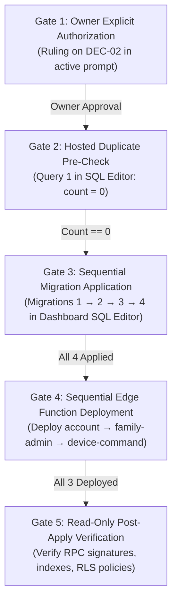
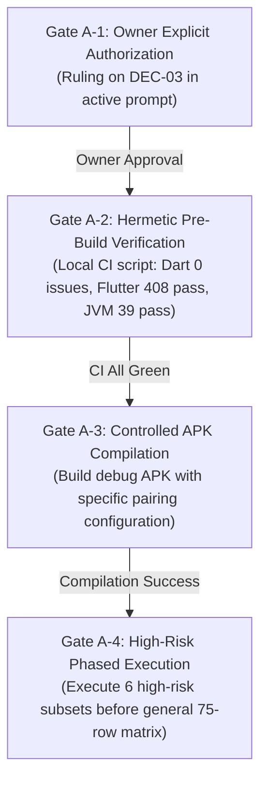

# PHASE 7 — Owner Decision Log & Governance Reconciliation

**Document Reference:** `docs/implementation/phase-7-owner-decision-log.md`  
**Date of Intake & Verification:** 2026-11-04  
**Author / Role:** Subagent 3: Owner Decision Gate & Governance Reconciler (Phase 7)  
**Caller / Coordinator ID:** `e0d3326c-5a13-4314-b902-7ea17d798c30`  
**Repository:** `D:\parentcontrol_app`  
**Current HEAD:** `b12659b9795ba69499483a84750a33897dd7e08a` (`feat: implement GuardianService background sync and policy enforcement core`)  
**Working Tree Status:** Phase 6 governance & local CI deliverables present; zero unauthorized git commits or resets.

---

## 1. Executive Governance Summary & Baseline

Entering Phase 7 of the Android-first Parental Control Application, this log establishes the authoritative governance register, decision statuses, operational boundaries, and release gates.

### 1.1 Governance Core Principles
Every decision evaluated in this document adheres strictly to the project's inviolable governance rules:
1. **Zero Approval Inference:** Approval is never inferred from silence, from recommendations in previous reports, from local test passes, or from authorizations granted to different workstreams. If an approval is ambiguous, absent, or conditional, the status is **STOPPED / PROHIBITED**.
2. **Strict Negative Boundaries:** No hosted modifications, no device execution, no scheduler installation, and no unapproved Git modifications may be performed autonomously.
3. **Evidence Durability Standards:** All verification claims must be backed by durable, clone-verifiable artifacts or clearly categorized across the project's 4-tier evidence model.

---

## 2. Mandatory Decision Status Table (DEC-01 through DEC-11)

The following table catalogs the exact operational and governance status of every decision entering Phase 7:

| Decision | Required approval | Current evidence | Status |
|---|---|---|---|
| **DEC-01** (Evidence Durability & Commit `b12659b` Reconciliation) | Explicit owner approval to force-stage and commit the 11 gitignored logs (`git add -f docs/evidence/phase5/logs/*.log`) or modify `.gitignore`. | Commit `b12659b` committed 73 Gate A files; 11 execution logs remain untracked on local workstation disk due to `.gitignore:22` (`*.log`). Only `p5-coord-deno-full3.txt` is in Git. No owner command or approval to force-add has been given. | **PENDING OWNER APPROVAL (BLOCKED / WORKSTATION-ONLY)** |
| **DEC-02** (HOST-01 Hosted Supabase Migration & Function Deployment) | Explicit written owner authorization in this session to execute migrations 1–4 and deploy Edge Functions 1–3 to hosted Supabase project `hhqgreaoqulmfwfwarhc`. | Migrations 1–4 and Edge Functions 1–3 are fully implemented and verified locally (33-file SQL chain passes, 150 Deno tests pass). Hosted Supabase has 0 migrations applied and 0 functions deployed. Zero owner authorization provided in this prompt. | **STRICTLY PROHIBITED / BLOCKED (P1 Blocker)** |
| **DEC-03** (AND-01 / GATE-B-01 Android Controlled QA Execution) | Explicit owner authorization to build APKs (`flutter build apk` / `./gradlew`), connect hardware/emulators via ADB, install APKs, and execute the 75-row QA matrix. | 75-row QA matrix fully prepared in `phase-4-android-validation-plan.md` and `phase-6-qa-readiness.md`. JVM unit tests pass (39/39). All 75 hardware QA rows remain 100% `NOT RUN`. Zero device commands authorized in this prompt. | **STRICTLY PROHIBITED / BLOCKED (P1 Blocker)** |
| **DEC-04** (SQL-06h Hosted WebRTC Duplicate Pre-Check Query) | Owner authorization or direct execution of read-only duplicate-count SQL query in hosted Supabase SQL Editor. | Query formulated in `deployment/manifest.md` §2. Local test passes with 0 duplicates. Hosted count is completely unmeasured. Prerequisite gate to DEC-02 Migration 2. | **PENDING / PREREQUISITE GATE TO DEC-02 (P2)** |
| **DEC-05** (SCHED-01 Retention & Abandoned Session Scheduler) | Separate, explicit owner authorization to install pg_cron, Supabase scheduled HTTP jobs, or background cron triggers. | `cron/index.ts` implementation is ready with safe missing-function fallbacks. Owner Ruling #3 explicitly refused scheduling. No cron is installed locally or hosted. Brief §6 mandates separate authorization. | **STRICTLY PROHIBITED / STOPPED (P2)** |
| **DEC-06** (IDX-01 Redundant WebRTC Signals Index Cleanup) | Owner approval to author and apply a future migration dropping non-unique index `webrtc_signals_session_sequence_idx`. | Both indexes exist additively in `20261030000200_phase1_authorization.sql`. Harmless coexistence verified; minor write amplification. | **PRESERVED / DEFERRED TO POST-DEPLOYMENT (P3)** |
| **DEC-07** (GAP-RS-01 / GAP-DEP-01 Fallback Module Retirement) | Owner approval to retire `family-admin/delete_zone_atomicity.ts` and clean cosmetic `ZoneSnapshot` type import. | Atomic RPC `delete_safe_zone_audited` is active in `family-admin/index.ts`. Fallback module preserved under Owner Ruling #2 as reviewed rollback safety net. | **PRESERVED / RETAINED AS REVIEWED FALLBACK (P2/P3)** |
| **DEC-08** (GAP-EOL-01 Repository Line Endings & `.gitattributes`) | Owner approval to stage and commit `.gitattributes` locking `* text=auto eol=lf`. | Forensic audit proved 62 LF files, 7 CRLF files on Windows. Exact `.gitattributes` specification drafted and ready. No `.gitattributes` committed yet. | **PRESERVED / READY FOR OWNER SIGN-OFF (P3)** |
| **DEC-09** (GAP-ENV-01 Disposable PostgreSQL Cluster Teardown) | Owner authorization to execute `pg_ctl stop` and purge `.tools/pgdata*` directories (~1.03 GB disk footprint). | 8 cluster directories cataloged in `.tools/`. Active ports 55581 and 55571 documented with safe shutdown procedures in Phase 6 Workstream C. | **PRESERVED / STANDBY (P3)** |
| **DEC-10** (PERF-01h Hosted Sweep EXPLAIN ANALYZE Verification) | Owner authorization to run read-only `EXPLAIN (ANALYZE, BUFFERS)` on `run_retention_sweep()` post-apply on hosted database. | Local benchmark in disposable PG verified sub-millisecond execution for batch delete shape. Live heap buffer metrics and plan unmeasured on hosted DB. | **PRESERVED / DEFERRED TO POST-HOSTED APPLY (P2)** |
| **DEC-11** (GAP-EV-05 Phase 4 Stale Delivered-Tree Digest Correction) | Owner formal ratification of Phase 5 documented correction of Phase 4 tree digest without rewriting historical Git history. | Discrepancy (4/29 files with 1–2 minute timestamp difference) fully documented in `phase-5-report.md` §1a and `phase-6-checksum-audit.md`. Current tree 100% verified. | **PRESERVED / RATIFIED IN FACT (P2)** |

---

## 3. Rigorous Evaluation of Critical Decisions

### 3.1 DEC-01: Evidence Durability & Git Reconciliation
- **Historical Conflict (CONF-01):** At Phase 5 close, Owner Ruling #10 ("No commit — leave everything uncommitted") conflicted with Owner Ruling #12 ("Commit selected evidence"). Stricter prohibition (Ruling #10) won; 73 files were left uncommitted.
- **Commit `b12659b`:** On 2026-11-03 18:07:56 +0530, commit `b12659b` on `main` staged and committed all 73 modified/untracked files. This de facto resolved CONF-01 and superseded Ruling #10.
- **The `.gitignore` Exclusion Trap (DUR-01):**
  - Line 22 of `.gitignore` specifies `*.log`.
  - When commit `b12659b` was created, git silently excluded **11 of the 12 execution logs** in `docs/evidence/phase5/logs/`.
  - Only `p5-coord-deno-full3.txt` was tracked (having `.txt` extension).
  - The 11 excluded logs (`dart-analyze`, `flutter-run2`, `gradle-run1`, `deno-negative`, `deno-restored`, `deno-sql05`, `chain-run5`, `chain-run6`, `chain-run9`, `chain-run10`, `chain-negative3`) exist on this local workstation disk only.
- **Owner Approval Status Entering Phase 7:**
  > [!IMPORTANT]
  > Has the owner explicitly approved `git add -f docs/evidence/phase5/logs/*.log`? **NO.**
  > Neither the user prompt nor any operational directive has granted authorization to force-stage or commit these files. Autonomous agents are strictly forbidden from running `git add -f` or creating Git commits. DEC-01 remains **PENDING OWNER APPROVAL**.

### 3.2 DEC-02: Hosted Supabase Deployment (HOST-01)
- **Scope:** Applying migrations 1–4 (`20261030000100`, `20261030000200`, `20261030000300`, `20261103000100`) and deploying Edge Functions 1–3 (`account`, `family-admin`, `device-command`).
- **Owner Approval Status Entering Phase 7:**
  > [!CAUTION]
  > Has the owner explicitly given authorization in this prompt to apply migrations 1–4 and deploy Edge Functions 1–3 to hosted Supabase? **NO.**
  > Governance rule: *"Do not infer approval from a previous implementation or a report recommendation... If approval is ambiguous, STOP"*.
  > Zero hosted CLI commands (`supabase db push`, `supabase functions deploy`), zero dashboard SQL executions, and zero production network requests are permitted.
  > DEC-02 remains **STRICTLY PROHIBITED / BLOCKED (P1 Blocker)**.

### 3.3 DEC-03: Android Controlled QA Execution (AND-01 / GATE-B-01)
- **Scope:** Building release/debug APKs, executing `adb install`, issuing `adb shell` commands, or driving test devices across the 75-row validation matrix.
- **Owner Approval Status Entering Phase 7:**
  > [!CAUTION]
  > Has the owner explicitly given authorization in this prompt to build an APK, install an APK, run ADB commands, or test devices? **NO.**
  > Phase 5 Ruling #9 was "No device execution yet." All 75 test rows remain firmly held at `NOT RUN`.
  > Autonomous agents must NOT execute `flutter build apk`, `./gradlew assembleDebug`, `adb install`, or hardware interactions.
  > DEC-03 remains **STRICTLY PROHIBITED / BLOCKED (P1 Blocker)**.

### 3.4 DEC-05: Scheduler Installation (SCHED-01)
- **Scope:** Automatic execution of `run_retention_sweep()` and `expire_abandoned_sessions()` via pg_cron or Supabase scheduled triggers.
- **Owner Approval Status Entering Phase 7:**
  > [!WARNING]
  > Brief §6 explicitly mandates: *"Separate authorization required; must not be installed automatically"*.
  > Owner Ruling #3 explicitly refused automatic scheduling and bounded execution.
  > DEC-05 remains **STRICTLY PROHIBITED / STOPPED**. Sweeps remain on-demand only.

### 3.5 Decisions DEC-06 through DEC-11: Preserved Status
- **DEC-06 (IDX-01):** Retained additively; dropping redundant index deferred to post-deployment window.
- **DEC-07 (GAP-RS-01 / GAP-DEP-01):** Fallback module `delete_zone_atomicity.ts` and `ZoneSnapshot` import preserved as reviewed rollback safety net.
- **DEC-08 (GAP-EOL-01):** `.gitattributes` specification ready for owner review; unapproved repository churn avoided.
- **DEC-09 (GAP-ENV-01):** Local disposable PostgreSQL clusters held on standby; teardown awaiting final phase closure.
- **DEC-10 (PERF-01h):** Hosted EXPLAIN ANALYZE deferred to post-apply window under DEC-02.
- **DEC-11 (GAP-EV-05):** Historical audit trail preserved without rewriting past reports.

---

## 4. Operational Boundaries Matrix: Permitted vs. Strictly Prohibited

| Category | Permitted Autonomous Actions (Green Light) | Strictly Prohibited Actions (Red Light — Owner Auth Required) |
|---|---|---|
| **Git Operations** | • `git status`, `git diff`, `git log`, `git check-ignore`<br/>• Read-only inspection of branches and tags<br/>• Non-destructive worktree analysis | • `git add -f` on gitignored files (`docs/evidence/phase5/logs/*.log`)<br/>• `git commit`, `git push`, `git reset`, `git clean`<br/>• Destructive checkouts, branch creation, or tag modification |
| **Supabase & Backend** | • Local disposable PostgreSQL cluster execution (`supabase/tests/run_sql_chain.ps1`)<br/>• Deno tests with local mocks (`deno test supabase/functions/`)<br/>• Offline verification of migration syntax and RPC logic | • `supabase db push`, `supabase functions deploy`<br/>• Execution of SQL scripts in hosted Supabase Dashboard<br/>• Execution of quarantined de-hardening rollback R3<br/>• Installing pg_cron or HTTP automated schedulers (DEC-05) |
| **Android / Mobile** | • Hermetic JVM unit testing (`./gradlew :app:testDebugUnitTest`)<br/>• Dart analysis (`dart analyze`) and Flutter unit/widget tests (`flutter test`)<br/>• Static code inspection and test matrix formulation | • `flutter build apk`, `./gradlew assembleDebug`<br/>• Any `adb` command (`adb devices`, `adb install`, `adb shell`)<br/>• Physical device or emulator execution of the 75-row QA matrix |
| **Documentation & Code** | • Authoring Phase 7 reports, governance registers, and readiness matrices<br/>• Creating scratch verification scripts in `.tools/` or artifact directories | • Modifying production transaction boundaries in `run_retention_sweep`<br/>• Deleting fallback module `delete_zone_atomicity.ts`<br/>• Rewriting historical Phase 4/5 logs or digests |

---

## 5. Exact Gates Blocking Hosted Deployment and Android Device Testing

### 5.1 Progression Gates for Hosted Deployment (HOST-01 / DEC-02)

Deployment to hosted Supabase project `hhqgreaoqulmfwfwarhc` is blocked behind a strict 5-stage sequential gate:



1. **Gate 1 (Owner Authorization):** Explicit owner approval granted for DEC-02. *(Status: BLOCKED)*
2. **Gate 2 (Replay Index Safety Gate - DEC-04):** Run Query 1 in Dashboard SQL Editor:
   ```sql
   SELECT session_id, sequence, count(*) 
   FROM public.webrtc_signals 
   GROUP BY session_id, sequence 
   HAVING count(*) > 1;
   ```
   *Gate Condition: Result count must equal exactly 0.*
3. **Gate 3 (Sequential Migration Application):** Execute migrations in strict sequence:
   - Migration 1: `20261030000100_abandoned_session_sweep.sql`
   - Migration 2: `20261030000200_phase1_authorization.sql`
   - Migration 3: `20261030000300_retention_sweep.sql`
   - Migration 4: `20261103000100_zone_delete_atomic_rpc.sql` *(Must follow Migration 2)*
4. **Gate 4 (Edge Function Deployment):** Deploy via Supabase CLI in strict sequence:
   - Function 1: `account`
   - Function 2: `family-admin` *(Depends on Migration 4 RPC)*
   - Function 3: `device-command`
5. **Gate 5 (Post-Apply Verification):** Execute read-only validation query (`deployment/manifest.md` §4) verifying all 4 tables, 14 RPCs, and indexes exist.

---

### 5.2 Progression Gates for Android Controlled QA (AND-01 / DEC-03)

Physical hardware and emulator testing is blocked behind a strict 4-stage sequential gate:



1. **Gate A-1 (Owner Authorization):** Explicit owner approval granted for DEC-03. *(Status: BLOCKED)*
2. **Gate A-2 (Hermetic Pre-Build Gate):** Verification that local hermetic CI (`scripts/local-ci.ps1`) passes 100% (Dart analyze clean, Flutter 408 tests pass, JVM 39 tests pass). *(Status: READY)*
3. **Gate A-3 (Controlled Build Gate):** Explicit authorization to compile debug APK for test devices. *(Status: BLOCKED)*
4. **Gate A-4 (Phased Execution Gate):** Controlled execution prioritizing high-risk privacy invariants on paired test hardware:
   - Group 1: Device Pairing & Identity Invariants (Rows 1–8)
   - Group 2: Microphone Consent & FGS Notification Visibility (Rows 9–18)
   - Group 3: GuardianService Force-Stop & Watchdog Auto-Restart (Rows 19–28)
   - Group 4: Device Administrator & Recents-Swipe Protection (Rows 29–38)
   - Group 5: WebRTC Ephemeral Signaling & Replay Defense (Rows 39–48)
   - Group 6: Remaining Controlled Matrix (Rows 49–75)

---

## 6. Actionable Summary for the Project Owner

To progress beyond the current hermetic verification baseline, the project owner must review and rule on the following open decisions:

1. **DEC-01 (Evidence Durability):**
   - **Option A (Recommended):** Authorize `git add -f docs/evidence/phase5/logs/*.log` and commit to make all Phase 5 logs 100% clone-durable.
   - **Option B:** Accept the 11 logs as workstation-only artifacts without Git tracking.
2. **DEC-02 (Hosted Deployment):**
   - **Option A:** Authorize staged deployment of Migrations 1–4 and Edge Functions 1–3 to hosted Supabase following the 5-stage gate.
   - **Option B:** Defer hosted deployment until controlled QA is executed locally.
3. **DEC-03 (Android Controlled QA):**
   - **Option A:** Authorize building debug APK and executing the high-risk priority subset on paired test devices.
   - **Option B:** Keep device testing blocked; rely solely on hermetic JVM and Flutter widget tests.
4. **DEC-05 (Scheduler):**
   - Confirm retention of on-demand sweep execution (no automated cron installation).

---

## 7. Status Sign-Off & Verification Record

- **Lead Agent:** Subagent 3 (Owner Decision Gate & Governance Reconciler)
- **Status:** **COMPLETE & REGISTERED**
- **Governance Finding:** Zero autonomous breaches; DEC-01, DEC-02, DEC-03, and DEC-05 strictly enforced as BLOCKED / PROHIBITED until explicit owner tie-breaks are received.