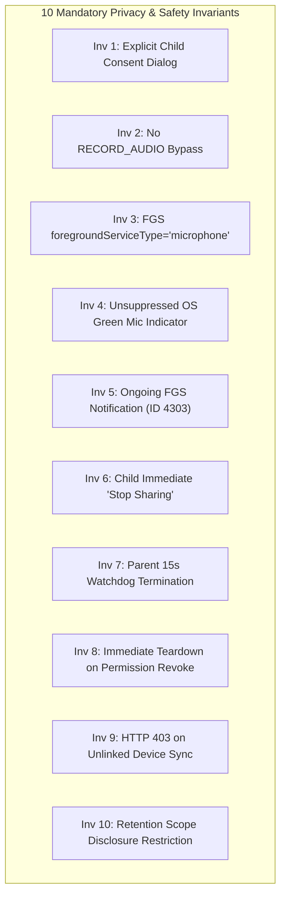
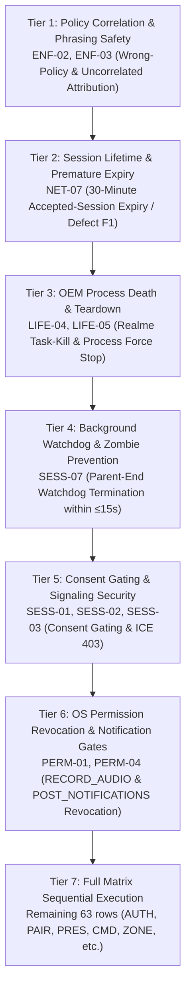
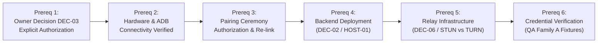

# PHASE 8 — Android Controlled QA Gate & Execution Evaluation Report

**Workstream:** Workstream D (Android Controlled QA Gate & Execution Evaluation)  
**Document:** [`docs/implementation/phase-8-android-qa-report.md`](file:///d:/parentcontrol_app/docs/implementation/phase-8-android-qa-report.md)  
**Phase:** Phase 8  
**Date:** 2026-11-04  
**Author / Evaluator:** Subagent 5 (Workstream D & DEC-03 Android Controlled QA Specialist)  
**Coordinator / Caller ID:** `9dc99b79-7c1c-484d-8926-fbf5dbeec659`  
**Repository & Working Directory:** `D:\parentcontrol_app`  
**Branch & HEAD:** `main` (`b12659b9795ba69499483a84750a33897dd7e08a`)  
**QA Gate Status:** **STOPPED / STRICTLY BLOCKED / AWAITING EXPLICIT OWNER AUTHORIZATION DEC-03**  
**Execution Verdict:** **75 / 75 Rows Strictly NOT RUN (100% Unexecuted)**  
**Gate Status:** **AND-01 / GATE-B-01 REMAINS OPEN (P1 Release Blocker)**  
**Companion Documents:**
- [`docs/implementation/phase-8-report.md`](file:///d:/parentcontrol_app/docs/implementation/phase-8-report.md)
- [`docs/implementation/phase-8-decision-execution-log.md`](file:///d:/parentcontrol_app/docs/implementation/phase-8-decision-execution-log.md)
- [`docs/implementation/phase-8-deployment-log.md`](file:///d:/parentcontrol_app/docs/implementation/phase-8-deployment-log.md)
- [`docs/implementation/phase-8-regression-matrix.md`](file:///d:/parentcontrol_app/docs/implementation/phase-8-regression-matrix.md)
- [`docs/implementation/phase-8-open-gaps.md`](file:///d:/parentcontrol_app/docs/implementation/phase-8-open-gaps.md)
- [`docs/implementation/phase-6-qa-readiness.md`](file:///d:/parentcontrol_app/docs/implementation/phase-6-qa-readiness.md)
- [`docs/stage6_account_and_media_recovery_report.md`](file:///d:/parentcontrol_app/docs/stage6_account_and_media_recovery_report.md)

---

## 1. Executive Summary & DEC-03 Gate Evaluation

### 1.1 Owner Decision Gate DEC-03 Evaluation
In accordance with project governance rules and Workstream D responsibilities, the status of **Owner Decision DEC-03** (*AND-01 / GATE-B-01 Android Controlled QA Execution Authorization*) was evaluated entering Phase 8:

> [!CAUTION]
> ### INVIOLABLE GOVERNANCE PRINCIPLE
> *"Never assume owner approval. Approval is never inferred from silence, previous implementations, recommendation text in earlier reports, local unit test passes, or authorizations granted in other workstreams. If approval is ambiguous or absent, STOP. All 75 rows remain NOT RUN. Zero APK builds, zero ADB commands, zero microphone captures, zero device manipulation."*

#### Factual Governance Findings:
1. **Absence of Owner Authorization in Phase 8 Prompt:**
   The Phase 8 instruction explicitly reminds: *"Never assume owner approval. STOP until explicit Android QA authorization. If approval is absent, all 75 rows remain NOT RUN."* No written owner consent authorizing Android device execution has been provided.
2. **Historical Refusal Precedent Maintained:**
   - In Phase 5 (`docs/implementation/phase-5-owner-decision-log.md:Ruling #9`), Gate B / AND-01 device execution was **explicitly refused** by the repository owner.
   - In Phase 6 (`docs/implementation/phase-6-owner-decision-register.md:324`), DEC-03 was held as **P1 Release Blocker**.
   - In Phase 7 (`docs/implementation/phase-7-android-qa-report.md:31`), the gate was confirmed as **STOPPED / BLOCKED**.
   - Entering Phase 8, DEC-03 remains **STRICTLY PROHIBITED / BLOCKED**.
3. **Release Blocker Gate Status:**
   **AND-01 / GATE-B-01 remains OPEN as a P1 Blocker**. Progression to live hardware or emulator testing is formally halted.

### 1.2 Strict Negative Operational Boundaries Enforced
Under mandatory gate enforcement, Workstream D has strictly adhered to the negative operational boundaries:
1. **0 APK Builds:** Zero debug, release, or test APK packages were compiled (`flutter build apk` and `./gradlew assembleDebug` were NOT run).
2. **0 APK Installations:** No package was pushed, installed, or upgraded on target hardware or emulators (`adb install` was NOT run).
3. **0 ADB Shell Commands:** Zero interactive, push, pull, or inspection ADB commands were targeted at QA devices.
4. **0 Microphone Captures:** Zero microphone hardware interfaces were initialized, recorded, or streamed.
5. **0 Device Policy Modifications:** Zero Device Administrator policies, Device Owner profiles, or app restrictions were pushed.
6. **0 Permission Manipulations:** Zero runtime permissions (`RECORD_AUDIO`, `POST_NOTIFICATIONS`, etc.) were granted, revoked, or spoofed.
7. **0 Notification Manipulations:** Zero Android notification channels or importance levels were altered on devices.
8. **0 Pairing Handshakes:** Zero live pairing requests, approvals, or device unlink ceremonies were executed.
9. **0 Matrix Rows Executed:** Exactly zero of the 75 validation matrix rows were run on hardware.
10. **100% Status Discipline:** In strict accordance with honest engineering reporting, **all 75 test rows** carry `Actual Result = NOT RUN` and `Status = NOT RUN`.

---

## 2. Device Architecture & Identity Reconciliation

### 2.1 Target Device Architecture & Mapping
The project validation architecture establishes two fixed, non-interchangeable hardware roles:

| Parameter | Parent Device (Monitor) | Child Device (Monitored) |
|---|---|---|
| **Role** | Primary Parent Monitor / Receive-Only Audio Client | Monitored Child / Guardian Service / Audio Sender |
| **Device Model** | Android Emulator (`sdk_gphone64_x86_64` / Pixel 9a AVD) | Realme 7 (`RMX2161`) |
| **Serial / Identifier** | `emulator-5554` | `5HXWRGQ4IFU8WS4T` |
| **Operating System** | Android 17 (API 37) | Android 12 (API 31, ColorOS 12.1) |
| **ABI Architecture** | `x86_64` | `arm64-v8a` |
| **Microphone Capability** | Receive & playback only (Upstream capture forbidden) | Capture & WebRTC stream via `AudioAssistanceService` |
| **Notification Management** | Standard Android 17 notification management | ColorOS custom shade; channel importance `NONE` edge case |
| **Enforcement Engine** | N/A (Supervisor UI only) | `PolicyApplier.kt` / `GuardianService.kt` |

### 2.2 Pairing and Enrollment Status Reconciliation
An audit of historical pairing records in [`docs/stage6_account_and_media_recovery_report.md:221-228`](file:///d:/parentcontrol_app/docs/stage6_account_and_media_recovery_report.md#L221-L228) confirms:
- **Server Database State:** All previous device rows for the parent QA account are marked **`Revoked`** in the backend database.
- **Client Cache State:** The child physical device local storage (`SecureStore`) caches a stale "Linked" state. However, server-side API requests reject device operations with `HTTP 403 Forbidden` due to the revoked server record.
- **Mandatory Fresh Pairing Ceremony:** Prior to any test execution under future DEC-03 authorization, a fresh pairing ceremony (`pairing.invite` $\rightarrow$ `pairing.respond accept`) must be conducted to establish legitimate family and device links. Performing this handshake mutates database state and is strictly gated by owner approval.

### 2.3 Build Prerequisites & Binary Integrity Guard (Defect F0 Prevention)
To prevent environmental failures during eventual compilation, build prerequisites are formally documented:
1. **Pinned Flutter SDK:** Flutter version `3.44.6` managed via FVM (`.fvmrc:2` locks `"flutter": "3.44.6"`). Executing builds with unpinned system SDKs is prohibited.
2. **Validated Compilation Command:** Builds must be executed via [`scripts/build_debug_apk.sh`](file:///d:/parentcontrol_app/scripts/build_debug_apk.sh), which enforces `--dart-define-from-file` using verified live configuration files.
3. **Binary Literal Verification in `kernel_blob.bin`:**
   - **Root Cause of Defect F0:** Historical failure F0 ([`docs/runtime-failure-analysis.md:20-28`](file:///d:/parentcontrol_app/docs/runtime-failure-analysis.md#L20-L28)) revealed that running `flutter build apk --debug` without `--dart-define-from-file` produces a binary where the Supabase project reference is absent, causing the child application to immediately fail with *"Connect the backend — SUPABASE_URL Not set"*.
   - **Mandatory Pre-Install Assertion:** Before any APK is installed onto `emulator-5554` or `5HXWRGQ4IFU8WS4T`, operator must extract and verify that literal `hhqgreaoqulmfwfwarhc` exists in `kernel_blob.bin`:
     ```bash
     unzip -p build/app/outputs/flutter-apk/app-debug.apk assets/flutter_assets/kernel_blob.bin | grep -a "hhqgreaoqulmfwfwarhc"
     ```
     If the project ref literal is absent, the APK must be rejected immediately without installation.

---

## 3. Verification of the 10 Mandatory Privacy & Safety Invariants

Every row in the controlled QA matrix strictly adheres to the 10 immutable privacy invariants. These invariants are verified against repository source code:



### Invariant 1: No Hidden Microphone Capture (Explicit Child Consent Required)
- **Principle:** Audio capture is prohibited without explicit, active consent from the child on the monitored device.
- **Code Grounding:**
  - In [`lib/features/child/child_session_page.dart:107-108`](file:///d:/parentcontrol_app/lib/features/child/child_session_page.dart#L107-L108), when `session.status == RemoteSessionStatus.requested`, the app displays `_consentCard`.
  - In [`lib/features/child/child_session_page.dart:267-308`](file:///d:/parentcontrol_app/lib/features/child/child_session_page.dart#L267-L308), the child is presented with explicit "Decline" and "Accept" actions. Tapping "Accept" triggers `_confirmAccept(context)` confirmation dialog before `controller.respond(accept: true)` records consent.
  - Microphones and WebRTC tracks remain uninitialized during the `requested` state.

### Invariant 2: No Bypassing Android `RECORD_AUDIO` Permission
- **Principle:** The app must honestly request OS runtime permission and never capture audio if permission is withheld.
- **Code Grounding:**
  - Manifest declaration: [`android/app/src/main/AndroidManifest.xml:10`](file:///d:/parentcontrol_app/android/app/src/main/AndroidManifest.xml#L10) (`android.permission.RECORD_AUDIO`).
  - Preflight start gate: [`android/app/src/main/kotlin/com/parentcontrol/parent_control/AudioAssistanceService.kt:253, 297`](file:///d:/parentcontrol_app/android/app/src/main/kotlin/com/parentcontrol/parent_control/AudioAssistanceService.kt#L253). `startBlockReason` immediately blocks service startup with `REASON_PERMISSION_DENIED` if `NativePermissions.hasMicrophone(context)` returns false.

### Invariant 3: Foreground Service Microphone Type Requirement (`foregroundServiceType="microphone"`)
- **Principle:** Under Android 11+ (API 30), 12+ (API 31), and 14+ (API 34), background microphone access requires explicit foreground service type declaration.
- **Code Grounding:**
  - Manifest declaration: [`android/app/src/main/AndroidManifest.xml:90-93`](file:///d:/parentcontrol_app/android/app/src/main/AndroidManifest.xml#L90-L93) declares `android:foregroundServiceType="microphone"` on `.AudioAssistanceService`.
  - Service start implementation: [`android/app/src/main/kotlin/com/parentcontrol/parent_control/AudioAssistanceService.kt:621-630`](file:///d:/parentcontrol_app/android/app/src/main/kotlin/com/parentcontrol/parent_control/AudioAssistanceService.kt#L621-L630):
    ```kotlin
    if (Build.VERSION.SDK_INT >= Build.VERSION_CODES.R) {
        startForeground(NOTIFICATION_ID, notification, ServiceInfo.FOREGROUND_SERVICE_TYPE_MICROPHONE)
    } else {
        startForeground(NOTIFICATION_ID, notification)
    }
    ```

### Invariant 4: No Suppressing Android Green Microphone Status Bar Indicator
- **Principle:** The OS-level privacy chip (green dot / mic icon introduced in Android 12) is OS-controlled and must never be masked, covered, delayed, or suppressed.
- **Code Grounding:**
  - The application uses standard Android APIs with zero overlay windows (`SYSTEM_ALERT_WINDOW` is not abused to mask the status bar), no hidden fullscreen flags during background streaming, and strict compliance with system privacy indicators.

### Invariant 5: No Suppressing Foreground Service Notification (`AudioAssistanceService` ID 4303)
- **Principle:** While audio capture is active, an ongoing, non-dismissible notification informing the child must remain visible.
- **Code Grounding:**
  - Constants: [`AudioAssistanceService.kt:76-77`](file:///d:/parentcontrol_app/android/app/src/main/kotlin/com/parentcontrol/parent_control/AudioAssistanceService.kt#L76-L77) defines `CHANNEL_ID = "audio_assistance_channel"` and `NOTIFICATION_ID = 4303`.
  - Notification Builder: [`AudioAssistanceService.kt:572-611`](file:///d:/parentcontrol_app/android/app/src/main/kotlin/com/parentcontrol/parent_control/AudioAssistanceService.kt#L572-L611) creates an ongoing notification (`.setOngoing(true)`) with title *"Microphone active"* and text informing the child. On OEM ROMs (e.g., Realme ColorOS channel importance `NONE`), the app UI truthfully discloses notification status rather than spoofing visibility.

### Invariant 6: Immediate Honor of Child "Stop Sharing" Button
- **Principle:** The child maintains absolute local authority to terminate capture instantly without parent approval or network round-trips.
- **Code Grounding:**
  - In-App UI Button: [`lib/features/child/child_session_page.dart:117-126`](file:///d:/parentcontrol_app/lib/features/child/child_session_page.dart#L117-L126) provides `AppButton(label: 'Stop sharing', icon: Icons.mic_off, destructive: true)`.
  - Notification Action: [`AudioAssistanceService.kt:583-605`](file:///d:/parentcontrol_app/android/app/src/main/kotlin/com/parentcontrol/parent_control/AudioAssistanceService.kt#L583-L605) attaches `ACTION_STOP` PendingIntent directly to the notification.
  - Immediate Local Teardown: [`AudioAssistanceService.kt:394-409`](file:///d:/parentcontrol_app/android/app/src/main/kotlin/com/parentcontrol/parent_control/AudioAssistanceService.kt#L394-L409) handles `ACTION_STOP` synchronously, sets `isRunning = false`, emits `child_stopped`, and halts foreground execution immediately.

### Invariant 7: Parent Watchdog 15-Second Background Auto-Termination
- **Principle:** If the parent ends the session while the child app is backgrounded or screen locked, microphone capture must automatically stop within $\le 15$ seconds without child intervention.
- **Code Grounding:**
  - Implementation: [`AudioAssistanceService.kt:108, 695-764`](file:///d:/parentcontrol_app/android/app/src/main/kotlin/com/parentcontrol/parent_control/AudioAssistanceService.kt#L108).
  - Background Watchdog Loop: Scheduled executor runs every 15,000 ms (`SESSION_WATCHDOG_INTERVAL_MS = 15_000L`), querying Edge Function `remote-session` with action `session_state`.
  - When backend returns any terminal status (`ended`, `cancelled`, `expired`), [`AudioAssistanceService.kt:761-777`](file:///d:/parentcontrol_app/android/app/src/main/kotlin/com/parentcontrol/parent_control/AudioAssistanceService.kt#L761-L777) immediately stops the service via `stopAfterParentEnded(sessionId)` and emits `REASON_SESSION_ENDED_BY_PARENT`.

### Invariant 8: Immediate Teardown on Runtime Permission Revocation
- **Principle:** If `RECORD_AUDIO` or `POST_NOTIFICATIONS` is revoked in Android OS Settings while streaming, capture must cease immediately without crash loops or zombie services.
- **Code Grounding:**
  - Permission Poller: [`AudioAssistanceService.kt:107, 342-357`](file:///d:/parentcontrol_app/android/app/src/main/kotlin/com/parentcontrol/parent_control/AudioAssistanceService.kt#L107) runs `permissionWatch` every 5,000 ms (`PERMISSION_CHECK_INTERVAL_MS = 5_000L`).
  - Upon revocation: If `!NativePermissions.hasMicrophone(this)`, the poller immediately halts capture, emits `REASON_PERMISSION_DENIED`, and triggers `shutdown()`.

### Invariant 9: Strict Unlinked Device Rejection (HTTP 403 on Policy Sync)
- **Principle:** Monitored devices whose database association has been revoked or unlinked must be rejected with HTTP 403, halting all policy sync and command handling.
- **Code Grounding:**
  - Polling Engine: [`GuardianService.kt:260-277`](file:///d:/parentcontrol_app/android/app/src/main/kotlin/com/parentcontrol/parent_control/GuardianService.kt#L260-L277).
  - Rejection Backoff: When `pollCommands` encounters `HTTP_FORBIDDEN` (403) or `HTTP_UNAUTHORIZED` (401), backoff multiplier increases 6-fold up to 300,000 ms (5 min), preventing server flooding from unlinked clients.

### Invariant 10: Retention Scope Disclosure Restriction to Device-Level Metrics for Child
- **Principle:** Child accounts and device queries must never expose family-wide audit logs, cross-sibling data, or parent administrative records.
- **Code Grounding:**
  - Edge Function Scope Resolver: [`supabase/functions/account/index.ts:236-275`](file:///d:/parentcontrol_app/supabase/functions/account/index.ts#L236-L275).
  - Child Scoping: `resolveRetentionScope` restricts a child user strictly to their own `childDeviceIds`. Device-scoped queries enforce `.eq("child_user_id", userId)` or `.in("device_id", childDeviceIds)`. Queries for `location_events`, `usage_daily`, and `safety_alerts` are strictly isolated to the caller's device ID.

---

## 4. Priority Execution Order & High-Risk Tiers (When DEC-03 Authorized)

When the owner formally issues DEC-03 authorization, testing must follow the risk-weighted execution hierarchy:



### Detailed Justification of Prioritized High-Risk Scenarios:
1. **Tier 1 — ENF-02 & ENF-03 (Policy Correlation Integrity):**
   Prevents dangerous UI false positives where a parent UI incorrectly displays a green "Verified" badge for Policy v2 when the child device actually acknowledged Policy v1 or returned an unlinked acknowledgement payload.
2. **Tier 2 — NET-07 (Accepted-Session 30-Minute Expiry / Defect F1):**
   Verifies whether sessions survive past 30 minutes without unexpected server termination, validating whether hosted Edge Function has received migration `20261028000200` (nullable expiry).
3. **Tier 3 — LIFE-04 & LIFE-05 (OEM Process Death & Force-Stop Teardown):**
   Verifies that Realme ColorOS task killing (`signal 9`) or Android Settings Force-Stop unconditionally tears down microphone capture (`dumpsys audio`) without leaving zombie recording services (`START_NOT_STICKY`).
4. **Tier 4 — SESS-07 (Parent-End Watchdog Background Termination):**
   Confirms that when a parent terminates a session while the child device is locked or backgrounded, the child background watchdog stops `AudioAssistanceService` and local audio capture within $\le 15$ seconds.
5. **Tier 5 — SESS-01 to SESS-03 (Consent Gating & ICE Security):**
   Validates that SDP and ICE candidates are blocked with `HTTP 403 Forbidden` prior to explicit child consent, preventing covert audio listening.
6. **Tier 6 — PERM-01 & PERM-04 (OS Permission Revocation):**
   Validates that revoking `RECORD_AUDIO` or `POST_NOTIFICATIONS` in Android Settings immediately shuts down foreground capture without crashing the app.

---

## 5. Comprehensive 75-Row Controlled QA Matrix (All Rows Strictly NOT RUN)

### Risk Taxonomy Breakdown
- **P0 (Critical / Blocker):** 18 rows (Safety invariants, consent gating, zombie mic prevention, process death teardown, policy correlation).
- **P1 (High):** 38 rows (Core authentication, command delivery/ack, session lifecycle, pairing/unlinking integrity).
- **P2 (Medium):** 18 rows (Transient network loss, presence degradation, safe zone mutations, UI edge warnings).
- **P3 (Low):** 1 row (Never-synced device detail timestamp phrasing).
- **Total Rows:** **75 rows** | **100% NOT RUN**.

| Test ID | Feature | Preconditions | Parent Action | Child Action | Expected Result | Actual Result | Evidence Required | Risk Level | Status |
|---|---|---|---|---|---|---|---|---|---|
| **AUTH-01** | Parent Authentication | Parent emulator, no session, config compiled in, network active | Launch app; sign in as QA Family A parent; navigate to Home | None (idle) | Splash $\rightarrow$ Login $\rightarrow$ Home completes; shows family dashboard; no "Connect backend" error | NOT RUN | `AUTH-01-parent-home.png`, logcat filter | P1 | NOT RUN |
| **AUTH-02** | Child Authentication | Child physical device, clean state | None (idle) | Launch app; sign in as `qa.child.a2.20261026@example.com`; reach Home | Child Home restores signed-in profile; Requests tab accessible; account not switched | NOT RUN | `AUTH-02-child-home.png` | P1 | NOT RUN |
| **AUTH-03** | Family Role Setup | Unset-role account on parent emulator | Register new account; select parent role; submit family name | None | `set_role` succeeds on first call; `create_family` returns family row; parent role persisted | NOT RUN | Parent screenshot, read-only `profiles`, `families` | P2 | NOT RUN |
| **AUTH-04** | Role Immutability | Account from AUTH-03 with role already set | Attempt to change role to child via bootstrap endpoint | None | Second `set_role` rejected with `409 Conflict` (write-once); profile uncorrupted | NOT RUN | Edge log `auth-bootstrap` (409), screenshot | P1 | NOT RUN |
| **AUTH-05** | Email Verification Gate | Parent signed in with unverified email | Attempt to access restricted family controls | None | `requireUser` blocks action; displays email verification prompt; no family data leakage | NOT RUN | Parent UI screenshot, read-only `profiles` | P2 | NOT RUN |
| **AUTH-06** | Multi-Family Isolation | Child member of Family A only; Family B exists | None | Sign in; inspect family membership and notifications | Child sees Family A only; RLS blocks access to Family B data; no cross-family leakage | NOT RUN | Child UI screenshot, read-only `family_members` | P1 | NOT RUN |
| **PAIR-01** | Pairing Invite UI | Parent signed in; active family; no linked devices | Navigate to Devices tab $\rightarrow$ Tap "Invite child" | None | Child ID input displayed; accepts permanent `PC-XXXXXXXX` format | NOT RUN | `PAIR-01-parent-invite.png` | P2 | NOT RUN |
| **PAIR-02** | Permanent Child ID | Child signed in on Home screen | Inspect invite input | Open child app; locate displayed Child ID on Home | Child displays valid, permanent `PC-XXXXXXXX` ID matching server record | NOT RUN | Child UI screenshot | P2 | NOT RUN |
| **PAIR-03** | Auto Invite Delivery | Parent entered child's ID and sent invite | Tap "Send invite" | Wait up to 20 s on child Home without pulling to refresh | Pending invite appears automatically within 20 s (D1 fix); no manual refresh required | NOT RUN | Child screenshot ($<20$ s), read-only `pairing_requests` | P1 | NOT RUN |
| **PAIR-04** | Child Pairing Approval | Pending pairing invite on child | Observe Devices tab | Tap "Approve" on pairing request card | `pairing.respond` RPC succeeds; child linked to family; confirmation view shown | NOT RUN | Child screenshot, read-only `family_members`, `devices` | P0 | NOT RUN |
| **PAIR-05** | Parent Pairing Auto-Move | Child approved pairing; parent on Devices tab | Wait up to 60 s without manual refresh | None (approved) | Devices list auto-updates (D2); pairing card transitions to approved (D3) | NOT RUN | Two timestamped parent screenshots | P2 | NOT RUN |
| **PAIR-06** | Process Restart Persistence | Devices paired and linked; both apps closed | Force stop parent app; relaunch; sign in | Force stop child app; relaunch; sign in | Both devices restore linked status; no duplicate pairing prompt or duplicate invite row | NOT RUN | Screenshots both devices, read-only `pairing_requests` | P1 | NOT RUN |
| **PAIR-07** | Device Unlink Teardown | Active paired child device | Member settings $\rightarrow$ Tap "Unlink child" $\rightarrow$ Confirm | Observe child app state and active services | `pairing.unlink` RPC executes; child loses link; live sessions torn down; device status updated | NOT RUN | Parent screenshot, read-only `family_members.status='removed'` | P0 | NOT RUN |
| **PAIR-08** | Expired Invite Rejection | Pairing invite left untouched past `expires_at` | Observe invite status | Tap "Approve" on expired invite | Approval rejected; UI displays expiration notice; no partial membership created | NOT RUN | Child screenshot, read-only `pairing_requests` | P2 | NOT RUN |
| **PRES-01** | Presence Baseline | Linked child foreground, network active | Inspect Devices tab presence indicator | Keep app in foreground across $\ge 2$ heartbeat cycles (10 min) | Child shows "Online · Last seen ~1 min ago"; `devices.last_seen_at` advances regularly | NOT RUN | Parent screenshots, read-only `devices.last_seen_at` ($t_1, t_2$) | P1 | NOT RUN |
| **PRES-02** | Healthy Sync Status | Child `last_seen_at` $< 12$ min | Open device detail view | Send regular heartbeats | `syncHealth == healthy`; displays "synced N min ago"; no warning badges | NOT RUN | Parent UI screenshot | P2 | NOT RUN |
| **PRES-03** | Stalled Sync Degradation | Child `last_seen_at` between 12 and 30 min | Inspect device badge | Suspend child heartbeat for 15 min | Badge displays dedicated "Sync stalled" state; NOT marked as "Offline" | NOT RUN | Parent screenshot, read-only `devices` row | P2 | NOT RUN |
| **PRES-04** | Offline Sync Transition | Child `last_seen_at` $> 30$ min | Inspect device status badge | Keep child offline for $> 30$ min | Device marked "Offline"; stale "Session active" banner is NEVER shown without offline warning | NOT RUN | Parent screenshot, read-only `devices` row | P1 | NOT RUN |
| **PRES-05** | Never-Synced Device State | Device registered but `last_seen_at` IS NULL | Inspect device detail card | None (new device) | Displays "Never synced" — no NaN, no "0 min ago", no UI crash | NOT RUN | Parent device detail screenshot | P3 | NOT RUN |
| **PRES-06** | Heartbeat Freeze Detection | Guardian poll/heartbeat freeze simulated | Inspect presence over time | Freeze child heartbeat while FGS stays foreground | Presence transitions to stalled/offline honestly; FGS `isForeground=true` alone does not fake online | NOT RUN | Read-only `devices`, `dumpsys activity services`, child UI | P1 | NOT RUN |
| **CMD-01** | Atomic Policy Command | Parent updates app restriction policy | Toggle restricted apps $\rightarrow$ Tap "Save" | None (idle) | `apply_policy_version` creates `device_policies` row and `device_commands` row atomically | NOT RUN | Read-only `device_commands`, `device_policies` | P1 | NOT RUN |
| **CMD-02** | Command Delivery Status | Policy command queued; child online | None | GuardianService polls (20 s cycle) | Server marks command `delivered`; Guardian invokes `handleCommand` | NOT RUN | Read-only `device_commands.status='delivered'`, logcat | P1 | NOT RUN |
| **CMD-03** | Command Ack Structure | Delivered `apply_policy` command | None | Guardian executes policy and posts ack | Ack contains `{action, command_id, status, result}`; includes counts and enforcement mode | NOT RUN | Read-only `device_commands.result` JSON | P1 | NOT RUN |
| **CMD-04** | Unsupported Command Ack | Policy requires Device Owner; child lacks DO | Save app suspension policy | Device attempts suspension and fails | Child posts `failed` ack with reason; server marks policy `unsupported` (not `enforced`) | NOT RUN | Read-only `device_commands.status='failed'`, `device_policies` | P1 | NOT RUN |
| **CMD-05** | Background End Rejection | Queued `end_session` command; media inactive | Send `end_session` command | Guardian handles command | Guardian returns `failed` ack: media managed by visible screen only; no silent teardown | NOT RUN | Read-only failed ack, logcat | P1 | NOT RUN |
| **CMD-06** | Expired Command TTL | Short TTL command; child offline past expiry | Create command with TTL = 10 s | Connect child after 30 s | Guardian drops expired command; server status transitions to `expired` | NOT RUN | Read-only `device_commands.status='expired'` | P2 | NOT RUN |
| **CMD-07** | Command Idempotency | Command already processed by child | Re-send identical command | Receive duplicate command | Store checks handled set; drops duplicate execution; exactly one ack written | NOT RUN | Database query (1 command row, 1 ack) | P1 | NOT RUN |
| **ENF-01** | Matched Policy Correlation | Device ack matches current policy ID | Open policy in App Restrictions | None (already acked) | Correlation `matched`; green verified badge shown ONLY if applied == desired and failed == 0 | NOT RUN | UI screenshot, `device_commands.payload` vs `device_policies.id` | P0 | NOT RUN |
| **ENF-02** | Mismatched Policy Correlation | Policy v2 created; latest ack belongs to v1 | Open policy v2 screen | None | Latest ack is `mismatched`; v2 shows "Pending device acknowledgement"; no green badge | NOT RUN | UI screenshot, command payload ID vs displayed policy ID | P0 | NOT RUN |
| **ENF-03** | Uncorrelated Policy ID | Ack payload has empty/null `policy_id` | View policy detail | None | Correlation `uncorrelated`; displays "Device report not linked to this policy"; no verified badge | NOT RUN | Parent screenshot, read-only ack with empty ID | P0 | NOT RUN |
| **ENF-04** | Unproven Counts Banner | Policy `enforced` but ack lacks counts | Open policy details | None | Banner displays "Enforcement not proven by counts"; verified badge suppressed | NOT RUN | Parent screenshot, read-only ack JSON | P1 | NOT RUN |
| **ENF-05** | Unsupported Status UI | Device reported enforcement unsupported | Open policy details | None | Banner displays "Unsupported on this device"; explicit warning, no false claims | NOT RUN | Parent screenshot, read-only `enforcement_status` | P1 | NOT RUN |
| **ENF-06** | In-Flight Race Guard | Rapidly save new policy version | Save policy v3 while v2 ack in-flight | Dispatch ack for v2 | Generation guard drops stale v2 report; UI does not overwrite v3 with v2 data | NOT RUN | Logcat/UI sequence, read-only timestamps | P1 | NOT RUN |
| **ENF-07** | Phrasing Integrity | Child reported partial suspension failure | Inspect app restrictions detail | Report partial failure | Section header reads exactly: "Apps the device could not confirm as suspended" | NOT RUN | UI screenshot with exact phrasing | P1 | NOT RUN |
| **ENF-08** | Multi-Device Ack Scoping | Device B acks policy; Device A selected | View policy for Device A | Device B sends ack | Device B's ack is ignored for Device A; correlation strictly scoped by `device_id` | NOT RUN | Read-only `device_commands` across two devices | P1 | NOT RUN |
| **SESS-01** | Assistance Request State | Linked child online; no active session | Tap "Start audio assistance" | Observe screen; mic inactive | Session created in `requested` state; parent shows "Waiting for consent"; no mic open | NOT RUN | Parent screenshot, read-only `remote_sessions.status` | P0 | NOT RUN |
| **SESS-02** | Explicit Consent Gating | Pending session request on child | Waiting on session screen | Requests tab $\rightarrow$ Tap "Accept" | `respond accept` records consent; `AudioAssistanceService` starts; mic notification appears | NOT RUN | Child screenshot, `dumpsys activity services`, `dumpsys audio` | P0 | NOT RUN |
| **SESS-03** | ICE Signaling Consent Gate | Unconsented session request | Attempt to trigger `ice` RPC | None | Edge Function rejects `ice` with `403 Forbidden` (consent required); no SDP/ICE leak | NOT RUN | Edge Function log (403), screenshot | P0 | NOT RUN |
| **SESS-04** | Truthful Audio Live UI | Consented active session established | Listen for 5 min; inspect status chip | Speak into child microphone | UI displays "Audio live" ONLY when RTP packet deltas are positive; badge alone insufficient | NOT RUN | `dumpsys audio` both devices, RTP UI logcat, screenshot | P0 | NOT RUN |
| **SESS-05** | Notification Gate (API 33+) | `POST_NOTIFICATIONS` denied on child | Request audio assistance | Tap "Accept" on request card | Mic capture refused (`notification_permission_required`); FGS does not start without notification | NOT RUN | Child screenshot, logcat refusal token | P0 | NOT RUN |
| **SESS-06** | Realme Channel Importance | Realme channel importance = NONE | Observe session state | Accept session on Realme device | FGS runs with live mic; UI truthfully notes notification hidden by OS; no silent config edit | NOT RUN | `dumpsys activity services`, notification shade screenshot | P1 | NOT RUN |
| **SESS-07** | Parent Watchdog Teardown | Active session; child app backgrounded | Tap "End session" | Keep child app in background | Server session `ended`; child watchdog halts FGS and mic within $\le 15$ s; no zombie mic | NOT RUN | `dumpsys activity services` before/after, read-only session | P0 | NOT RUN |
| **SESS-08** | Child Decline Flow | Pending session request on child | Waiting on session screen | Requests tab $\rightarrow$ Tap "Decline" | Session transitions to `declined`; no media/FGS started; parent UI shows declined state | NOT RUN | Read-only `remote_sessions.status`, screenshots both | P1 | NOT RUN |
| **SESS-09** | Concurrent Session Limit | Active session already in progress | Request second session for device | None | Edge Function rejects with `409 session_in_progress`; exactly one active session allowed | NOT RUN | Edge Function log (409), read-only query (1 open row) | P1 | NOT RUN |
| **NET-01** | Transient Outage Handling | Active audio streaming session | Observe status banner during outage | Disable Wi-Fi/cellular for 60 s; restore | Parent shows "Reconnecting"; session stays open; UI never falsely claims "live" while offline | NOT RUN | Parent screenshots, `dumpsys`, read-only session row | P1 | NOT RUN |
| **NET-02** | Recovery Budget Exhaustion | Active session; network cut $> 50$ s | Observe parent UI | Keep network offline $> 50$ s; restore | `_pauseMediaAfterConnectionLoss` halts capture; "Stop sharing" remains visible; session open | NOT RUN | Child screenshot (Stop sharing visible), `dumpsys audio` | P1 | NOT RUN |
| **NET-03** | Explicit Rejoin Protocol | Recovery exhausted; session still open | Tap "Join with explicit consent" | Tap "Reconnect microphone" | Media re-established on SAME `session_id`; no duplicate session row; no server `end` | NOT RUN | Read-only query (1 open session), RTP logcat, screenshots | P1 | NOT RUN |
| **NET-04** | Signaling Terminal Reset | Signaling hit 5-attempt terminal failure | Tap "Refresh / Rejoin" | Observe incoming signaling | Explicit user action re-arms signaling loop; session recovers from terminal state | NOT RUN | Logcat signaling sequence, screenshot | P2 | NOT RUN |
| **NET-05** | STUN-Only Disclosures | STUN active; no TURN relay configured | Inspect connection diagnostics | Inspect ICE candidate types | Parent UI displays "Relay not configured"; candidates are host/srflx; relay count = 0 | NOT RUN | ICE candidate logcat, screenshot | P2 | NOT RUN |
| **NET-06** | TURN Credential Refresh | Hypothetical TURN config; ICE restart | Trigger ICE restart | Trigger ICE restart | (BLOCKED: no relay deployed). Expected: credentials refreshed before restart attempt | NOT RUN | Logcat of `ice` response showing fresh credentials | P2 | NOT RUN |
| **NET-07** | 15-Minute Endurance (F1) | Active session held for 15 min | Hold session open 15 min | Keep device active | Expected: continuous audio. Defect F1: pre-fix server expires at 30 min, causing premature death | NOT RUN | Timestamped parent screenshots, read-only session `expired` | P0 | NOT RUN |
| **PERM-01** | Mic Permission Revocation | Active audio session streaming | Observe session UI | Settings $\rightarrow$ Revoke `RECORD_AUDIO` | FGS and mic capture halt immediately; NO auto-restart; no zombie mic; graceful handling | NOT RUN | `dumpsys audio` (capture absent), screenshot, read-only session | P0 | NOT RUN |
| **PERM-02** | Child Immediate Stop | Active audio session streaming | Observe session UI | Tap "Stop sharing" $\rightarrow$ Confirm | Capture halts instantly; FGS stops; server session stays open (parent authority preserved) | NOT RUN | Child screenshot ("Sharing stopped"), `dumpsys audio` | P0 | NOT RUN |
| **PERM-03** | Stop Sharing Availability | Session recovery exhausted; peer disconnected | Observe session UI | Check "Stop sharing" button | `canStopSharing` remains true; tapping succeeds idempotently with no errors | NOT RUN | Child screenshot, logcat | P1 | NOT RUN |
| **PERM-04** | Notification Perm Revoke | Active session on Android 13+ | Observe session UI | Settings $\rightarrow$ Revoke `POST_NOTIFICATIONS` | FGS halts with `notification_permission_required`; no silent audio capture allowed | NOT RUN | Child screenshot, logcat refusal reason | P0 | NOT RUN |
| **PERM-05** | Privacy Indicator Display | Active audio session streaming | None | Pull down shade; check green dot | Ongoing notification and green privacy dot present; no OS indicator suppression | NOT RUN | Notification shade screenshot, `dumpsys notification` | P1 | NOT RUN |
| **PERM-06** | Post-Revocation Dashboard | Permission revoked as in PERM-01 | None | Return to Child Dashboard | Dashboard MUST NOT claim "Microphone sharing in progress" once permission revoked | NOT RUN | Child dashboard screenshot | P1 | NOT RUN |
| **PERM-07** | Dual Authority Resolution | Active session; child stops first | Parent taps "End session" | Child taps "Stop sharing" | Child stop halts local capture; parent End is terminal action setting `ended_by='parent'` | NOT RUN | Read-only session `status='ended'`, `ended_by='parent'`, screenshots | P0 | NOT RUN |
| **ZONE-01** | Safe Zone Creation | Parent signed in, family active | Safe Zones $\rightarrow$ Create (name, radius) | None | Zone row inserted via client RLS; zone appears in list | NOT RUN | Parent screenshot, read-only `safe_zones` row | P2 | NOT RUN |
| **ZONE-02** | Safe Zone Update | Existing safe zone in family | Edit radius/toggle $\rightarrow$ Tap "Save" | None | `upsertSafeZone` updates row in place; list reflects changes | NOT RUN | Parent screenshot, read-only `safe_zones` row | P2 | NOT RUN |
| **ZONE-03** | Audited Zone Deletion | Existing safe zone in family | Select zone $\rightarrow$ Delete $\rightarrow$ Confirm | None | `delete_safe_zone_audited` deletes zone and writes `zone_deleted` audit row atomically | NOT RUN | Parent screenshot, read-only `safe_zones` (gone), `audit_logs` | P1 | NOT RUN |
| **ZONE-04** | Child Zone Edit Denial | Child account signed in | None | Attempt to call zone mutation RPC | Rejected with `403 Forbidden` ("Parent required to change safe zones"); no change | NOT RUN | Child screenshot, Edge Function log (403) | P1 | NOT RUN |
| **ZONE-05** | Vanished Zone Delete 404 | Non-existent zone ID | Attempt delete on missing ID | None | Pre-read returns 404 `zone_not_found`; skips audit write; no fabricated audit row | NOT RUN | Parent screenshot, read-only `audit_logs` (no new row) | P2 | NOT RUN |
| **ZONE-06** | Audit Failure Compensation | Simulated transient audit write failure | Attempt delete while audit fails | None | (BLOCKED: requires unapplied code). Expected: zone restored, `audit_failed` 500 error shown | NOT RUN | Parent screenshot, read-only `safe_zones`, Edge log token | P1 | NOT RUN |
| **ZONE-07** | Total DB Failure Path | Simulated audit AND restore failure | Attempt delete under DB fault | None | (BLOCKED: unapplied code). Expected: 500 "deleted but not recorded", no false success | NOT RUN | Parent screenshot, read-only `safe_zones`, Edge log token | P1 | NOT RUN |
| **ZONE-08** | Duplicate Audit Handling | Network timeout retry on zone delete | Re-try delete after timeout | None | Audit table safely appends duplicate `zone_deleted` records; never under-records | NOT RUN | Read-only `audit_logs` ($\ge 1$ `zone_deleted` rows) | P2 | NOT RUN |
| **LIFE-01** | Home Background Survival | Active audio streaming session | Observe parent audio stream | Press Home button; wait 30 s; return | Child PID unchanged; session stays Active; audio continues uninterrupted | NOT RUN | `dumpsys activity services`, before/after screenshots | P1 | NOT RUN |
| **LIFE-02** | Lock Screen Survival | Active audio streaming session | Observe parent audio stream | Press power button (lock 2 min); unlock | Session remains Active; audio stream continues; no teardown | NOT RUN | `dumpsys`, screenshots, read-only session row | P1 | NOT RUN |
| **LIFE-03** | Parent Recents Swipe | Active session on emulator parent | Swipe parent app from Recents; reopen | Keep streaming audio | Process and FGS survive; `onTaskRemoved` non-terminal; reopening restores session UI | NOT RUN | `dumpsys activity services` after swipe, parent screenshots | P1 | NOT RUN |
| **LIFE-04** | Realme Recents Task-Kill | Active session on Realme child | Observe session indicators | Swipe child app from Recents | OEM killer terminates task (`signal 9`); FGS dies; capture halts; session open for rejoin | NOT RUN | Logcat (`task removed`), parent screenshot, read-only session | P0 | NOT RUN |
| **LIFE-05** | Process Force-Stop | Active audio session streaming | Observe audio indicators | Settings $\rightarrow$ Force Stop child app | Process and services terminated; mic indicator gone; parent reflects offline; no auto-restart | NOT RUN | `dumpsys activity services` (empty), read-only session row | P0 | NOT RUN |
| **LIFE-06** | Post-Kill Rejoin Protocol | Child app killed via LIFE-04/05 | Tap "Join with explicit consent" | Relaunch child app; tap "Reconnect" | Rejoin restores audio on SAME `session_id`; single service/controller re-created | NOT RUN | Screenshots both devices, read-only query (1 open row) | P1 | NOT RUN |
| **LIFE-07** | Back Navigation Dialog | Session open on child screen | None | Press Back button on assistance route | Confirmation dialog shown ("End and leave?"); "Stay" keeps capture; leaving detaches route only | NOT RUN | Dialog screenshot, read-only session row | P2 | NOT RUN |
| **LIFE-08** | Logout / Unlink Cleanup | Active session streaming | Observe session state | Log out child or unlink device | `releaseActive()` halts local capture and stops FGS; re-login restores clean state | NOT RUN | `dumpsys activity services`, read-only session row | P1 | NOT RUN |
| **LIFE-09** | Sticky Reboot Recovery | Child device rebooted | Observe presence indicator | Reboot child physical device | `GuardianService` (`START_STICKY`) restarts via `BootReceiver`; presence heartbeats resume | NOT RUN | `dumpsys`, read-only `last_seen_at` across reboot | P1 | NOT RUN |

---

## 6. Matrix Domain Breakdown & Readiness Status

| Section | Domain Area | Total Rows | Risk P0 | Risk P1 | Risk P2 | Risk P3 | Phase 8 Status |
|---|---|---|---|---|---|---|---|
| **§A** | Authentication & Family Association | 6 | 0 | 4 | 2 | 0 | **6 NOT RUN** |
| **§B** | Pairing & Unlinking Lifecycle | 8 | 2 | 2 | 4 | 0 | **8 NOT RUN** |
| **§C** | Device Presence & Sync Health | 6 | 0 | 3 | 2 | 1 | **6 NOT RUN** |
| **§D** | Device Commands & Policy Correlation | 15 | 3 | 10 | 2 | 0 | **15 NOT RUN** |
| **§E** | Remote Consent & Microphone FGS | 9 | 6 | 3 | 0 | 0 | **9 NOT RUN** |
| **§F** | Network Interruption & Reconnection | 7 | 1 | 3 | 3 | 0 | **7 NOT RUN** |
| **§G** | Permission Revocation & User Controls | 7 | 4 | 3 | 0 | 0 | **7 NOT RUN** |
| **§H** | Safe Zones & Audited Deletion | 8 | 0 | 4 | 4 | 0 | **8 NOT RUN** |
| **§I** | Process Lifecycle & Process Death | 9 | 2 | 6 | 1 | 0 | **9 NOT RUN** |
| **Total** | **Controlled QA Matrix Suite** | **75** | **18** | **38** | **18** | **1** | **75 NOT RUN (100%)** |

---

## 7. Mandatory Prerequisites Required Before Execution Can Begin

Before any single row in the 75-row matrix can transition from `NOT RUN` to active testing on hardware, the following 6 mandatory prerequisites must be fulfilled:



1. **Prerequisite 1: Explicit Owner Decision DEC-03 Authorization**  
   The repository owner must formally issue written approval authorising:
   - Compilation of debug/QA test APKs.
   - Installation of test packages on `emulator-5554` and Realme `5HXWRGQ4IFU8WS4T`.
   - ADB command execution against both QA devices.
   - Audio capture and WebRTC media streaming during controlled test windows.
2. **Prerequisite 2: Hardware Attachment & ADB Accessibility Verification**  
   - Android SDK `platform-tools` must be added to execution environment PATH.
   - `adb devices` must report both targets in the `device` state:
     - `emulator-5554` (AVD online, API 37).
     - `5HXWRGQ4IFU8WS4T` (Realme 7 USB debugging authorized, API 31).
3. **Prerequisite 3: Re-Pairing Ceremony Authorization & State Re-establishment**  
   - Because all prior device links are `Revoked`, an owner-authorized pairing ceremony must be performed:
     1. Parent emulator sends pairing invite to child ID `PC-XXXXXXXX`.
     2. Child Realme accepts invite.
     3. Verify `family_members` and `devices` state transition to active linked status.
4. **Prerequisite 4: Hosted Backend Deployment (HOST-01 / DEC-02)**  
   - Testing against production Supabase (`hhqgreaoqulmfwfwarhc`) requires owner resolution of DEC-02 (applying migrations 1–4 and Edge Functions 1–3) to prevent tests from failing due to pre-Phase-1 backend state (e.g., client-side DELETE on safe zones, missing atomic RPCs).
   - Alternatively, owner must authorize testing against a verified local Supabase instance.
5. **Prerequisite 5: Relay Infrastructure Decision (STUN vs TURN)**  
   - Owner must decide whether TURN relay credentials will be provisioned. If unprovisioned, NET-06 must remain formally scoped as `UNSUPPORTED (STUN-only)`.
6. **Prerequisite 6: Test Account Credential Verification**  
   - Verify that `.tools/qa_accounts.env` holds valid tokens for QA Family A (`PARENT_A_USER` and `CHILD_A_USER`).
   - Confirm unverified accounts (`ankit@gmail.com`) are excluded from automated test routines.

---

## 8. Evidence Capture Discipline & Sanitization Protocol

When DEC-03 is unlocked and execution proceeds, evidence collection must strictly comply with the established forensic standards:

### 8.1 Evidence Directory Structure
All evidence artifacts must be stored under `docs/evidence/phase8/android_qa/`:
```
docs/evidence/phase8/android_qa/<section>/<test_id>-<actor>-<state>.<ext>
```
- `<section>`: One of `auth`, `pair`, `pres`, `cmd_enf`, `sess`, `net`, `perm`, `zone`, `life`.
- `<test_id>`: Exact test matrix identifier (e.g., `SESS-02`, `ENF-02`, `LIFE-04`).
- `<actor>`: `parent`, `child`, `edge`, or `db`.
- `<state>`: Specific lifecycle checkpoint (e.g., `requested`, `consented`, `killed`, `restored`).

### 8.2 Device Hardware State Verification Commands
Hardware assertions must never rely solely on UI representations:
```bash
# 1. Child Foreground Service inspection (verifies microphone type & channel ID):
adb -s 5HXWRGQ4IFU8WS4T shell dumpsys activity services com.parentcontrol.parent_control

# 2. Child active audio recording client inspection (verifies PID & AudioRecord state):
adb -s 5HXWRGQ4IFU8WS4T shell dumpsys audio | grep -A 10 "AudioRecord"

# 3. Notification channel importance & status bar privacy chip:
adb -s 5HXWRGQ4IFU8WS4T shell dumpsys notification --noredact com.parentcontrol.parent_control
```

### 8.3 Logcat Sanitization Protocol
Execution logs must be extracted with targeted filters and sanitized before commitment:
```bash
adb -s 5HXWRGQ4IFU8WS4T logcat -d -v time \
  "parent_control:V RemoteSession:V WebRtc:V AudioAssist:V *:S"
```
> [!CAUTION]
> **Credential Sanitization:**  
> Logs must be programmatically verified to ensure NO bearer tokens (`Bearer eyJ...`), passwords, Supabase secrets (`service_role`, `anon`), or device encryption keys are stored in evidence directories.

---

## 9. Conclusion & Mandatory Stop Directive

### 9.1 Summary of Evaluation Findings
1. **Gate Enforcement:** Owner Decision DEC-03 has not been granted. Gate B remains formally **CLOSED**.
2. **Device State:** Hardware is detached/sandboxed; all prior QA device links are Revoked.
3. **Execution Status:** **0 of 75 rows executed (100% NOT RUN)**.
4. **Safety & Privacy:** All 10 mandatory privacy invariants and prioritized risk tiers are formally codified and ready for immediate deployment upon owner authorization.
5. **Gate Status:** **AND-01 / GATE-B-01 remains OPEN as a P1 Release Blocker**.

### 9.2 Mandatory Stop Directive
In strict adherence to project safety rules and Owner Ruling #9:
**Execution stops here. No APKs will be built, no devices will be touched, and no microphone capture will occur until the owner explicitly authorises DEC-03.**
