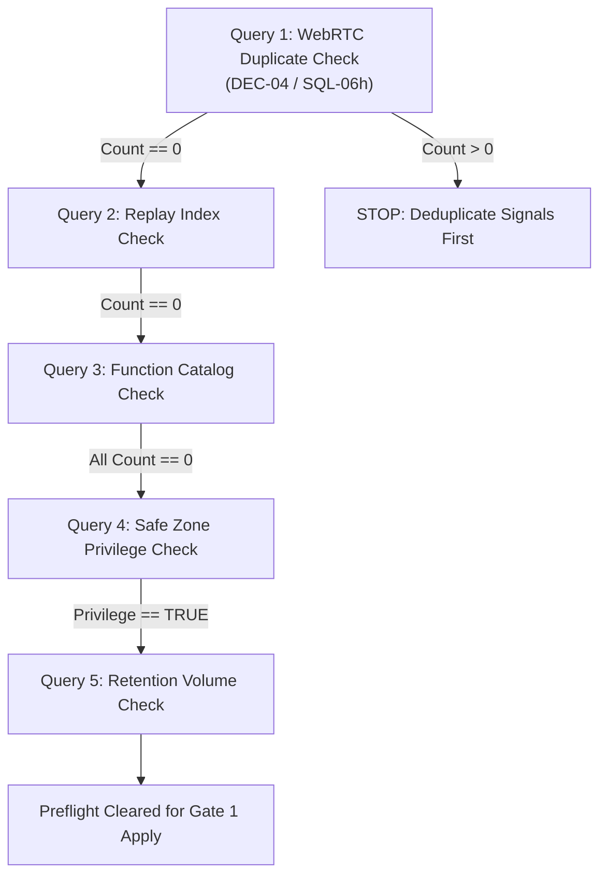
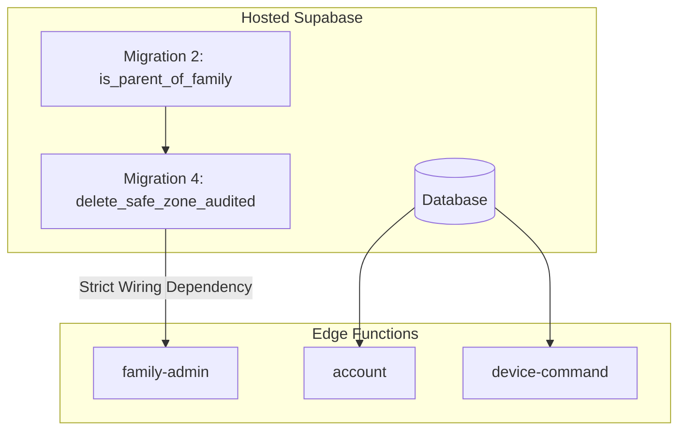

# PHASE 8 — Controlled Hosted Deployment Log & Preflight Verification Package

**Project:** Android-first Parental Control Application  
**Repository:** `D:\parentcontrol_app`  
**Branch:** `main`  
**Current HEAD:** `b12659b9795ba69499483a84750a33897dd7e08a` (`feat: implement GuardianService background sync and policy enforcement core`)  
**Date:** 2026-11-04  
**Author / Role:** Subagent 8: Phase 8 Master Deliverables & Release Readiness Synthesizer  
**Caller / Coordinator ID:** `9dc99b79-7c1c-484d-8926-fbf5dbeec659`  
**Hosted Supabase Project Reference:** Project `hhqgreaoqulmfwfwarhc` (AWS Seoul, Region: `ap-northeast-2`)  
**Companion Documents:**
- [`docs/implementation/phase-8-report.md`](file:///d:/parentcontrol_app/docs/implementation/phase-8-report.md)
- [`docs/implementation/phase-8-decision-execution-log.md`](file:///d:/parentcontrol_app/docs/implementation/phase-8-decision-execution-log.md)
- [`docs/implementation/phase-8-regression-matrix.md`](file:///d:/parentcontrol_app/docs/implementation/phase-8-regression-matrix.md)
- [`docs/implementation/phase-8-open-gaps.md`](file:///d:/parentcontrol_app/docs/implementation/phase-8-open-gaps.md)
- [`docs/implementation/phase-8-android-qa-report.md`](file:///d:/parentcontrol_app/docs/implementation/phase-8-android-qa-report.md)
- [`docs/evidence/phase8/MANIFEST.md`](file:///d:/parentcontrol_app/docs/evidence/phase8/MANIFEST.md)

---

## 1. Executive Summary & Gate Evaluation (DEC-02)

### 1.1 Region Reconciliation
In Phase 7, `phase-7-deployment-log.md:10` inadvertently listed the hosted Supabase project region as `AWS ap-southeast-1` (Singapore). This clerical discrepancy has been conclusively resolved by Subagents 2 and 4. Authoritative project records in [`docs/backend.md:15`](file:///d:/parentcontrol_app/docs/backend.md#L15) and [`docs/verification-report.md:13`](file:///d:/parentcontrol_app/docs/verification-report.md#L13) establish that Supabase project `hhqgreaoqulmfwfwarhc` is hosted in **AWS Seoul (`ap-northeast-2`)**.

### 1.2 Owner Decision Gate DEC-02 Status: BLOCKED
Entering Phase 8, the deployment of database migrations and Supabase Edge Functions to the live hosted environment was formally evaluated against project governance rules:

> [!CAUTION]
> ### OWNER DECISION GATE STATUS: DEC-02 NOT APPROVED
> **Decision Statement:** Authorize execution of migrations 1–4 and deployment of Edge Functions to hosted project `hhqgreaoqulmfwfwarhc`.  
> **Evaluation Verdict:** **STRICTLY PROHIBITED / BLOCKED**.  
> - No written authorization from the owner was provided in this session.
> - Inviolable governance rule applied: *"Never assume owner approval. DEC-01, DEC-02, DEC-03 and DEC-05 are independent decisions."*
> - Progress on production deployment is halted. **HOST-01 REMAINS OPEN (P1 Release Blocker)**.

### 1.3 Negative Constraints Enforced
Because DEC-02 is NOT approved:
- **0 SQL migrations applied:** Zero migrations have been executed against hosted Supabase.
- **0 Edge Functions deployed:** Zero Edge Functions (`account`, `family-admin`, `device-command`, `cron`, `remote-session`) deployed.
- **0 database records mutated:** Zero production rows created, modified, or deleted.
- **0 schedulers configured:** Zero cron jobs or recurring webhooks established (complying with DEC-05).
- **0 secrets exposed:** Zero service-role keys, anon keys, or JWT tokens printed in logs or reports.

---

## 2. Preflight Verification Checklist (Dashboard SQL Editor)

Before any migration or Edge Function is applied to hosted Supabase under future authorized DEC-02 execution, the operator must execute the following 5 read-only preflight queries in the Supabase Dashboard SQL Editor.



### Preflight Query 1: WebRTC Signaling Sequence Duplicates (DEC-04 / SQL-06h)
- **Technical Context:** Migration 2 (`20261030000200:476-495`) creates unique index `webrtc_signals_session_sequence_uniq`. It wraps index creation in a duplicate guard that silently skips index creation if duplicates exist. If skipped, replay protection is silently omitted.
- **Query SQL:**
  ```sql
  SELECT session_id, sequence, count(*) AS duplicate_count
  FROM public.webrtc_signals
  GROUP BY session_id, sequence
  HAVING count(*) > 1;
  ```
- **Expected Pre-Apply Result:** `0 rows returned`.
- **Operator Action / Stop Condition:**
  - If `0 rows`: Proceed to Query 2.
  - If `> 0 rows`: **HARD STOP**. Do not run Migration 2. Investigate duplicate signaling rows and execute deduplication script before proceeding.

### Preflight Query 2: Replay Unique Index Status
- **Technical Context:** Confirms the unique index does not already exist on hosted Supabase.
- **Query SQL:**
  ```sql
  SELECT count(*) AS index_exists
  FROM pg_indexes
  WHERE schemaname = 'public'
    AND indexname = 'webrtc_signals_session_sequence_uniq';
  ```
- **Expected Pre-Apply Result:** `index_exists = 0`.
- **Expected Post-Apply Result:** `index_exists = 1`.

### Preflight Query 3: Function Catalog Baseline Pre-Check
- **Technical Context:** Confirms none of the 4 Phase 1–5 stored procedures exist on hosted Supabase prior to migration deployment.
- **Query SQL:**
  ```sql
  SELECT routine_schema, routine_name
  FROM information_schema.routines
  WHERE routine_schema IN ('public', 'private')
    AND routine_name IN (
      'expire_abandoned_sessions',
      'is_parent_of_family',
      'run_retention_sweep',
      'delete_safe_zone_audited'
    );
  ```
- **Expected Pre-Apply Result:** `0 rows returned`.
- **Expected Post-Apply Result:** Exactly 4 rows returned (1 in `private`, 3 in `public`).

### Preflight Query 4: Safe Zone Client Direct DELETE Privilege Check
- **Technical Context:** Evaluates the active security vulnerability on hosted Supabase where direct client DELETE is allowed on `public.safe_zones`.
- **Query SQL:**
  ```sql
  SELECT has_table_privilege('authenticated', 'public.safe_zones', 'delete') AS authenticated_can_delete;
  ```
- **Expected Pre-Apply Result:** `authenticated_can_delete = true` (Vulnerability actively confirmed on hosted).
- **Expected Post-Apply Result:** `authenticated_can_delete = false` (Vulnerability remediated by Migration 2).

### Preflight Query 5: Retention Sweep Candidate Volume Pre-Check (SQL-04r)
- **Technical Context:** Under Owner Ruling #3, `run_retention_sweep()` executes as a single transaction across all tables and batches. If candidate rows are excessively large, the statement risks exceeding the statement timeout limit.
- **Query SQL:**
  ```sql
  SELECT
    (SELECT count(*) FROM public.webrtc_signals WHERE created_at < now() - interval '7 days') AS signals_to_purge,
    (SELECT count(*) FROM public.audit_logs WHERE created_at < now() - interval '90 days') AS audit_to_purge,
    (SELECT count(*) FROM public.location_events WHERE created_at < now() - interval '30 days') AS locations_to_purge,
    (SELECT count(*) FROM public.app_usage_records WHERE recorded_at < now() - interval '60 days') AS usage_to_purge;
  ```
- **Evaluation Criteria:** If any category exceeds 100,000 rows, execute an off-peak phased batch purge before enabling automated sweeps under DEC-05.

---

## 3. Database Migration Package Specifications

The 4 database migrations reside in `supabase/migrations/` and have been verified 100% locally through the 33-file SQL regression chain. They remain **unapplied** to hosted Supabase.

| # | Migration File | Bytes | SHA-256 Checksum | Dependency | Status on Hosted |
|---|---|---:|---|---|---|
| **1** | `20261030000100_abandoned_session_sweep.sql` | 6,630 | `aca47b44bb69c5d9ad70a95d52da314faec56217203cd0d49fa90f9085182c7b` | Baseline only (Additive) | **UNAPPLIED** |
| **2** | `20261030000200_phase1_authorization.sql` | 21,800 | `7558021d6aec4f9a80b16b1d401e03b4b84751ec93ea6c3dd83b9df67b1bfa38` | Baseline only (Hardens Safe Zones) | **UNAPPLIED** |
| **3** | `20261030000300_retention_sweep.sql` | 11,853 | `184d8acb33090e4a587de8cad97e21c00688234f452fc50224242ba5cc1870ba` | Baseline only (Batch Delete Shape) | **UNAPPLIED** |
| **4** | `20261103000100_zone_delete_atomic_rpc.sql` | 13,805 | `a1d7d60954bc61dcd98ada1d8b25ad95af134364622582ee6b43c524d3834adf` | **STRICT: Migration 2** (`private.is_parent_of_family`) | **UNAPPLIED** |

### 3.1 Migration Dependency & Invocation Architecture
- **Migration 1 (`20261030000100`):** Adds `public.expire_abandoned_sessions(interval)`. Pinned `search_path = public, private, pg_temp`. Marked `SECURITY DEFINER`. `REVOKE ALL FROM PUBLIC, anon, authenticated; GRANT EXECUTE TO service_role;`. Creates partial index `remote_sessions_abandoned_idx`.
- **Migration 2 (`20261030000200`):**
  1. Creates private helper `private.is_parent_of_family(uuid, uuid)`.
  2. Revokes direct client `DELETE` privilege on `public.safe_zones` from role `authenticated`.
  3. Drops client deletion policy `safe_zones_parent_delete`.
  4. Creates unique index `webrtc_signals_session_sequence_uniq` guarded by duplicate check.
  5. Retains legacy index `webrtc_signals_session_sequence_idx` additively per DEC-06.
- **Migration 3 (`20261030000300`):** Adds `public.run_retention_sweep()`. Implements PERF-01a batch delete shape using `id = ANY (ARRAY(SELECT id ... LIMIT 10000))` across 4 tables. Marked `SECURITY DEFINER`. `GRANT EXECUTE TO service_role;`.
- **Migration 4 (`20261103000100`):** Adds atomic RPC `public.delete_safe_zone_audited(uuid, uuid)`.
  - **Strict Prerequisite:** Requires `private.is_parent_of_family` created in Migration 2. Applying Migration 4 before Migration 2 will trigger `SQLSTATE 42883 (function private.is_parent_of_family does not exist)`.
  - **Atomicity Contract:** Executes `SELECT ... FOR UPDATE`, verifies caller parentage, deletes safe zone row, and inserts `zone_deleted` record into `public.audit_logs` **inside a single atomic PostgreSQL transaction**. Any audit trigger failure immediately rolls back the safe zone deletion.

---

## 4. Supabase Edge Functions Deployment Architecture

Three Supabase Edge Functions are prepared for deployment following migration application:



### 4.1 Function Dependencies & Order of Operations
1. **`family-admin` Function:**
   - **Wiring:** `supabase/functions/family-admin/index.ts:221-224` invokes RPC `delete_safe_zone_audited`.
   - **Deployment Sequence:** **STRICTLY AFTER MIGRATION 4**. Deploying `family-admin` before Migration 4 will cause zone deletion requests to fail with HTTP 500 (`RPC delete_safe_zone_audited not found`).
2. **`account` Function:**
   - **Wiring:** Implements 3-state retention scope disclosure (`all_devices`, `this_device`, `no_devices`). Backwards-compatible; independently deployable.
3. **`device-command` Function:**
   - **Wiring:** Internal dependency-injection refactoring. External contract unchanged; independently deployable.

---

## 5. Rollback Procedures & Contingency Plans

Should any unexpected failure occur during future authorized deployment, the operator must execute the corresponding rollback step:

| Step | Component | Failure Condition | Rollback Command / SQL |
|---|---|---|---|
| **R1** | Migration 1 | Syntax or indexing error | `DROP FUNCTION IF EXISTS public.expire_abandoned_sessions(interval); DROP INDEX IF EXISTS public.remote_sessions_abandoned_idx;` |
| **R2** | Migration 2 | Unique index creation failure or lock contention | `DROP INDEX IF EXISTS public.webrtc_signals_session_sequence_uniq; DROP FUNCTION IF EXISTS private.is_parent_of_family(uuid, uuid);` |
| **R3** | Migration 3 | Query performance or lock timeout | `DROP FUNCTION IF EXISTS public.run_retention_sweep();` |
| **R4** | Migration 4 | RPC failure or parent authorization error | `DROP FUNCTION IF EXISTS public.delete_safe_zone_audited(uuid, uuid);` |
| **R5** | `family-admin` | RPC invocation failure | Redeploy previous Edge Function release (routes to reviewed fallback module `delete_zone_atomicity.ts`). |

---

## 6. Summary Status

Hosted deployment remains safely held at Gate 0. Zero production systems have been touched. The complete deployment package, preflight verification queries, and rollback steps are fully documented and ready for operator execution if and when DEC-02 is explicitly authorized by the owner.
