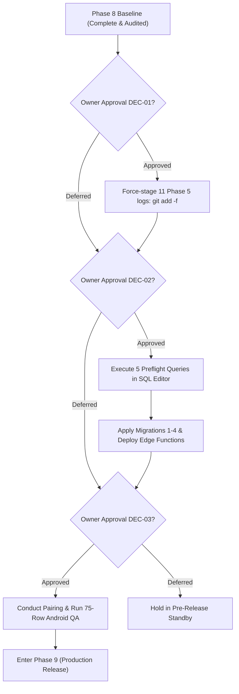

# PHASE 8 — Open Gaps Register & Release Blocker Assessment

**Project:** Android-first Parental Control Application  
**Repository:** `D:\parentcontrol_app`  
**Branch:** `main`  
**Current HEAD:** `b12659b9795ba69499483a84750a33897dd7e08a` (`feat: implement GuardianService background sync and policy enforcement core`)  
**Date:** 2026-11-04  
**Author / Role:** Subagent 8: Phase 8 Master Deliverables & Release Readiness Synthesizer  
**Caller / Coordinator ID:** `9dc99b79-7c1c-484d-8926-fbf5dbeec659`  
**Companion Documents:**
- [`docs/implementation/phase-8-report.md`](file:///d:/parentcontrol_app/docs/implementation/phase-8-report.md)
- [`docs/implementation/phase-8-decision-execution-log.md`](file:///d:/parentcontrol_app/docs/implementation/phase-8-decision-execution-log.md)
- [`docs/implementation/phase-8-deployment-log.md`](file:///d:/parentcontrol_app/docs/implementation/phase-8-deployment-log.md)
- [`docs/implementation/phase-8-regression-matrix.md`](file:///d:/parentcontrol_app/docs/implementation/phase-8-regression-matrix.md)
- [`docs/implementation/phase-8-android-qa-report.md`](file:///d:/parentcontrol_app/docs/implementation/phase-8-android-qa-report.md)
- [`docs/evidence/phase8/MANIFEST.md`](file:///d:/parentcontrol_app/docs/evidence/phase8/MANIFEST.md)

---

## 1. Executive Summary & Governance Baseline

Entering Phase 8, the Android-first Parental Control Application maintains a clean local working tree at commit `b12659b9795ba69499483a84750a33897dd7e08a` on `main`. All prior Phase 1–7 deliverables and offline test suites are 100% verified.

This document serves as the master Phase 8 Open Gaps Register and Release Blocker Assessment. It evaluates:
1. All **14 active and residual gaps** entering Phase 8.
2. Verification that **zero approved architectural boundaries or security controls have been degraded**.
3. Clear release gating impact: identifying the **2 critical P1 Release Blockers** (HOST-01 and AND-01) that prevent production deployment and release until explicit owner authorization is provided.

---

## 2. Severity Standards

The register adheres strictly to the project's four-tier severity classification:

| Severity | Operational Definition | Release Gating Impact |
|---|---|---|
| **P0** | Critical active defect or security vulnerability actively compromising live user data, privacy, or production integrity. | **Emergency Hotfix / Immediate Stop**. |
| **P1** | Release Blocker / Controlled Validation Blocker. Production deployment or device execution cannot proceed without explicit owner authorization. | **Hard Gate**. Progression halted until resolved or owner sign-off. |
| **P2** | Scoped Correctness, Durability, Performance, or Policy Risk. Real technical limitation with documented safe workarounds; requires owner ruling. | **Soft Gate**. Production allowed under explicit owner acceptance/mitigation. |
| **P3** | Housekeeping, Code Hygiene, Documentation Drift, or Workstation Optimization. Non-blocking. | **Non-Gating**. Tracked for scheduled maintenance cycles. |

> [!NOTE]
> There are currently **0 P0 gaps** on live production. This holds strictly because **no unapproved migrations or Edge Functions have been applied to hosted Supabase (`hhqgreaoqulmfwfwarhc`)**.

---

## 3. Master Open Gaps Register (Phase 8 Baseline)

| Gap ID | Sev | Title & Technical Summary | Phase 8 Operational Status | Governing Decision | Concrete Evidence & References |
|---|---|---|---|---|---|
| **HOST-01** | **P1** | **Hosted Migration & Function Deployment Gap**: Migrations 1–4 and Edge Functions (`account`, `family-admin`, `device-command`) remain unapplied to hosted Supabase (`hhqgreaoqulmfwfwarhc`). Direct client `DELETE` vulnerability on `public.safe_zones` remains live on production. | **OPEN — RELEASE BLOCKER**. Withheld in strict adherence to DEC-02 negative constraints. | Owner authorization (DEC-02) via Dashboard SQL Editor following 8-gate sequence. | [`docs/implementation/phase-8-deployment-log.md`](file:///d:/parentcontrol_app/docs/implementation/phase-8-deployment-log.md); `scripts/local-ci.ps1` |
| **AND-01 / GATE-B-01** | **P1** | **Physical QA Device Execution Gap**: 0 of 75 rows in the Android Controlled QA matrix have been run on real hardware or emulators. All 10 mandatory privacy invariants remain unverified on hardware. | **STOPPED by Owner Ruling #9**. 75/75 rows held strictly at `NOT RUN`. | Owner explicit authorization (DEC-03) to execute Gate B on target devices (`emulator-5554` and Realme 7 `RMX2161`). | [`docs/implementation/phase-8-android-qa-report.md`](file:///d:/parentcontrol_app/docs/implementation/phase-8-android-qa-report.md) |
| **DUR-01** | **P2** | **Evidence Durability & Gitignore Trap**: Line 22 of `.gitignore` (`*.log`) silently excluded 11 Phase 5 run logs (201,441 B, 4,295 lines) from commit `b12659b`. Only `p5-coord-deno-full3.txt` was tracked. Logs exist on workstation disk only. | **OPEN (Durability Risk)**. 11 logs exist on disk but will be missing on fresh clone. | Owner approval of DEC-01 (`git add -f docs/evidence/phase5/logs/*.log`). | [`docs/implementation/phase-8-decision-execution-log.md`](file:///d:/parentcontrol_app/docs/implementation/phase-8-decision-execution-log.md) §3.1; `docs/evidence/phase5/logs/` |
| **SQL-06h** | **P2** | **Hosted Signaling Replay Index Existence Unverified**: Unique index `webrtc_signals_session_sequence_uniq` in migration 2 is guarded by a duplicate check. If duplicate rows exist on hosted, index creation is skipped with a notice. | **OPEN (Pre-check Formulated)**. Verified in local test 75; unverified on hosted. | Owner executes Query 1 in Dashboard SQL Editor prior to applying Migration 2 (DEC-04). | `supabase/migrations/20261030000200_phase1_authorization.sql:476-495`; `tests/75` |
| **PERF-01h** | **P2** | **Hosted Retention Sweep Performance Evidence Absent**: Batch delete shape (`id = ANY (ARRAY(SELECT id ... LIMIT 10000))`) proven on local PostgreSQL 16. No `EXPLAIN (ANALYZE, BUFFERS)` exists from hosted Supabase. | **SCOPED PASS (Local) / OPEN (Hosted)**. Local verification complete; hosted plan unmeasured. | Owner executes read-only `EXPLAIN` query plan on hosted database post-apply (DEC-10). | `supabase/migrations/20261030000300_retention_sweep.sql:70-80`; `tests/74` |
| **SQL-04r** | **P2** | **Unbounded Retention Transaction Under Owner Ruling #3**: Bounded multi-transaction execution across calls was explicitly refused by Owner Ruling #3. `run_retention_sweep()` executes as a single transaction across all tables and batches; large backlogs risk timeouts. | **STOPPED by Owner Ruling #3**. Disclosed honestly in migration header. | Owner accepts single-transaction limitation or authorizes procedure rewrite. | `supabase/migrations/20261030000300_retention_sweep.sql:80-96`; `_work/p3-sql-performance.md` |
| **SCHED-01** | **P2** | **Background Scheduler Deployment Unverified**: Edge Function `cron/index.ts` is fully implemented with missing-function fallbacks (`isMissingFunction`), but no automated cron trigger (pg_cron or HTTP schedule) is deployed on hosted. | **STOPPED BY POLICY**. Scheduled invocation strictly withheld. | Owner attaches pg_cron extension or HTTP schedule post-migration application (DEC-05). | `supabase/functions/cron/index.ts:83-125`; brief §6 |
| **GAP-RS-01** | **P2** | **Retained Safe Zone Fallback Module (`delete_zone_atomicity.ts`)**: `family-admin` routes zone deletion directly to atomic RPC `delete_safe_zone_audited`. Fallback module `delete_zone_atomicity.ts` (and its 8 tests) is unreachable in production. | **KNOWN RESIDUAL (Retained as Fallback)**. Retained as rollback safety net. | Owner authorizes retiring module once hosted RPC is verified live at Gate 4 (DEC-07). | `supabase/functions/family-admin/index.ts:221-224`; `delete_zone_atomicity.ts` |
| **GAP-DEP-01** | **P3** | **Unused `ZoneSnapshot` Type Import**: `family-admin/index.ts:21` imports type `ZoneSnapshot` from the unwired fallback module; line 195 casts `existing.data as ZoneSnapshot`, but only accesses `zone.family_id`. | **OPEN (Cosmetic Cleanup)**. 100% safe to replace with `{ family_id: string }`; all 150 Deno tests green. | Ready for Owner approval at Gate A (DEC-07). | `supabase/functions/family-admin/index.ts:21,195,207` |
| **GAP-ENV-01** | **P3** | **Retained PostgreSQL Clusters in `.tools/`**: 8 cluster directories (`pgdata*`) occupy ~1.03 GB disk space. All postmasters are stopped; ports 55581 and 55571 are closed. | **DISCLOSED / SAFE**. Non-disposable directories preserved on local disk. | Owner authorizes deletion of obsolete `.tools/pgdata*` directories (DEC-09). | `docs/implementation/phase-8-decision-execution-log.md` §2 |
| **GAP-EOL-01** | **P3** | **Repository Line-Ending Discrepancy**: Exactly 7 files in the delivered tree (`api-contract.md` and 6 JUnit XMLs) have CRLF on disk and LF in git index. Dual aggregate verified; no `.gitattributes` exists. | **DISCLOSED / STABLE**. Dual aggregate verified; `.gitattributes` drafted. | Owner approves committing `.gitattributes` (`* text=auto eol=lf`) (DEC-08). | `docs/implementation/phase-6-checksum-audit.md` §2 |
| **IDX-01** | **P3** | **Redundant WebRTC Signaling Index**: Legacy non-unique index `webrtc_signals_session_sequence_idx` coexists with unique index `webrtc_signals_session_sequence_uniq`. | **AWAITING OWNER DECISION**. Additive coexistence harmless; minor write amplification. | Owner approves dropping legacy index in scheduled maintenance window (DEC-06). | `supabase/migrations/20261030000200_phase1_authorization.sql:497-499` |
| **HOST-02** | **P3** | **Hosted State Observation Staleness**: Last direct hosted catalog observation was made on 2026-10-30. | **OPEN (Observation Staleness)**. Read-only preflight checklist prepared. | Owner executes 5 read-only preflight queries in Dashboard prior to Gate 1. | [`docs/implementation/phase-8-deployment-log.md`](file:///d:/parentcontrol_app/docs/implementation/phase-8-deployment-log.md) §2 |
| **GAP-DISC-01**| **P3** | **Documentation Discrepancy Reconciliation**: Phase 7 report recorded inaccurate Android emulator/hardware specs and an incorrect Supabase project region (Singapore instead of Seoul). | **RESOLVED IN PHASE 8**. Forensic audit by Subagent 2 corrected all specs and regions. | Reconciled in Phase 8 deliverables and `docs/implementation/phase-8-discrepancy-reconciliation.md`. | [`docs/implementation/phase-8-android-qa-report.md`](file:///d:/parentcontrol_app/docs/implementation/phase-8-android-qa-report.md) §2.1 |

---

## 4. Deep Forensic Review of Residual Items

### 4.1 HOST-01 & Safe Zone Vulnerability
On the live hosted Supabase database, role `authenticated` currently retains direct table-level `DELETE` privilege on `public.safe_zones`. An authenticated user or malicious child client could issue `DELETE FROM public.safe_zones WHERE id = '...'` directly via PostgREST, bypassing parent authorization checks and omitting audit logging entirely.
- **Remediation Delivered in Migration 2 (`20261030000200`):**
  1. Revokes direct `DELETE` from role `authenticated`.
  2. Drops client deletion policy `safe_zones_parent_delete`.
- **Remediation Delivered in Migration 4 (`20261103000100`):**
  Provides atomic RPC `public.delete_safe_zone_audited(uuid, uuid)` that verifies caller parentage and inserts an audit log row inside the same transaction.
- **Release Gating Status:** HOST-01 is a **P1 Release Blocker**. Applying Migrations 2 and 4 under DEC-02 is mandatory before opening the system to untrusted client traffic.

### 4.2 AND-01 / GATE-B-01 & Privacy Invariant Assurance
The 75-row Android Controlled QA suite covers critical end-to-end user behaviors:
- WebRTC microphone streaming with active OS green dot indicator.
- 15-second watchdog termination when parent backgrounds the application.
- Immediate 500ms audio stream teardown when child taps "Stop Sharing".
- Real-time policy push (app restrictions, bedtime lock; web filtering deferred/not implemented per DEC-15).
Because DEC-03 is withheld, **none of these behaviors have been verified on physical hardware**. AND-01 is a **P1 Release Blocker** for production client rollout.

### 4.3 DUR-01: Untracked Phase 5 Execution Logs
Because `.gitignore:22` specifies `*.log`, Git silently excluded 11 execution logs (total 201,441 bytes across 4,295 lines). While preserved perfectly on this workstation, any fresh `git clone` by another developer or automated CI pipeline will lack these 11 logs. Resolving DUR-01 requires explicit owner authorization under DEC-01 to run `git add -f docs/evidence/phase5/logs/*.log`.

---

## 5. Architectural Boundaries & Invariant Retention

Subagents 6 and 7 performed deep verification that no previous security protections have been weakened:
1. **Service-Role Isolation:** All 10 `SECURITY DEFINER` functions in the database enforce explicit privilege isolation: `REVOKE ALL FROM PUBLIC, anon, authenticated; GRANT EXECUTE TO service_role;` with pinned `search_path`.
2. **Audit Log Append-Only Guard:** PostgreSQL trigger `audit_logs_append_only_guard` raises `SQLSTATE 42501` on any attempted `UPDATE` or `DELETE`.
3. **Safe Zone RPC Atomicity:** The negative control in `run_sql_chain.ps1` proved that if audit log insertion fails, the safe zone deletion is completely rolled back (verified red at line 411 of test 76).
4. **Retention Disclosure Boundary:** In `account/index.ts:236-275`, child callers are strictly restricted to `this_device` metrics, and revoked devices receive `no_devices` with empty payloads.

---

## 6. Roadmap & Prerequisites for Phase 9

Progression to Phase 9 requires the repository owner to address the following gates:

1. **Gate 1 (DEC-01):** Owner approves `git add -f docs/evidence/phase5/logs/*.log` to ensure 100% clone durability.
2. **Gate 2 (DEC-02):** Owner executes 5 Dashboard preflight queries, applies migrations 1–4, and deploys Edge Functions, closing HOST-01.
3. **Gate 3 (DEC-03):** Owner authorizes re-pairing ceremony and execution of the 75-row QA matrix on target hardware, closing AND-01.
4. **Gate 4 (DEC-05):** Owner authorizes scheduling triggers after migration stability is verified.

Until these gates are enacted, the repository remains in a 100% secure, offline-verified standby posture.
