# PHASE 9 — Workstream F: DEC-05 Scheduler Policy & Data Retention Architecture Audit

**Project:** Android-first Parental Control Application  
**Repository:** `D:\parentcontrol_app`  
**Branch:** `main`  
**Current HEAD:** `b12659b9795ba69499483a84750a33897dd7e08a`  
**Date:** 2026-11-04  
**Author / Role:** Subagent 6: Scheduler & Retention Policy Analyst  
**Coordinator ID:** `69ce22be-3642-4007-a757-b448f71c7ebc`  
**Governing Decision:** DEC-05 (Scheduler Deployment & Data Retention Policy)  
**Decision Status:** **DEC-05: APPROVED — CHOICE B (ON-DEMAND EXECUTION ONLY).** (corrected 2026-11-04; this header originally read `PENDING / STOPPED BY POLICY (P2)`)  

---

## 1. Executive Summary & Governance Assertion

In strict conformance with Phase 9 governance protocols and the project's inviolable negative operational boundaries:
1. **DEC-05 Status is Formally PENDING:** No scheduled jobs, background daemons, cron extension hooks, or recurring cloud webhooks have been created, activated, or enabled.
   > Dated correction (2026-11-04, semantics finalised in the R5 micro-correction pass): **DEC-05: APPROVED — CHOICE B (ON-DEMAND EXECUTION ONLY).** What remains prohibited is **automation only**: no `pg_cron`, no Supabase scheduled trigger, no recurring cron webhook and no automated scheduler activation. Choice B does **not** prohibit retention-sweep execution as such — authorised manual / on-demand execution of `run_retention_sweep()` and `expire_abandoned_sessions()` **is** the approved operating model. Neither this documentation pass nor any Phase 9 pass authorises or executes a sweep: an on-demand invocation against hosted Supabase is a production mutation requiring separate written owner authorisation. Approval of Choice B ratifies the on-demand posture; it does not activate any scheduler. The sentence above is preserved as the historical pre-decision record.
2. **Explicit Owner Authorization Mandatory:** Under Owner Ruling #3 and the Master Decision Register, automated scheduling is **strictly prohibited** without separate, explicit, written authorization from the project owner.
3. **Zero Automated Scheduling Active:** All automatic database maintenance, telemetry data purges, and session expiry routines are **100% disabled by default**. The database and Edge Functions operate exclusively in an **on-demand execution posture**.

---

## 2. Comprehensive Scheduler State Audit (pg_cron & Supabase Config)

A forensic audit of all repository migration scripts, configuration manifests, and Edge Function definitions was executed to verify the dormant state of schedulers.

### 2.1 Audit Findings by Component

| Component / Artifact | File Location | Observed Implementation State | Automated Scheduler Active? |
|---|---|---|---|
| **Abandoned Session Migration** | `supabase/migrations/20261030000100_abandoned_session_sweep.sql` | Defines partial index `remote_sessions_abandoned_idx` and `SECURITY DEFINER` function `public.expire_abandoned_sessions(p_max_age interval)`. Permissions restricted: `REVOKE ALL FROM PUBLIC, anon, authenticated; GRANT EXECUTE TO service_role;`. Contains **zero** calls to `cron.schedule` or external webhooks. | **NO (100% Dormant)** |
| **Data Retention Sweep Migration** | `supabase/migrations/20261030000300_retention_sweep.sql` | Defines indexes `webrtc_signals_created_idx`, `audit_logs_created_idx` and `SECURITY DEFINER` batch function `public.run_retention_sweep()`. Permissions restricted: `REVOKE ALL FROM PUBLIC, anon, authenticated; GRANT EXECUTE TO service_role;`. Explicit header contract: *"There is no pg_cron and no hosted scheduler in this phase."* | **NO (100% Dormant)** |
| **Initial Schema Cron Guard** | `supabase/migrations/20260101000100_functions.sql:949-970` | Contains conditional block: `if exists (select 1 from pg_extension where extname = 'pg_cron') then ... else raise notice 'pg_cron not installed; schedule ... manually'`. `pg_cron` extension is **not** installed in hosted or local setups. | **NO (Guarded & Inactive)** |
| **Supabase Configuration** | `supabase/config.toml` | Defines `[functions.cron]` with `verify_jwt = false`. Contains **no** `[cron]`, `[db.cron]`, or scheduled webhook trigger blocks. | **NO (Disabled by Default)** |
| **Cron Edge Function Handler** | `supabase/functions/cron/index.ts` | Entrypoint requiring HTTP `POST` authenticated via constant-time comparison against `CRON_SECRET` header `x-cron-secret`. Contains guard: if `CRON_SECRET` is unset or `< 16` characters, raises HTTP 503 (`cron_not_configured`). Deployed secret `CRON_SECRET` is absent on hosted environment. | **NO (Self-Gated / 503 Guarded)** |
| **Opportunistic Session Sweeper** | `supabase/functions/_shared/remote_session_lifecycle.ts` | `withAbandonedSweep` executes `expire_abandoned_sessions` in-band prior to `request_remote_session`. It is strictly synchronous/reactive, not a background scheduler. | **NO (Reactive Only)** |

### 2.2 Verification of Extension Status
- **PostgreSQL Extension `pg_cron`:** Absent from active schema definitions. Not enabled on hosted Supabase project `hhqgreaoqulmfwfwarhc`.
- **Operating System Tasks:** Zero Windows scheduled tasks, zero systemd services, and zero standalone daemon processes configured.
- **Hosted Cloud Triggers:** Zero Supabase scheduled functions, zero GitHub Actions cron workflows, and zero AWS EventBridge rules exist.

---

## 3. Operational Analysis: On-Demand vs. Automated Execution

### 3.1 Retention Sweep Execution Model Analysis

The single server-side retention procedure is `public.run_retention_sweep()`, which purges expired signaling, audit, location, and application usage data.

```mermaid
flowchart TD
    subgraph OnDemandExecution["On-Demand Model (DEC-05 APPROVED Choice B - On-Demand Only)"]
        OD1["Manual CLI / SQL Editor Trigger"] --> OD2["Single DB Transaction: run_retention_sweep()"]
        OD2 --> OD3["Backlog Deletion (10k batches)"]
        OD3 --> OD4["Append-Only Audit Marker Inserted"]
        OD4 --> OD5["Reports Show Stale 'last_sweep_at' Between Runs"]
    end

    subgraph AutomatedExecution["Automated Model (Proposed under DEC-05 Approval)"]
        AU1["Nightly Cron / Scheduler Trigger"] --> AU2["Bounded Off-Peak Execution"]
        AU2 --> AU3["Zero Backlog Accumulation (<24h data)"]
        AU3 --> AU4["Continuous COPPA/GDPR Window Compliance"]
    end
```



#### A. Storage Growth Between Sweeps
- **`public.webrtc_signals` (7-Day Retention Window):**
  - High write amplification during remote audio assistance sessions (SDP offers, answers, ICE candidate exchanges up to 16 KiB per payload).
  - Without scheduled execution, signaling payloads accumulate indefinitely. On an active system, hundreds of megabytes of ephemeral signaling rows accumulate, bloating the table and indexes (`webrtc_signals_session_sequence_uniq`, `webrtc_signals_created_idx`).
- **`public.audit_logs` (365-Day Retention Window):**
  - Append-only event store. Growth is linear with system events (session transitions, policy pushes, admin activities).
  - Under on-demand execution, records older than 1 year remain stored on disk until an operator manually triggers the sweep.
- **`public.location_events` (Per-Family Window, Default 30 Days):**
  - Generated continuously by child background telemetry (`GuardianService` / `device-telemetry`). At 1 ping per 10 minutes, each child device produces ~144 rows/day (~4,320 rows/month).
  - Across 1,000 active devices, 4.3 million records accumulate monthly (~500 MB to 1 GB disk footprint). Without scheduled purging, PostgreSQL heap bloat, index degradation, and backup sizes increase monotonically.
- **`public.usage_daily` (Per-Family Window, Default 90 Days):**
  - Daily aggregated app usage records per package. Moderate linear growth (~10–30 rows per device daily). Monotonically grows without scheduled purges.

#### B. Compliance & Legal Exposure Windows
- **COPPA & GDPR Article 5(1)(e) (Storage Limitation):**
  - The application's privacy policy promises that child location history is purged after the configured window (default 30 days) and raw WebRTC signaling after 7 days.
  - In an on-demand regime, compliance depends entirely on operator diligence. If operators miss a manual execution, the platform enters technical non-compliance as identifiable child telemetry remains queryable and stored in database backups beyond declared horizons.

#### C. Transaction Backlog & Single-Transaction Failure Risk (SQL-04r / PERF-01h)
- In accordance with **Owner Ruling #3**, `run_retention_sweep()` executes as a **single transaction across all tables and batches**.
- While each `DELETE` statement is bounded to `v_batch = 10000` via primary-key array lookups (`id = any (array(select id ... limit 10000))`), PL/pgSQL functions **cannot execute intermediate `COMMIT` statements**.
- **The Operational Trap:** If on-demand sweeps are delayed for months, backlogs can reach hundreds of thousands of rows. When an on-demand sweep is finally triggered, the massive multi-batch transaction generates extreme WAL volume, holds row locks, and risks exceeding the Supabase database `statement_timeout` (typically 8–60 seconds).
- **All-or-Nothing Rollback:** If a timeout occurs, the entire transaction rolls back—deleting **zero rows**. The operator is then stranded with a backlog that cannot be purged via `run_retention_sweep()` without manual SQL batch scripting.

#### D. Auditability & Dashboard Transparency
- `run_retention_sweep()` inserts an audit record:
  ```sql
  insert into public.audit_logs (
    family_id, actor_user_id, device_id, event_type, target_type, target_id, metadata
  ) values (null, null, null, 'retention_sweep', 'system', null, jsonb_build_object(...));
  ```
- The `account` Edge Function reads the latest `retention_sweep` audit log to populate the `last_sweep_at` field returned to parent clients.
- In an on-demand posture, parents observe erratic, stale timestamps (e.g. `last_sweep_at: "45 days ago"`), signaling operational neglect.

---

### 3.2 Abandoned Session Expiry Execution Model Analysis

Under `20261028000200_parent_controlled_session_lifetime.sql`, consented sessions (`accepted`/`active`) have no fixed expiry; elapsed time alone never terminates a live session.

#### A. The Abandoned Session State
- An **abandoned session** occurs when a session is consented (`expires_at` is cleared to NULL), but never ended by the parent because:
  1. The child device crashed, rebooted, or had its battery drained.
  2. The parent closed or uninstalled the app without tapping "End Session".
  3. Network connectivity was permanently severed after WebRTC negotiation.

#### B. Dangling WebRTC Sessions & Device Lockout Trap
- **The Concurrency Guard:** `public.request_remote_session(device_id, ...)` enforces an atomic per-device mutex:
  ```sql
  if exists (
    select 1 from public.remote_sessions
    where device_id = p_device_id and status in ('requested', 'accepted', 'active')
  ) then
    raise exception 'session_in_progress' using errcode = 'P0001';
  end if;
  ```
- **The Consequence of On-Demand Sweep:**
  - An abandoned row remains in `accepted` or `active` forever if no sweeper executes.
  - As a result, **no new audio/video assistance session can ever be started on that child device**.
  - Any subsequent request by the parent fails with `session_in_progress (409)`.

#### C. Built-in Mitigations & Fallback Watchdog Architecture
The project architecture incorporates two layers of protection against dangling sessions:
1. **In-Band Opportunistic Sweep (`withAbandonedSweep`):**
   - Implemented in `supabase/functions/remote-session/index.ts:125-133` and `_shared/remote_session_lifecycle.ts`.
   - Every time a parent initiates a `request` action, the Edge Function executes `expire_abandoned_sessions(p_max_age => '24 hours')` *before* acquiring the per-device lock.
   - **Limitation:** This only cleans sessions that are already older than 24 hours (`coalesce(accepted_at, requested_at) < now() - interval '24 hours'`). An abandoned session between 1 minute and 23 hours 59 minutes old **remains blocking**.
2. **Client-Side Android Fallback Watchdogs (`AudioAssistanceService.kt`):**
   - **Local Capture Heartbeat:** Dart confirms active capture every 10 s. If heartbeat ceases for `CAPTURE_HEARTBEAT_TIMEOUT_MS`, the service terminates local capture.
   - **Backend Polling Watchdog (`pollSessionState`):** Every 15 seconds, the foreground service queries the backend `session_state` endpoint. If the parent ended the session, the child service immediately halts.
   - **Crucial Asymmetry:** The client watchdog stops the *microphone*, but if the child phone abruptly dies or crashes, the client watchdog cannot notify the backend. The backend row remains `active` until swept.

---

### 3.3 Comparative Operational Trade-Offs (Enabling vs. Disabling DEC-05)

| Dimension | DEC-05 DISABLED (APPROVED Choice B — On-Demand Execution Only) | DEC-05 ENABLED (Automated Scheduler Active — NOT AUTHORISED) |
|---|---|---|
| **Governance Posture** | 100% compliant with negative operational boundary. Zero unauthorized state changes. | Requires formal Owner Authorization sign-off. |
| **Storage Consumption** | Unbounded linear growth between sweeps. High disk bloat on signaling and GPS tables. | Strictly bounded storage. Ephemeral signals purged after 7d; GPS after 30d. |
| **Transaction Reliability** | High risk of single-transaction statement timeouts during infrequent massive batch sweeps. | High reliability; nightly sweeps process small daily incremental volumes (~sub-second). |
| **Regulatory Compliance** | Point-in-time compliance dependent on manual operator execution. Risk of audit failure. | Continuous, deterministic compliance with COPPA/GDPR data retention windows. |
| **Session Availability** | Stale abandoned sessions can block device remote assistance for up to 24 hours. | Stale sessions pruned systematically; reduced device lockout risk. |
| **Operational Overhead** | High manual operator toil; requires runbook execution, token handling, and scheduling reminders. | Zero routine manual intervention; automated failure alerting on missed jobs. |

---

### 3.4 Permissions & Credentials Required for DEC-05 Approval

If the repository owner approves DEC-05, the following credentialing and access structure must be provisioned:

#### Option 1: Supabase Scheduled Edge Function (External / HTTP Trigger - Recommended)
1. **Edge Function Secret:**
   - Secret Name: `CRON_SECRET`
   - Secret Format: Cryptographically secure random alphanumeric string $\ge 32$ bytes.
   - Configuration Command: `supabase secrets set CRON_SECRET="<generated-secret>"`
2. **Scheduler Permissions:**
   - The external scheduler (Supabase scheduled trigger or GitHub Actions) requires **only** HTTPS access to invoke `https://<PROJECT_REF>.supabase.co/functions/v1/cron` with header `x-cron-secret: <CRON_SECRET>`.
   - The scheduler requires **zero direct database credentials** and **zero service-role keys**.
3. **Internal Database Permissions (Already Configured):**
   - The `cron` Edge Function runs under Supabase internal `service_role`.
   - Security grants defined in `20261030000100` and `20261030000300` already grant execution to `service_role`:
     ```sql
     GRANT EXECUTE ON FUNCTION public.expire_abandoned_sessions(interval) TO service_role;
     GRANT EXECUTE ON FUNCTION public.run_retention_sweep() TO service_role;
     ```

#### Option 2: In-Database `pg_cron` Extension (Alternative)
1. **Database Privileges:** Requires `postgres` (superuser-equivalent) privilege to execute `CREATE EXTENSION IF NOT EXISTS pg_cron WITH SCHEMA pg_catalog;`.
2. **Execution Context:** Scheduled jobs execute internally as database user `postgres`.
3. **No External Secrets:** No HTTP endpoints or network egress required; purely internal PostgreSQL engine schedule.

---

## 4. Retention Scope, Isolation & Child Telemetry Protection

### 4.1 Master Retention Policies & TTL Specifications

| Table Name | Retention Window (TTL) | Governing Migration | Purge Mechanism | Security & Isolation Boundary |
|---|---|---|---|---|
| **`public.webrtc_signals`** | **7 Days** (`interval '7 days'`) | `20261030000300:136-147` | Batch DELETE (`limit 10000`) via `id = ANY(ARRAY(...))` | Global system table. Ephemeral WebRTC signaling (SDP/ICE) purged without family distinction. |
| **`public.audit_logs`** | **365 Days** (`interval '365 days'`) | `20261030000300:149-162` | Batch DELETE (`limit 10000`) via `id = ANY(ARRAY(...))` | Bypasses append-only trigger via `SECURITY DEFINER` service-role context. Purge summary marker is written *after* purge. |
| **`public.location_events`** | **30 Days Default** (Configurable: 1–3650 days per family) | `20261030000300:164-213` | Per-family cursor iteration; Batch DELETE (`limit 10000`) | Family-isolated (`WHERE family_id = v_family.id`). Soft-deleted families are processed to prevent orphaned telemetry. |
| **`public.usage_daily`** | **90 Days Default** (Configurable: 1–3650 days per family) | `20261030000300:215-229` | Per-family cursor iteration; Batch DELETE (`limit 10000`) | Family-isolated (`WHERE family_id = v_family.id`). Calendar date comparison (`day < cutoff::date`). |
| **`public.remote_sessions` (Abandoned)** | **24 Hours** (`p_max_age interval`) | `20261030000100:87-156` | Cursor `FOR UPDATE`; updates status to `'expired'` | Pinned to consented states (`accepted`, `active`). Audit log recorded with `ended_reason = 'abandoned'`. |
| **`public.remote_sessions` (Stale Requests)** | **10 Minutes** (`expires_at <= now()`) | `20261028000200:80-99` | In-lock update in `request_remote_session` & `expire_stale_sessions` | Cleans unconsented `requested` rows only. |

### 4.2 Child Telemetry Protection & Isolation Guarantees

1. **Strict RLS Isolation:**
   - Role `authenticated` has direct table-level `DELETE` privileges **completely revoked** on `location_events`, `usage_daily`, `webrtc_signals`, and `audit_logs`.
   - Child user accounts cannot read parent audit logs, cannot query signaling outside their active session, and cannot modify retention policies.
2. **Privacy Architecture (PRIV-01 Option A):**
   - Implemented in `supabase/functions/account/retention.ts:122-175`.
   - When a **child caller** requests a retention or data export report, the server resolves scope strictly to `"device"`, restricted exclusively to devices where `child_user_id == callerUserId`.
   - Children receive zero family-wide metrics and zero access to project-wide sweep markers (`includeSweepTotals = false`, `readsSweepMarker = false`).
3. **Family Boundary Isolation in Purge Routines:**
   - In `run_retention_sweep()`, child telemetry is processed family-by-family:
     ```sql
     for v_family in select f.id, f.settings from public.families f order by f.id loop
       -- location purge strictly scoped:
       delete from public.location_events where family_id = v_family.id ...;
       -- usage purge strictly scoped:
       delete from public.usage_daily where family_id = v_family.id ...;
     end loop;
     ```
   - This prevents cross-tenant data leakage or one family's heavy telemetry volume from interfering with another family's retention enforcement.
4. **Complete Erasure of Soft-Deleted Families:**
   - Soft-deleted families (marked inactive or deleted) are explicitly evaluated during sweep loops (`select f.id, f.settings from public.families`). This guarantees that deleted family data does not survive indefinitely in database storage.

---

## 5. Operational Runbook: On-Demand Execution Procedures

Until DEC-05 receives explicit owner authorization, operators must execute retention and session sweeps **manually** according to the following runbook.

### 5.1 Preflight Safety Verifications (Hosted SQL Editor)

Before executing on-demand purges, run the following read-only diagnostic query to inspect candidate backlog volume and detect statement timeout risks:

```sql
-- Read-Only Preflight: Check candidate backlog volume
SELECT
  (SELECT count(*) FROM public.webrtc_signals WHERE created_at < now() - interval '7 days') AS signals_to_purge,
  (SELECT count(*) FROM public.audit_logs WHERE created_at < now() - interval '365 days') AS audit_to_purge,
  (SELECT count(*) FROM public.remote_sessions WHERE status IN ('accepted', 'active') 
    AND coalesce(accepted_at, requested_at) < now() - interval '24 hours') AS abandoned_sessions_to_close;
```
> [!WARNING]
> If `signals_to_purge` or `audit_to_purge` exceeds **100,000 rows**, do not execute `run_retention_sweep()` during peak operational hours. Execute during maintenance windows to avoid database lock contention.

---

### 5.2 Method 1: Edge Function HTTP Execution (Recommended Operator Path)

Operators with possession of `CRON_SECRET` can trigger sweeps via standard HTTPS calls:

#### 1. Full Data Retention Sweep
```bash
curl -i -X POST "https://<PROJECT_REF>.supabase.co/functions/v1/cron" \
  -H "Content-Type: application/json" \
  -H "x-cron-secret: <CRON_SECRET>" \
  --data '{"action":"retention_sweep"}'
```
**Expected Response:** HTTP 200 OK with JSON breakdown:
```json
{
  "swept_at": "2026-11-04T12:00:00.000Z",
  "webrtc_signals": 1240,
  "audit_logs": 85,
  "location_events": 4500,
  "usage_daily": 320,
  "families_examined": 14,
  "per_family": [...]
}
```

#### 2. Abandoned Consented Session Sweep
```bash
curl -i -X POST "https://<PROJECT_REF>.supabase.co/functions/v1/cron" \
  -H "Content-Type: application/json" \
  -H "x-cron-secret: <CRON_SECRET>" \
  --data '{"action":"sweep_sessions"}'
```
**Expected Response:** `{"closed_sessions": <integer>}`

#### 3. Stale Pending Session Request Expiry
```bash
curl -i -X POST "https://<PROJECT_REF>.supabase.co/functions/v1/cron" \
  -H "Content-Type: application/json" \
  -H "x-cron-secret: <CRON_SECRET>" \
  --data '{"action":"expire_sessions"}'
```
**Expected Response:** `{"expired_sessions": <integer>}`

#### 4. Offline Device Detection
```bash
curl -i -X POST "https://<PROJECT_REF>.supabase.co/functions/v1/cron" \
  -H "Content-Type: application/json" \
  -H "x-cron-secret: <CRON_SECRET>" \
  --data '{"action":"detect_offline"}'
```
**Expected Response:** `{"alerts_created": <integer>}`

---

### 5.3 Method 2: Direct Database SQL Execution (Dashboard SQL Editor Path)

Privileged operators accessing the Supabase Dashboard SQL Editor (`postgres` or `service_role`) can invoke the stored procedures directly:

```sql
-- Step 1: Sweep abandoned sessions (>24 hours)
SELECT public.expire_abandoned_sessions('24 hours');

-- Step 2: Sweep expired pending requests (>10 minutes)
SELECT private.expire_stale_sessions();

-- Step 3: Run comprehensive data retention sweep
SELECT public.run_retention_sweep();

-- Step 4: Verify audit log summary record was recorded
SELECT * FROM public.audit_logs 
WHERE event_type = 'retention_sweep' 
ORDER BY created_at DESC 
LIMIT 1;
```

---

## 6. Formal Decision Status & Owner Authorization Gate

| Decision Reference | Operational Domain | Current Formal Status | Authorization Requirement |
|---|---|---|---|
| **DEC-05** | Recurring Scheduler & Background Cron Infrastructure | **APPROVED — CHOICE B (ON-DEMAND EXECUTION ONLY)** | Requires explicit, written owner instruction to provision `CRON_SECRET` and enable recurring scheduler invocation. |

### Definitive Invariant:
**No background worker, pg_cron schedule, cloud scheduler trigger, or automated recurring job has been configured or enabled in Phase 9.** All data retention and session cleanup functionality remains strictly dormant until invoked on-demand by authorized personnel or until the owner formally approves DEC-05.
> Dated clarification (2026-11-04, R5): the final clause above — "or until the owner formally approves DEC-05" — is the pre-decision historical wording and is **no longer current**. **DEC-05: APPROVED — CHOICE B (ON-DEMAND EXECUTION ONLY).** The approved operating model is exactly what this sentence already describes as permitted: dormant automated machinery, with retention and session cleanup invoked **manually / on-demand by authorised personnel**. Automation stays prohibited (no `pg_cron`, no Supabase scheduled trigger, no recurring cron webhook); on-demand execution is authorised as the model, but **this documentation pass neither authorises nor executes any sweep** — an actual hosted invocation still requires separate written owner authorisation. The sentence above is preserved verbatim.

