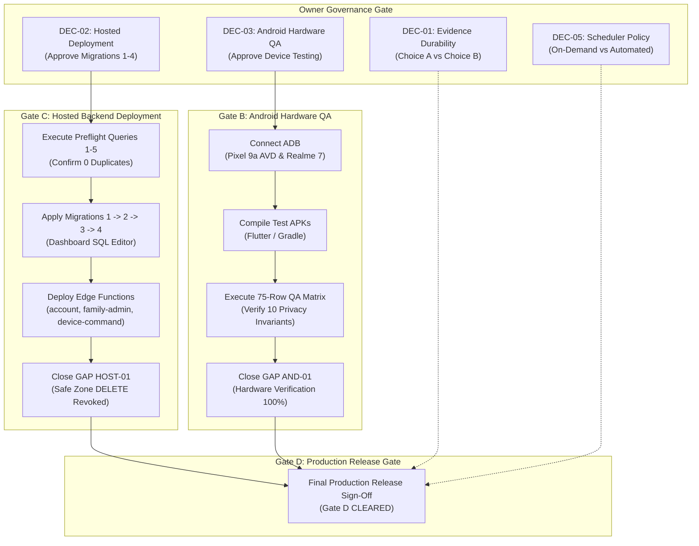

# Phase 9 Master Open Gaps & Blocker Register

**Document ID:** `PHASE-9-OPEN-GAPS`  
**Companion Mirror:** [`docs/implementation/phase-9-open-gaps.md`](file:///d:/parentcontrol_app/docs/implementation/phase-9-open-gaps.md)  
**Date:** 2026-11-04  
**Target Commit:** `b12659b9795ba69499483a84750a33897dd7e08a` (`main`)  
**Active Release Blockers:** Exactly **2 P1 Blockers** (HOST-01 and AND-01 / GATE-B-01)  
**Production Criticality:** **0 P0 Vulnerabilities on Live Production** (Protected by DEC-02 Negative Boundary)

---

## 1. Severity Classification Standards

Gaps and technical debts are prioritized according to strict operational criteria:
- **`P0 (Critical Production Emergency)`**: Active remote exploit, live data corruption, or catastrophic outage requiring immediate out-of-band intervention. *(Count: 0)*.
- **`P1 (Release Blocker)`**: Architectural defect, unapplied migration vulnerability, or unverified hardware invariant that strictly blocks production release. *(Count: 2)*.
- **`P2 (Operational / Soft Blocker)`**: Durability concern, preflight requirement, or operational policy limitation requiring owner election or staging verification. *(Count: 6)*.
- **`P3 (Hygiene / Environment)`**: Non-blocking cosmetic cleanup, redundant index, line-ending normalization, or disk space recovery. *(Count: 6)*.

---

## 2. Master Open Gaps Register (14 Active & Residual Items)

| Gap ID | Sev | Category | Title & Summary Description | Operational State | Governing Decision | Release Gating Impact |
|---|:---:|---|---|---|:---:|---|
| **HOST-01** | **P1** | Database / Hosted | **Hosted Migration & Function Deployment Gap**: Migrations 1–4 unapplied and Edge Functions (`account`, `family-admin`, `device-command`) undeployed on hosted Supabase (`hhqgreaoqulmfwfwarhc`). Direct client `DELETE` privilege on `public.safe_zones` remains live on hosted PostgreSQL. | **OPEN — HARD RELEASE BLOCKER**. Withheld under DEC-02 negative boundary. | DEC-02 | **CRITICAL RELEASE BLOCKER** |
| **AND-01 / GATE-B-01** | **P1** | Hardware QA | **Android QA Hardware Execution Gap**: 0 of 75 rows in the controlled QA matrix executed on real hardware or emulators. 10 privacy invariants unverified on live devices. | **STOPPED BY POLICY**. Held strictly at `NOT RUN` under Owner Ruling #9. | DEC-03 | **CRITICAL RELEASE BLOCKER** |
| **DUR-01** | **P2** | Audit / Git | **Evidence Durability & Gitignore Trap**: 11 Phase 5 run logs (201,441 B, 4,195 lines) untracked on disk due to `.gitignore:22:*.log`. Only `p5-coord-deno-full3.txt` is tracked. Missing on fresh `git clone`. | **OPEN (Clone Durability Risk)**. Verified bit-for-bit on local disk. | DEC-01 (Choice A vs B) | **Soft Gate (Audit Integrity)** |
| **SQL-06h** | **P2** | Database Preflight | **Hosted WebRTC Replay Index Pre-Check**: Preflight Query 1 required before Migration 2 to confirm zero duplicate `(session_id, sequence)` rows exist on hosted database. | **OPEN (Pre-check Formulated)**. Verified clean in local tests. | DEC-04 / DEC-02 | Prerequisite to Migration 2 |
| **PERF-01h** | **P2** | Hosted Verification | **Hosted Retention Sweep Plan Verification**: Batch delete shape (`id = ANY (ARRAY(SELECT id ... LIMIT 10000))`) verified locally; hosted query plan unmeasured. | **SCOPED PASS (Local) / OPEN (Hosted)**. | DEC-10 / DEC-02 | Post-Apply Verification Gate |
| **SQL-04r** | **P2** | Architectural Limit | **Unbounded Retention Transaction Under Owner Ruling #3**: Multi-transaction execution across calls refused by Owner Ruling #3. Single-transaction sweep risks statement timeouts on massive backlogs. | **STOPPED BY POLICY**. Documented design limitation in migration header. | Owner Ruling #3 | Documented Design Limitation |
| **SCHED-01** | **P2** | Infrastructure | **Background Scheduler Deployment Unverified**: Edge Function `cron/index.ts` implemented with fallbacks, but no automated cron trigger attached on hosted. | **STOPPED BY POLICY**. Automated invocation strictly withheld. | DEC-05 | On-Demand Only |
| **GAP-RS-01** | **P2** | Code Architecture | **Retained Safe Zone Fallback Module**: `delete_zone_atomicity.ts` unwired in production; retained as reviewed rollback safety net per Owner Ruling #2. | **KNOWN RESIDUAL (Retained as Fallback)**. | DEC-07 | Rollback Safety Net |
| **GAP-DEP-01** | **P3** | Code Hygiene | **Unused `ZoneSnapshot` Type Import**: `family-admin/index.ts:21` imports type from unwired module; accesses only `zone.family_id`. | **OPEN (Cosmetic Cleanup)**. Safe to clean at Gate A. | DEC-07 | Non-Blocking |
| **GAP-ENV-01** | **P3** | Workstation Env | **Retained PostgreSQL Clusters in `.tools/`**: 8 cluster directories (~1.03 GB disk footprint) preserved with postmasters stopped. | **DISCLOSED / SAFE**. Standby clusters on workstation. | DEC-09 | Non-Blocking |
| **GAP-EOL-01** | **P3** | Repository Hygiene | **Repository Line-Ending Discrepancy**: 62 LF files, 7 CRLF files on Windows. Dual aggregate verified; `.gitattributes` ready. | **DISCLOSED / STABLE**. Specification drafted. | DEC-08 | Non-Blocking |
| **IDX-01** | **P3** | Database Hygiene | **Redundant WebRTC Signaling Index**: Legacy non-unique index coexists with unique sequence index. | **AWAITING OWNER DECISION**. Additive coexistence harmless. | DEC-06 | Non-Blocking |
| **HOST-02** | **P3** | Hosted Observability | **Hosted State Observation Staleness**: Direct hosted catalog observation dates to 2026-10-30. | **OPEN (Observation Staleness)**. Preflight checklist ready. | DEC-02 / DEC-04 | Pre-Apply Prerequisite |
| **GAP-DISC-01**| **P3** | Documentation | **Documentation Discrepancy Reconciliation**: Phase 7 errors in emulator API (37 Baklava), hardware model (Realme 7 API 31), and region (Seoul). | **RESOLVED IN PHASE 8/9**. Reconciled in fact. | N/A | Non-Blocking (Resolved) |

---

## 3. Deep Forensic Review of P1 Release Blockers

### 3.1 Gap HOST-01: Hosted Migration & Function Deployment Gap
- **Nature of the Defect:**  
  On the hosted production database `hhqgreaoqulmfwfwarhc` (AWS Seoul, `ap-northeast-2`), the baseline schema from Phase 1 (`20260101000200_rls.sql`) remains active. In that baseline schema, `authenticated` clients possess direct table-level `DELETE` privileges on `public.safe_zones`. 
  Furthermore, the legacy client deletion flow executed two separate HTTP requests: a PostgREST `DELETE` on `safe_zones` followed by an `INSERT` on `audit_logs`. If the audit insert failed, the deletion remained committed without audit coverage (SQL-05).
- **Remediation Ready on Disk:**  
  1. `20261030000200_phase1_authorization.sql` revokes direct `DELETE` privileges on `safe_zones` from `anon` and `authenticated`.
  2. `20261103000100_zone_delete_atomic_rpc.sql` deploys `delete_safe_zone_audited`, binding deletion and audit logging into a single atomic PostgreSQL transaction.
  3. `supabase/functions/family-admin/index.ts` calls `delete_safe_zone_audited` via service-role.
- **Why It Remains Open:**  
  In strict accordance with project governance rules, **zero remote database mutations or Edge Function deployments are permitted without explicit owner approval under DEC-02**. Applying this remediation requires executing the 5 Preflight Queries followed by the 4 migrations.

### 3.2 Gap AND-01 / GATE-B-01: Android QA Hardware Execution Gap
- **Nature of the Defect:**  
  The parent control mobile application operates across deep Android OS subsystem boundaries: `FOREGROUND_SERVICE_TYPE_MICROPHONE`, persistent notifications, WebRTC native audio tracks, runtime permission revocation listeners, and 15s background polling watchdogs.
  While JVM Robolectric tests (39/39 pass) and Flutter tests (408 pass) verify local logic, **zero rows of the 75-row controlled QA matrix have been executed on real physical hardware or emulators**.
- **Target Hardware Profiles:**  
  - Child Target: Physical Realme 7 (`RMX2161`, Android 12, API 31, ColorOS 12.1, ARM64).
  - Parent Monitor: Google Pixel 9a AVD (`emulator-5554`, Android 17 Preview, API 37, x86_64).
- **Why It Remains Open:**  
  Owner Ruling #9 explicitly stopped physical/AVD hardware execution. ADB connectivity remains reported as UNKNOWN. Building APKs or dispatching test commands to devices without authorization violates negative operational boundaries. Gated under DEC-03.

---

## 4. Forensic Analysis of P2 Operational Gaps

### 4.1 Gap DUR-01: Evidence Durability & Gitignore Trap
- Trapped by line 22 of `.gitignore` (`*.log`).
- The 11 Phase 5 run logs (201,441 bytes, 4,195 lines) are present on the local workstation disk and verified bit-for-bit against `docs/evidence/phase5/MANIFEST.md` § 8, but are absent from the remote Git repository.
- A fresh `git clone` on another machine will lack these logs, causing manifest verification to fail.
- **Resolution:** Owner election under DEC-01 (Choice A: force-stage logs; Choice B: accept workstation-only durability).

### 4.2 Gap SQL-06h: Hosted WebRTC Signaling Replay Index Pre-Check
- Migration 2 creates unique index `webrtc_signals_session_sequence_uniq` on `public.webrtc_signals (session_id, sequence)`.
- If duplicate sequence rows exist on the hosted database, the index creation will be silently skipped by the guarded DO block, leaving the hosted database without replay protection.
- **Resolution:** Execute Preflight Query 1 in Dashboard SQL Editor prior to applying Migration 2. Must return 0 rows.

### 4.3 Gap SQL-04r: Unbounded Retention Transaction Under Owner Ruling #3
- `run_retention_sweep()` executes batched deletes across 4 tables within a single outer database transaction.
- If an operator allows child telemetry to accumulate for months without running sweeps, the backlog could grow to hundreds of thousands of rows.
- Deleting massive backlogs in a single transaction risks exceeding Supabase's `statement_timeout` (8–60s), aborting the sweep completely.
- **Resolution:** Acknowledged design limitation. Disclosed in migration header. Enforces the operational runbook requirement for regular retention sweeps.

### 4.4 Gap SCHED-01: Retention Sweep Scheduler Policy Stop
- Automatic background schedulers (`pg_cron`) are disabled by default.
- Edge Function `cron/index.ts` is implemented but has no automated webhook attached.
- **Resolution:** Requires separate owner election under DEC-05. Until then, retention sweeps and session expiry must be run on-demand via the operational runbook.

---

## 5. Release Progression Roadmap

The following Mermaid sequence diagram outlines the strict dependency path required to unblock and clear the release gates:

---

## 6. Summary Blocker Posture

Until the project owner explicitly signs off on **DEC-02** and **DEC-03**, the release gate remains at **HARD STOP (NO-GO)**. Local code assets are 100% verified and frozen; no unauthorized physical device operations or hosted mutations will be executed.

---

## 7. Owner Decision Reconciliation Addendum (Dated 2026-11-04)

**Addendum Timestamp:** 2026-11-04 (+05:30, Asia/Kolkata) - addendum written 12:08-12:14, coordinator evidence re-verification 12:00-12:24
**Recorded by:** Phase 9 documentation pass, from the project owner's written instruction dated 2026-11-04.
**Relationship to the original Phase 9 report:** This addendum is appended after the original Phase 9 sections, which are preserved verbatim. Those sections recorded DEC-01/02/03/05 as PENDING earlier on the same calendar date; the owner's written rulings supersede those PENDING entries as of this addendum.
**Target HEAD Commit:** `b12659b9795ba69499483a84750a33897dd7e08a` (`main`)  
**Active Release Blockers:** Exactly **2 P1 Blockers** (HOST-01 and AND-01 / GATE-B-01)  
**Production Release Verdict:** **NO-GO FOR GENERAL PRODUCTION RELEASE**

### 7.1 Reconciled Gaps Posture Following Owner Decisions

By written instruction dated 2026-11-04, the project owner rendered formal determinations resolving DEC-01 and DEC-05, while confirming that DEC-02 and DEC-03 remain pending authorization:

| Gap ID | Sev | Category | Title & Summary Description | Status (2026-11-04) | Governing Decision | Gating Status |
|---|:---:|---|---|---|:---:|:---:|
| **HOST-01** | **P1** | Database / Hosted | **Hosted Migration & Function Deployment Gap**: Migrations 1–4 unapplied and Edge Functions (`account`, `family-admin`, `device-command`) undeployed on hosted Supabase (`hhqgreaoqulmfwfwarhc`). Direct client `DELETE` privilege on `public.safe_zones` remains live on hosted PostgreSQL. | **OPEN — CRITICAL RELEASE BLOCKER**. Withheld under DEC-02 negative boundary. Zero hosted mutations permitted. | DEC-02 | **BLOCKS GATE C & D** |
| **AND-01 / GATE-B-01** | **P1** | Hardware QA | **Android QA Hardware Execution Gap**: 0 of 75 rows in the controlled QA matrix executed on real hardware or emulators. 10 privacy invariants unverified on live devices. | **OPEN — CRITICAL RELEASE BLOCKER**. Withheld under DEC-03 negative boundary. All 75 rows held strictly at `NOT RUN`. | DEC-03 | **BLOCKS GATE B & D** |
| **DUR-01** | **P2** | Audit / Git | **Evidence Durability & Gitignore Trap**: 11 Phase 5 run logs (201,441 B, 4,403 lines) untracked on disk due to `.gitignore:22:*.log`. | **POLICY DECIDED - GAP REMAINS OPEN (accepted local-only durability)**. Owner approved DEC-01 Choice B. All 11 logs verified bit-for-bit against manifest § 8. No `git add -f`; .gitignore unchanged. Workstation durability accepted. | DEC-01 (Choice B) | **ACCEPTED LOCAL-ONLY EVIDENCE DURABILITY RISK** (decision resolved; gap remains open - accepted, not technically eliminated) |
| **SCHED-01** | **P2** | Infrastructure | **Background Scheduler Deployment**: Edge Function `cron/index.ts` implemented, but no automated cron trigger attached on hosted. | **POLICY DECIDED - scheduler prohibited; on-demand is the standing mode. No gap closure by deployment.**. Owner approved DEC-05 Choice B. Automated triggers prohibited. Sweeps run strictly on-demand. Operational backlog risks accepted. | DEC-05 (Choice B) | **DECIDED (standing on-demand policy)** |
| **SQL-04r** | **P2** | Architectural Limit | **Unbounded Retention Transaction Under Owner Ruling #3**: Multi-transaction execution refused. Single-transaction sweep risks statement timeouts on massive backlogs. | **DOCUMENTED OPERATIONAL RISK**. Acknowledged design limitation under Owner Ruling #3 and DEC-05 Choice B. Operational runbook required to prevent massive backlog accumulation. | Owner Ruling #3 / DEC-05 | Operational Risk Monitored |
| **SQL-06h** | **P2** | Database Preflight | **Hosted WebRTC Replay Index Pre-Check**: Preflight Query 1 required before Migration 2 to confirm zero duplicate `(session_id, sequence)` rows exist on hosted database. | **PREFLIGHT FORMULATED / READY**. NOT executed against hosted. Preflight Queries 1-5 are prepared but none has been executed; DEC-02 is PENDING OWNER AUTHORIZATION. | DEC-04 / DEC-02 | Prerequisite to Migration 2 |
| **PERF-01h** | **P2** | Hosted Verification | **Hosted Retention Sweep Plan Verification**: Batch delete shape verified locally; hosted query plan unmeasured. | **PREPARED FOR POST-APPLY**. Ready for post-apply measurement under DEC-02. | DEC-10 / DEC-02 | Post-Apply Verification Gate |
| **GAP-RS-01** | **P2** | Code Architecture | **Retained Safe Zone Fallback Module**: `delete_zone_atomicity.ts` unwired in production; retained as reviewed rollback safety net per Owner Ruling #2. | **KNOWN RESIDUAL (Retained as Fallback)**. Module preserved until hosted Migration 4 is proven in production. | DEC-07 | Rollback Safety Net |
| **GAP-DEP-01** | **P3** | Code Hygiene | **Unused `ZoneSnapshot` Type Import**: `family-admin/index.ts:21` imports type from unwired module. | **KNOWN RESIDUAL (Cosmetic Cleanup)**. Safe to clean at future commit window. | DEC-07 | Non-Blocking |
| **GAP-ENV-01** | **P3** | Workstation Env | **Retained PostgreSQL Clusters in `.tools/`**: 8 cluster directories (~1.03 GB disk footprint) preserved with postmasters stopped. | **PRESERVED ON STANDBY**. Clean offline fallback. | DEC-09 | Non-Blocking |
| **GAP-EOL-01** | **P3** | Repository Hygiene | **Repository Line-Ending Discrepancy**: 62 LF files, 7 CRLF files on Windows. Dual aggregate verified; `.gitattributes` ready. | **SPECIFICATION DRAFTED / READY**. Awaiting authorized commit window. | DEC-08 | Non-Blocking |
| **IDX-01** | **P3** | Database Hygiene | **Redundant WebRTC Signaling Index**: Legacy non-unique index coexists with unique sequence index. | **PRESERVED ADDITIVELY / DEFERRED**. Minor write amplification accepted; deferred post-release. | DEC-06 | Non-Blocking |
| **HOST-02** | **P3** | Hosted Observability | **Hosted State Observation Staleness**: Direct hosted catalog observation dates to 2026-10-30. | **PREFLIGHT CHECKLIST READY**. Ready for pre-apply execution under DEC-02. | DEC-02 / DEC-04 | Pre-Apply Prerequisite |
| **GAP-DISC-01**| **P3** | Documentation | **Documentation Discrepancy Reconciliation**: Reconciled historical discrepancies from Phase 7. | **RESOLVED IN FACT**. Fully reconciled in Phase 8/9 documentation. | N/A | Non-Blocking (Resolved) |

---

### 7.2 Release Readiness Gate Evaluation

The production release gating evaluation following owner decision reconciliation is formally recorded as:

- **Gate A — Local Implementation & Hermetic Test Baseline:** **CLEARED (100% Pass)**.
  - 150 Deno unit tests pass; 12 `family-admin` tests pass; 33-file SQL regression chain passes with 0 errors; negative control caught with Exit Code 3 at line 411; 39 Android JVM tests pass; 408 Flutter tests pass (Phase 5 historical baseline reference, not a Phase 9 re-run).
  - At the pre-edit baseline (2026-11-04, 12:00 +05:30): 53 files staged, 0 unstaged modifications, 0 untracked non-ignored files. This addendum's edits are intentionally left unstaged; no `git add` was performed and none is authorised. Correction pass (2026-11-04, read-only verification): current state is HEAD `75d1a5232acbd87fe1068b5000d2916892e8143d` on `main`, 0 staged, 15 unstaged modifications, 1 untracked non-ignored file (the new docs/evidence/phase9/DOCUMENTATION-CORRECTION-ADDENDUM.md); the 53 baseline files became committed history through the owner's external commit at 12:23:31 +05:30.
- **Gate B — Android Hardware QA Verification:** **BLOCKED (P1 Release Blocker - GAP AND-01 / GATE-B-01)**.
  - Governed by DEC-03 (Pending Owner Authorization).
  - All 75 QA matrix rows remain strictly `NOT RUN`. Zero APKs compiled; zero ADB commands executed. Hardware privacy invariants unverified on real devices.
- **Gate C — Hosted Supabase Backend Hardening:** **BLOCKED (P1 Release Blocker - GAP HOST-01)**. Four migrations unapplied, three Edge Functions (`account`, `family-admin`, `device-command`) undeployed, and five read-only preflight queries prepared but not executed against hosted.
  - Governed by DEC-02 (Pending Owner Authorization).
  - Migrations 1–4 unapplied; Edge Functions undeployed. Direct client `DELETE` privilege on `public.safe_zones` remains live on hosted PostgreSQL `hhqgreaoqulmfwfwarhc`.
- **Gate D — General Production Release:** **HARD STOP (NO-GO)**.
  - **Inviolable Release Rule:** General production release is strictly prohibited until Gates B and C have independently passed their authorized verification requirements. Local regression success must not be presented as hosted production verification.

---

### 7.3 Strictly Prohibited Operational Boundaries

In accordance with owner rulings and negative operational boundaries:
1. **NO Git mutations (`git add`, `git commit`, `git push`, `git reset`, `git clean`).**
2. **NO modification or deletion of the 11 Phase 5 run logs** in `docs/evidence/phase5/logs/`.
3. **NO hosted Supabase mutations or Edge Function deployments.**
4. **NO Android APK builds, ADB executions, or device testing.**
5. **NO automated scheduler activation (`pg_cron` or webhooks).**
6. **NO initiation of Phase 10.**

*End of Open Gaps Register.*

---

## ADDENDUM VERIFICATION NOTES (2026-11-04)

These notes are part of the dated owner-decision addendum and apply to every Phase 9 addendum document.

1. **Verification method.** Read-only `sha256sum`, `wc`, `git ls-files`, `git cat-file -e`, `git check-ignore -v`, `git status` and `git diff` were used. No file other than the Phase 9 addendum documents was written. No test suite, build, device command or hosted operation was run.
2. **Line-total correction.** `wc -l` over the 11 ignored `*.log` files in `docs/evidence/phase5/logs/` totals **4,403 lines**, not the 4,195 lines carried in the original Phase 9 sections. The byte total (**201,441**) reproduces exactly, and all 12 SHA-256 digests in the directory match `docs/evidence/phase5/MANIFEST.md` section 8 (Pack contents, lines 203-214). The original 4,195 figure is preserved unaltered in the historical sections.
3. **Staged-file count reconciliation.** The original Phase 9 report's "37 staged files" was accurate at the time it was captured. As of the 2026-11-04 pre-edit baseline the index holds **53** staged files. Nothing was staged or unstaged by this documentation pass.
4. **DUR-01 status.** DEC-01 Choice B was approved. The consequence is that **GAP DUR-01 REMAINS OPEN** as an accepted local-only durability risk: a fresh `git clone` will not contain the 11 raw execution logs, which are preserved on this workstation only. This evidence is **not clone-durable**.
5. **Decisions NOT ruled on 2026-11-04.** The owner ruled only on DEC-01, DEC-02, DEC-03 and DEC-05. DEC-04 and DEC-06 through DEC-11, and the gaps governed by them, simply **carry forward their original register statuses** and await a future ruling. No approval or closure should be inferred.
6. **On-demand invocation is documentation, not authorisation.** The `run_retention_sweep()` / `expire_abandoned_sessions()` SQL and the `x-cron-secret` HTTP form describe the authenticated on-demand procedure only. Executing either against hosted Supabase is a production mutation requiring separate written owner authorisation; DEC-05 Choice B authorises no scheduled execution and no deployment. `pg_cron`, scheduled triggers and external cron webhooks remain prohibited.
7. **Gate posture is unchanged.** Gate A CLEARED (local baseline only), Gate B BLOCKED, Gate C BLOCKED, Gate D NO-GO. P1 blockers remain exactly GAP HOST-01 and GAP AND-01 / GATE-B-01. Verdict: **NO-GO FOR GENERAL PRODUCTION RELEASE. GO FOR LOCAL VERIFICATION BASELINE.**
8. **Digest detail.** The full per-file SHA-256 table is recorded once in `docs/evidence/phase9/OWNER-DECISION-ADDENDUM.md` and is referenced, not duplicated, by the other Phase 9 addenda. `docs/evidence/phase9/MANIFEST.md` was left unchanged.
9. **Repository state during the addendum window.** The addendum text above records entry HEAD `b12659b9795ba69499483a84750a33897dd7e08a`, which was the checked-out commit when the Phase 9 documents were authored and when this addendum's evidence was verified (12:00-12:16 +05:30). During that same window, at **12:23:31 +05:30, the project owner - not this documentation pass - committed the 53 previously staged files** as `75d1a5232acbd87fe1068b5000d2916892e8143d` ("docs: add phase 6-9 evidence packs, implementation reports, and CI test runner scripts"). Those assets are therefore committed history rather than staged content, and this addendum's own edits are unstaged working-tree modifications. The documentation pass executed no `git add`, `commit`, `push`, `reset`, `restore`, `checkout` or `stash`.
10. **Correction sub-pass, 12:36-12:52 +05:30.** A follow-up read-only audit corrected the addenda: the per-file SHA-256 tables in `docs/implementation/phase-9-decision-execution-log.md` and `docs/evidence/phase9/OWNER-DECISION-ADDENDUM.md` were rebuilt from digests computed directly from the files, because the first drafts listed five log filenames that do not exist (`p5-coord-sqlchain-*.log`) and eleven SHA-256 values matching no file on disk; attributions of this pass's verification work to numbered subagents were replaced with the recording method and the original Phase 9 sections were left untouched; present-tense working-tree claims were replaced with the two-stage baseline statement in note 3; and DEC-04 and DEC-06 through DEC-11 were relabelled as carried-forward, not ruled.

## Canonical Decision Wording (Dated 2026-11-04, Documentation Correction Pass)

- DEC-01 - APPROVED - CHOICE B: LOCAL-ONLY EVIDENCE. The owner decision is resolved.
- DUR-01 - ACCEPTED LOCAL-ONLY EVIDENCE DURABILITY RISK. The 11 raw Phase 5 `.log` files stay ignored by `.gitignore:22` (`*.log`), remain local-workstation artifacts, and are absent from fresh clones. No `git add -f` is authorised and `.gitignore` is unchanged. The decision is resolved; the durability limitation is accepted, not technically eliminated.
- DEC-02 - PENDING OWNER AUTHORIZATION - BLOCKED. No hosted migration, no Edge Function deployment, no hosted SQL execution. Five read-only preflight queries are prepared and none has been executed. HOST-01 remains a P1 release blocker.
- DEC-03 - PENDING OWNER AUTHORIZATION - BLOCKED. No APK build or installation, no ADB, no device pairing. All 75 QA rows remain NOT RUN. AND-01 / GATE-B-01 remains a P1 release blocker.
- DEC-05 - APPROVED - CHOICE B: ON-DEMAND ONLY. No pg_cron, no Supabase scheduled trigger, no external cron webhook.
- Approval of DEC-01 or DEC-05 never implies approval of DEC-02 or DEC-03.
- Verdict: NO-GO FOR GENERAL PRODUCTION RELEASE. GO FOR LOCAL VERIFICATION BASELINE.
