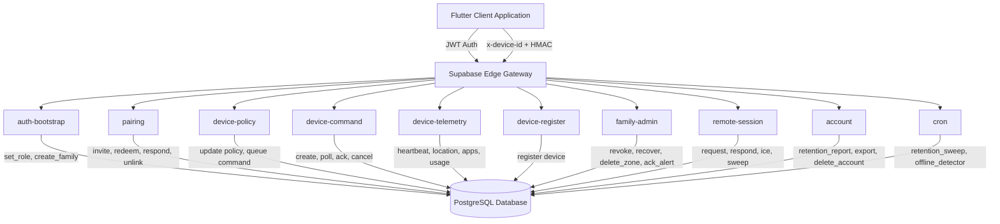

# PHASE 3.0 — BACKEND DEPENDENCY MAP & COMPONENT TRACEABILITY

**Project:** `D:\parentcontrol_app`  
**Supabase Project ID:** `hhqgreaoqulmfwfwarhc`  
**Execution Mode:** STRICT READ-ONLY AUDIT  
**Audit Date:** 2026-11-18  

---

## 1. BACKEND ARCHITECTURE OVERVIEW

The backend infrastructure comprises:
1. **19 Relational Database Tables** in schema `public`.
2. **14+ Stored Procedures / RPCs** in schemas `public` and `private`.
3. **PostgreSQL Triggers** enforcing audit immutability, timestamps, and profile lifecycle.
4. **10 Supabase Edge Functions** (Deno runtime) enforcing business logic and mediating administrative writes.
5. **Private Realtime Channels** delivering row-level updates to authenticated parents.

---

## 2. RELATIONAL TABLE DEPENDENCY MATRIX

| Table Name | Primary Purpose | Writes Mediated By | Reads Mediated By | Foreign Key Cascades | Connected UI Features |
|---|---|---|---|---|---|
| `profiles` | Stores user role (`parent`/`child`) and display name | Auth Trigger / `auth-bootstrap` | PostgREST RLS (`profiles_select`) | References `auth.users(id) ON DELETE CASCADE` | Login, Register, Shell Headers |
| `families` | Represents family group and default settings | `auth-bootstrap` (`create_family`) | PostgREST RLS (`is_family_member`) | `owner_id -> profiles(id) ON DELETE CASCADE` | Family Setup, Parent Shell |
| `family_members` | Associates users with families (`active`/`removed`) | `pairing`, `account` | PostgREST RLS | `family_id -> families(id) CASCADE`, `user_id -> profiles(id) CASCADE` | Family Members Tab, Child Shell |
| `devices` | Enrolled physical hardware devices | `device-register`, `device-telemetry` | PostgREST RLS | `family_id -> families CASCADE`, `child_user_id -> profiles CASCADE` | Devices Tab, Child Home |
| `device_pairing_tokens`| 8-char ephemeral pairing codes (15m TTL) | `pairing` (`create`) | Service Role Only | `child_user_id -> profiles CASCADE` | Child Enrollment Screen |
| `pairing_requests` | Formal link requests pending child/parent approval | `pairing` (`invite`, `redeem`, `respond`) | PostgREST RLS | References tokens, families, and profiles | Parent Outgoing, Child Requests |
| `device_policies` | Versioned enforcement rules (bedtime, apps, quota)| `device-policy` (`update`) | PostgREST RLS | `device_id -> devices CASCADE`, `family_id -> families CASCADE` | Screen Time, App Restrictions |
| `device_commands` | Queued async commands (`apply_policy`, etc.) | `device-policy`, `device-command` | PostgREST RLS / Edge Poll | `device_id -> devices CASCADE`, `family_id -> families CASCADE` | Command Polling Loop |
| `usage_daily` | Daily aggregated app usage telemetry | `device-telemetry` (`usage_upload`) | PostgREST RLS | `device_id -> devices CASCADE`, `family_id -> families CASCADE` | Screen Time Dashboard, Charts |
| `location_events` | GPS fix history for child devices | `device-telemetry` (`location_upload`)| PostgREST RLS | `device_id -> devices CASCADE`, `family_id -> families CASCADE` | Parent Location Map |
| `safe_zones` | Geofence definitions (lat, lng, radius) | PostgREST Insert / `family-admin` | PostgREST RLS | `family_id -> families CASCADE` | Safe Zones Manager Screen |
| `safe_zone_states` | Inside/outside state per device and zone | Geofence Evaluation Engine | PostgREST RLS | `zone_id -> safe_zones CASCADE`, `device_id -> devices CASCADE` | Safe Zone State Indicators |
| `safety_alerts` | Low battery, zone exit, offline alerts | Database Triggers / Telemetry | PostgREST RLS + Realtime | `family_id -> families CASCADE`, `device_id -> devices CASCADE` | Alerts Tab (Realtime) |
| `remote_sessions` | WebRTC audio assistance session state | `remote-session` (`request`, `respond`) | PostgREST RLS + Realtime | `parent_user_id -> profiles CASCADE`, `child_user_id -> profiles CASCADE` | Remote Assistance Page |
| `webrtc_signals` | Ephemeral SDP offers, answers, ICE candidates | PostgREST Insert (`webrtc_signals`) | PostgREST RLS + Realtime | `session_id -> remote_sessions CASCADE` | WebRTC Peer Handshake |
| `audit_logs` | Append-only compliance and security event trail | Database Triggers / `recordAudit` | PostgREST RLS (`is_family_parent`) | `family_id -> SET NULL`, `actor_user_id -> SET NULL` | Audit Logs Viewer Screen |
| `device_apps` | Installed package discovery cache per device | `device-telemetry` (`apps_upload`) | PostgREST RLS | `device_id -> devices CASCADE`, `family_id -> families CASCADE` | App Restrictions Picker |
| `pairing_attempts` | Rate-limiting bucket for failed pairing codes | `pairing` (`redeem`) | Service Role Only | `parent_user_id -> profiles CASCADE` | Pairing Error Feedback |
| `child_contact_ids` | Canonical permanent Child ID registry (`PC-XXXXXX`) | `pairing` (`get_contact_id`) | PostgREST RLS | `child_user_id -> profiles CASCADE` | Child Enrollment Screen |

---

## 3. EDGE FUNCTIONS INVENTORY & ACTION MAPPING

### Edge Function Action Registry

| Edge Function Directory | Exposed Actions | Auth Mechanism | Client Repository Caller | Status |
|---|---|---|---|---|
| `supabase/functions/account/` | `retention_report`, `export`, `delete_account` | User Bearer JWT | `account_privacy_repository.dart` | **Tested Locally — Ready to Deploy (Defect E-15)** |
| `supabase/functions/auth-bootstrap/` | `set_role`, `create_family` | User Bearer JWT | `supabase_auth_repository.dart`, `supabase_family_repository.dart` | **Deployed & Active** |
| `supabase/functions/cron/` | `retention_sweep`, `detect_offline_devices`, `expire_stale_sessions` | Service Role / Cron Secret | Background Scheduled Worker | **Deployed & Active** |
| `supabase/functions/device-command/` | `create`, `poll`, `ack`, `cancel` | Device Secret HMAC / User JWT | `DeviceHttpClient.kt`, `supabase_policy_repository.dart` | **Deployed & Active** |
| `supabase/functions/device-policy/` | `update` | Parent User JWT | `supabase_policy_repository.dart` | **Deployed & Active** |
| `supabase/functions/device-register/` | `register` | Child User JWT | `supabase_device_repository.dart` | **Deployed & Active** |
| `supabase/functions/device-telemetry/`| `heartbeat`, `location_upload`, `apps_upload`, `usage_upload` | Device Secret HMAC | `GuardianService.kt`, `LocationTrackingService.kt` | **Deployed & Active** |
| `supabase/functions/family-admin/` | `revoke_device`, `recover_device`, `unlink_child`, `delete_zone`, `ack_alert`, `update_retention`, `purge_data` | Parent / Owner User JWT | `supabase_device_repository.dart`, `supabase_family_repository.dart`, `supabase_alert_repository.dart` | **Deployed & Active** |
| `supabase/functions/pairing/` | `get_contact_id`, `invite`, `create`, `redeem`, `respond`, `cancel`, `unlink`, `pending_child`, `list_family` | User Bearer JWT | `supabase_pairing_repository.dart` | **Deployed & Active** |
| `supabase/functions/remote-session/` | `request`, `respond`, `start`, `end`, `ice`, `pending_child`, `session_state` | User Bearer JWT | `supabase_remote_session_repository.dart` | **Deployed & Active** |

---

## 4. STORED PROCEDURES & RPC TRACEABILITY

| Procedure / Function Name | Schema | Purpose | Invoked By |
|---|---|---|---|
| `private.handle_new_user()` | `private` | Trigger: Creates `public.profiles` on `auth.users` insert | Supabase Auth Trigger |
| `private.audit_logs_append_only()` | `private` | Trigger: Forbids UPDATE and DELETE on `public.audit_logs` | PostgreSQL Trigger |
| `private.remote_session_transition_guard()` | `private` | Trigger: Validates WebRTC session state machine | PostgreSQL Trigger |
| `public.delete_safe_zone_audited()` | `public` | RPC: Atomically removes safe zone and inserts audit entry | `family-admin` (`delete_zone`) |
| `public.apply_policy_version()` | `public` | RPC: Increments policy version and enqueues command | `device-policy` (`update`) |
| `public.respond_pairing_request()` | `public` | RPC: Atomic approval/rejection of pairing request | `pairing` (`respond`) |
| `public.unlink_child()` | `public` | RPC: Unlinks child from family and revokes tokens | `pairing` (`unlink`) |
| `public.revoke_device()` | `public` | RPC: Sets device status to revoked and timestamps revocation | `family-admin` (`revoke_device`) |
| `public.request_device_recovery()` | `public` | RPC: Generates one-time recovery nonce for desynced keystores | `family-admin` (`recover_device`) |
| `public.expire_stale_sessions()` | `public` | RPC: Sweeps abandoned sessions older than deadline | `remote-session` / `cron` |
| `public.detect_offline_devices()` | `public` | RPC: Flags devices without heartbeat > 5m as offline | `cron` Scheduled Worker |
| `public.run_retention_sweep()` | `public` | RPC: Cleans up historical records older than retention window | `cron` Scheduled Worker |

---

## 5. DISCONNECTED & ORPHANED COMPONENT AUDIT

1. **`request_device_recovery` RPC:** Present in `supabase/migrations/20260101000400_device_recovery.sql` and supported in `family-admin` Edge Function, but **no user-facing button or recovery workflow exists in the Flutter Parent UI**.
2. **`device_pairing_tokens.qr_payload`:** QR code string is generated in the pairing Edge Function, but `ChildEnrollmentPage` displays the alphanumeric code text only (no QR code rendering library is imported in Flutter).
3. **`account` Edge Function:** Exists locally in `supabase/functions/account/` with full unit test suite (30 tests), but has not yet been deployed to the remote project `hhqgreaoqulmfwfwarhc` (Root cause of Defect E-15).
