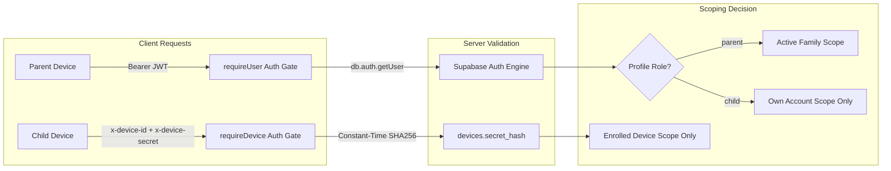

# PHASE 3.0 — SECURITY AND PRIVACY AUDIT MATRIX

**Project:** `D:\parentcontrol_app`  
**Package:** `com.parentcontrol.parent_control`  
**Target Backend:** Supabase Project `hhqgreaoqulmfwfwarhc`  
**Execution Mode:** STRICT READ-ONLY AUDIT  
**Audit Date:** 2026-11-18  

---

## 1. ROW LEVEL SECURITY (RLS) COVERAGE MATRIX

All 19 PostgreSQL tables in `public` have Row Level Security enabled (`ALTER TABLE ... ENABLE ROW LEVEL SECURITY`). Direct table access via PostgREST is governed by deterministic SQL predicates:

| Table Name | RLS Enabled? | Direct SELECT Policy | Direct INSERT Policy | Direct UPDATE Policy | Direct DELETE Policy | Security Notes |
|---|---|---|---|---|---|---|
| `profiles` | ✅ YES | Any authenticated user (`id = auth.uid()` or shared active family) | Trigger Only (`handle_new_user`) | Self only (`id = auth.uid()`, immutable role) | Cascade from `auth.users` | Cannot elevate role via UPDATE. |
| `families` | ✅ YES | Active family members (`is_family_member(id)`) | Service Role Only | Owner only (`owner_id = auth.uid()`) | Owner only (No active members/devices) | Cross-family queries return 0 rows. |
| `family_members` | ✅ YES | Active family members | Service Role / Edge Function | Service Role Only | Self or Owner | Prevents self-promotion to parent. |
| `devices` | ✅ YES | Active family parent OR device child owner | Service Role Only (`device-register`) | Service Role Only | Owner / Cascade | `secret_hash` column is not granted to client. |
| `device_pairing_tokens` | ✅ YES | Service Role Only | Service Role Only | Service Role Only | Service Role Only | Client cannot select or tamper with pairing tokens. |
| `pairing_requests` | ✅ YES | Request parent OR request child | Service Role Only | Service Role Only | Service Role Only | State transitions mediated by `pairing` Edge Function. |
| `device_policies` | ✅ YES | Family members | Service Role Only | Service Role Only | Cascade | Created only via `device-policy` Edge Function. |
| `device_commands` | ✅ YES | Family parent OR enrolled device | Service Role Only | Service Role Only | Cascade | Polled using device HMAC auth headers. |
| `usage_daily` | ✅ YES | Family members | Service Role Only | Service Role Only | Retention Sweep / Cascade | Aggregated daily app statistics only. |
| `location_events` | ✅ YES | Family parents | Service Role Only | Service Role Only | Retention Sweep / Cascade | Child device cannot select location history. |
| `safe_zones` | ✅ YES | Family members | Family parents | Family parents (immutable `family_id`)| Service Role Only (`delete_safe_zone_audited`)| Direct DELETE removed in migration 20261030000200. |
| `safe_zone_states`| ✅ YES | Family members | Service Role Only | Service Role Only | Cascade | Computed server-side. |
| `safety_alerts` | ✅ YES | Family members | Service Role Only | Service Role Only | Cascade | Acknowledgement mediated by `family-admin`. |
| `remote_sessions` | ✅ YES | Participating parent OR child | Service Role Only | Service Role Only | Cascade | State machine transitions guarded by trigger. |
| `webrtc_signals` | ✅ YES | Participating session members | Participating session members | None (Append-only)| Cascade / Sweep (7 days) | Ephemeral signaling rows. |
| `audit_logs` | ✅ YES | Family parents | Service Role Only | ❌ FORBIDDEN (Trigger) | ❌ FORBIDDEN (Trigger) | Append-only; trigger aborts UPDATE and DELETE. |
| `device_apps` | ✅ YES | Family members | Service Role Only | Service Role Only | Cascade | Uploaded via `device-telemetry`. |
| `pairing_attempts`| ✅ YES | Service Role Only | Service Role Only | Service Role Only | Service Role Only | Anti-bruteforce bucket. |
| `child_contact_ids`| ✅ YES | Family parents OR child owner | Service Role Only | Service Role Only | Cascade | Permanent Child ID mappings. |

---

## 2. AUTHENTICATION & IDENTITY BOUNDARIES



### Key Security Findings
1. **Client Identity Non-Spoofability:** Edge Functions derive user identity exclusively from the verified Bearer JWT (`auth.user.id`). Any `user_id` or `family_id` supplied in HTTP request bodies is ignored for scoping decisions.
2. **Device Secret Protection:**
   - Private secrets are generated on-device via Android Keystore CSPRNG (`SecureStore.kt`).
   - The device secret is never written to log files, exported, or returned in API responses.
   - The database only ever stores `secret_hash = sha256(secret)`.
   - Verification uses timing-attack-resistant constant-time hex comparison (`constantTimeEqualHex`).
3. **Service Role Security:** The high-privilege `SUPABASE_SERVICE_ROLE_KEY` is strictly confined to Deno Edge Functions and PostgreSQL internal triggers. It never reaches the Flutter application binary.

---

## 3. PRIVACY & SURVEILLANCE PROTECTIONS

| Privacy Domain | Implementation Detail | Audit Finding | Status |
|---|---|---|---|
| **Child Microphone Access** | One-way WebRTC audio is gated by `MediaSelfTestSheet`. Audio capture begins **only after the child manually taps "Allow Assistance"**. | Parent cannot remotely turn on the microphone without active child consent. | **COMPLIANT** |
| **Camera Privacy** | `android.hardware.camera` is marked `required="false"` in `AndroidManifest.xml`. Zero camera capture or background video streaming code exists. | App cannot access or stream camera video under any condition. | **COMPLIANT** |
| **Parent Microphone** | Parent WebRTC peer connection initializes with `offerToReceiveAudio: true` and no local audio tracks attached. | Parent voice/audio is never captured or transmitted to the child. | **COMPLIANT** |
| **Location Tracking Disclosure** | `LocationTrackingService.kt` runs as a persistent Android Foreground Service displaying an ongoing system notification. | Child is continuously informed whenever location tracking is active. | **COMPLIANT** |
| **Screen Time & App Visibility** | Reports only package names, app labels, and foreground usage duration. | Does NOT log keystrokes, messages, screen contents, or browsing history. | **COMPLIANT** |
| **GDPR Data Subject Export** | `account/index.ts` provides full account data export paged at 1,000 rows with a hard 20,000-row cap per table. Excludes sensitive secrets. | Exports complete data history while excluding cryptographic credentials. | **COMPLIANT** |
| **GDPR Account Deletion** | Dual confirmation requirement (`confirm: "DELETE"` and email match). Cascades profile, memberships, and Auth records. | Blocks deletion if active family members or devices exist, preventing orphaned data. | **COMPLIANT** |

---

## 4. ANDROID OS PERMISSIONS & APPLICATION SECURITY

```xml
<!-- Manifest Hardening Highlights -->
<application
    android:allowBackup="false"
    android:networkSecurityConfig="@xml/network_security_config">
```

1. **`android:allowBackup="false"`:** Prevents extracting SQLite databases, Keystore encrypted preferences, or session tokens via `adb backup`.
2. **`networkSecurityConfig`:** Enforces TLS for all external connections and restricts cleartext traffic.
3. **Exported Component Hygiene:**
   - `MainActivity`: Exported for deep-linking, but rejects all intents that do not strictly match `parentcontrol://auth-callback` with valid PKCE tokens.
   - `ParentControlDeviceAdminReceiver`: Exported with mandatory `android.permission.BIND_DEVICE_ADMIN`.
   - `GuardianService`, `LocationTrackingService`, `AudioAssistanceService`: Marked `android:exported="false"`, preventing unauthorized external intent spoofing.
   - `BootReceiver`: Marked `android:exported="false"`.
