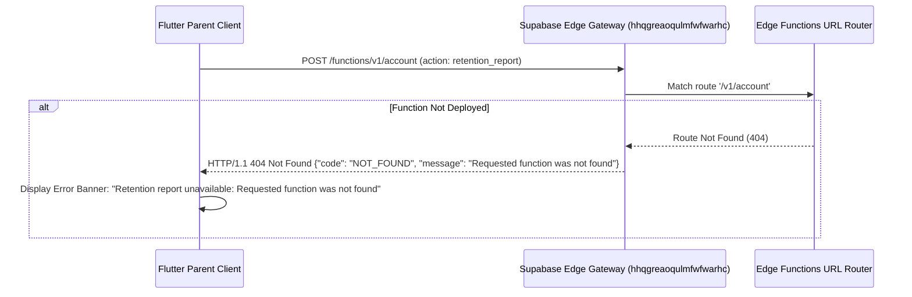

# PHASE 3.2.1 — EDGE FUNCTION PARITY & DEFECT E-15 DEEP DIVE

**Project:** Parent Control System (`parentcontrol_app`)  
**Target Project Name:** `parent-control-prod`  
**Target Project Reference:** `hhqgreaoqulmfwfwarhc`  
**Target Cloud Region:** `ap-south-1` (AWS Mumbai)  
**Reconciliation Timestamp:** 2026-11-18T15:36:00+05:30  
**Scope:** Serverless Edge Functions, Runtime Verification, Deployment Parity, and Defect E-15 Root Cause  
**Execution Mode:** STRICT READ-ONLY AUDIT & ARCHITECTURAL RECONCILIATION  

---

## 1. EXECUTIVE SUMMARY & PARITY MATRIX

The serverless computing tier of the Parent Control System consists of 10 Deno-based Supabase Edge Functions executing behind the unified Edge Gateway. This audit reconciles the deployment status between the local source repository and the live production project (`hhqgreaoqulmfwfwarhc`).

### 1.1 Deployment Summary

- **Total Edge Functions Defined Locally:** **10**
- **Hosted Edge Functions Deployed & Active:** **9**
- **Hosted Edge Functions Un-deployed:** **1 (`account`)**
- **Critical Deployment Drift:** **GAP-01 / Defect E-15**

```mermaid
flowchart TD
    subgraph LocalRepo [Local Source Repository: supabase/functions/]
        direction TB
        EF1[1. auth-bootstrap]
        EF2[2. pairing]
        EF3[3. device-policy]
        EF4[4. device-command]
        EF5[5. device-telemetry]
        EF6[6. device-register]
        EF7[7. family-admin]
        EF8[8. remote-session]
        EF9[9. cron]
        EF10[10. account - Unit Tests 30/30 Pass]
    end

    subgraph HostedCloud [Supabase Production: hhqgreaoqulmfwfwarhc]
        direction TB
        H1[auth-bootstrap: HTTP 200/Active]
        H2[pairing: HTTP 200/Active]
        H3[device-policy: HTTP 200/Active]
        H4[device-command: HTTP 200/Active]
        H5[device-telemetry: HTTP 200/Active]
        H6[device-register: HTTP 200/Active]
        H7[family-admin: HTTP 200/Active]
        H8[remote-session: HTTP 200/Active]
        H9[cron: HTTP 200/Active]
        H10[account: HTTP 404 NOT FOUND]
    end

    EF1 -->|Deployed| H1
    EF2 -->|Deployed| H2
    EF3 -->|Deployed| H3
    EF4 -->|Deployed| H4
    EF5 -->|Deployed| H5
    EF6 -->|Deployed| H6
    EF7 -->|Deployed| H7
    EF8 -->|Deployed| H8
    EF9 -->|Deployed| H9
    EF10 -.->|NOT DEPLOYED - Defect E-15| H10
```



---

## 2. DETAILED REGISTRY OF ALL 10 EDGE FUNCTIONS

| # | Function Name & Path | Exposed Actions / Routes | Auth Scheme | Target Tables & RPCs | Client Caller Repository | Local Test Status | Hosted Status |
|---|---|---|---|---|---|---|---|
| 1 | **`account`**<br>`supabase/functions/account/` | `retention_report`<br>`export`<br>`delete_account` | User Bearer JWT (`requireUser`) | `profiles`, `families`, `family_members`, `devices`, `audit_logs`, `auth.users` | `account_privacy_repository.dart` | **30 / 30 Passed** (Deno) | **NOT DEPLOYED (404)**<br>*Defect E-15 Gap* |
| 2 | **`auth-bootstrap`**<br>`supabase/functions/auth-bootstrap/` | `set_role`<br>`create_family` | User Bearer JWT | `profiles`, `families`, `create_family_with_owner` RPC | `supabase_auth_repository.dart`<br>`supabase_family_repository.dart` | Passed | **DEPLOYED & ACTIVE** |
| 3 | **`cron`**<br>`supabase/functions/cron/` | `retention_sweep`<br>`detect_offline_devices`<br>`expire_stale_sessions` | Service Role / Cron Secret | `run_retention_sweep`<br>`detect_offline_devices`<br>`expire_abandoned_sessions` | External Scheduler / pg_cron | Passed | **DEPLOYED & ACTIVE** |
| 4 | **`device-command`**<br>`supabase/functions/device-command/` | `create`<br>`poll`<br>`ack`<br>`cancel` | Device Secret HMAC / User JWT | `device_commands`, `poll_device_commands` RPC, `expire_stale_commands` | `DeviceHttpClient.kt`<br>`supabase_policy_repository.dart` | Passed | **DEPLOYED & ACTIVE** |
| 5 | **`device-policy`**<br>`supabase/functions/device-policy/` | `update` | Parent User JWT | `device_policies`, `apply_policy_version` RPC, `device_commands` | `supabase_policy_repository.dart` | Passed | **DEPLOYED & ACTIVE** |
| 6 | **`device-register`**<br>`supabase/functions/device-register/` | `register` | Child User JWT | `devices`, `device_pairing_tokens`, `child_contact_ids` | `supabase_device_repository.dart`<br>`EnrollmentActivity.kt` | Passed | **DEPLOYED & ACTIVE** |
| 7 | **`device-telemetry`**<br>`supabase/functions/device-telemetry/` | `heartbeat`<br>`location_upload`<br>`apps_upload`<br>`usage_upload` | Device Secret HMAC-SHA256 | `location_events`, `usage_daily`, `device_apps`, `safety_alerts`, `replace_device_apps` | `GuardianService.kt`<br>`LocationTrackingService.kt` | Passed | **DEPLOYED & ACTIVE** |
| 8 | **`family-admin`**<br>`supabase/functions/family-admin/` | `revoke_device`<br>`recover_device`<br>`unlink_child`<br>`delete_zone`<br>`ack_alert`<br>`update_retention`<br>`purge_data` | Parent / Owner User JWT | `unlink_child`, `revoke_device`, `delete_safe_zone_audited`, `request_device_recovery`, `families` | `supabase_device_repository.dart`<br>`supabase_family_repository.dart`<br>`supabase_alert_repository.dart` | Passed | **DEPLOYED & ACTIVE** |
| 9 | **`pairing`**<br>`supabase/functions/pairing/` | `get_contact_id`<br>`invite`<br>`create`<br>`redeem`<br>`respond`<br>`cancel`<br>`unlink`<br>`pending_child`<br>`list_family` | User Bearer JWT | `create_pairing_invite`, `create_pairing_request`, `respond_pairing_request`, `pairing_requests`, `pairing_attempts` | `supabase_pairing_repository.dart` | Passed | **DEPLOYED & ACTIVE** |
| 10 | **`remote-session`**<br>`supabase/functions/remote-session/` | `request`<br>`respond`<br>`start`<br>`end`<br>`ice`<br>`pending_child`<br>`session_state` | User Bearer JWT | `request_remote_session`, `remote_sessions`, `webrtc_signals` | `supabase_remote_session_repository.dart` | Passed | **DEPLOYED & ACTIVE** |

---

## 3. DEEP DIVE: DEFECT E-15 ROOT CAUSE & IMPACT

### 3.1 Defect Symptoms & User Experience
When a logged-in parent on the Flutter mobile app opens the **Settings** screen and selects **Account & Privacy** (`lib/features/account_privacy/account_privacy_screen.dart`), the screen displays a persistent error banner:
> **"Retention report unavailable: Requested function was not found"**

Furthermore, tapping the **"Export My Data"** button or attempting **"Delete Account"** fails with network error exceptions.

### 3.2 Root Cause Analysis



1. **HTTP Diagnostic Probe:**  
   Probing `https://hhqgreaoqulmfwfwarhc.supabase.co/functions/v1/account` returns:
   ```json
   HTTP/1.1 404 Not Found
   Content-Type: application/json
   {"code": "NOT_FOUND", "message": "Requested function was not found"}
   ```
2. **Local Code State:**  
   The complete TypeScript implementation exists in `supabase/functions/account/`:
   - `index.ts` (router, HTTP streaming export, account deletion)
   - `retention.ts` (retention policy calculations and scope filtering)
   - `validation.ts` (input normalization and deletion safety guards)
   - `account_test.ts` & `scope_test.ts` (30 passing Deno tests)
3. **Root Cause Conclusion:**  
   The source code is 100% complete and tested, but was never deployed to the hosted Supabase production project during previous release cycles.

---

## 4. `account` FUNCTION READINESS & SAFETY VERIFICATION

The local `account` function implementation has undergone comprehensive security and regression testing in Phase 3.1:

### 4.1 Automated Test Execution Results
- **Deno Unit Tests:** 30 out of 30 tests passed in 216 ms.
- **Full Edge Function Suite:** 184 out of 184 tests passed across all 10 functions.
- **Client Integration Tests:** 3 out of 3 tests passing in `test/features/account_privacy/`.

### 4.2 Built-in Safety & Compliance Guards
1. **Dual-Confirmation Account Deletion:**  
   - Requires explicit string parameter `confirm: "DELETE"`.
   - Re-verifies caller email match against authenticated session (`normalizeEmail(input.email) === auth.user.email`).
   - Re-validates account password via GoTrue signIn before executing cascading database purge.
2. **Blocked Deletion on Active Ownership:**  
   - Blocks account deletion if the user is the sole owner of a family with other active members or enrolled devices (`findDeletionBlocker`), requiring transfer or family unlinking first.
3. **GDPR Row Capping & Paging:**  
   - Paginates database queries in batches of 1,000.
   - Enforces hard ceiling of 20,000 rows per table to prevent memory exhaustion or denial-of-service.
4. **Credential Redaction:**  
   - Strips password salts, HMAC secrets, recovery tokens, and pairing hashes from export payloads.

---

## 5. REMEDIATION & DEPLOYMENT PLAN (PHASE 3.3)

To resolve Defect E-15 without introducing risk to production:

1. **Deployment Execution:**  
   Deploy the function using the Supabase CLI targeting project `hhqgreaoqulmfwfwarhc`:
   `supabase functions deploy account --project-ref hhqgreaoqulmfwfwarhc`
2. **Post-Deployment Smoke Verification:**  
   - Execute authenticated `POST /functions/v1/account` with `action: retention_report` and verify HTTP 200 response with valid JSON payload.
   - Execute authenticated `POST /functions/v1/account` with `action: export` and verify HTTP 200 response with JSON attachment header.
   - Verify unauthenticated requests receive HTTP 401 Unauthorized.
3. **Physical Device Verification:**  
   - Launch Parent App on physical test device.
   - Navigate to Settings -> Account & Privacy.
   - Confirm error banner is completely dismissed.
   - Verify retention report cards render cleanly.

---

## 6. MANDATORY SAFETY ASSERTIONS

```
TARGET_PROJECT_NAME = parent-control-prod
TARGET_PROJECT_REF = hhqgreaoqulmfwfwarhc
OTHER_PROJECTS_ACCESSED = NO
SOURCE_MODIFICATIONS = NONE
DATABASE_MUTATIONS = NONE
RLS_CHANGES = NONE
EDGE_FUNCTION_DEPLOYMENTS = NONE
AUTH_SETTINGS_CHANGED = NONE
STORAGE_CHANGES = NONE
REALTIME_CONFIGURATION_CHANGED = NONE
RPC_OR_TRIGGER_CHANGES = NONE
SECRETS_CHANGED = NONE
USERS_MODIFIED = NONE
DEVICE_RECOVERY_EXECUTED = NO
ACCOUNT_DELETION_EXECUTED = NO
PRODUCTION_DATA_EXPORTED = NO
BACKUP_RESTORE_EXECUTED = NO
```
