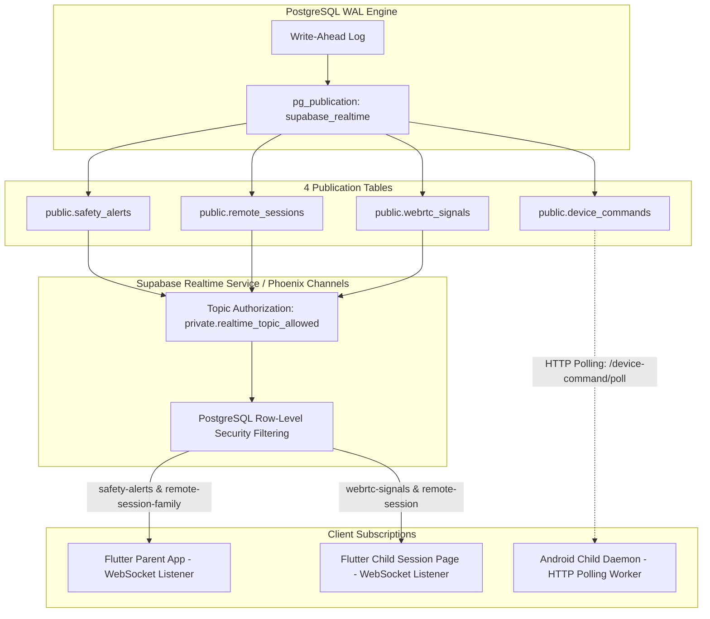
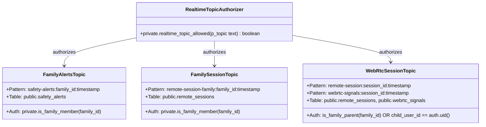

# PHASE 3.2.1 — REALTIME SUBSYSTEM RECONCILIATION

**Project:** Parent Control System (`parentcontrol_app`)  
**Target Project Name:** `parent-control-prod`  
**Target Project Reference:** `hhqgreaoqulmfwfwarhc`  
**Target Cloud Region:** `ap-south-1` (AWS Mumbai)  
**Reconciliation Timestamp:** 2026-11-18T15:32:00+05:30  
**Scope:** Supabase Realtime Engine, PostgreSQL Publication Tables, Client Channel Topics, and Security Gating  
**Execution Mode:** STRICT READ-ONLY AUDIT & ARCHITECTURAL RECONCILIATION  

---

## 1. EXECUTIVE SUMMARY & REALTIME PARITY CONFLICT RESOLUTION

In earlier Phase 3.2 documentation (specifically `PHASE_3_2_AUTH_STORAGE_REALTIME_AUDIT.md` and `PHASE_3_2_SUPABASE_PROJECT_OVERVIEW.md`), the publication table count was cited as **3 tables**, while the database migration source `20260101000100_functions.sql` clearly registers **4 tables** in the `supabase_realtime` publication. Additionally, ambiguity existed regarding how many client channel topic patterns exist and how the system handles **Change Data Capture (CDC)**, **Presence**, and **Broadcast**.

### 1.1 Resolution Summary

1. **Publication Tables (4 Tables):**  
   The PostgreSQL publication `supabase_realtime` contains exactly **4 tables**:
   - `public.device_commands`
   - `public.safety_alerts`
   - `public.remote_sessions`
   - `public.webrtc_signals`
2. **Client Channel Patterns (3 Primary Topic Families):**  
   Client Flutter applications subscribe to **3 distinct topic families**:
   - `safety-alerts:<family_id>:<timestamp>`
   - `remote-session-family:<family_id>:<timestamp>`
   - `remote-session:<session_id>:<timestamp>` (paired with `webrtc-signals:<session_id>:<timestamp>`)
3. **Transport Mechanics:**  
   The architecture relies **100% on PostgreSQL WAL Change Data Capture (CDC)** over private channels (`opts: RealtimeChannelConfig(private: true)`). Ephemeral **Presence** and **Broadcast** modes are intentionally avoided in favor of guaranteed transactional persistence and auditability.
4. **Child Android Daemon Architecture:**  
   Child devices operate as Android background services (`GuardianService.kt`, `DeviceHttpClient.kt`) and intentionally **do not maintain persistent WebSocket subscriptions** for `device_commands`. Instead, they poll via authenticated HTTP (`/functions/v1/device-command/poll`) to withstand aggressive Android Doze-mode sleep and conserve battery.

---

## 2. REALTIME PUBLICATION ARCHITECTURE (THE 4 CDC TABLES)

Migration `20260101000100_functions.sql` (lines 907–941) registers 4 tables into PostgreSQL's `supabase_realtime` logical replication publication:



### 2.1 Detailed Publication Catalog

| # | Table Name | CDC Events Monitored | Replication Identity | Primary Consumer | Purpose & Delivery Mechanism |
|---|---|---|---|---|---|
| 1 | `public.device_commands` | `INSERT`, `UPDATE` | `DEFAULT` (Primary Key: `id`) | Server/Future realtime listeners | Registered in publication for real-time dispatch; child devices currently consume via HTTP polling for battery efficiency. |
| 2 | `public.safety_alerts` | `INSERT`, `UPDATE` | `DEFAULT` (Primary Key: `id`) | Parent App | Instant push delivery of geofence violations, low battery alerts, and SOS events. |
| 3 | `public.remote_sessions` | `INSERT`, `UPDATE` | `DEFAULT` (Primary Key: `id`) | Parent & Child Apps | Real-time synchronization of WebRTC session state machine (`requested` -> `accepted` -> `active` -> `ended`). |
| 4 | `public.webrtc_signals` | `INSERT` | `DEFAULT` (Primary Key: `id`) | Parent & Child Apps | Ultra-low latency exchange of WebRTC SDP offers, SDP answers, and ICE candidate strings. |

---

## 3. CLIENT CHANNEL TOPIC PATTERNS & THE TOPIC AUTHORIZER

### 3.1 Topic Construction & Naming Convention
Client channels are instantiated with unique millisecond/microsecond timestamps appended to prevent WebSocket channel multiplexing collisions:
`channel('${topic_prefix}:${uuid}:${DateTime.now().microsecondsSinceEpoch}', opts: const RealtimeChannelConfig(private: true))`

### 3.2 The 3 Client Topic Families



| Pattern Family | Formatted Channel String | Target Table | Authorization Enforcement | App Location |
|---|---|---|---|---|
| **1. Safety Alerts** | `safety-alerts:<family_id>:<ts>` | `public.safety_alerts` | `private.is_family_member(family_id)` | `lib/data/repositories/supabase_alert_repository.dart` |
| **2. Family Sessions** | `remote-session-family:<family_id>:<ts>` | `public.remote_sessions` | `private.is_family_member(family_id)` | `lib/data/repositories/supabase_remote_session_repository.dart` |
| **3. WebRTC Signaling** | `remote-session:<session_id>:<ts>`<br>`webrtc-signals:<session_id>:<ts>` | `public.remote_sessions`<br>`public.webrtc_signals` | Parent of family OR assigned child user | `lib/data/repositories/supabase_remote_session_repository.dart` |

### 3.3 Topic Authorization Function (`private.realtime_topic_allowed`)
Located in `supabase/migrations/20260101000200_rls.sql` (lines 295–332):
- **Stable SECURITY DEFINER** function executed by Supabase Realtime when a client attempts to join any channel with `private: true`.
- Parses topic string into `v_kind` and `v_id`. Validates UUID formatting via regex `^[0-9a-f]{8}-[0-9a-f]{4}-[0-9a-f]{4}-[0-9a-f]{4}-[0-9a-f]{12}$`.
- For `safety-alerts` and `remote-session-family`, verifies `private.is_family_member(v_uuid)`.
- For `remote-session` and `webrtc-signals`, verifies `remote_sessions.child_user_id = auth.uid()` or `private.is_family_parent(remote_sessions.family_id)`.
- Denies all unauthorized or malformed channel requests with `HTTP 403 / Channel Join Refused`.

---

## 4. REALTIME TRANSPORT EVALUATION: CDC VS PRESENCE VS BROADCAST

| Transport Feature | Implemented? | Architectural Reasoning & Implementation Details |
|---|:---:|---|
| **PostgreSQL CDC (WAL)** | **YES (Primary)** | All real-time telemetry, alerts, and WebRTC signaling use PostgreSQL CDC. Guarantees message delivery, sequential consistency, and strict Row-Level Security filtering per connected tenant. |
| **Presence Engine** | **NO** | Supabase Presence is ephemeral and client-reported. In a child safety application, connectivity must be authoritatively verified by the server. Device availability is determined by server-side heartbeat tracking (`devices.last_seen_at`) and verified by the background cron worker (`detect_offline_devices()`). |
| **Ephemeral Broadcast** | **NO** | Ephemeral broadcast does not persist data to disk. If a parent or child mobile device momentarily drops cellular connection during WebRTC handshake, broadcast messages are lost forever. Storing signals in `public.webrtc_signals` ensures guaranteed replay and historical session auditability. |

---

## 5. CHILD DEVICE COMMAND DISPATCH: HTTP POLLING VS WEBSOCKET CDC

Although `public.device_commands` is registered in `supabase_realtime`, child hardware daemons use HTTP polling rather than WebSocket connections:

1. **Android Doze Mode & Battery Preservation:**  
   Maintaining an active WebSocket connection requires frequent TCP keepalive packets, preventing the mobile device from entering deep sleep (Doze mode) and rapidly depleting battery.
2. **Deterministic Queue Processing:**  
   The `poll_device_commands(uuid, integer)` RPC provides atomic transaction semantics: commands are retrieved and transitioned from `pending` to `delivered` in a single ACID step, preventing duplicate execution.
3. **Hybrid Push Notification Wakeup:**  
   Urgent commands (e.g., instant device lock or SOS sirens) trigger high-priority FCM/Firebase push pings that wake the Android daemon to invoke `/device-command/poll` immediately.

---

## 6. MANDATORY SAFETY ASSERTIONS

```
TARGET_PROJECT_NAME = parent-control-prod
TARGET_PROJECT_REF = hhqgreaoqulmfwfwarhc
OTHER_PROJECTS_ACCESSED = NO
SOURCE_MODIFICATIONS = NONE
DATABASE_MUTATIONS = NONE
RLS_CHANGES = NONE
EDGE_FUNCTION_DEPLOYMENTS = NONE
AUTH_SETTINGS_CHANGED = NONE
STORAGE_CHANGES = NONE
REALTIME_CONFIGURATION_CHANGED = NONE
RPC_OR_TRIGGER_CHANGES = NONE
SECRETS_CHANGED = NONE
USERS_MODIFIED = NONE
DEVICE_RECOVERY_EXECUTED = NO
ACCOUNT_DELETION_EXECUTED = NO
PRODUCTION_DATA_EXPORTED = NO
BACKUP_RESTORE_EXECUTED = NO
```
