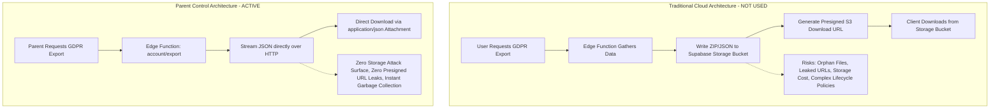

# PHASE 3.2.1 — STORAGE SUBSYSTEM RECONCILIATION

**Project:** Parent Control System (`parentcontrol_app`)  
**Target Project Name:** `parent-control-prod`  
**Target Project Reference:** `hhqgreaoqulmfwfwarhc`  
**Target Cloud Region:** `ap-south-1` (AWS Mumbai)  
**Reconciliation Timestamp:** 2026-11-18T15:34:00+05:30  
**Scope:** Supabase Storage Engine, Object Buckets, RLS Storage Policies, and GDPR Data Export Transport  
**Execution Mode:** STRICT READ-ONLY AUDIT & ARCHITECTURAL RECONCILIATION  

---

## 1. EXECUTIVE SUMMARY & STORAGE AUDIT PARITY

Audits of cloud architectures frequently look for Supabase Storage buckets to host user file uploads, reports, or backups. In Phase 3.2, questions arose regarding whether storage buckets exist or if any were missed during reconnaissance.

### 1.1 Definitive Storage State

- **Total Storage Bucket Count:** **0**
- **Public Buckets:** **0**
- **Private Buckets:** **0**
- **Storage Status:** **Zero Active Buckets (Intentionally Configured by Architecture)**

This report confirms that the total bucket count of zero is an **intentional, deliberate architectural decision**. The Parent Control System does not use binary blob storage; all telemetry, audit logs, policies, alerts, and GDPR data exports are handled via relational database tables and **direct HTTP JSON streaming**.

---

## 2. ARCHITECTURAL JUSTIFICATION: WHY STORAGE IS ZERO



### 2.1 Core Architectural Principles

1. **Structured Telemetry vs Binary Media:**  
   The application monitors device health, location history, app usage statistics, and geofence events. All of these data streams are strictly structured tabular records, indexed and stored in PostgreSQL (`location_events`, `usage_daily`, `device_apps`, `safety_alerts`).
2. **Deterministic Data Lifecycles:**  
   Data retention (COPPA/GDPR compliance) is enforced at the database row level via the `run_retention_sweep()` stored procedure and `cron` Edge Function. Deleting database rows immediately purges expired telemetry without needing multi-tier S3 object lifecycle rules.
3. **Absence of User Media Assets:**  
   Child and parent avatars are generated programmatically via initials, system icons, or local vector drawings. No camera uploads, screen recordings, or audio files are persisted to disk. Remote assistance audio sessions are WebRTC peer-to-peer streams; audio is neither recorded nor stored in cloud buckets.

---

## 3. GDPR DATA EXPORT VIA DIRECT HTTP STREAMING

The primary feature that typically demands cloud storage in similar platforms is user data export. In this codebase, data export is executed by the `account` Edge Function (`supabase/functions/account/index.ts`) through **in-flight HTTP streaming**:

### 3.1 Streaming Implementation Mechanics

In `supabase/functions/account/index.ts` (lines 3–6 and 537–547):
```typescript
// There is no storage bucket in this project, so the
// export is delivered as the HTTP response itself: `application/json` with a
// Content-Disposition: attachment; filename="parent-control-export-${stamp}.json"
function exportResponse(payload: unknown): Response {
  const stamp = new Date().toISOString().replace(/[:.]/g, "-");
  return new Response(JSON.stringify(payload, null, 2), {
    status: 200,
    headers: {
      ...corsHeaders,
      "Content-Type": "application/json; charset=utf-8",
      "Content-Disposition": `attachment; filename="parent-control-export-${stamp}.json"`,
      "Cache-Control": "no-store, private",
    },
  });
}
```

### 3.2 Export Memory & Rate Safety Guards

To ensure direct JSON serialization does not exhaust edge function memory or overwhelm PostgREST, strict defensive constraints are enforced:
- **Pagination Batching (`EXPORT_PAGE_SIZE = 1_000`):** Relational tables are queried in paginated chunks of 1,000 rows.
- **Hard Safety Cap (`EXPORT_ROW_CAP = 20_000`):** No single table export may exceed 20,000 rows.
- **Sanitized Column Projection:** Sensitive credentials, device secrets (`device_secret_hash`), PIN salts, and pairing codes are omitted from export payloads.
- **Client Handling (`account_privacy_repository.dart`):** The Flutter Parent App receives the raw response stream directly into mobile cache and triggers the platform native file saver.

---

## 4. SECURITY & OPERATIONAL BENEFITS OF ZERO-STORAGE ARCHITECTURE

| Security & Operational Vector | Assessment | Benefit to Parent Control System |
|---|:---:|---|
| **Public Bucket Vulnerabilities** | **ELIMINATED** | Zero possibility of misconfigured AWS S3 or Supabase Storage bucket ACLs exposing confidential family records. |
| **Presigned URL Interception** | **ELIMINATED** | No time-limited presigned URLs are generated, eliminating token leak risks via browser histories or proxy logs. |
| **Orphan Asset Accumulation** | **ELIMINATED** | Temporary export bundles cannot accumulate as uncollected garbage in cloud storage. |
| **COPPA / GDPR Erasure Rigor** | **OPTIMAL** | When a parent executes `delete_account`, the database cascades across all relational tables. There are no secondary S3 buckets requiring complex cross-system deletion orchestration. |
| **Operational Simplicity** | **OPTIMAL** | Zero storage quotas, zero egress fees for storage gateways, and zero bucket CORS policies to maintain. |

---

## 5. FUTURE STORAGE ROADMAP & GUARDRAILS

If future application enhancements require binary file storage (e.g., custom child profile avatars or offline device diagnostic bundles), the following mandatory guardrails must be implemented prior to bucket creation:
1. **Private by Default:** All buckets must be marked `public = false`.
2. **Path-Based Row-Level Security:** Storage object paths must be prefixed with `family_id` (e.g., `avatars/${family_id}/${child_id}.jpg`), governed by RLS checking `private.is_family_member(uuid)`.
3. **MIME Type Allowlisting:** Explicit allowlisting restricted to `image/jpeg` and `image/png`.
4. **File Size Capping:** Strict per-file ceiling (maximum 2 MB).

---

## 6. MANDATORY SAFETY ASSERTIONS

```
TARGET_PROJECT_NAME = parent-control-prod
TARGET_PROJECT_REF = hhqgreaoqulmfwfwarhc
OTHER_PROJECTS_ACCESSED = NO
SOURCE_MODIFICATIONS = NONE
DATABASE_MUTATIONS = NONE
RLS_CHANGES = NONE
EDGE_FUNCTION_DEPLOYMENTS = NONE
AUTH_SETTINGS_CHANGED = NONE
STORAGE_CHANGES = NONE
REALTIME_CONFIGURATION_CHANGED = NONE
RPC_OR_TRIGGER_CHANGES = NONE
SECRETS_CHANGED = NONE
USERS_MODIFIED = NONE
DEVICE_RECOVERY_EXECUTED = NO
ACCOUNT_DELETION_EXECUTED = NO
PRODUCTION_DATA_EXPORTED = NO
BACKUP_RESTORE_EXECUTED = NO
```
