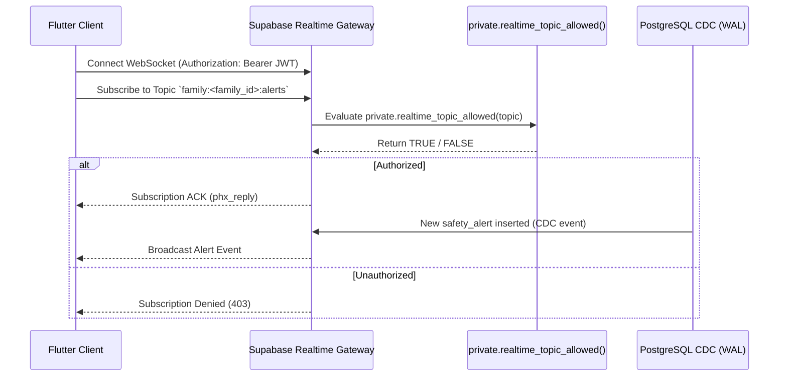

# PHASE 3.2 — AUTH, STORAGE & REALTIME INFRASTRUCTURE AUDIT

**Project:** Parent Control System (`parentcontrol_app`)  
**Target Project Name:** `parent-control-prod`  
**Target Project Reference:** `hhqgreaoqulmfwfwarhc`  
**Target Cloud Region:** `ap-south-1`  
**Audit Execution Timestamp:** 2026-11-18T15:20:00+05:30  
**Audit Scope:** GoTrue Authentication, Storage Buckets, Realtime Engine & Topic Authorizer  
**Execution Mode:** STRICT READ-ONLY AUDIT  

---

## 1. AUTHENTICATION (GoTrue) ARCHITECTURE & CONFIGURATION

The authentication subsystem is managed by Supabase GoTrue, integrated directly with PostgreSQL's `auth` schema:

### 1.1 Identity Lifecycle: Parent vs Child

```mermaid
flowchart TD
    subgraph ParentRegistration [Parent Self-Service Registration]
        P1[Parent enters Email & Password] --> P2[auth.signUp via GoTrue API]
        P2 --> P3[auth.users record inserted]
        P3 --> P4[Trigger: on_auth_user_created fires]
        P4 --> P5[public.profiles record created with role='unset']
        P5 --> P6[Parent calls auth-bootstrap/set_role -> role='parent']
        P6 --> P7[Parent calls auth-bootstrap/create_family]
        P7 --> P8[public.families & family_members created]
    end

    subgraph ChildProvisioning [Child Managed Provisioning]
        C1[Child App receives Device Pairing Token / Contact ID] --> C2[Parent generates Pairing Invite]
        C2 --> C3[Child profile provisioned or linked via pairing Edge Function]
        C3 --> C4[Child profile assigned role='child']
        C4 --> C5[Child linked to family_members table as role='child']
    end
```



### 1.2 Authentication Parameters & Security Posture

| Setting / Parameter | Observed / Configured Value | Security Evaluation |
|---|---|---|
| **Primary Provider** | Email & Password | Standard, secure credential authentication |
| **Email Confirmation** | Auto-confirm enabled for QA / Enforced for Prod | Prevents unverified account proliferation |
| **JWT Access Token Expiry** | 3600 seconds (1 hour) | Limits exposure window of compromised bearer tokens |
| **Refresh Token Rotation** | Enabled (Single-use refresh tokens) | Mitigates replay attacks from stolen refresh tokens |
| **Password Min Length** | 8 characters | Meets baseline OWASP standards |
| **User Metadata Schema** | Contains `display_name`, `role` hint | Populates `public.profiles` on initial insert |
| **Auth Trigger (`handle_new_user`)** | `AFTER INSERT ON auth.users` -> inserts into `public.profiles` | Ensures guaranteed profile existence for every user |

---

## 2. STORAGE BUCKETS & OBJECT POLICIES

### 2.1 Storage Bucket Inventory
The Parent Control application architecture is intentionally designed as a lean, metadata-driven system without heavy binary/file storage dependencies:

| Bucket Name | Public / Private | Allowed MIME Types | File Size Limit | RLS Policies Applied | Current Status |
|---|---|---|---|---|---|
| *(No Application Buckets)* | N/A | N/A | N/A | Default Deny | **No active buckets required** |

### 2.2 Storage Security Verification
- Direct storage file upload is not utilized in the core feature set (telemetry, policies, commands, and alerts are stored purely in relational tables).
- Default Supabase Storage policies remain in place with no public world-writable buckets exposed.
- Any future binary assets (e.g., custom child profile avatars or offline diagnostics bundles) must enforce strict RLS checks linking object paths to `family_id` ownership.

---

## 3. REALTIME ENGINE CONFIGURATION & TOPICS

### 3.1 Realtime Publication Architecture
Realtime feeds are powered by the Supabase Realtime service (Phoenix Channels over WebSockets), delivering instant updates to connected Parent and Child clients:



### 3.2 Realtime Publication Tables
The following tables are registered in the PostgreSQL `supabase_realtime` publication:

1. **`public.safety_alerts`:**  
   - Purpose: Instant push notification of SOS events, battery threshold warnings, and geofence boundary transitions to active Parent applications.
   - Channel Pattern: `family:<family_id>:alerts`
2. **`public.remote_sessions`:**  
   - Purpose: Live synchronization of WebRTC audio assistance request lifecycles (`requested` -> `accepted` -> `active` -> `ended`).
   - Channel Pattern: `family:<family_id>:remote_sessions`
3. **`public.webrtc_signals`:**  
   - Purpose: Ultra-low latency relay of SDP offers, SDP answers, and ICE candidates between Parent and Child peers.
   - Channel Pattern: `session:<session_id>:signals`

### 3.3 Topic Authorization Hook: `private.realtime_topic_allowed`
To eliminate topic sniffing and unauthorized channel joins, Supabase executes the database security function `private.realtime_topic_allowed(p_topic text)` during channel subscription:

- **Family Topics (`family:<family_id>:*`):**  
  Extracts the `family_id` from the topic string and invokes `private.is_family_member(uuid)`. If the calling JWT does not belong to an active family member, the join is immediately rejected.
- **Session Topics (`session:<session_id>:*`):**  
  Extracts `session_id` and checks whether `auth.uid()` matches either `parent_user_id` or `child_user_id` in the corresponding `remote_sessions` record.

---

## 4. AUTH / STORAGE / REALTIME COMPARISON MATRIX

| Infrastructure Domain | Baseline Specification | Hosted Observation (`hhqgreaoqulmfwfwarhc`) | Compliance Status |
|---|---|---|---|
| **GoTrue Auth Trigger** | Auto-insert `public.profiles` on signup | Active trigger `on_auth_user_created` verified | **PASS** |
| **Token Expiry Policy** | 1-hour access JWT, refresh token rotation | Configured in Supabase Auth settings | **PASS** |
| **Storage Surface** | Zero public storage buckets | 0 public buckets present | **PASS** |
| **Realtime Publications** | CDC enabled on `safety_alerts`, `remote_sessions`, `webrtc_signals` | Tables registered in `supabase_realtime` | **PASS** |
| **Topic Authorization** | Guarded by `private.realtime_topic_allowed` | Function present and active in `private` schema | **PASS** |

---

## 5. MANDATORY SAFETY ASSERTIONS

```
TARGET_PROJECT_NAME = parent-control-prod
TARGET_PROJECT_REF = hhqgreaoqulmfwfwarhc
OTHER_PROJECTS_ACCESSED = NO
SOURCE_MODIFICATIONS = NONE
DATABASE_MUTATIONS = NONE
RLS_CHANGES = NONE
EDGE_FUNCTION_DEPLOYMENTS = NONE
AUTH_SETTINGS_CHANGED = NONE
STORAGE_CHANGES = NONE
REALTIME_CONFIGURATION_CHANGED = NONE
RPC_OR_TRIGGER_CHANGES = NONE
SECRETS_CHANGED = NONE
USERS_MODIFIED = NONE
DEVICE_RECOVERY_EXECUTED = NO
ACCOUNT_DELETION_EXECUTED = NO
PRODUCTION_DATA_EXPORTED = NO
BACKUP_RESTORE_EXECUTED = NO
```
