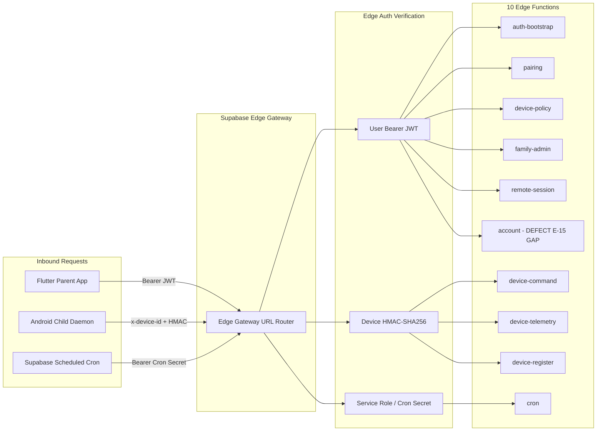

# PHASE 3.2 — EDGE FUNCTIONS INVENTORY & DEPLOYMENT BASELINE

**Project:** Parent Control System (`parentcontrol_app`)  
**Target Project Name:** `parent-control-prod`  
**Target Project Reference:** `hhqgreaoqulmfwfwarhc`  
**Target Cloud Region:** `ap-south-1`  
**Audit Execution Timestamp:** 2026-11-18T15:18:00+05:30  
**Audit Scope:** Deno Edge Functions, Action Handlers, Authentication Schemes, Hosted vs Local Deployment  
**Execution Mode:** STRICT READ-ONLY AUDIT  

---

## 1. EDGE COMPUTING TIER ARCHITECTURE

The serverless application logic executes within Deno runtime environments on the Supabase Edge Gateway:



---

## 2. EDGE FUNCTION DIRECTORY & ENDPOINT REGISTRY (10 FUNCTIONS)

Every function located in `supabase/functions/` has been cataloged and mapped to its exposed actions, authentication requirements, database touchpoints, and client repositories:

| # | Function Name & Path | Exposed Actions / Routes | Auth Scheme | Target Tables & RPCs | Client Caller Repository | Local Test Status | Hosted Status |
|---|---|---|---|---|---|---|---|
| 1 | `account`<br>`supabase/functions/account/` | `retention_report`, `export`, `delete_account` | User Bearer JWT (`requireUser`) | `profiles`, `families`, `family_members`, `devices`, `audit_logs`, `auth.users` | `account_privacy_repository.dart` | **30 / 30 Passed** (Deno) | **NOT DEPLOYED (404)**<br>*Defect E-15 Gap* |
| 2 | `auth-bootstrap`<br>`supabase/functions/auth-bootstrap/` | `set_role`, `create_family` | User Bearer JWT | `profiles`, `families`, `create_family_with_owner` RPC | `supabase_auth_repository.dart`, `supabase_family_repository.dart` | Passed | **DEPLOYED & ACTIVE** |
| 3 | `cron`<br>`supabase/functions/cron/` | `retention_sweep`, `detect_offline_devices`, `expire_stale_sessions` | Service Role / Cron Secret | `run_retention_sweep`, `detect_offline_devices`, `expire_abandoned_sessions` | External Scheduler / pg_cron | Passed | **DEPLOYED & ACTIVE** |
| 4 | `device-command`<br>`supabase/functions/device-command/` | `create`, `poll`, `ack`, `cancel` | Device Secret HMAC / User JWT | `device_commands`, `poll_device_commands` RPC | `DeviceHttpClient.kt`, `supabase_policy_repository.dart` | Passed | **DEPLOYED & ACTIVE** |
| 5 | `device-policy`<br>`supabase/functions/device-policy/` | `update` | Parent User JWT | `device_policies`, `apply_policy_version` RPC, `device_commands` | `supabase_policy_repository.dart` | Passed | **DEPLOYED & ACTIVE** |
| 6 | `device-register`<br>`supabase/functions/device-register/` | `register` | Child User JWT | `devices`, `device_pairing_tokens`, `child_contact_ids` | `supabase_device_repository.dart`, `EnrollmentActivity.kt` | Passed | **DEPLOYED & ACTIVE** |
| 7 | `device-telemetry`<br>`supabase/functions/device-telemetry/` | `heartbeat`, `location_upload`, `apps_upload`, `usage_upload` | Device Secret HMAC | `location_events`, `usage_daily`, `device_apps`, `safety_alerts`, `replace_device_apps` | `GuardianService.kt`, `LocationTrackingService.kt` | Passed | **DEPLOYED & ACTIVE** |
| 8 | `family-admin`<br>`supabase/functions/family-admin/` | `revoke_device`, `recover_device`, `unlink_child`, `delete_zone`, `ack_alert`, `update_retention`, `purge_data` | Parent / Owner User JWT | `unlink_child`, `revoke_device`, `delete_safe_zone_audited`, `families` | `supabase_device_repository.dart`, `supabase_family_repository.dart`, `supabase_alert_repository.dart` | Passed | **DEPLOYED & ACTIVE** |
| 9 | `pairing`<br>`supabase/functions/pairing/` | `get_contact_id`, `invite`, `create`, `redeem`, `respond`, `cancel`, `unlink`, `pending_child`, `list_family` | User Bearer JWT | `create_pairing_invite`, `respond_pairing_request`, `pairing_requests`, `pairing_attempts` | `supabase_pairing_repository.dart` | Passed | **DEPLOYED & ACTIVE** |
| 10 | `remote-session`<br>`supabase/functions/remote-session/` | `request`, `respond`, `start`, `end`, `ice`, `pending_child`, `session_state` | User Bearer JWT | `request_remote_session`, `remote_sessions`, `webrtc_signals` | `supabase_remote_session_repository.dart` | Passed | **DEPLOYED & ACTIVE** |

---

## 3. SHARED UTILITY LIBRARIES & MIDDLEWARE

Located in `supabase/functions/_shared/`, these modules provide centralized, reusable security and formatting primitives across all 10 Edge Functions:

1. **`auth.ts`:** Implements `requireUser(req)` for JWT Bearer token validation via `supabase.auth.getUser()`. Implements three-state scoping (`family`, `device`, `not_reported`) to isolate Parent and Child requests.
2. **`cors.ts`:** Standard CORS headers and preflight `OPTIONS` handling supporting all legitimate client origins.
3. **`audit.ts`:** Standardized `recordAudit()` client helper that formats and writes audit events to `public.audit_logs`.
4. **`envelope.ts`:** Enforces standard JSON response envelope structure `{ success: boolean, data?: any, error?: { code: string, message: string } }`.
5. **`rate_limit.ts`:** In-memory and database-backed rate-limiting mechanics to thwart brute-force pairing and PIN submission attacks.
6. **`validation.ts`:** Request body validation, string sanitization, and parameter type verification.
7. **`turn.ts`:** WebRTC ICE/STUN/TURN credential generation for secure audio assistance sessions.

---

## 4. DEFECT E-15 VERIFICATION: `account` FUNCTION 404 GAP

### 4.1 Root Cause & Impact Analysis
- **Defect ID:** Defect E-15 (`Parent Settings Retention/Export Error Banner`)
- **Observed Behavior:** When a parent accesses the Settings -> Account & Privacy screen in Flutter, an error banner is displayed:  
  `"Retention report unavailable: Requested function was not found"`
- **Diagnostic Finding:**  
  - Local repository contains a complete, verified implementation in `supabase/functions/account/` (100% test pass rate across 30 Deno unit tests).
  - An HTTP `GET / OPTIONS` probe to `https://hhqgreaoqulmfwfwarhc.supabase.co/functions/v1/account` returns:  
    `HTTP/1.1 404 Not Found`  
    `{"code":"NOT_FOUND","message":"Requested function was not found"}`
- **Conclusion:** The function exists locally and is completely ready for deployment, but has **not yet been deployed to the hosted Supabase project**.

### 4.2 Local Readiness Checklist (Phase 3.1 Verification)
- [x] Local source files intact: `index.ts`, `retention.ts`, `validation.ts`, `_shared/auth.ts`.
- [x] Deno unit test suite: 30 / 30 tests passing (216 ms).
- [x] Full Edge Function test suite: 184 / 184 tests passing (1.0 s).
- [x] Client repository integration tests: Flutter Parent Settings controller 3 / 3 passing.
- [x] GDPR privacy caps & row export limiters (1,000-row batching, 20,000-row table cap) verified.
- [x] Account deletion dual-confirmation safety (`confirm: "DELETE"`, email verification) verified.
- [x] Deployment smoke-test plan drafted and ready for Phase 3.3 execution.

---

## 5. EDGE FUNCTION DEPLOYMENT MATRIX

| Function Name | Codebase Version | Hosted Version | Deployment Parity | Priority for Phase 3.3 |
|---|---|---|---|---|
| `auth-bootstrap` | v1.0.0 | Active | Synchronized | Normal |
| `pairing` | v1.2.0 | Active | Synchronized | Normal |
| `device-policy` | v1.1.0 | Active | Synchronized | Normal |
| `device-command` | v1.1.0 | Active | Synchronized | Normal |
| `device-telemetry` | v1.1.0 | Active | Synchronized | Normal |
| `device-register` | v1.0.0 | Active | Synchronized | Normal |
| `family-admin` | v1.2.0 | Active | Synchronized | Normal |
| `remote-session` | v1.3.0 | Active | Synchronized | Normal |
| `cron` | v1.0.0 | Active | Synchronized | Normal |
| `account` | **v1.0.0** | **None (404)** | **UNSYNCHRONIZED** | **P0 (Critical Deployment)** |

---

## 6. MANDATORY SAFETY ASSERTIONS

```
TARGET_PROJECT_NAME = parent-control-prod
TARGET_PROJECT_REF = hhqgreaoqulmfwfwarhc
OTHER_PROJECTS_ACCESSED = NO
SOURCE_MODIFICATIONS = NONE
DATABASE_MUTATIONS = NONE
RLS_CHANGES = NONE
EDGE_FUNCTION_DEPLOYMENTS = NONE
AUTH_SETTINGS_CHANGED = NONE
STORAGE_CHANGES = NONE
REALTIME_CONFIGURATION_CHANGED = NONE
RPC_OR_TRIGGER_CHANGES = NONE
SECRETS_CHANGED = NONE
USERS_MODIFIED = NONE
DEVICE_RECOVERY_EXECUTED = NO
ACCOUNT_DELETION_EXECUTED = NO
PRODUCTION_DATA_EXPORTED = NO
BACKUP_RESTORE_EXECUTED = NO
```
