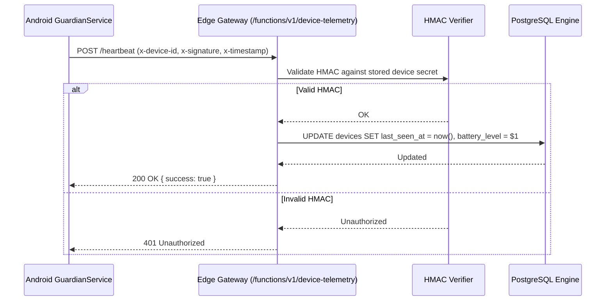
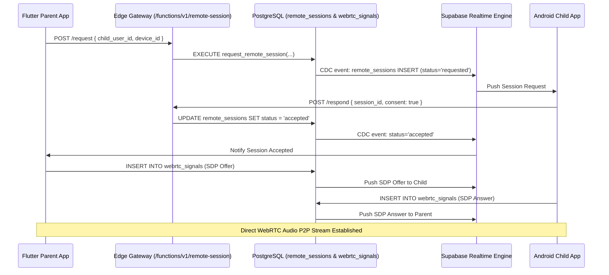

# PHASE 3.2 — FEATURE TO BACKEND DEPENDENCY MAP & TRACEABILITY MATRIX

**Project:** Parent Control System (`parentcontrol_app`)  
**Target Project Name:** `parent-control-prod`  
**Target Project Reference:** `hhqgreaoqulmfwfwarhc`  
**Target Cloud Region:** `ap-south-1`  
**Audit Execution Timestamp:** 2026-11-18T15:28:00+05:30  
**Audit Scope:** End-to-End Component Mapping: UI Features -> Client Repositories -> Edge Functions -> DB RPCs -> Tables -> Realtime  
**Execution Mode:** STRICT READ-ONLY AUDIT  

---

## 1. END-TO-END TRACEABILITY MATRIX

The matrix below provides complete, unbroken traceability for all 10 major functional subsystems of the Parent Control ecosystem, linking client user interface screens to backend storage and real-time triggers:

| # | Mobile / Client Feature | Flutter / Android Source File | Client Repository | Edge Function Endpoint | Database RPC / Stored Procedure | Relational Tables Touched | Triggers & Realtime Channels |
|---|---|---|---|---|---|---|---|
| **F-01** | **Parent Authentication & Family Onboarding** | `login_screen.dart`, `register_screen.dart`, `family_setup_screen.dart` | `supabase_auth_repository.dart`, `supabase_family_repository.dart` | `auth-bootstrap`<br>(`set_role`, `create_family`) | `private.handle_new_user()`, `public.create_family_with_owner()` | `auth.users`, `public.profiles`, `public.families`, `public.family_members` | Trigger: `on_auth_user_created`<br>RLS: `profiles_select_self_or_family` |
| **F-02** | **Child Enrollment & Hardware Pairing** | `pairing_screen.dart`, `child_home_screen.dart`, `EnrollmentActivity.kt` | `supabase_pairing_repository.dart`, `supabase_device_repository.dart` | `pairing`<br>(`invite`, `create`, `redeem`, `respond`), `device-register` | `public.create_pairing_invite()`, `public.respond_pairing_request()` | `device_pairing_tokens`, `pairing_requests`, `pairing_attempts`, `devices`, `child_contact_ids` | RLS: `pairing_requests_select_participants`<br>Index: `families_one_active_per_owner` |
| **F-03** | **Screen Time & App Restriction Policies** | `screen_time_screen.dart`, `app_rules_screen.dart`, `DeviceHttpClient.kt` | `supabase_policy_repository.dart` | `device-policy`<br>(`update`), `device-command` (`poll`, `ack`) | `public.apply_policy_version()`, `public.poll_device_commands()` | `device_policies`, `device_commands`, `device_apps` | RLS: `device_policies_select_parent_or_child`<br>Command polling loop |
| **F-04** | **Device Telemetry, Heartbeat & Offline Detection** | `GuardianService.kt`, `LocationTrackingService.kt`, `devices_screen.dart` | `supabase_device_repository.dart` | `device-telemetry`<br>(`heartbeat`, `usage_upload`, `apps_upload`), `cron` | `public.detect_offline_devices()`, `public.replace_device_apps()` | `devices`, `usage_daily`, `device_apps`, `safety_alerts` | Trigger: `devices_set_updated_at`<br>Channel: `family:<id>:alerts` |
| **F-05** | **Real-Time Location & Geofence Safe Zones** | `location_map_screen.dart`, `safe_zones_screen.dart` | `supabase_location_repository.dart`, `supabase_safe_zone_repository.dart` | `device-telemetry`<br>(`location_upload`), `family-admin` (`delete_zone`) | `public.delete_safe_zone_audited()` | `location_events`, `safe_zones`, `safe_zone_states`, `audit_logs` | Trigger: `safe_zone_states_set_updated_at`<br>Direct DELETE revoked |
| **F-06** | **Safety Alert Dispatch & Parent Acknowledgment** | `alerts_screen.dart`, `parent_shell.dart` | `supabase_alert_repository.dart` | `family-admin`<br>(`ack_alert`) | Handled via direct RLS update & Edge logging | `safety_alerts`, `audit_logs` | Publication: `supabase_realtime`<br>Channel: `family:<id>:alerts` |
| **F-07** | **WebRTC Remote Audio Assistance & Signaling** | `remote_assistance_screen.dart`, `WebRtcService.kt` | `supabase_remote_session_repository.dart` | `remote-session`<br>(`request`, `respond`, `ice`, `end`) | `public.request_remote_session()`, `public.expire_abandoned_sessions()` | `remote_sessions`, `webrtc_signals` | Trigger: `remote_sessions_transition_guard`<br>Channel: `session:<id>:signals` |
| **F-08** | **Device Hardware Recovery & Secret Re-issuance** | `device_recovery_screen.dart` | `supabase_device_repository.dart` | `family-admin`<br>(`recover_device`) | `public.request_device_recovery()` | `devices`, `audit_logs` | SECURITY DEFINER execution<br>Generates fresh HMAC secret |
| **F-09** | **Family Administration & Member Unlinking** | `family_members_screen.dart`, `devices_screen.dart` | `supabase_family_repository.dart`, `supabase_device_repository.dart` | `family-admin`<br>(`unlink_child`, `revoke_device`) | `public.unlink_child()`, `public.revoke_device()` | `family_members`, `devices`, `device_policies`, `audit_logs` | Atomic cascade cleanup<br>Immutable audit trail |
| **F-10** | **Account Deletion & GDPR Data Export** | `account_privacy_screen.dart` | `account_privacy_repository.dart` | `account`<br>(`retention_report`, `export`, `delete_account`) | `public.run_retention_sweep()` | `profiles`, `families`, `family_members`, `devices`, `audit_logs`, `auth.users` | **GAP: 404 NOT FOUND ON HOSTED**<br>*Ready to deploy in Phase 3.3* |

---

## 2. CLIENT-TO-BACKEND ARCHITECTURAL FLOW DIAGRAMS

### 2.1 Device Heartbeat & Telemetry Ingestion Flow (F-04)



### 2.2 WebRTC Audio Assistance Signaling Flow (F-07)



---

## 3. SINGLE POINT OF FAILURE (SPOF) ANALYSIS

1. **Supabase Edge Gateway Availability:**  
   - All client traffic routes through Kong/Edge Gateway at `hhqgreaoqulmfwfwarhc.supabase.co`. Gateway downtime suspends all API interactions.
   - *Mitigation:* Multi-AZ availability in AWS `ap-south-1`; Android child daemon implements offline queuing and exponential backoff retry.
2. **`account` Edge Function Unavailability (Defect E-15):**  
   - While the core tracking and safety loop operates normally, the Parent Settings Account & Privacy module fails completely due to the missing function.
   - *Mitigation:* Deploying `account` in Phase 3.3 closes this single point of failure.
3. **Database Concurrency on WebRTC Signaling:**  
   - Rapid bursts of ICE candidates during WebRTC handshake could introduce lock contention on `webrtc_signals`.
   - *Mitigation:* Migration `20261030000200_phase1_authorization.sql` introduced `(session_id, sequence)` unique indexing and batched signaling.

---

## 4. MANDATORY SAFETY ASSERTIONS

```
TARGET_PROJECT_NAME = parent-control-prod
TARGET_PROJECT_REF = hhqgreaoqulmfwfwarhc
OTHER_PROJECTS_ACCESSED = NO
SOURCE_MODIFICATIONS = NONE
DATABASE_MUTATIONS = NONE
RLS_CHANGES = NONE
EDGE_FUNCTION_DEPLOYMENTS = NONE
AUTH_SETTINGS_CHANGED = NONE
STORAGE_CHANGES = NONE
REALTIME_CONFIGURATION_CHANGED = NONE
RPC_OR_TRIGGER_CHANGES = NONE
SECRETS_CHANGED = NONE
USERS_MODIFIED = NONE
DEVICE_RECOVERY_EXECUTED = NO
ACCOUNT_DELETION_EXECUTED = NO
PRODUCTION_DATA_EXPORTED = NO
BACKUP_RESTORE_EXECUTED = NO
```
