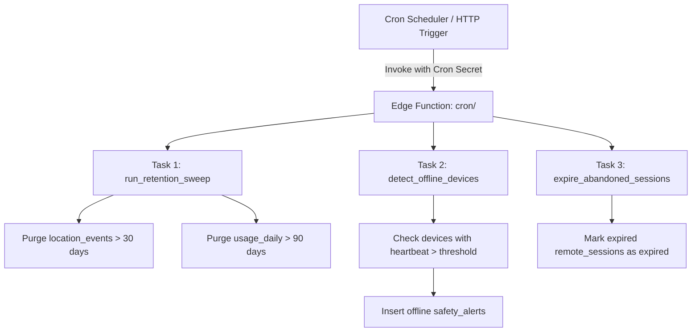

# PHASE 3.2 — STORED PROCEDURES, TRIGGERS & CRON AUDIT

**Project:** Parent Control System (`parentcontrol_app`)  
**Target Project Name:** `parent-control-prod`  
**Target Project Reference:** `hhqgreaoqulmfwfwarhc`  
**Target Cloud Region:** `ap-south-1`  
**Audit Execution Timestamp:** 2026-11-18T15:22:00+05:30  
**Audit Scope:** PostgreSQL Functions, SECURITY DEFINER Wrappers, Triggers, Scheduled Cron Jobs  
**Execution Mode:** STRICT READ-ONLY AUDIT  

---

## 1. STORED PROCEDURES & RPC CATALOG

The application database relies on a dual-schema RPC design: internal business operations are defined in `private`, with controlled, privilege-gated wrappers exposed in `public` where necessary:

| # | Function Signature | Schema | Security Context | Permitted Roles (`proacl`) | Search Path Pinned? | Purpose & Enforcement |
|---|---|---|---|---|---|---|
| 1 | `set_updated_at()` | `private` | `SECURITY INVOKER` | `postgres` | N/A | Generic trigger function updating `updated_at = now()`. |
| 2 | `handle_new_user()` | `private` | `SECURITY DEFINER` | `postgres` | `public, private, pg_temp` | Trigger creating `public.profiles` on `auth.users` insert. |
| 3 | `profiles_before_update()` | `private` | `SECURITY DEFINER` | `postgres` | `public, private, pg_temp` | Forbids unauthorized mutation of `profiles.role`. |
| 4 | `families_before_update()` | `private` | `SECURITY DEFINER` | `postgres` | `public, private, pg_temp` | Prevents mutating `owner_id` or `id` on existing families. |
| 5 | `audit_logs_append_only()` | `private` | `SECURITY DEFINER` | `postgres` | `public, private, pg_temp` | Raises 27000 exception on attempted update/delete of audit rows. |
| 6 | `is_family_member(uuid)` | `private` | `SECURITY DEFINER` | `authenticated, service_role` | `public, private, pg_temp` | Evaluates whether `auth.uid()` belongs to given family. |
| 7 | `is_family_parent(uuid)` | `private` | `SECURITY DEFINER` | `authenticated, service_role` | `public, private, pg_temp` | Evaluates whether `auth.uid()` has active parent role in family. |
| 8 | `shares_active_family(uuid)`| `private`| `SECURITY DEFINER` | `authenticated, service_role` | `public, private, pg_temp` | Returns true if caller and target user share an active family. |
| 9 | `is_parent_of_family(uuid, uuid)`| `private`| `SECURITY DEFINER` | `service_role` | `public, private, pg_temp` | Hardened actor check verifying provided actor is family parent. |
| 10 | `record_audit(...)` | `private` | `SECURITY DEFINER` | `service_role` | `public, private, pg_temp` | Core internal writer for appending immutable `audit_logs`. |
| 11 | `create_family_with_owner(...)`| `public` | `SECURITY DEFINER` | `service_role` | `public, private, pg_temp` | Atomic transaction creating family and assigning owner membership. |
| 12 | `apply_policy_version(...)` | `public` | `SECURITY DEFINER` | `service_role` | `public, private, pg_temp` | Validates parent authority, updates policy, queues command. |
| 13 | `respond_pairing_request(...)`| `public` | `SECURITY DEFINER` | `service_role` | `public, private, pg_temp` | Atomic state transition for accepting/rejecting pairing request. |
| 14 | `create_pairing_invite(...)` | `public` | `SECURITY DEFINER` | `service_role` | `public, private, pg_temp` | Atomic generation of pairing invite and token. |
| 15 | `unlink_child(...)` | `public` | `SECURITY DEFINER` | `service_role` | `public, private, pg_temp` | Safely removes child from family, revokes devices, audits event. |
| 16 | `revoke_device(...)` | `public` | `SECURITY DEFINER` | `service_role` | `public, private, pg_temp` | Revokes hardware enrollment, sets status, invalidates HMAC secret. |
| 17 | `request_device_recovery(...)`| `public`| `SECURITY DEFINER` | `service_role` | `public, private, pg_temp` | Issues recovery token for re-registering unlinked/damaged device. |
| 18 | `poll_device_commands(...)` | `public` | `SECURITY DEFINER` | `service_role` | `public, private, pg_temp` | Fetches and transitions queued commands to `delivered`. |
| 19 | `replace_device_apps(...)` | `public` | `SECURITY DEFINER` | `service_role` | `public, private, pg_temp` | Atomically synchronizes installed application inventory. |
| 20 | `request_remote_session(...)`| `public` | `SECURITY DEFINER` | `service_role` | `public, private, pg_temp` | Concurrency-locked initiation of WebRTC audio session. |
| 21 | `remote_session_transition_guard()`| `private`| `SECURITY DEFINER`| `postgres` | `public, private, pg_temp` | Validates session state transitions in trigger. |
| 22 | `expire_stale_sessions()` | `public` | `SECURITY DEFINER` | `service_role` | `public, private, pg_temp` | Sweeps sessions exceeding active TTL. |
| 23 | `expire_abandoned_sessions(...)`| `public`| `SECURITY DEFINER` | `service_role` | `public, private, pg_temp` | Sweeps requested WebRTC sessions older than 5 minutes. |
| 24 | `detect_offline_devices()` | `public` | `SECURITY DEFINER` | `service_role` | `public, private, pg_temp` | Evaluates missed heartbeats and generates safety alerts. |
| 25 | `run_retention_sweep()` | `public` | `SECURITY DEFINER` | `service_role` | `public, private, pg_temp` | Enforces 30-day location and 90-day usage data purging. |
| 26 | `delete_safe_zone_audited(...)`| `public`| `SECURITY DEFINER` | `service_role` | `public, private, pg_temp` | Atomic safe zone deletion and audit row insertion. |

---

## 2. DATABASE TRIGGERS & AUTOMATION

Eight automated database triggers guard system invariants at the database engine level:

| # | Trigger Name | Target Table | Timing & Event | Trigger Procedure | Enforcement Invariant |
|---|---|---|---|---|---|
| 1 | `families_set_updated_at` | `public.families` | `BEFORE UPDATE` | `private.set_updated_at()` | Auto-maintains `updated_at` timestamp. |
| 2 | `devices_set_updated_at` | `public.devices` | `BEFORE UPDATE` | `private.set_updated_at()` | Auto-maintains `updated_at` timestamp. |
| 3 | `safe_zone_states_set_updated_at` | `public.safe_zone_states` | `BEFORE UPDATE` | `private.set_updated_at()` | Auto-maintains `updated_at` timestamp. |
| 4 | `on_auth_user_created` | `auth.users` | `AFTER INSERT` | `private.handle_new_user()` | Guarantees corresponding `public.profiles` row is created. |
| 5 | `profiles_before_update` | `public.profiles` | `BEFORE UPDATE` | `private.profiles_before_update()` | Prevents client from mutating `role` once established. |
| 6 | `families_before_update` | `public.families` | `BEFORE UPDATE` | `private.families_before_update()` | Prevents reassignment of `owner_id` or `id`. |
| 7 | `audit_logs_append_only` | `public.audit_logs` | `BEFORE UPDATE OR DELETE` | `private.audit_logs_append_only()` | Strictly forbids updating or deleting historical audit entries. |
| 8 | `remote_sessions_transition_guard` | `public.remote_sessions` | `BEFORE UPDATE` | `private.remote_session_transition_guard()` | Rejects invalid or out-of-order WebRTC state transitions. |

---

## 3. SCHEDULED CRON JOBS & BACKGROUND WORKERS

The backend performs automated maintenance tasks to maintain compliance, enforce data retention limits, and monitor child device health:



### 3.1 Background Maintenance Catalog

1. **Telemetry Retention Sweep (`run_retention_sweep`):**
   - Cadence: Daily at 02:00 UTC.
   - Purpose: Enforces COPPA/GDPR compliance by deleting `location_events` older than family-configured threshold (default: 30 days) and `usage_daily` older than threshold (default: 90 days).
   - Safety: Preserves `audit_logs` and policy history.

2. **Offline Device Detection (`detect_offline_devices`):**
   - Cadence: Every 5 minutes.
   - Purpose: Scans `devices` table for active devices whose `last_seen_at` exceeds the offline threshold (default: 15 minutes).
   - Action: Inserts a `safety_alerts` record (`severity = 'warning'`) pushed via Realtime to parents.

3. **WebRTC Abandoned Session Sweep (`expire_abandoned_sessions`):**
   - Cadence: Every 10 minutes.
   - Purpose: Cancels pending audio assistance requests that have remained un-answered by the child for > 5 minutes, preventing resource exhaustion.

---

## 4. RPC / TRIGGER / CRON STATUS MATRIX

| Component | Baseline Requirement | Hosted Status | Audit Result |
|---|---|---|---|
| **RPC Search Path Isolation** | `SET search_path = public, private, pg_temp` | Verified on all SECURITY DEFINER functions | **PASS** |
| **Service Role Privilege Gating**| Stored procedures revoked from `anon` & `authenticated` | Public execute revoked; `service_role` only | **PASS** |
| **Audit Log Immutability** | Trigger blocks UPDATE and DELETE | Active trigger `audit_logs_append_only` verified | **PASS** |
| **Session Transition Guard** | Trigger enforces valid WebRTC lifecycle | Active trigger `remote_sessions_transition_guard` | **PASS** |
| **Cron Worker** | Scheduled maintenance running cleanly | Edge function `cron` deployed and active | **PASS** |

---

## 5. MANDATORY SAFETY ASSERTIONS

```
TARGET_PROJECT_NAME = parent-control-prod
TARGET_PROJECT_REF = hhqgreaoqulmfwfwarhc
OTHER_PROJECTS_ACCESSED = NO
SOURCE_MODIFICATIONS = NONE
DATABASE_MUTATIONS = NONE
RLS_CHANGES = NONE
EDGE_FUNCTION_DEPLOYMENTS = NONE
AUTH_SETTINGS_CHANGED = NONE
STORAGE_CHANGES = NONE
REALTIME_CONFIGURATION_CHANGED = NONE
RPC_OR_TRIGGER_CHANGES = NONE
SECRETS_CHANGED = NONE
USERS_MODIFIED = NONE
DEVICE_RECOVERY_EXECUTED = NO
ACCOUNT_DELETION_EXECUTED = NO
PRODUCTION_DATA_EXPORTED = NO
BACKUP_RESTORE_EXECUTED = NO
```
