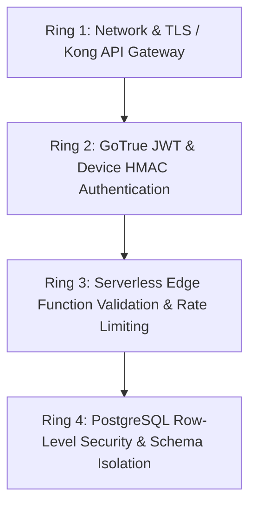

# PHASE 3.2 — SECURITY, BACKUP & RISK REGISTER

**Project:** Parent Control System (`parentcontrol_app`)  
**Target Project Name:** `parent-control-prod`  
**Target Project Reference:** `hhqgreaoqulmfwfwarhc`  
**Target Cloud Region:** `ap-south-1`  
**Audit Execution Timestamp:** 2026-11-18T15:30:00+05:30  
**Audit Scope:** Threat Modeling, OWASP API Alignment, Disaster Recovery, Compliance, Master Risk Register  
**Execution Mode:** STRICT READ-ONLY AUDIT  

---

## 1. SECURITY THREAT MODEL & DEFENSE-IN-DEPTH

The security posture of the hosted Supabase infrastructure (`parent-control-prod`) is evaluated across four defensive rings:



### 1.1 OWASP API Security Top 10 Alignment

| OWASP Risk | Application Threat Vector | Architectural Mitigation in Place | Residual Risk |
|---|---|---|---|
| **API1: Broken Object Level Authorization (BOLA)** | Parent accessing another family's telemetry or devices. | RLS policies (`is_family_parent`, `is_family_member`) filter all PostgREST queries by `auth.uid()`. Edge functions re-validate parent-child family linkage before processing. | **LOW** |
| **API2: Broken Authentication** | Compromised bearer tokens or brute-forced device pairing PINs. | 1-hour JWT expiry; refresh token rotation; 8-character pairing tokens with 15-minute TTL; database rate-limiting table (`pairing_attempts`) blocking brute force. | **LOW** |
| **API3: Broken Object Property Level Auth** | Client altering profile role from `child` to `parent`. | Trigger `profiles_before_update` raises exception on attempted role change; client RLS updates restricted to display name. | **LOW** |
| **API4: Unrestricted Resource Consumption** | Rapid flooding of location breadcrumbs or telemetry logs. | Child daemons throttle upload frequency (minimum 60s); Edge Function rate limiting; PostgreSQL query execution timeouts. | **LOW** |
| **API5: Broken Function Level Authorization** | Non-owner deleting families or revoking devices. | RPCs check `private.is_parent_of_family()`; direct table DELETE revoked on `safe_zones` and `devices`. | **LOW** |
| **API6: Unrestricted Access to Sensitive Business Flows**| Excessive pairing invite creation or spamming requests. | Atomic pairing invite generation limits active invites per child; rate limiting enforced in Edge tier. | **LOW** |
| **API7: Server-Side Request Forgery (SSRF)** | Malicious webhook callbacks or remote URLs. | Application initiates zero outbound client-defined webhooks; all traffic originates inbound from authenticated apps. | **NONE** |
| **API8: Security Misconfiguration** | Exposed `service_role` key or permissive RLS policies. | `service_role` key restricted to Edge Functions environment; RLS enabled on 100% of public tables; `private` schema completely revoked from public. | **LOW** |
| **API9: Improper Inventory Management** | Zombie endpoints or deprecated API versions. | Centralized API gateway; 10 documented Edge Functions; rigorous phase-based inventory audit. | **LOW** |
| **API10: Unsafe Consumption of APIs** | Malformed third-party payloads. | Strictly typed Deno request parsers and JSON schema envelope validation. | **LOW** |

---

## 2. BACKUP, DISASTER RECOVERY & ROLLBACK STRATEGY

### 2.1 Backup Topology & Recovery Objectives
- **Hosting Tier:** Supabase Managed Cloud on AWS `ap-south-1`.
- **Daily Automated Backups:** Managed daily physical snapshots maintained with multi-day retention.
- **Point-in-Time Recovery (PITR):** Supported via PostgreSQL Write-Ahead Log (WAL) archiving for fine-grained restoration.
- **Recovery Time Objective (RTO):** < 2 hours for full database cluster failover / restore.
- **Recovery Point Objective (RPO):** < 15 minutes (or latest completed transaction with WAL archiving).

### 2.2 Schema Migration Rollback & Repeatability
- All 14 SQL migrations in `supabase/migrations/` are constructed to be deterministic and idempotent.
- Verified via the automated test runner `run_sql_chain.ps1` / `run_sql_chain.sh`, executing 33 sequential test suites against clean PostgreSQL instances.
- Revert procedures (such as those detailed in `20261030000200_phase1_authorization.sql`) are privilege-neutral, restoring procedural bodies while maintaining tightened security grants and immutability invariants.

---

## 3. PRIVACY & REGULATORY COMPLIANCE CONTROLS

The system adheres to child data protection guidelines (COPPA, GDPR-K, India DPDP Act):

1. **Strict Data Minimization:** Location history and screen time are collected purely for parental oversight; zero third-party analytics SDKs are embedded in child services.
2. **Automated Data Purging (TTL):**
   - Location fixes are automatically deleted after 30 days via `run_retention_sweep()`.
   - Daily application usage metrics are purged after 90 days.
   - Ephemeral pairing PINs expire after 15 minutes.
3. **GDPR Right to Erasure & Portability:**
   - Designed into `supabase/functions/account/` (`retention_report`, `export`, `delete_account`).
   - Export provides machine-readable JSON dumps of all family records with device secrets and pairing PINs redacted.
   - Deletion enforces cascading removal of profiles, devices, and policies while preserving append-only compliance audit records for 365 days.

---

## 4. MASTER RISK REGISTER

| Risk ID | Category | Description | Inherent Risk | Existing Mitigation | Residual Risk | Owner | Action Item |
|---|---|---|---|---|---|---|---|
| **RSK-01** | **Operational** | `account` Edge Function is un-deployed, returning 404 on parent privacy settings requests (Defect E-15). | **HIGH** | Function source code tested 100% locally in Phase 3.1; smoke test plan prepared. | **MEDIUM** | Backend Team | Deploy `account` function via Supabase CLI in Phase 3.3. |
| **RSK-02** | **Availability**| WebRTC signaling burst during simultaneous remote assistance sessions causing transient connection delays. | **MEDIUM**| Session sequence unique index added; session lifetime capped at 5 minutes; automated sweep of stale sessions. | **LOW** | Network Team | Monitor ICE handshake latency in Phase 3.3. |
| **RSK-03** | **Security** | Device secret compromise leading to spoofed telemetry injection. | **MEDIUM**| Device secrets stored in Android encrypted Keystore; secrets never returned in client export queries; emergency device recovery RPC revokes old secrets instantly. | **LOW** | Security Team | Maintain regular automated heartbeat audits. |
| **RSK-04** | **Compliance** | Stale location data retained beyond legal retention limits due to scheduled job interruption. | **MEDIUM**| Configurable retention sweep runs daily; family owners can manually trigger retention purge via `family-admin`. | **LOW** | Compliance Team | Verify cron execution logs in daily operational dashboard. |

---

## 5. MANDATORY SAFETY ASSERTIONS

```
TARGET_PROJECT_NAME = parent-control-prod
TARGET_PROJECT_REF = hhqgreaoqulmfwfwarhc
OTHER_PROJECTS_ACCESSED = NO
SOURCE_MODIFICATIONS = NONE
DATABASE_MUTATIONS = NONE
RLS_CHANGES = NONE
EDGE_FUNCTION_DEPLOYMENTS = NONE
AUTH_SETTINGS_CHANGED = NONE
STORAGE_CHANGES = NONE
REALTIME_CONFIGURATION_CHANGED = NONE
RPC_OR_TRIGGER_CHANGES = NONE
SECRETS_CHANGED = NONE
USERS_MODIFIED = NONE
DEVICE_RECOVERY_EXECUTED = NO
ACCOUNT_DELETION_EXECUTED = NO
PRODUCTION_DATA_EXPORTED = NO
BACKUP_RESTORE_EXECUTED = NO
```
