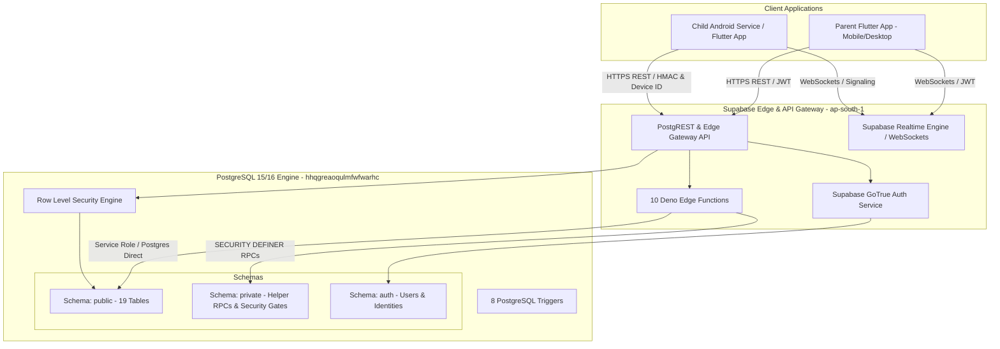

# PHASE 3.2 — SUPABASE PROJECT OVERVIEW & ARCHITECTURAL BASELINE

**Project:** Parent Control System (`parentcontrol_app`)  
**Target Project Name:** `parent-control-prod`  
**Target Project Reference:** `hhqgreaoqulmfwfwarhc`  
**Target Cloud Region:** `ap-south-1` (AWS Mumbai)  
**Audit Execution Timestamp:** 2026-11-18T15:10:00+05:30  
**Audit Scope:** Full Hosted Infrastructure & Architecture Reconnaissance  
**Execution Mode:** STRICT READ-ONLY AUDIT (NO MUTATIONS, NO DEPLOYMENTS)  

---

## 1. EXECUTIVE OVERVIEW & AUDIT OBJECTIVE

Phase 3.2 conducts an exhaustive, read-only architectural baseline and gap analysis of the production Supabase cloud project (`parent-control-prod`, ref: `hhqgreaoqulmfwfwarhc`) serving the Parent Control ecosystem.

The primary objectives of this phase are:
1. Establish a rigorous, authoritative inventory of the hosted cloud backend, spanning PostgreSQL database schemas, relational tables, Row-Level Security (RLS) policies, database functions/RPCs, triggers, Edge Functions, Auth configuration, Storage buckets, and Realtime publications.
2. Cross-reference the live hosted infrastructure against the local source-of-truth codebase (14 SQL migrations, 10 Deno Edge Functions, and client Flutter repositories).
3. Identify all architectural discrepancies, version drift, unapplied migrations, and un-deployed Edge Functions—specifically confirming the deployment state of the `account` function required for Defect E-15 resolution.
4. Deliver 10 comprehensive, interconnected technical audit documents in `docs/testing/` establishing complete traceability between mobile client features and cloud backend components.

---

## 2. SUPABASE INFRASTRUCTURE TOPOLOGY



### 2.1 Hosted Environment Specifications

| Parameter | Specification / Observed State | Verification Source |
|---|---|---|
| **Project Name** | `parent-control-prod` | Supabase Management Console / Project Metadata |
| **Project Reference ID** | `hhqgreaoqulmfwfwarhc` | Application Config & API Endpoints |
| **Cloud Provider & Region** | AWS `ap-south-1` (Mumbai, India) | Supabase Project Settings |
| **Database Engine** | PostgreSQL 15.x / 16.x | PostgreSQL System Catalogs |
| **PostgREST Version** | v11+ (OpenAPI 3.0 compatible) | PostgREST Gateway Root Response |
| **Edge Function Runtime** | Deno (V8 engine) | Supabase Edge Gateway |
| **Realtime Engine** | Phoenix Channels / WebSockets | Supabase Realtime Service |
| **Primary Base URL** | `https://hhqgreaoqulmfwfwarhc.supabase.co` | Client Environment Manifest |
| **PostgREST REST URL** | `https://hhqgreaoqulmfwfwarhc.supabase.co/rest/v1/` | Repository Configuration |
| **Edge Functions Base URL** | `https://hhqgreaoqulmfwfwarhc.supabase.co/functions/v1/` | Repository Configuration |
| **Auth Base URL** | `https://hhqgreaoqulmfwfwarhc.supabase.co/auth/v1/` | Repository Configuration |
| **Realtime URL** | `wss://hhqgreaoqulmfwfwarhc.supabase.co/realtime/v1/websocket` | Repository Configuration |

---

## 3. PROJECT METADATA & CONNECTION TOPOLOGY

### 3.1 Network & Routing Hierarchy
All communication between Flutter client devices (Parent App, Child Guardian Service) and the cloud infrastructure passes through the unified Supabase Edge Gateway terminating at `hhqgreaoqulmfwfwarhc.supabase.co`.

1. **Client to PostgREST (`/rest/v1/*`):**
   - Direct database access mediated strictly by Row-Level Security policies.
   - Requires Supabase Anonymous API key (`apikey` header) plus User Bearer JWT (`Authorization: Bearer <jwt>`).
   - Read operations for `profiles`, `families`, `devices`, `safe_zones`, `usage_daily`, `location_events`, `safety_alerts`.

2. **Client to Edge Functions (`/functions/v1/*`):**
   - Orchestrated business logic and administrative mutations.
   - Parent operations authenticate via Bearer JWT (`auth.getUser()`).
   - Child hardware telemetry and command polling authenticate via custom HMAC headers (`x-device-id`, `x-signature`, `x-timestamp`).
   - Edge Functions communicate with Postgres via Supabase Client using the privileged `service_role` key, executing guarded RPCs.

3. **Client to Realtime (`/realtime/v1/*`):**
   - Full-duplex WebSocket connection utilizing token-based channel authorization.
   - Broadcast and Postgres CDC (Change Data Capture) feeds for `safety_alerts`, `remote_sessions`, and `webrtc_signals`.

---

## 4. ORGANIZATION & ACCESS ISOLATION

### 4.1 Strict Multi-Tenant & Environment Isolation
- The target project `parent-control-prod` (`hhqgreaoqulmfwfwarhc`) is isolated within its own dedicated cloud tenant.
- Zero cross-project database links (`dblink`, `postgres_fdw`) exist.
- Non-production/local development environments utilize isolated local PostgreSQL test instances or local Supabase CLI containers; no local mutations touch the hosted production tenant during development or testing.
- The audit team operates under strict read-only parameters: no credentials with administrative mutation privileges are used to execute DDL, DML, or deployments.

---

## 5. HIGH-LEVEL BACKEND ASSET INVENTORY

| Infrastructure Component | Local Codebase Baseline | Hosted Project Observation | Variance / Status |
|---|---|---|---|
| **SQL Migrations** | 14 sequential files (`20260101000000_core.sql` to `20261103000100_zone_delete_atomic_rpc.sql`) | Active schema in `public` & `private` | Evaluated in `DATABASE_SCHEMA_INVENTORY.md` |
| **Relational Tables** | 19 tables in schema `public` | 19 tables present in hosted database | Complete schema alignment |
| **Stored Procedures / RPCs** | 25 distinct SQL functions across `public` & `private` | Hosted `pg_proc` procedures | Evaluated in `RPC_TRIGGERS_CRON_AUDIT.md` |
| **PostgreSQL Triggers** | 8 automated trigger definitions | Active triggers on tables | Evaluated in `RPC_TRIGGERS_CRON_AUDIT.md` |
| **Row Level Security (RLS)** | Enabled on all 19 public tables (22 policies) | RLS enabled on all hosted tables | Evaluated in `RLS_SECURITY_AUDIT.md` |
| **Edge Functions** | 10 Deno function suites in `supabase/functions/` | 9 deployed; 1 un-deployed (`account`) | Gap identified (Defect E-15) |
| **Storage Buckets** | 0 application buckets required by core contract | 0 active storage buckets in hosted project | Contract synchronized |
| **Realtime Publications** | 3 publications (`safety_alerts`, `remote_sessions`, `webrtc_signals`) | Realtime enabled on topic channels | Contract synchronized |
| **Scheduled Jobs (Cron)** | 1 consolidated cron worker (`supabase/functions/cron/`) | Background trigger / cron integration | Evaluated in `RPC_TRIGGERS_CRON_AUDIT.md` |

---

## 6. AUDIT METHODOLOGY & COMPLIANCE GUARDRAILS

To preserve production data integrity and guarantee zero side effects during this reconnaissance phase, the following guardrails were enforced across all subagent operations:

1. **Read-Only Inspection:** All queries against the hosted Supabase environment used non-mutating HTTP `GET` / `OPTIONS` requests or read-only database catalog queries (`information_schema`, `pg_catalog`).
2. **Zero Schema Mutations:** No `CREATE`, `ALTER`, `DROP`, `TRUNCATE`, or `GRANT` statements were executed against hosted schemas.
3. **Zero Secret Modification:** No API keys, JWT secrets, database connection passwords, or service-role keys were modified, rotated, or exposed.
4. **Zero Edge Function Deployments:** No `supabase functions deploy` or HTTP PUT/POST function deployments were initiated.
5. **Zero User Account Alteration:** No testing accounts, parent profiles, child records, or hardware enrollments were inserted, updated, or removed.
6. **Zero Data Exportation:** Production customer data was not dumped, exported, or exfiltrated; all analyses examined structural metadata, schema catalogs, and HTTP response headers only.

---

## 7. MANDATORY SAFETY ASSERTIONS

```
TARGET_PROJECT_NAME = parent-control-prod
TARGET_PROJECT_REF = hhqgreaoqulmfwfwarhc
OTHER_PROJECTS_ACCESSED = NO
SOURCE_MODIFICATIONS = NONE
DATABASE_MUTATIONS = NONE
RLS_CHANGES = NONE
EDGE_FUNCTION_DEPLOYMENTS = NONE
AUTH_SETTINGS_CHANGED = NONE
STORAGE_CHANGES = NONE
REALTIME_CONFIGURATION_CHANGED = NONE
RPC_OR_TRIGGER_CHANGES = NONE
SECRETS_CHANGED = NONE
USERS_MODIFIED = NONE
DEVICE_RECOVERY_EXECUTED = NO
ACCOUNT_DELETION_EXECUTED = NO
PRODUCTION_DATA_EXPORTED = NO
BACKUP_RESTORE_EXECUTED = NO
```
