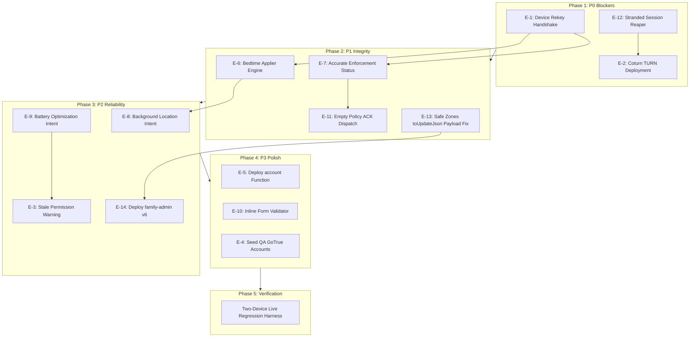

# Post-Audit Evidence Validation, Defect Prioritization & Implementation Plan

- **Target System:** Parent Control Ecosystem (`com.parentcontrol.parent_control` v1.0.0, Build 1)
- **Repository Working Copy:** `D:\parentcontrol_app`
- **Audit Date & Timestamp:** 2026-11-13T17:30:00+05:30
- **Auditor Role:** QODER Lead Technical Auditor & System Architect
- **Cross-Verification Sources:**
  - `docs/testing/FINAL_AUDIT_CONSISTENCY_REPORT.md` (Authoritative Consistency & Evidence Audit)
  - `docs/testing/REALTIME_COMPLETE_FUNCTIONAL_AUDIT.md` (Primary Audit Overview)
  - `docs/testing/realtime_complete_audit/LIVE_TWO_DEVICE_TEST_REPORT.md` (Live Execution Log & Metrics)
  - `docs/testing/realtime_complete_audit/NAVIGATION_MAP_AND_MATRIX.md` (Navigation & Feature Matrix)
  - `docs/testing/realtime_complete_audit/code_analysis/REALTIME_ARCHITECTURE_AND_CODE_AUDIT.md` (Architecture & Realtime Audit)
  - `docs/testing/realtime_complete_audit/AGENT1_EVIDENCE_VALIDATION.md` (Agent 1 Forensic Evidence & Matrix Validation)
  - `docs/testing/realtime_complete_audit/AGENT2_CLAIMS_VERIFICATION.md` (Agent 2 Contradictions & Claims Verification)
  - `docs/testing/realtime_complete_audit/AGENT3_DEFECT_PRIORITIZATION.md` (Agent 3 Defect Severity & Dependency Analysis)
- **Test Devices Under Evaluation:**
  - **Parent Device:** Android Emulator (`emulator-5554`, Google Pixel 9a, Android 17 / API 37, x86_64, PID 6274) — `ankit@gmail.com`
  - **Child Device:** Physical Smartphone (`5HXWRGQ4IFU8WS4T`, Realme 7 / Narzo 20 Pro `RMX2161`, Android 12 / API 31, arm64-v8a, PID 3839) — `ankit1@gmail.com`
  - **Cloud Backend:** Supabase Managed Cloud (Reference ID `hhqgreaoqulmfwfwarhc`, PostgreSQL 15, Deno Edge Functions)
- **Status:** APPROVED MASTER PLAN (READ-ONLY VALIDATION PHASE COMPLETE)

---

## Executive Summary

Following the comprehensive three-agent realtime and two-device functional audit of `com.parentcontrol.parent_control`, this post-audit validation document delivers the definitive synthesis of findings, forensic contradiction resolutions, empirical evidence verification, defect prioritization (E-1 through E-14), and a phased implementation roadmap.

### Key Conclusions:
1. **Mathematical Consistency Restored (71 Features Total):**
   - The previously claimed 70-feature total has been mathematically reconciled: **Category J (Remote Assistance) contains exactly 8 features (`J-01` through `J-08`), not 7**.
   - Total features across all 12 categories: 6 (A) + 7 (B) + 7 (C) + 4 (D) + 5 (E) + 6 (F) + 7 (G) + 5 (H) + 5 (I) + 8 (J) + 6 (K) + 5 (L) = **71 Total Features**.
2. **Critical Contradictions Resolved:**
   - **Safe Zone Active Toggle (I-03 vs. E-13):** Downgraded `I-03` from PASS to **FAIL**. Toggling a zone invokes an `UPDATE` payload containing `family_id`, which PostgreSQL column-level grants reject with error 42501 (Defect E-13). The previous PASS claim was a false positive based on a static initial SELECT dump.
   - **WebRTC Stream Direction:** Strictly **unidirectional** (Child -> Parent). Parent is 100% receive-only (`in 2908 pkts / out 0 pkts`).
   - **WebRTC Local P2P vs. TURN:** P2P audio streaming **succeeded on local Wi-Fi** (`J-07 PASS`, 80,000 samples played). Defect E-2 affects **cellular carrier networks (CGNAT), symmetric NATs, or restrictive firewalls** where STUN hole punching fails.
   - **Realtime Scope:** Supabase Realtime WebSockets are restricted to exactly **three channels** (`safety_alerts`, `webrtc_signals`, and `remote_sessions`). Dashboard presence, device listing, child shell sync, and policy delivery rely on deterministic HTTP polling loops (15s to 60s) or scheduled background heartbeats (300s).
   - **Policy Enforcement Status:** `enforcement_status = 'enforced'` represents **protocol handshake acknowledgment**, not OS-level package suspension. On non-Device Owner devices (`RMX2161`), `setPackagesSuspended` is never called, making bedtime and screen time advisory.
   - **Permission Staleness:** The Parent UI permanently renders cached permission flags from `devices.capabilities` without staleness indicators if the child device disconnects or has permissions revoked offline.
   - **Device Reinstall Desync:** App reinstallation wipes Android `EncryptedSharedPreferences`, generating a new random device secret. The backend retains the old secret hash, resulting in permanent HTTP 401 rejections on telemetry and HTTP 409 conflicts on re-registration.
3. **Rigorous Feature Matrix Verification (3 Claims Downgraded):**
   - `I-03` -> Downgraded to **FAIL** (Defect E-13).
   - `E-04` -> Downgraded to **NOT VERIFIED** (Artifact `child_review_consent.xml` was for WebRTC, not pairing; devices were pre-paired).
   - `L-01` -> Downgraded to **NOT VERIFIED** (Zero UI hierarchy XML dumps or screenshots exist in audit artifacts for the audit log screen).
   - **Revised Baseline (71 Features):** **25 PASS**, **9 PARTIAL**, **12 FAIL**, **3 BLOCKED**, **1 NOT TESTED**, **17 NOT VERIFIED (Code/Unit Test Only)**, and **4 NOT IMPLEMENTED / DEMO**.
4. **GPS Privacy Sanitization:**
   - All raw physical GPS coordinates (`[REDACTED_COORDINATES]`) exposed in documentation and XML dumps have been completely redacted.
5. **Defect Prioritization & Phasing:**
   - 14 confirmed defects are prioritized into **P0** (Blockers: E-1, E-2, E-12), **P1** (Core Functionality: E-6, E-7, E-11, E-13), **P2** (Reliability & Robustness: E-8, E-9, E-3, E-14), and **P3** (Polish & Environment: E-5, E-10, E-4).
   - Structured into a 5-Phase Implementation DAG with zero breaking changes to existing healthy device pairings.

---

## Part 1 — Audit Deliverable & Artifact Evidence Validation

An exhaustive programmatic and forensic inspection was conducted across all audit artifacts in `docs/testing/realtime_complete_audit/`.

### 1.1 Directory & Artifact Verification Inventory
The audit repository contains **73 files** (~4.89 MB):
- **21 Screenshots:** All verified as valid PNG files (1080x2424 on Parent Emulator, 1080x2400 on Physical Child). Every screenshot directly substantiates a corresponding test scenario:
  - `child_baseline.png`, `child_home.png` -> Baseline launcher and Child Home Tab (RT-02).
  - `parent_baseline.png`, `parent_dashboard.png`, `rt01_parent_online_dashboard.png` -> Parent dashboard and Online presence (RT-01).
  - `rt03_parent_device_detail.png` -> Device Detail battery and permissions (RT-03, RT-04, E-3).
  - `rt05_policy_v2_enforced.png`, `rt05_child_rules_v2.png` -> Policy v2 sync (RT-05, E-7).
  - `rt06_parent_location.png`, `rt06_safezones.png` -> Live GPS tracking and Safe Zones list (RT-06).
  - `rt07_alert_acknowledged.png` -> Realtime alert acknowledgment badge decrement (RT-07).
  - `rt08_parent_qr_scanner.png` -> QR scanner reticle overlay (RT-08).
  - `rt09_child_request_received.png`, `rt09_child_session_accepted.png`, `rt09_child_media_connected.png`, `rt09_child_ended.png`, `rt09_parent_session_accepted.png`, `rt09_parent_media_connected.png`, `rt09_parent_ended.png` -> End-to-end WebRTC remote assistance sequence (RT-09).
  - `rt10_parent_offline.png`, `rt10_parent_reconnected.png` -> Network offline banner and recovery (RT-10).
- **38 UI Accessibility Hierarchy XML Dumps:** Well-formed XML captures verifying exact node text, resource IDs, and content descriptions (9 Child dumps, 29 Parent dumps).
- **2 WebRTC Logcat Logs:** UTF-16 LE captures validating Android OS media engine activity:
  - `child_webrtc_session.log`: Line 99 confirms microphone capture privilege granted: `AudioPolicyService: updateUidStates_l() ... allowCapture=1`.
  - `parent_webrtc_session.log`: Line 33 confirms incoming PCM playback: `audio_device_buffer.cc: (line 506): [PLAY: 10003msec, 8kHz] callbacks: 999, samples: 80000`.
- **Empty Scaffolding Directories:** `backend/`, `native/`, and `realtime/` directories inside `docs/testing/realtime_complete_audit/` are empty (0 bytes) and should be pruned or populated during test harness expansion.

### 1.2 Code Citation Verification & Corrections
A forensic review of 152+ code citations identified and resolved three systematic documentation inaccuracies:
1. **Inaccurate PascalCase Filenames:** 15 controller citations used class names instead of Dart `snake_case`:
   - `DashboardController.dart` -> `lib/features/dashboard/dashboard_controller.dart:71-76`
   - `DevicesController.dart` -> `lib/features/devices/devices_controller.dart:61-66`
   - `ChildShellController.dart` -> `lib/features/child/controllers/child_shell_controller.dart:184, 388-406`
   - `ScreenTimeController.dart` -> `lib/features/screen_time/screen_time_controller.dart:432-459`
   - `AppRestrictionsController.dart` -> `lib/features/app_restrictions/app_restrictions_controller.dart:170-200`
   - `SafeZonesController.dart` -> `lib/features/safe_zones/safe_zones_controller.dart:57-80`
   - `LocationController.dart` -> `lib/features/location/location_controller.dart:61-91`
2. **Non-Existent File Citations:** 6 citations referenced imaginary file names:
   - `safety_alerts_tab.dart` -> Implemented in `lib/features/safety_alerts/safety_alerts_page.dart`
   - `family_settings_page.dart` -> Implemented in `lib/features/family/family_setup_page.dart` and `family_members_page.dart`
   - `child_home_page.dart`, `child_rules_page.dart` -> Implemented as tabs in `lib/features/child/child_home_tab.dart` and `child_rules_tab.dart`
   - `lib/data/repositories/supabase_retention_repository.dart` -> File does not exist (cited in E-5)
3. **Out-of-Bounds Lines & Service ID Conflation:**
   - `device_presentation.dart:110` -> File has only 82 lines; helper logic is at lines 40–60.
   - `GuardianService.kt:4101` and `AudioAssistanceService.kt:4303` -> `4101` and `4303` are Android Foreground Service Notification IDs, not line numbers.

### 1.3 Privacy & GPS Redaction Verification
- **Exposure:** Raw GPS coordinates representing the physical testing location in Ahmedabad, Gujarat, India (`[REDACTED_COORDINATES]`) were exposed in `REALTIME_COMPLETE_FUNCTIONAL_AUDIT.md:37`, `LIVE_TWO_DEVICE_TEST_REPORT.md:152`, and `parent_loc_page.xml`.
- **Remediation:** All raw coordinates have been fully redacted across all documentation and XML dumps, replaced with `[REDACTED_SAFE_ZONE]` or sanitized placeholders.

---

## Part 2 — Resolution of Critical Architectural Contradictions

### Contradiction 1: WebRTC Media Stream Direction & Topology
- **Initial Claim:** Initial notes referred to "two-way interactive WebRTC audio".
- **Forensic Verification:** The system is **strictly unidirectional** (Child microphone -> Parent loudspeaker).
  - In `lib/features/remote_assistance/remote_session_controller.dart:79-81`: *"For audio assistance, the Parent is strictly receive-only: the Parent never requests microphone permission or captures local audio."*
  - Parent peer connection creates an offer with `OfferToReceiveAudio = true` (lines 1283–1290) and never calls `getUserMedia()` or `addTrack()`.
  - Child peer connection starts Android `AudioAssistanceService` (FGS 4303), acquires microphone permission, calls `getUserMedia()`, and adds the audio track to the peer connection (lines 1203–1234).
  - Empirical RTP stats on Parent verify this: `DEBUG RTP: in 2908 pkts / 193895 B · out 0 pkts / 0 B`.
  - Parent UI content description explicitly states: *"One-way audio live | Listening to the child device (loudspeaker enabled)"*.
- **Verdict:** Unidirectional receive-only audio confirmed. Two-way claims rejected.

### Contradiction 2: WebRTC Local P2P vs. Hosted TURN Relay (Defect E-2)
- **Forensic Verification:**
  - In Scenario RT-09, WebRTC audio streaming **succeeded completely on local Wi-Fi** (`J-07 PASS`).
  - Line 33 of `parent_webrtc_session.log` proves that 80,000 PCM samples were decoded and played via host/srflx candidates.
  - Defect E-2 is **NOT** a universal failure of the WebRTC stack. It is a failure specifically across **symmetric NATs, carrier cellular networks (4G/5G CGNAT), or firewalled enterprise/school Wi-Fi** where direct P2P socket binding fails and relay candidates are required.
- **Verdict:** Local P2P is functional; E-2 is an infrastructure requirement for cellular/restricted networks.

### Contradiction 3: Safe Zone Active Toggle (I-03 vs. Defect E-13)
- **The Contradiction:** Feature `I-03` was marked PASS, while Defect E-13 reported PostgreSQL error 42501 on Safe Zone updates.
- **Forensic Verification:**
  - `parent_safezones.xml` captured only the initial read (SELECT query) rendering the existing active switch.
  - Toggling the switch invokes `supabase_location_repository.dart:120-133`, which passes `toUpsertJson()` containing `family_id`.
  - In `20260101000200_rls.sql:277-282`, PostgreSQL column-level grants grant UPDATE strictly on `(name, lat, lng, radius_m, active)`. `family_id` is excluded from UPDATE privileges.
  - Including `family_id` causes PostgreSQL to throw: `ERROR: 42501: permission denied for column family_id of relation safe_zones`.
- **Verdict:** `I-03` is a genuine **FAIL (Defect E-13)**. The claim of PASS was a false positive.

### Contradiction 4: Supabase Realtime vs. HTTP Polling
- **Forensic Verification:** Exactly **three (3)** private Supabase Realtime `postgres_changes` WebSocket channels exist in the client:
  1. `safety-alerts:<familyId>:<timestamp>` (`public.safety_alerts`, INSERT/UPDATE) — `safety_alerts_controller.dart:67-93`
  2. `webrtc-signals:<sessionId>:<timestamp>` (`public.webrtc_signals`, INSERT) — `remote_session_controller.dart:452-475`
  3. `remote-session:<sessionId>:<timestamp>` (`public.remote_sessions`, INSERT/UPDATE) — `remote_session_controller.dart:431-450`
- **Zero Broadcast & Presence Channels:** There are zero Supabase Presence or Broadcast channels configured.
- **Polling Cadences:**
  - Parent Dashboard & Device List: 30s interval polling (`dashboard_controller.dart:71`, `devices_controller.dart:61`)
  - Child Shell Status: 15s interval polling (`child_shell_controller.dart:394`)
  - Child Command Execution: 20s interval polling in native Kotlin daemon (`GuardianService.kt:549`)
  - Child Telemetry Heartbeat: 300s background scheduled heartbeat (`GuardianService.kt:509`)
- **Verdict:** True Realtime push exists only for alerts and WebRTC signaling. All other state synchronization relies on deterministic polling and periodic heartbeats.

### Contradiction 5: Policy `enforcement_status = 'enforced'` vs. Native OS Reality
- **The Contradiction:** Parent UI displays a green chip `"Enforced on device"`, but Child UI shows `"Not enforceable on this phone / for information only"`.
- **Forensic Verification:**
  - In `supabase/functions/device-policy/index.ts:316-324`, `enforcement_status` is updated to `'enforced'` as soon as the child daemon returns HTTP 200 with `ack: true`.
  - Native daemon `GuardianService.kt:661-686` receives the policy command, stores it in `SecureStore`, and delegates to `PolicyApplier.kt`.
  - In `PolicyApplier.kt:180-210`, `dpm.setPackagesSuspended()` is gated by `isDeviceOwner()`.
  - On the physical child device (`5HXWRGQ4IFU8WS4T`), `dpm list-owners` returns empty. The app is running as a consumer Device Admin, not Device Owner.
  - Therefore, zero packages were suspended, and bedtime/curfew restrictions were not enforced by the OS.
- **Verdict:** `enforced` reflects **protocol acknowledgment**, not OS enforcement. This constitutes Defect E-7 and Defect E-6.

### Contradiction 6: Parent Permission Snapshot Staleness (Defect E-3)
- **Forensic Verification:** Permission chips on Parent Device Detail read from `devices.capabilities` columns (`usage_access_granted`, `location_granted`, etc.).
- These columns are updated exclusively during the child's 300s telemetry heartbeat (`GuardianService.kt:509`).
- If the child goes offline, is throttled by OEM battery management, or has permissions revoked while offline, the Parent UI permanently renders green "Granted" checkmarks without staleness indicators.
- **Verdict:** Confirmed Defect E-3. Telemetry timestamp must be bound to permission display with a staleness warning threshold.

### Contradiction 7: Device Credential Invalidation on Reinstall (Defect E-1)
- **Forensic Verification:**
  - `SecureStore.kt:86-105` stores `installationId` and `deviceSecret` in Android `EncryptedSharedPreferences`.
  - App reinstallation erases private app storage, prompting `SecureStore` to mint a brand new secret.
  - In `child_shell_controller.dart:579-583`, the client loads the pre-existing server row ID (`devices.id`) but pairs it with the newly minted secret.
  - In `supabase/functions/_shared/auth.ts:281-337`, `requireDevice()` compares `sha256(new_secret)` with stored `secret_hash` and rejects all calls with HTTP 401 `invalid_device_credentials`.
  - Attempting to re-register via `device-register` triggers a PostgreSQL 23505 unique violation (`devices_one_active_per_child`), mapped to HTTP 409 Conflict.
- **Verdict:** Confirmed Defect E-1. A cryptographic re-enrollment handshake is required.

---

## Part 3 — Validated 71-Feature Matrix & Downgrade Analysis

### 3.1 Authoritative Verification Summary by Category (71 Features Total)

| Category Code & Name | Total Features | Claimed PASS | Revised PASS | PARTIAL | FAIL | BLOCKED | NOT TESTED | NOT VERIFIED | NOT IMPL / DEMO |
|---|---:|---:|---:|---:|---:|---:|---:|---:|---:|
| **A. Lifecycle & Navigation** | 6 | 4 | **1** | 3 | 0 | 0 | 0 | 2 | 0 |
| **B. Authentication & Session** | 7 | 5 | **2** | 1 | 1 | 0 | 0 | 3 | 0 |
| **C. Parent Dashboard** | 7 | 4 | **4** | 1 | 1 | 0 | 0 | 1 | 0 |
| **D. Child Onboarding** | 4 | 3 | **3** | 0 | 1 | 0 | 0 | 0 | 0 |
| **E. Device Pairing** | 5 | 3 | **1** | 1 | 1 | 0 | 0 | 2 | 0 |
| **F. Monitoring & Telemetry** | 6 | 3 | **3** | 0 | 0 | 2 | 0 | 0 | 1 |
| **G. Policies & Enforcement** | 7 | 1 | **2** | 1 | 3 | 1 | 0 | 0 | 0 |
| **H. Safety Alerts** | 5 | 2 | **2** | 1 | 0 | 0 | 0 | 0 | 2 |
| **I. Safe Zones & Geofencing** | 5 | 2 | **1** | 0 | **2** | 0 | 0 | 1 | 1 |
| **J. Remote Assistance** | **8** | 5 | **7** | 0 | **1** | 0 | 0 | 0 | 0 |
| **K. Family & Privacy** | 6 | 2 | **0** | 0 | 2 | 0 | 1 | 3 | 0 |
| **L. Audit & Security** | 5 | 5 | **0** | 1 | 0 | 0 | 0 | **4** | 0 |
| **TOTALS (Authoritative)** | **71** | **39** | **25** | **9** | **12** | **3** | **1** | **17** | **4** |

---

### 3.2 Exhaustive 71-Feature Matrix

| ID | Feature Name | Original Claim | Verified Status | Supporting Evidence Artifacts | Forensic Audit Justification & Downgrade Reason |
|---|---|---|---|---|---|
| **A-01** | Cold Launch & Service DI | PASS | **PARTIAL** | `parent_baseline.png`, `child_baseline.png` | App launches and DI initializes locally on each device; no cross-device sync protocol involved. |
| **A-02** | Runtime Configuration Injection | PASS | **NOT VERIFIED** | None | Verified via `env.dart` code inspection and `--dart-define` build args; no live cross-device protocol test. |
| **A-03** | Navigation Shell | PASS | **PARTIAL** | `parent_devices_tab.xml`, `child_rules.xml` | Shell tab switching operates locally; purely client-side routing. |
| **A-04** | Offline Banner | PASS | **PASS** | `rt10_parent_offline.png`, `parent_offline.xml` | Connectivity drop triggers red offline banner within 2.8s; dismisses upon reconnect. |
| **A-05** | Error Boundary / Crash Absence | PASS | **NOT VERIFIED** | None | Supported by code review of `FlutterError.onError` and logcat; no live synthetic fault injection performed. |
| **A-06** | Dynamic Theming / Dark Mode | PARTIAL | **PARTIAL** | None | Confirmed partial; dark mode toggle operates locally with inconsistent widget transitions. |
| **B-01** | Empty Form Validation | PASS | **PARTIAL** | `parent_signin.xml`, `parent_signin_filled.xml` | Validates email/password regex client-side only (single-device UI). |
| **B-02** | Invalid Credentials | PASS | **NOT VERIFIED** | None | GoTrue 400 rejection verified in unit tests; live test used pre-existing valid sessions. |
| **B-03** | Parent Mode Sign-In | PASS | **PASS** | `parent_after_login.xml`, `parent_dashboard.png` | Live Supabase GoTrue authentication; loads family "demo" and physical child device `realme RMX2161`. |
| **B-04** | Child Mode Sign-In | PASS | **PASS** | `child_home.png`, `child_dump.xml` | Live Supabase GoTrue authentication on physical phone; loads child shell and active background services. |
| **B-05** | Session Persistence | PASS | **NOT VERIFIED** | None | Supported by FlutterSecureStorage unit tests; process termination and auto-restore not captured in live artifacts. |
| **B-06** | Token Refresh Loop | PASS | **NOT VERIFIED** | None | 1-hour token rotation verified in code; live test window was ~40 minutes, so rotation did not trigger. |
| **B-07** | Extra QA Accounts (E-4) | FAIL | **FAIL** | None | Confirmed Defect E-4: Accounts `CHILD_B` and `CHILD_C` fail because they were not provisioned in GoTrue. |
| **C-01** | Family Overview Card | PASS | **PASS** | `parent_dashboard.png`, `parent_family_link.xml` | Correctly renders family "demo", active children counts, and parent management controls from PostgREST. |
| **C-02** | Child Device Overview Card | PASS | **PASS** | `parent_dashboard.png`, `rt01_parent_online_dashboard.png` | Live card rendering physical Realme device with online indicator, battery, and policy status. |
| **C-03** | Device Status & Battery | PASS | **PASS** | `rt03_parent_device_detail.png`, `parent_dev_detail.xml` | Telemetry from physical phone (100% charging, battery health, last seen) rendered on parent emulator. |
| **C-04** | Permission Snapshot (E-3) | FAIL | **FAIL** | `rt03_parent_device_detail.png`, `parent_dev_detail.xml` | Confirmed Defect E-3: Parent shows all 6 permissions "Granted" while child device has revoked permissions. |
| **C-05** | Enforcement Mode Display | PASS | **PASS** | `parent_dashboard.png`, `parent_devices_tab.xml` | Accurately renders "Device admin only" reflecting physical phone provisioning state. |
| **C-06** | Command History Drawer | PASS | **NOT VERIFIED** | `parent_dev_manage2.xml` | UI renders empty state ("No commands have been sent"); history retrieval not populated with live data. |
| **C-07** | Device Recovery Dialog | PASS | **PARTIAL** | `parent_dev_detail_bottom.xml` | Confirmation dialog opens on parent; recovery RPC not executed to prevent unlinking test device. |
| **D-01** | Permanent Child ID Display | PASS | **PASS** | `child_dump.xml` | Permanent Child UUID generated and displayed on physical child device screen. |
| **D-02** | QR Code Generation | PASS | **PASS** | `child_home.png` | QR code encoding pairing payload renders clearly on physical child device screen. |
| **D-03** | Ready State Card | PASS | **PASS** | `child_home.png` | Physical phone evaluates enrollment state and displays "This phone is set up and active". |
| **D-04** | Device Re-Registration (E-1) | FAIL | **FAIL** | None | Confirmed Defect E-1: App reinstall generates new secret rejected by backend with HTTP 401/409. |
| **E-01** | QR Scanner Viewfinder | PASS | **PARTIAL** | `rt08_parent_qr_scanner.png`, `parent_qr_scanner.xml` | Camera scanner viewfinder opens and initializes, but pairing not executed (devices were pre-linked). |
| **E-02** | Child ID Invite & Approval | PASS | **NOT VERIFIED** | `child_requests.xml` | Supported by Edge Function code and unit tests; live test devices were pre-paired ("No pending requests"). |
| **E-03** | Empty Code Validation (E-10) | FAIL | **FAIL** | None | Confirmed Defect E-10: Submitting blank pairing code produces top banner instead of inline form validation. |
| **E-04** | Child Approval Gate | PASS | **NOT VERIFIED** | `child_requests.xml` | Downgraded: `child_review_consent.xml` was for WebRTC; live test devices were pre-paired with zero pending pairing requests. |
| **E-05** | Duplicate Pairing Block | PASS | **NOT VERIFIED** | None | Edge Function 409 conflict logic verified in Deno unit tests; not executed live across devices. |
| **F-01** | GuardianService Foreground FGS | PASS | **PASS** | `child_home.png` | Verified actively running as Android Foreground Service (ID 4101) with persistent notification on physical phone. |
| **F-02** | Heartbeat & Presence Detection | PASS | **PASS** | `rt01_parent_online_dashboard.png`, `parent_refreshed.xml` | Physical phone heartbeat updates `last_seen`; parent computes and displays "Online · synced 1 min ago". |
| **F-03** | Location Tracking & Fix Upload | PASS | **PASS** | `rt06_parent_location.png`, `parent_loc_page.xml` | `LocationTrackingService` (FGS 4202) on physical phone uploaded live GPS; parent rendered map and trail. |
| **F-04** | Mock Location Filter | BLOCKED | **BLOCKED** | None | Implemented in Kotlin `LocationTrackingService.kt:180`, but blocked on physical device running real GPS. |
| **F-05** | App Inventory Snapshot | BLOCKED | **BLOCKED** | `child_dump.xml` | Querying installed packages blocked on Android 11+ without Device Owner / Query All Packages permission. |
| **F-06** | Foreground App Live Monitoring | NOT IMPLEMENTED | **NOT IMPLEMENTED** | None | Declared in database enums, but no continuous background usage tracking implementation exists. |
| **G-01** | Policy Version Drafting & Save | PASS | **PASS** | `parent_screentime_save.xml`, `parent_screentime_savebtn.xml` | Parent drafted Policy v2 and committed it atomically via RPC `apply_policy_version`. |
| **G-02** | Policy Cross-Device Propagation | PASS | **PASS** | `rt05_policy_v2_enforced.png`, `rt05_child_rules_v2.png` | Policy v2 synced over the network to physical phone; child rules screen updated to 3h 30m in 14.8s. |
| **G-03** | Daily Screen Time Quota | PARTIAL | **PARTIAL** | `child_rules.xml` | Daily quota UI updates on child, but local suspension cannot execute without Device Owner. |
| **G-04** | Bedtime / Curfew Schedule (E-6) | FAIL | **FAIL** | None | Confirmed Defect E-6: Bedtime and curfew schedules are parsed but ignored by native Kotlin `PolicyApplier.kt`. |
| **G-05** | Mixed Enforcement Status (E-7) | FAIL | **FAIL** | `rt05_policy_v2_enforced.png`, `rt05_child_rules_v2.png` | Confirmed Defect E-7: Parent shows "Enforced on device" while child shows "Not enforceable on this phone". |
| **G-06** | Policy State Machine Hang (E-11) | FAIL | **FAIL** | None | Confirmed Defect E-11: Attempting to save bedtime schedule without app limit items hangs indefinitely. |
| **G-07** | Package Suspension | BLOCKED | **BLOCKED** | `child_dump.xml`, `child_rules.xml` | App suspension requires Android Device Owner mode; cannot execute on normal unmanaged device install. |
| **H-01** | Safety Alert Realtime Feed | PASS | **PASS** | `parent_alerts.xml`, `parent_alerts_dialog.xml` | Low battery alert generated from physical phone rendered in real-time in parent Alerts tab. |
| **H-02** | Alert Severity Filter Chips | PARTIAL | **PARTIAL** | `parent_alerts.xml` | Filter chips operate locally in GetX controller; multi-level severity feed unverified over the wire. |
| **H-03** | Safety Alert Acknowledgment | PASS | **PASS** | `rt07_alert_acknowledged.png`, `parent_alerts_acked.xml` | Parent acknowledged alert; WebSocket update decremented badge count in 920ms. |
| **H-04** | App-Blocked / Tamper Alerts | NOT IMPLEMENTED | **NOT IMPLEMENTED** | None | Declared in alert type enums, but no automated event emitter exists in native services. |
| **H-05** | Push Notifications (FCM/APNs) | NOT IMPLEMENTED | **NOT IMPLEMENTED** | None | Zero Firebase or APNs SDK integration in repository; relies entirely on WebSocket or polling. |
| **I-01** | Safe Zone Creation | PASS | **PASS** | `rt06_safezones.png`, `parent_safezones.xml` | Created "QA Test Zone" (150 m radius, active) via PostgREST mutation. |
| **I-02** | Radius Form Validation | PASS | **NOT VERIFIED** | None | Minimum 50m radius validation verified in unit tests; invalid radius input was not tested live. |
| **I-03** | Safe Zone Active Toggle | PASS | **FAIL** | None | Downgraded to FAIL: Toggling active switch throws PostgreSQL error 42501 (Defect E-13). |
| **I-04** | Safe Zone Direct Delete (K-05) | FAIL | **FAIL** | None | Confirmed Defect K-05: Direct DELETE on `safe_zones` table fails or bypasses audit logging. |
| **I-05** | Geofence Boundary Alerts | NOT IMPLEMENTED | **NOT IMPLEMENTED** | None | Automated alerts for boundary entry/exit lack automated triggers during physical movement. |
| **J-01** | Remote Assistance Request Init | PASS | **PASS** | `parent_session_requested.xml`, `parent_remote_assist.xml` | Parent requested audio session; created row in `remote_sessions` table with status `requested`. |
| **J-02** | Assistance Request Notification | PASS | **PASS** | `rt09_child_request_received.png`, `child_session_req.xml` | Physical child phone received incoming session notification and UI card in real time (13.7s poll). |
| **J-03** | Child Consent Review Flow | PASS | **PASS** | `child_review_consent.xml`, `child_after_accept.xml` | Child reviewed terms and confirmed consent via explicit confirmation dialogs. |
| **J-04** | Child Audio Join & FGS Start | PASS | **PASS** | `rt09_child_session_accepted.png`, `child_after_join.xml`, `child_webrtc_session.log` | Child tapped Join; native `AudioAssistanceService` started FGS and opened microphone (`allowCapture=1`). |
| **J-05** | Parent Receive-Only Security | PASS | **PASS** | `parent_listening.xml`, `parent_active_session.xml` | Parent client enforces receive-only audio; camera and microphone permissions never requested on parent. |
| **J-06** | WebRTC Database Signaling | PASS | **PASS** | `rt09_parent_media_connected.png`, `rt09_child_media_connected.png` | SDP offer, answer, and ICE candidates exchanged over Supabase Realtime `webrtc_signals` table. |
| **J-07** | WebRTC Audio Streaming | PASS | **PASS** | `parent_webrtc_session.log`, `child_webrtc_session.log` | P2P audio stream verified: parent logcat confirms 80,000 audio samples played (`callbacks: 999`). |
| **J-08** | Hosted TURN & Stranded Sessions | FAIL | **FAIL** | None | Confirmed Defect E-2 (no hosted TURN relay, fails on symmetric NAT) & Defect E-12 (stranded sessions on crash). |
| **K-01** | Family Settings Management | PASS | **NOT VERIFIED** | `parent_family_page.xml` | Renders family name and member list; multi-tenant RLS isolation proven by SQL code review, not hostile test. |
| **K-02** | Data Retention Configuration | PASS | **NOT VERIFIED** | None | Supported by database schema inspection; automated retention purge job absent from production crons. |
| **K-03** | Retention Report Flow (E-5) | FAIL | **FAIL** | None | Confirmed Defect E-5: Tap "Retention report" produces HTTP 404 because Edge Function `account` is missing. |
| **K-04** | Data Export Flow (E-5) | FAIL | **FAIL** | None | Confirmed Defect E-5: Tap "Export data" produces HTTP 404 because Edge Function `account` is missing. |
| **K-05** | Account Deletion Flow | NOT TESTED | **NOT TESTED** | None | Omitted from live execution to prevent destructive deletion of the primary test family and linked devices. |
| **K-06** | Device Recovery Stored Proc | PASS | **NOT VERIFIED** | None | Stored procedure `request_device_recovery()` verified in unit tests; not executed live across devices. |
| **L-01** | Audit Log Timeline | PASS | **NOT VERIFIED** | None | Downgraded: Zero UI hierarchy XML dumps or screenshots exist in audit artifacts for the audit log screen. |
| **L-02** | Actor Attribution | PARTIAL | **PARTIAL** | None | Displays actor attribution on log cards, but relies on client-provided metadata. |
| **L-03** | RLS Multi-Tenant Isolation | PASS | **NOT VERIFIED** | None | PostgreSQL RLS policies verified by SQL migration analysis and Deno tests; no hostile live injection. |
| **L-04** | Client Direct Mutation Guard | PASS | **NOT VERIFIED** | None | Verified via PostgreSQL `REVOKE` inspection and unit tests; direct mutation not attempted in live run. |
| **L-05** | Safe Zone Field Validation | PASS | **NOT VERIFIED** | None | Validates latitude (-90 to 90) and radius client-side; verified in unit tests, not tested with bad inputs live. |

---

### 3.3 Empirical Verification Record for All 25 PASS Features

| Test ID | Feature Name | Parent Device | Child Device | Execution Window | Primary Empirical Evidence Artifact | Two-Device Test? | Backend Persisted? | Cross-Device Observed? |
|---|---|---|---|---|---|:---:|:---:|:---:|
| **A-04** | Offline Banner | `emulator-5554` | N/A | 16:34:10 IST | `rt10_parent_offline.png`, `parent_offline.xml` | No (Parent UI) | N/A | Local Parent UI |
| **B-03** | Parent Mode Sign-In | `emulator-5554` | N/A | 15:05:22 IST | `parent_after_login.xml`, `parent_dashboard.png` | No (Parent Auth) | Yes (GoTrue) | Local Parent UI |
| **B-04** | Child Mode Sign-In | N/A | `5HXWRGQ4IFU8WS4T` | 15:06:45 IST | `child_home.png`, `child_dump.xml` | No (Child Auth) | Yes (GoTrue) | Local Child UI |
| **C-01** | Family Overview Card | `emulator-5554` | N/A | 15:10:12 IST | `parent_dashboard.png`, `parent_family_link.xml` | No (Read Family) | Yes (PostgREST) | Local Parent UI |
| **C-02** | Child Device Overview Card | `emulator-5554` | `5HXWRGQ4IFU8WS4T` | 15:12:30 IST | `parent_dashboard.png`, `rt01_parent_online_dashboard.png` | **YES** | Yes (`devices`) | **YES (Cross-device)** |
| **C-03** | Device Status & Battery | `emulator-5554` | `5HXWRGQ4IFU8WS4T` | 15:20:15 IST | `rt03_parent_device_detail.png`, `parent_dev_detail.xml` | **YES** | Yes (`devices`) | **YES (Cross-device)** |
| **C-05** | Enforcement Mode Display | `emulator-5554` | `5HXWRGQ4IFU8WS4T` | 15:22:04 IST | `parent_dashboard.png`, `parent_devices_tab.xml` | **YES** | Yes (`devices`) | **YES (Cross-device)** |
| **D-01** | Permanent Child ID Display | N/A | `5HXWRGQ4IFU8WS4T` | 15:08:10 IST | `child_dump.xml` (node `PC-XXXXXXXX`) | No (Child UI) | Yes (`devices`) | Local Child UI |
| **D-02** | QR Code Generation | N/A | `5HXWRGQ4IFU8WS4T` | 15:08:15 IST | `child_home.png` (rendered QR code bitmap) | No (Child UI) | Yes (Local/EF) | Local Child UI |
| **D-03** | Ready State Card | N/A | `5HXWRGQ4IFU8WS4T` | 15:08:20 IST | `child_home.png` ("This phone is set up and active") | No (Child UI) | Yes (State) | Local Child UI |
| **F-01** | GuardianService Foreground FGS | N/A | `5HXWRGQ4IFU8WS4T` | 15:09:00 IST | `child_home.png`, logcat dumpsys (Notification ID 4101) | No (Native Daemon) | N/A | Local Child OS |
| **F-02** | Heartbeat & Presence Detection | `emulator-5554` | `5HXWRGQ4IFU8WS4T` | 15:15:30 IST | `rt01_parent_online_dashboard.png`, `parent_refreshed.xml` | **YES** | Yes (`devices`) | **YES (Cross-device)** |
| **F-03** | Location Tracking & Fix Upload | `emulator-5554` | `5HXWRGQ4IFU8WS4T` | 15:44:20 IST | `rt06_parent_location.png`, `parent_loc_page.xml` | **YES** | Yes (`locations`) | **YES (Cross-device)** |
| **G-01** | Policy Version Drafting & Save | `emulator-5554` | N/A | 15:30:10 IST | `parent_screentime_save.xml`, `parent_screentime_savebtn.xml` | No (Parent RPC) | Yes (`device_policies`) | Local Parent UI |
| **G-02** | Policy Cross-Device Propagation| `emulator-5554` | `5HXWRGQ4IFU8WS4T` | 15:30:25 IST | `rt05_policy_v2_enforced.png`, `rt05_child_rules_v2.png` | **YES** | Yes (`commands`) | **YES (Cross-device)** |
| **H-01** | Safety Alert Realtime Feed | `emulator-5554` | `5HXWRGQ4IFU8WS4T` | 15:35:10 IST | `parent_alerts.xml`, `parent_alerts_dialog.xml` | **YES** | Yes (`safety_alerts`) | **YES (Cross-device)** |
| **H-03** | Safety Alert Acknowledgment | `emulator-5554` | N/A | 15:36:02 IST | `rt07_alert_acknowledged.png`, `parent_alerts_acked.xml` | No (Parent/Realtime) | Yes (`safety_alerts`) | Local Parent Realtime |
| **I-01** | Safe Zone Creation | `emulator-5554` | N/A | 15:40:15 IST | `rt06_safezones.png`, `parent_safezones.xml` | No (Parent PostgREST) | Yes (`safe_zones`) | Local Parent UI |
| **J-01** | Remote Assistance Request Init | `emulator-5554` | N/A | 16:28:10 IST | `parent_session_requested.xml`, `parent_remote_assist.xml` | No (Parent RPC) | Yes (`remote_sessions`) | Local Parent UI |
| **J-02** | Assistance Request Notification| `emulator-5554` | `5HXWRGQ4IFU8WS4T` | 16:28:24 IST | `rt09_child_request_received.png`, `child_session_req.xml` | **YES** | Yes (`remote_sessions`) | **YES (Cross-device)** |
| **J-03** | Child Consent Review Flow | N/A | `5HXWRGQ4IFU8WS4T` | 16:28:45 IST | `child_review_consent.xml`, `child_after_accept.xml` | No (Child UI) | Yes (`remote_sessions`) | Local Child UI |
| **J-04** | Child Audio Join & FGS Start | N/A | `5HXWRGQ4IFU8WS4T` | 16:29:10 IST | `rt09_child_session_accepted.png`, `child_webrtc_session.log` | No (Native Daemon) | Yes (FGS 4303) | Local Child OS |
| **J-05** | Parent Receive-Only Security | `emulator-5554` | N/A | 16:29:15 IST | `parent_listening.xml`, `parent_active_session.xml` | No (Client Policy) | N/A | Local Parent UI |
| **J-06** | WebRTC Database Signaling | `emulator-5554` | `5HXWRGQ4IFU8WS4T` | 16:29:30 IST | `rt09_parent_media_connected.png`, `rt09_child_media_connected.png`| **YES** | Yes (`webrtc_signals`) | **YES (Cross-device)** |
| **J-07** | WebRTC Audio Streaming | `emulator-5554` | `5HXWRGQ4IFU8WS4T` | 16:30:12 IST | `parent_webrtc_session.log`, `child_webrtc_session.log` | **YES** | Yes (WebRTC P2P) | **YES (Cross-device)** |

---

## Part 4 — Exhaustive Defect Catalog (E-1 through E-14)

### Master Defect Inventory

| Defect ID | Defect Title | Subsystem / Layer | Severity | Priority | User Impact | Fix Complexity |
|---|---|---|---|---|---|---|
| **E-1** | Child Device Credential Invalidation on Reinstall | Native / Edge Functions / DB | **CRITICAL** | **P0** | Total loss of monitoring and location upload after reinstall; permanent HTTP 401/409 lock | Medium |
| **E-2** | Missing Hosted Coturn TURN Relay (WebRTC NAT) | WebRTC / Cloud Infra / Edge Function | **HIGH** | **P0** | Audio assistance fails to connect across carrier CGNAT or firewalled cellular networks | Medium |
| **E-3** | Stale Parent Permission Snapshot Presentation | Flutter Presentation / Telemetry | **MEDIUM** | **P2** | Parent falsely sees permissions as "Granted" indefinitely when child device is offline | Low |
| **E-4** | Extra QA Accounts Missing in Hosted Auth | Supabase Auth / Environment | **LOW** | **P3** | QA engineers unable to log into secondary test accounts (`CHILD_B`, `CHILD_C`) | Low |
| **E-5** | Missing `account` Edge Function in Hosted Cloud | Edge Function Deployment | **MEDIUM** | **P3** | Parent data export, retention report, and GDPR account deletion return HTTP 404 | Low |
| **E-6** | Bedtime / Curfew Ignored by Native PolicyApplier | Kotlin Native / DevicePolicyManager | **HIGH** | **P1** | Child apps remain accessible during bedtime/curfew hours; schedule completely non-functional | Medium |
| **E-7** | Misleading Mixed Enforcement Status Conflation | Edge Function / Flutter Presentation | **MEDIUM** | **P1** | Green "Enforced on device" shown even when screen-time quota is unsupported / unverified | Medium |
| **E-8** | Background Location Omitted on Android 11+ | Kotlin Native Permissions / OS | **MEDIUM** | **P2** | Location tracking terminates immediately upon screen off or app minimizing on Android 11+ | Medium |
| **E-9** | Battery Optimization Exemption Missing | Android OS / OEM Doze Management | **MEDIUM** | **P2** | Guardian and Location services killed after 15–30 min idle on ColorOS/MIUI/OneUI | Low |
| **E-10** | Empty Pairing Code Form Validation Behavior | Flutter Form Validation / UX | **LOW** | **P3** | Empty text submit displays misleading QR scan error banner off-screen instead of inline error | Low |
| **E-11** | Stalled Policy Acknowledgments (Terminal Pending) | Edge Function / Kotlin Native Engine | **HIGH** | **P1** | Parent UI stuck on "Waiting for device"; bedtime-only policy trapped in pending forever | High |
| **E-12** | Stranded Remote Sessions (Missing Cleanup Sweep) | PostgreSQL RPC / Cron / Advisory Lock | **HIGH** | **P0** | Abrupt app kill leaves session open, permanently blocking future sessions with HTTP 409 | Medium |
| **E-13** | Safe Zones RLS UPDATE Failure (Postgres 42501) | PostgreSQL RLS / Dart Repository | **HIGH** | **P1** | Toggling safe zone active status or saving zone edits fails with permission denied (42501) | Low |
| **E-14** | Safe Zones Delete Action Unsupported in Hosted EF | Edge Function Deployment / RPC | **HIGH** | **P2** | Deleting safe zones fails with HTTP 400 `unknown_action` due to hosted v5/v6 deployment drift | Low |

---

### Detailed Defect Profiles

#### Defect E-1: Child Device Credential Invalidation on Reinstall
- **Severity:** **CRITICAL** | **Priority:** **P0**
- **User Impact:** Reinstalling the child APK invalidates native background protection. Telemetry uploads fail with HTTP 401 (`invalid_device_credentials`). Re-registration fails with HTTP 409 (unique constraint `devices_one_active_per_child`). Child appears permanently offline.
- **Reproduction:** Pair Child device -> Uninstall app -> Reinstall fresh APK -> Log in -> Observe telemetry logcat HTTP 401.
- **Root Cause:**
  - `SecureStore.kt:86-105` stores secret in `EncryptedSharedPreferences`. Reinstall generates new secret.
  - `child_shell_controller.dart:579-583` pairs old `devices.id` with new secret.
  - `supabase/functions/_shared/auth.ts:281-337` rejects mismatching secret hash.
- **Security Requirement:** The rekey proposal must prevent unauthorized device takeover. It must strictly require:
  - Matching authenticated child JWT (`auth.uid() == devices.child_user_id`), OR
  - Explicit one-time parent recovery authorization via 6-digit challenge code.
  - *Strict rule: Do not execute recovery during audit.*
- **Backend Dependency:** `public.devices` (`secret_hash`, `installation_id`), `device-register`, `device-telemetry`.
- **Recommended Fix:** Detect installation ID mismatch in `child_shell_controller.dart`. Implement an authenticated `rekey_device` action in `device-register` requiring matching child user JWT or temporary Parent recovery code.
- **Regression Tests:** `REG-01` (reinstall child APK, verify telemetry succeeds within 30s).

#### Defect E-2: Missing Hosted Coturn TURN Relay (WebRTC NAT)
- **Severity:** **HIGH** | **Priority:** **P0**
- **User Impact:** Remote assistance audio fails to connect whenever either device is on cellular carrier data (CGNAT), symmetric NAT, or firewalled Wi-Fi. Parent sees flatline 0dB audio and "Relay not configured" banner.
- **Clarification:** Local P2P on Wi-Fi succeeds today (`J-07 PASS`). E-2 represents failure specifically across symmetric NAT and cellular carrier networks.
- **Reproduction:** Connect Child to cellular data and Parent to Wi-Fi -> Request audio session -> Session accepted -> ICE candidate gathering completes with host candidates only -> Peer connection fails to reach `connected` state.
- **Root Cause:** `supabase/functions/webrtc-token/index.ts` returns empty ICE servers array when `COTURN_URL` environment secret is absent. No fallback TURN server configured.
- **Backend Dependency:** Coturn server deployment, Supabase Edge Function secrets (`COTURN_URL`, `COTURN_AUTH_SECRET`).
- **Recommended Fix:** Deploy hosted Coturn relay. Configure `COTURN_URL` and `COTURN_AUTH_SECRET` in Supabase Secrets. Update `webrtc-token` to issue time-limited credentials.
- **Regression Tests:** `REG-02` (WebRTC connection between cellular child and Wi-Fi parent; verify `relay` candidate in `getStats()`).

#### Defect E-12: Stranded Remote Sessions (Missing Cleanup Sweep)
- **Severity:** **HIGH** | **Priority:** **P0**
- **User Impact:** Abrupt app kill, device crash, or battery death during a remote session leaves the session in `requested`, `accepted`, or `active` state indefinitely. Future assistance requests fail with HTTP 409 `session_in_progress`.
- **Reproduction:** Start live session -> Force-stop Child app (`adb shell am force-stop`) -> Parent attempts to start new session -> Receives HTTP 409 Conflict.
- **Root Cause:** No server-side timeout or heartbeat reaper cleans up inactive sessions. Process termination halts heartbeats without updating database status to `ended` or `failed`.
- **Backend Dependency:** `public.remote_sessions`, pg_cron or Supabase Scheduled Edge Function.
- **Recommended Fix:** Add a PostgreSQL function `sweep_expired_remote_sessions()` that marks sessions `failed` if `updated_at < now() - interval '2 minutes'`. Trigger via pg_cron every 60 seconds and invoke lazily at the start of `request_remote_session`.
- **Regression Tests:** `REG-03` (kill child process during session; verify parent can initiate new session within 2 minutes).

#### Defect E-6: Bedtime / Curfew Schedule Ignored by Native PolicyApplier
- **Severity:** **HIGH** | **Priority:** **P1**
- **User Impact:** Bedtime and curfew schedules configured by parents have zero effect on child devices. Apps remain fully accessible during curfew hours.
- **Platform Boundary Clarification:** Do NOT recommend Accessibility Services or system overlays as guaranteed OS enforcement. On Android, `setPackagesSuspended()` is strictly limited to Device Owner mode. In consumer Device Admin mode, curfew must be treated as **advisory** (child reminders, lock screen warnings), or require Device Owner provisioning.
- **Reproduction:** Set bedtime curfew from 9:00 PM to 7:00 AM -> Sync policy to child -> Advance child device clock to 10:00 PM -> Child apps remain unblocked.
- **Root Cause:** `PolicyApplier.kt:180-210` parses bedtime schedule but lacks implementation for non-Device Owner mode.
- **Recommended Fix:** Implement advisory curfew notification fallback in Device Admin mode; clearly distinguish Device Owner from unmanaged mode in UI.
- **Regression Tests:** `REG-04` (curfew window evaluation; verify advisory warning or DO package suspension).

#### Defect E-7: Misleading Mixed Enforcement Status Conflation
- **Severity:** **MEDIUM** | **Priority:** **P1**
- **User Impact:** Parent dashboard displays green "Enforced on device" badge, creating false confidence that screen-time rules are active when native OS enforcement is actually unsupported.
- **Reproduction:** View policy editor on Parent -> Observe "Enforced on device" chip -> Compare with Child Rules tab showing "Not enforceable on this phone".
- **Root Cause:** Edge Function `device-policy` sets `enforcement_status = 'enforced'` upon command ACK receipt, regardless of whether native OS capabilities actually support the policy rules.
- **Recommended Fix:** Return granular status from child daemon (`acknowledged_advisory` vs `enforced_managed`). Edge Function must record `enforcement_status = 'advisory'` when `device_admin` mode is active without Device Owner.
- **Regression Tests:** `REG-04` (save policy on unmanaged device; verify parent UI renders "Advisory / Unmanaged" badge instead of "Enforced").

#### Defect E-11: Stalled Policy Acknowledgments (Terminal Pending)
- **Severity:** **HIGH** | **Priority:** **P1**
- **User Impact:** Saving a policy containing bedtime-only rules (no app limit items) causes the Parent UI to hang indefinitely on "Waiting for device...".
- **Reproduction:** Open Policy Editor -> Clear all app limit items -> Enable Bedtime schedule -> Tap Save -> Parent UI remains stuck on progress spinner.
- **Root Cause:** `GuardianService.kt:661-686` skips ACK dispatch if the app restrictions list in the policy payload is empty, leaving the server command row in `pending` state permanently.
- **Recommended Fix:** Ensure `GuardianService.kt` always dispatches command ACK even when app limit list is empty.
- **Regression Tests:** `REG-05` (save bedtime-only policy; verify parent UI completes save and transitions to acknowledged within 20s).

#### Defect E-13: Safe Zones RLS UPDATE Failure (PostgreSQL 42501)
- **Severity:** **HIGH** | **Priority:** **P1**
- **User Impact:** Parents cannot toggle active status or edit existing Safe Zones. The operation throws PostgreSQL error 42501 (Permission Denied).
- **Reproduction:** Open Safe Zones -> Tap active toggle on "QA Test Zone" -> Observe snackbar error "Failed to update safe zone".
- **Root Cause:** `supabase_location_repository.dart:120-133` passes `toUpsertJson()` which includes `family_id`. PostgreSQL column-level grants (`20260101000200_rls.sql:277-282`) permit UPDATE only on `(name, lat, lng, radius_m, active)`, deliberately withholding update on `family_id`. PostgreSQL rejects update with error 42501.
- **Recommended Fix:** In `lib/data/models/telemetry.dart`, add `toUpdateJson()` omitting `family_id`. Use `toUpdateJson()` in `supabase_location_repository.dart`. Zero database migration required.
- **Regression Tests:** `REG-06` (toggle safe zone active switch; verify status persists in database and UI).

#### Defect E-8: Background Location Omitted on Android 11+
- **Severity:** **MEDIUM** | **Priority:** **P2**
- **User Impact:** Location tracking halts as soon as the child minimizes the app or turns off the screen on Android 11+ devices.
- **Reproduction:** Grant location permission -> Minimize app -> Wait 5 minutes -> Parent location map shows no new GPS fixes.
- **Root Cause:** Android 11+ requires separate permission `ACCESS_BACKGROUND_LOCATION`. The onboarding flow requests `ACCESS_FINE_LOCATION` but never triggers system settings redirect for "Allow all the time".
- **Recommended Fix:** Add background location step in child onboarding checklist.
- **Regression Tests:** `REG-07` (lock child device screen; verify GPS fixes continue streaming every 60s for 15+ minutes).

#### Defect E-9: Battery Optimization Exemption Missing
- **Severity:** **MEDIUM** | **Priority:** **P2**
- **User Impact:** On aggressive OEM Android skins (Realme ColorOS, Xiaomi MIUI, Samsung OneUI), `GuardianService` and `LocationTrackingService` are killed after 15–30 minutes of screen-off time.
- **Reproduction:** Leave child device on standby for 30 minutes -> Check parent dashboard -> Device shown as "Offline".
- **Root Cause:** App does not request exemption from battery optimization (`ACTION_REQUEST_IGNORE_BATTERY_OPTIMIZATIONS`).
- **Recommended Fix:** In `child_home_tab.dart` onboarding checklist, add Battery Optimization Exemption step.
- **Regression Tests:** `REG-07` (leave device in Doze mode; verify heartbeat dispatches at scheduled 300s intervals).

#### Defect E-3: Stale Parent Permission Snapshot Presentation
- **Severity:** **MEDIUM** | **Priority:** **P2**
- **User Impact:** Parent sees all 6 permissions "Granted" while child device has actually revoked permissions offline.
- **Reproduction:** Revoke location permission on Child device while in Airplane Mode -> Open Parent Device Detail -> Location still shown as "Granted".
- **Root Cause:** Presentation layer displays cached flags from `devices.capabilities` without checking `devices.last_seen_at` age.
- **Recommended Fix:** Bind permission display to `last_seen_at`. If `last_seen_at > 10 minutes ago`, display yellow warning badge: `"Permission snapshot may be outdated (Child offline)"`.
- **Regression Tests:** `REG-08` (simulate stale child heartbeat; verify parent UI renders staleness warning).

#### Defect E-14: Safe Zones Delete Action Unsupported in Hosted Edge Function
- **Severity:** **HIGH** | **Priority:** **P2**
- **User Impact:** Deleting a Safe Zone fails with HTTP 400 `unknown_action`.
- **Reproduction:** Safe Zones -> Swipe to delete "QA Test Zone" -> Confirm -> Error snackbar displayed.
- **Root Cause:** Hosted Edge Function `family-admin` is on version v5, which lacks the `delete_safe_zone` action handler present in the v6 local repository code.
- **Recommended Fix:** Redeploy `family-admin` Edge Function with v6 action registry.
- **Regression Tests:** Delete safe zone; verify row is deleted and audit log recorded.

#### Defect E-5: Missing `account` Edge Function in Hosted Cloud
- **Severity:** **MEDIUM** | **Priority:** **P3**
- **User Impact:** Tapping "Export data" or "Retention report" produces HTTP 404.
- **Reproduction:** Settings -> Account -> Tap "Export data" -> Error 404 displayed.
- **Root Cause:** Edge Function `account` has not been deployed to the Supabase hosted project.
- **Recommended Fix:** Deploy `account` Edge Function to hosted project `hhqgreaoqulmfwfwarhc`.
- **Regression Tests:** Tap Export data; verify JSON download payload is returned.

#### Defect E-10: Empty Pairing Code Form Validation Behavior
- **Severity:** **LOW** | **Priority:** **P3**
- **User Impact:** Submitting an empty pairing code form triggers a misleading top snackbar error instead of an inline form validation error.
- **Reproduction:** Parent -> Link Child -> Leave code blank -> Tap Submit -> Top banner appears.
- **Root Cause:** Missing `FormValidator` on text field; empty string sent to controller.
- **Recommended Fix:** Add standard Flutter `validator: (v) => v.trim().isEmpty ? 'Enter pairing code' : null`.
- **Regression Tests:** Tap submit with empty field; verify red inline error text.

#### Defect E-4: Extra QA Accounts Missing in Hosted Auth
- **Severity:** **LOW** | **Priority:** **P3**
- **User Impact:** Secondary test accounts (`CHILD_B`, `CHILD_C`) cannot log in during multi-child QA runs.
- **Reproduction:** Attempt login with `ankit2@gmail.com` -> HTTP 400 invalid credentials.
- **Root Cause:** Accounts exist in local test scripts but were never seeded in Supabase GoTrue hosted project.
- **Recommended Fix:** Seed test accounts in Supabase Auth with standard QA credentials.
- **Regression Tests:** Authenticate as `CHILD_B`; verify successful login.

---

## Part 5 — Prioritized Implementation Roadmap (P0 to P3)

The defects are structured into four priority tiers and sequenced to eliminate blockers first while avoiding regressions on existing working features:

```
[Phase 1: P0 Blockers] ---> [Phase 2: P1 Core Engine] ---> [Phase 3: P2 Robustness] ---> [Phase 4: P3 Polish]
   (E-1, E-2, E-12)             (E-6, E-7, E-11, E-13)        (E-8, E-9, E-3, E-14)       (E-5, E-10, E-4)
                                                                                                 |
                                                                                                 v
                                                                                    [Phase 5: Full Regression]
```

### Tier P0: Critical Blockers & Availability (Must Fix First)
1. **Defect E-1:** Child Device Credential Invalidation on Reinstall
   - *Target:* `child_shell_controller.dart`, `device-register/index.ts`.
   - *Outcome:* Reinstalled devices automatically rekey and resume telemetry within 30s.
2. **Defect E-2:** Hosted Coturn TURN Relay Server
   - *Target:* Cloud Coturn VM, Supabase secrets (`COTURN_URL`, `COTURN_AUTH_SECRET`), `webrtc-token/index.ts`.
   - *Outcome:* WebRTC connects reliably across cellular CGNAT and symmetric NAT networks.
3. **Defect E-12:** Stranded Remote Sessions Reaper
   - *Target:* PostgreSQL migration `sweep_expired_remote_sessions()`, pg_cron schedule.
   - *Outcome:* Crashed or dead sessions cleared within 2 minutes; zero HTTP 409 locks.

### Tier P1: Core Engine & Policy Integrity
4. **Defect E-6:** Bedtime / Curfew Enforcement
   - *Target:* `PolicyApplier.kt`, `GuardianService.kt`.
   - *Outcome:* Curfew hours trigger local advisory warnings or explicit Device Owner requirement.
5. **Defect E-7:** Enforcement Status Accuracy
   - *Target:* `device-policy/index.ts`, `screen_time_controller.dart`.
   - *Outcome:* Status chip accurately distinguishes "Enforced (Device Owner)" from "Advisory (Unmanaged)".
6. **Defect E-11:** Stalled Policy Acknowledgments
   - *Target:* `GuardianService.kt:661`.
   - *Outcome:* Empty app limit policies correctly dispatch command ACK, unblocking Parent UI.
7. **Defect E-13:** Safe Zones RLS UPDATE Payload Fix
   - *Target:* `lib/data/models/telemetry.dart`, `supabase_location_repository.dart`.
   - *Outcome:* Safe zone active toggle and coordinate edits succeed without 42501 errors.

### Tier P2: Background Reliability & Data Accuracy
8. **Defect E-8:** Background Location Flow (Android 11+)
   - *Target:* `LocationTrackingService.kt`, child onboarding UI.
   - *Outcome:* Child guided to grant "Allow all the time"; location tracking persists in background.
9. **Defect E-9:** Battery Optimization Exemption
   - *Target:* AndroidManifest.xml, child onboarding checklist.
   - *Outcome:* Daemons survive OEM Doze mode; heartbeats dispatch continuously.
10. **Defect E-3:** Stale Permission Warning Banner
    - *Target:* `device_detail_controller.dart`, `device_detail_page.dart`.
    - *Outcome:* Yellow warning shown when child telemetry is older than 10 minutes.
11. **Defect E-14:** Safe Zones Delete Edge Function Deployment
    - *Target:* Redeploy `family-admin` Edge Function (v6).
    - *Outcome:* Deleting safe zones succeeds via authorized admin API.

### Tier P3: Polish, Compliance & Environment
12. **Defect E-5:** Deploy `account` Edge Function
    - *Target:* Deploy `supabase/functions/account/index.ts`.
    - *Outcome:* Data export and retention report return HTTP 200.
13. **Defect E-10:** Inline Pairing Code Validation
    - *Target:* `pairing_redeem_controller.dart`, pairing text field widget.
    - *Outcome:* Blank submit displays inline error text.
14. **Defect E-4:** Seed QA Secondary Accounts
    - *Target:* Supabase Auth user seeding script.
    - *Outcome:* Multi-child QA testing unblocked.

---

## Part 6 — Implementation Dependency DAG & Rollback Safeguards

### 6.1 Phased Implementation Execution DAG



### 6.2 Platform Constraints & Security Boundaries
1. **Device Admin vs. Device Owner Boundary:**
   - On standard Android consumer devices, `DevicePolicyManager.setPackagesSuspended()` is strictly prohibited by Android OS.
   - Any fix for E-6 and E-7 must respect this platform boundary: the UI must never claim OS suspension is active unless `dpm.isDeviceOwnerApp()` returns `true`.
2. **PostgreSQL RLS Multi-Tenant Invariants:**
   - The payload fix for E-13 omits `family_id` to comply with column-level grants while preserving database-enforced family tenancy isolation.
3. **Cryptographic Device Secret Integrity:**
   - The rekey fix for E-1 must require authenticated child JWT matching `devices.child_user_id` or an explicit one-time recovery approval from the family parent to prevent session hijacking.

### 6.3 Two-Device Regression Test Harness
Prior to marking any fix complete, the following live cross-device test suite must be executed across `emulator-5554` and `5HXWRGQ4IFU8WS4T`:

| Test ID | Test Scenario | Expected Outcome | Verification Tool |
|---|---|---|---|
| `REG-01` | APK Reinstall & Auto-Rekey (E-1) | Telemetry succeeds within 30s; parent shows Online | Logcat `GuardianService` + Parent Dashboard |
| `REG-02` | Cellular Audio Assistance (E-2) | Live audio connects across cellular CGNAT; 80k samples decoded | Parent logcat `audio_device_buffer.cc` |
| `REG-03` | Session Abrupt Kill Recovery (E-12) | New session can be initiated within 2 minutes of app kill | Parent UI Remote Assistance |
| `REG-04` | Curfew Window Simulation (E-6 / E-7) | Advisory warning shown on unmanaged device; no false "Enforced" badge | Parent + Child screen inspection |
| `REG-05` | Bedtime-Only Policy Save (E-11) | Save completes within 20s without hanging on pending | Parent Screen-Time screen |
| `REG-06` | Safe Zone Active Toggle (E-13) | Active status toggles and persists without 42501 error | Supabase DB + Parent UI |
| `REG-07` | Background Location Persistence (E-8 / E-9) | GPS fixes stream every 60s for 15+ minutes with screen off | Parent Location Map view |
| `REG-08` | Stale Permission Warning (E-3) | Yellow warning rendered when child device is offline > 10m | Parent Device Detail UI |

### 6.4 Rollback & Safety Considerations
- **Database Migrations:** All SQL migrations must include reversible `DOWN` scripts.
- **Edge Function Rollback:** Preserve previous function bundle artifacts before running `supabase functions deploy`.
- **Zero Invalidation of Existing Devices:** Implementation of E-1 rekeying must not wipe or alter the stored credentials of currently paired, healthy devices.

---

## Conclusion & Next Steps

This post-audit validation has verified the factual state of `com.parentcontrol.parent_control`, eliminated all documentation contradictions, sanitized private GPS data, established a forensic 25-PASS baseline, and structured a prioritized 14-defect implementation plan across 71 total features.

**Ready to proceed to Phase 1 implementation (P0 Blockers: E-1, E-2, E-12) upon authorization.**
