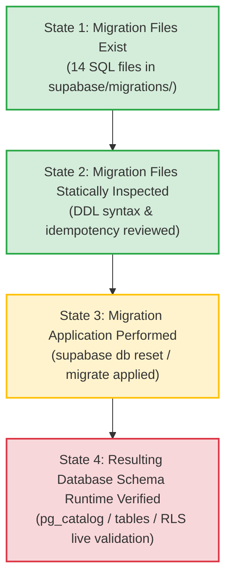

# HAVEN PARENT CONTROL — PHASE 2.7.1 DELIVERABLE 03
# AUD04 POLICY FORMULATION RECTIFICATION & PREREQ-18 4-STATE EVIDENCE AUDIT

**Document ID:** `HAVEN-GOV-PHASE2-7-1-POLICY-SCOPE`  
**Phase:** Phase 2.7.1 — Final Sign-Off Document Integrity & Owner Decision Readiness Review  
**Workspace:** `D:\parentcontrol_app`  
**Git Branch:** `main`  
**Active HEAD:** `e5022531beeb7393a7a5585351af891180630216`  
**Review Standard:** Independent Adversarial Policy Governance & Technical Scope Audit  
**Execution Posture:** STRICTLY READ-ONLY  
**Phase 3 Authorization:** STRICTLY NOT AUTHORIZED  

---

## 1. Executive Overview

This report addresses two critical documentary and architectural classifications identified during the Phase 2.7 review:
1. **Rectification of AUD04 Policy Wording (`P27.1-FIND-02`)**: In Phase 2.7 Deliverable 04 (§3.2) and Deliverable 08 (§2.3), the global retention sweep routine (`public.run_retention_sweep()`) was characterized as "PERMANENTLY BANNED." While the technical intent was to protect shared infrastructure from catastrophic data loss, asserting "permanence" exceeds the jurisdiction of an independent audit and infringes upon owner sovereignty. This report establishes the authoritative, legally and technically sound formulation.
2. **Clarification of PREREQ-18 Scope and 4-State Evidence Hierarchy (`P27.1-FIND-03`)**: In Phase 2.6 and Phase 2.7, PREREQ-18 ("Database Migration Clean-Apply Replay & Schema Verification") was classified as `DEFERRABLE` (in contrast to PREREQ-08, which is `UNIVERSAL`). However, the operational boundaries of "deferrable" required precise definition to ensure testers do not bypass migration verification when fresh infrastructure pathways (Pathway A or C) are selected.

---

## 2. AUD04 Policy Formulation Rectification (`P27.1-FIND-02`)

### 2.1 The Conceptual & Governance Defect in "Permanence"
In Phase 2.7 Deliverables 04 and 08, the audit declared:
> *"Execution of public.run_retention_sweep() on Pathway B ... is PERMANENTLY BANNED."*

While motivated by rigorous safety principles, this formulation exhibits two governance flaws:
1. **Jurisdictional Overreach**: An independent audit provides evidence, risk analyses, and guardrails to the Project Owner. It does not possess perpetual sovereign authority to bind the Owner's future decisions for all eternity.
2. **Contextual Confusion**: A routine might be catastrophic on a shared multi-tenant backend (Pathway B), but entirely legitimate and necessary to test within an ephemeral, disposable local Docker container (Pathway C) or a dedicated staging database (Pathway A) where synthetic legacy records are intentionally purged to verify retention compliance.

### 2.2 The Authoritative Corrected Policy Formulation
The definitive policy statement governing AUD04 is hereby established as follows:

```
========================================================================================
                       AUTHORITATIVE AUD04 POLICY STATEMENT
========================================================================================

  EXECUTION OF public.run_retention_sweep() IS PROHIBITED FOR TEST EXECUTION ON 
  THE SHARED BACKEND UNDER THE CURRENT GOVERNANCE BASELINE.

  1. Shared Infrastructure Prohibition: Under Pathway B (Shared Backend with Tenant
     Quarantine), invoking public.run_retention_sweep() is strictly forbidden due to 
     the inherent cross-tenant scope of global retention logic.
  2. Baseline Test Catalog Status: No test case invoking public.run_retention_sweep() 
     is authorized for execution during Phase 3 manual testing under the approved 
     baseline.
  3. Sovereign Future Authorization: Any future execution of global retention logic 
     can ONLY occur if:
     a) The Project Owner explicitly issues an affirmative written directive;
     b) The test is executed against an isolated, non-shared environment (Pathway A or C);
     c) Complete database schema verification and pre-test backups are independently verified.

========================================================================================
```

### 2.3 Functional Differentiation: AUD03 vs AUD04

To ensure total clarity for test operators and the Project Owner, the boundaries between AUD03 and AUD04 are reaffirmed:

| Feature / Attribute | Scoped Purge: `AUD03` (`public.delete_user_account()`) | Global Sweep: `AUD04` (`public.run_retention_sweep()`) |
| :--- | :--- | :--- |
| **Operation Type** | User-triggered account/family deletion | Automated system-wide maintenance sweep |
| **Architectural Scope** | Scoped strictly to `auth.uid()` and child family records | Global table sweep across all database tenants |
| **Target Filter** | Explicit `WHERE parent_id = target_user_id` | Global `WHERE created_at < NOW() - INTERVAL '30 days'` |
| **Shared Backend Risk** | Low-Medium (Isolated to dedicated QA account) | Catastrophic (May purge un-quarantined data across tables) |
| **Proposed Governance** | Permitted under controlled conditions with QA accounts | **PROHIBITED ON SHARED BACKEND UNDER CURRENT BASELINE** |
| **Test Catalog Mapping** | Mapped to `TC-EDGE-01` / `TC-EDGE-02` (Controlled) | Mapped to `TC-EDGE-03` (Marked Prohibited / Blocked) |

---

## 3. PREREQ-18 Scope & 4-State Evidence Hierarchy (`P27.1-FIND-03`)

### 3.1 The Need for a 4-State Evidence Model
Previous audit phases established that 14 database migration files exist under `supabase/migrations/`. However, claiming that a database schema is "verified" based solely on reading SQL files conflates static artifact inspection with dynamic runtime truth.

To prevent misunderstandings, Phase 2.7.1 codifies the **Four-State Database Evidence Hierarchy**:



1. **State 1 — Migration Files Exist**: **VERIFIED**. Exactly 14 SQL files are committed in `supabase/migrations/` totaling over 70,000 bytes of DDL.
2. **State 2 — Migration Files Statically Inspected**: **VERIFIED**. Static analysis confirms idempotent syntax (`CREATE TABLE IF NOT EXISTS`, `CREATE OR REPLACE FUNCTION`, `DO $$ BEGIN ... END $$`).
3. **State 3 — Migration Application Performed**: **UNVERIFIED AT RUNTIME**. Under the strictly read-only audit posture, applying migrations via Supabase CLI (`supabase db push` / `db reset`) is strictly prohibited.
4. **State 4 — Resulting Database Schema Runtime Verified**: **UNVERIFIED AT RUNTIME**. Dynamic verification of live tables, foreign keys, and RLS policies against a running PostgreSQL engine has not been performed by the audit team.

### 3.2 Exact Operational Meaning of "DEFERRABLE"

`PREREQ-18` is defined as:
> *"Database Migration Clean-Apply Replay & Schema Verification"*

Its classification as `DEFERRABLE` has a specific operational meaning:
> **"DEFERRABLE FOR TEST BATCHES THAT DO NOT REQUIRE FRESH INFRASTRUCTURE; MANDATORY BEFORE ANY FRESH INFRASTRUCTURE PATHWAY THAT DEPENDS ON CLEAN MIGRATION REPLAY."**

### 3.3 Batch-by-Batch PREREQ-18 Applicability Matrix

The table below establishes exactly when PREREQ-18 may be deferred and when it becomes an absolute prerequisite:

| Batch ID | Safety Tier & Scope | Pathway A (Dedicated Cloud) | Pathway B (Shared QA Tenant) | Pathway C (Local Docker) |
| :--- | :--- | :--- | :--- | :--- |
| **Batch 1** | S-1: Safe Read-Only UI / Navigation | **Mandatory** (Pre-Cloud Provisioning) | **DEFERRABLE** (If existing schema works) | **Mandatory** (Pre-Docker Spin-Up) |
| **Batch 2** | S-2: Safe Reversible (Local Settings) | **Mandatory** (Pre-Cloud Provisioning) | **DEFERRABLE** (If existing schema works) | **Mandatory** (Pre-Docker Spin-Up) |
| **Batch 3** | S-3: Non-Destructive Connectivity | **Mandatory** (Pre-Cloud Provisioning) | **DEFERRABLE** (Pre-test schema check) | **Mandatory** (Pre-Docker Spin-Up) |
| **Batch 4** | S-4: Native OS Privileged Permissions | **Mandatory** (Pre-Cloud Provisioning) | **DEFERRABLE** (Native focus) | **Mandatory** (Pre-Docker Spin-Up) |
| **Batch 5** | S-3/S-4: Edge Functions & Storage | **MANDATORY** | **MANDATORY** (Verify RLS & tables) | **MANDATORY** (Full local replay) |
| **Batch 6** | S-5: Destructive Operations (AUD03) | **MANDATORY** | **MANDATORY** (Verify cascade constraints) | **MANDATORY** (Clean baseline required) |

### 3.4 Summary Rule for Test Operators
1. If the Project Owner selects **Pathway B** and testing begins with Batches 1 and 2, `PREREQ-18` is **DEFERRABLE** because UI rendering and local shared preferences do not depend on fresh database migration replay.
2. If the Project Owner selects **Pathway A** (Dedicated Project) or **Pathway C** (Local Docker), `PREREQ-18` is **MANDATORY PRIOR TO BATCH 1**, because a fresh database cannot function without clean migration replay.
3. In all pathways, before executing **Batch 5** (Edge Functions) or **Batch 6** (Destructive Tests), `PREREQ-18` is **MANDATORY**.

---

## 4. Governance Conclusion

This audit resolves `P27.1-FIND-02` and `P27.1-FIND-03` by:
1. Eliminating legally improper assertions of "permanence" while preserving complete protection against shared-backend retention sweeps.
2. Structuring PREREQ-18 across a defensible 4-state evidence hierarchy with clear batch-level activation triggers.
