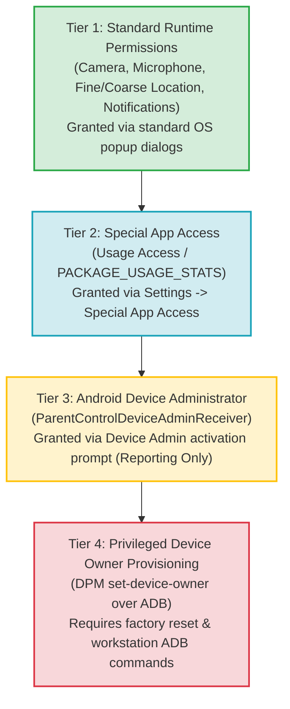

# HAVEN PARENT CONTROL — PHASE 2.7.2 DELIVERABLE 04
# OWNER PERMISSION GATE P25-OWNER-05 AUTHORIZATION SCOPE REVIEW

**Document ID:** `HAVEN-GOV-PHASE2-7-2-GATE05-REVIEW`  
**Phase:** Phase 2.7.2 — Android Permission Capability & Migration Dependency Final Evidence Audit  
**Workspace:** `D:\parentcontrol_app`  
**Git Branch:** `main`  
**Active HEAD:** `e5022531beeb7393a7a5585351af891180630216`  
**Review Standard:** Independent Adversarial Authorization Boundary Review  
**Execution Posture:** STRICTLY READ-ONLY  
**Runtime Execution:** PROHIBITED  
**Phase 3 Authorization:** STRICTLY NOT AUTHORIZED  

---

## 1. Executive Purpose & Scope

Owner Decision Gate `P25-OWNER-05` governs the native Android operating system permissions and privileged capabilities that test engineers are authorized to activate during Phase 3 manual testing.

In Phase 2.7 Deliverable 08 and Phase 2.7.1 Deliverable 02, Option 5-A was formulated as:
> *"Authorize Full Native OS Permissions Exclusively on Dedicated Lab Test Hardware (Device Admin, Accessibility Service, Usage Access, Overlay Display, and Location permissions on dedicated test hardware only)."*

Following the source code evidence uncovered in Deliverables 02 and 03 of this audit, this report conducts a critical review of Gate `P25-OWNER-05` to identify and resolve three documentary defects:
1. **Inclusion of Non-Existent Services**: Option 5-A referenced "Accessibility Service", which is 100% absent from the codebase (`M08`).
2. **Conflation of Device Admin and Device Owner**: Option 5-A did not separate in-app Device Admin activation from external, out-of-band ADB Device Owner provisioning.
3. **Bundling of Disparate Privacy Tiers**: Standard runtime permissions (Camera/Mic for WebRTC) were bundled with administrative device lock privileges without granular isolation.

This report establishes the authoritative, legally and technically sound recommendations for the Owner Decision structure without modifying historical Phase 2.7/2.7.1 documents.

---

## 2. Identified Deficiencies in Previous Gate 5 Formulations (`P27.2-FIND-03`)

### 2.1 Deficiency 1: Mentioning Non-Existent Services Creates False Expectations
Including "Accessibility Service" in an owner approval option suggests to the Project Owner that HAVEN contains an Accessibility Service that will be activated and tested. Because `HavenAccessibilityService` does not exist in any form (`M08`), including it in an approval block creates a serious governance risk: an owner might approve Option 5-A believing they have authorized accessibility-based app blocking, when in reality no such code exists.

### 2.2 Deficiency 2: Equating Device Admin with Device Owner
`ParentControlDeviceAdminReceiver` can be activated via an in-app system intent (`DevicePolicyManager.ACTION_ADD_DEVICE_ADMIN`). However, as proven in Deliverable 02, Device Admin requests **zero policy flags** and **cannot suspend applications**. 

Application suspension (`TC-APP07`) strictly requires **Device Owner** provisioning, which requires:
- A factory-reset Android handset with zero user accounts.
- Executing an external ADB terminal command from a host workstation.

Treating Device Admin and Device Owner as interchangeable implies that clicking "Activate Device Admin" in the UI enables app suspension, which is technically false.

### 2.3 Deficiency 3: Lack of Granular Privacy Segregation
A tester might be authorized to test Camera and Microphone hardware for WebRTC calls (`TC-CHD05`, `TC-EXP-08`), but strictly forbidden from modifying native Device Administrator privileges. The previous formulation lacked an intermediate tier allowing standard multimedia/location testing while locking out high-privilege administrative mutations.

---

## 3. Recommended Four-Tier Owner Permission Framework

To provide unambiguous, actionable choices for the Project Owner, Phase 2.7.2 recommends partitioning native permissions into four distinct, hierarchically segregated tiers:



### 3.1 Tier 1: Standard Runtime Permissions
- **Scope**: `ACCESS_FINE_LOCATION`, `ACCESS_COARSE_LOCATION`, `CAMERA`, `RECORD_AUDIO`, `POST_NOTIFICATIONS`.
- **Request Flow**: In-app runtime permission dialogs hosted by `MainActivity`.
- **Functionality**: QR code pairing, active WebRTC audio/video call, current location fix, notification posting.
- **Risk Profile**: Moderate privacy risk; zero device takeover or administration risk.

### 3.2 Tier 2: Special App Access (Usage Access)
- **Scope**: `android.permission.PACKAGE_USAGE_STATS`.
- **Request Flow**: User is redirected to `Settings.ACTION_USAGE_ACCESS_SETTINGS`.
- **Functionality**: `UsageReporter.kt` queries `UsageStatsManager` to aggregate daily screen time and per-app usage.
- **Risk Profile**: High privacy risk (reads application usage history across the entire device); zero device administration risk.

### 3.3 Tier 3: Android Device Administrator
- **Scope**: `ParentControlDeviceAdminReceiver` with `BIND_DEVICE_ADMIN`.
- **Request Flow**: In-app intent launch to `DevicePolicyManager.ACTION_ADD_DEVICE_ADMIN`.
- **Functionality**: Enables `isAdminActive() == true` and reports `enforcement_mode = "device_admin"`. Requests zero policy flags in XML.
- **Risk Profile**: Operational risk (app appears under Device Administrators in Android Settings); does not enable app blocking.

### 3.4 Tier 4: Privileged Device Owner Provisioning
- **Scope**: `DevicePolicyManager.setPackagesSuspended()`.
- **Request Flow**: CANNOT be requested in-app. Requires external provisioning via ADB on a factory-reset lab phone.
- **Functionality**: Enables true OS-level application suspension for `TC-APP07`.
- **Risk Profile**: Critical operational risk. Permanently manages the device until factory-reset; must strictly never occur on personal hardware.

---

## 4. Recommended Granular Decision Formulation for Gate P25-OWNER-05

The following revised options are recommended for presentation to the Project Owner:

```markdown
----------------------------------------------------------------------------------------
REVISED RECOMMENDATION FOR GATE 5: NATIVE PERMISSION & PRIVILEGE SCOPE (P25-OWNER-05)
----------------------------------------------------------------------------------------

[ ] Option 5-A: Authorize Full Tiers 1 Through 4 (Including ADB Device Owner Provisioning)
    Authorize Tiers 1, 2, and 3 via Android UI, AND authorize test engineers to execute 
    out-of-band ADB provisioning (`dpm set-device-owner`) on dedicated lab hardware to 
    validate Tier 4 native app suspension (TC-APP07). Strictly prohibited on personal devices.

[ ] Option 5-B: Authorize Tiers 1 Through 3 Only (Standard Runtime, Usage Access & Device Admin)
    Authorize in-app runtime permissions, Usage Access settings, and Device Admin activation. 
    Strictly prohibit ADB Device Owner provisioning. TC-APP07 (app suspension) will be 
    tested in non-owner mode to verify graceful "unsupported" error reporting.

[ ] Option 5-C: Authorize Non-Administrative Permissions Only (Tiers 1 and 2 Only)
    Authorize Camera, Microphone, Location, Notifications, and Usage Access. 
    Strictly prohibit activating Device Administrator (Tier 3) and Device Owner (Tier 4). 
    Tests requiring Device Admin (TC-SET05, TC-EXP-55) are marked blocked.

[ ] Option 5-D: Restrict to UI Inspection Only (Zero Native Permissions Granted)
    Prohibit granting any runtime or special permissions. Restrict testing to mock UI flows.

Owner Explicit Directives for Gate 5:
________________________________________________________________________________________
```

---

## 5. Mandatory Authorization Distinctions & Current Status

The following governance principles are reaffirmed:
1. **An owner may authorize testing a permission without authorizing implementation of a new Android service.**
2. **An owner may authorize Device Admin testing without authorizing Device Owner provisioning.**
3. **An owner may approve camera/microphone testing without authorizing unrelated special permissions.**
4. **A permission authorization does not mean the permission has been granted.**
5. **A test prerequisite does not authorize changing the device.**
6. **`P25-OWNER-05` remains in state `PENDING OWNER DECISION` / `LOCKED` until the Project Owner formally executes a decision.**
