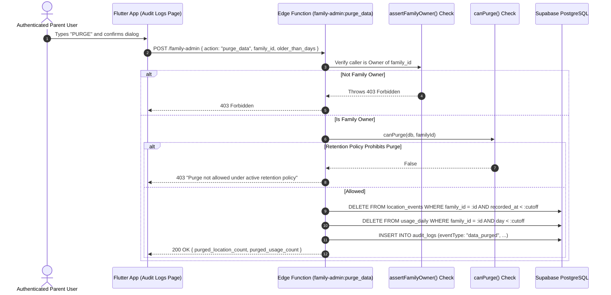

# HAVEN PARENT CONTROL — PHASE 2.7.6
## DELIVERABLE 03: AUD03 SCOPE AND AUTHORIZATION BOUNDARY

**Document ID:** `HAVEN-GOV-PHASE2-7-6-DOC03`  
**Phase:** Phase 2.7.6 — AUD03 Expected Behavior, TC-EXP-48 Execution Separation & Final Evidence Closure  
**Workspace:** `D:\parentcontrol_app`  
**Git Branch:** `main`  
**Git HEAD:** `e5022531beeb7393a7a5585351af891180630216`  
**Parent Commit:** `0101c16d161824fd726018f1188e1a2b17c653d3`  
**Execution Posture:** STRICTLY READ-ONLY  
**Test Case Reference:** `TC-EXP-47` (Functionality ID: `AUD03`)  

---

### 1. MISSION & CONTEXT

Functionality `AUD03` corresponds to the parent-initiated historical telemetry purge capability exposed via `lib/features/audit_logs/audit_logs_page.dart` and executed via the Supabase Edge Function `family-admin` (`case "purge_data"`).

Because `AUD03` issues permanent SQL `DELETE` commands, this document defines its precise architectural scope, authorization boundary, tenant blast radius, and testing governance status.

---

### 2. EXACT DESTRUCTIVE DATA SCOPE

An exhaustive review of `supabase/functions/family-admin/index.ts` lines 265–345 and database schema definitions establishes the exact destructive boundary of `AUD03`:

```
+---------------------------------------------------------------------------------------+
|                                    AUD03 BLAST RADIUS                                 |
+---------------------------------------------------------------------------------------+
|  AFFECTED TABLES (DESTRUCTIVE):                                                       |
|    1. public.location_events                                                          |
|       - Scope: WHERE family_id = :caller_family_id AND recorded_at < :cutoff_timestamp |
|       - Operation: Permanent Hard DELETE (CASCADE if foreign keys exist)              |
|    2. public.usage_daily                                                              |
|       - Scope: WHERE family_id = :caller_family_id AND day < :cutoff_date             |
|       - Operation: Permanent Hard DELETE                                              |
|                                                                                       |
|  PROTECTED TABLES (IMMUTABLE / ZERO DELETION):                                        |
|    1. public.audit_logs                                                               |
|       - Scope: ZERO ROWS DELETED.                                                     |
|       - Protection Mechanism: PostgreSQL BEFORE TRIGGER private.audit_logs_append_only|
|       - Behavioral Action: Appends new record with eventType = "data_purged"          |
|    2. All Tables for Other Families                                                   |
|       - Scope: ZERO ROWS DELETED. Multi-tenant isolation strictly enforced.           |
+---------------------------------------------------------------------------------------+
```

#### 2.1 Affected Data Breakdown
1. **`public.location_events`**:
   - Geolocation telemetry records (latitude, longitude, accuracy, timestamp, child device ID).
   - Only records older than the specified `olderThanDays` parameter relative to server UTC `now()` are deleted.
2. **`public.usage_daily`**:
   - Aggregated daily application screen-time telemetry (package name, minutes used, date).
   - Only records where `day` is older than the calculated cutoff date are deleted.

#### 2.2 Preserved Data Breakdown
1. **`public.audit_logs`**:
   - Every administrative action, device pairing, policy change, lock/unlock command, and emergency alert remains permanently retained.
   - The purge execution itself generates an immutable audit record:
     ```json
     {
       "family_id": "<caller_family_id>",
       "actor_user_id": "<caller_user_id>",
       "event_type": "data_purged",
       "details": {
         "older_than_days": 60,
         "purged_location_count": 142,
         "purged_usage_count": 58,
         "timestamp": "2026-11-24T14:30:00.000Z"
       }
     }
     ```
2. **Active Telemetry**:
   - All location and usage records generated within the retention window (`recorded_at >= cutoff`) are preserved intact.

---

### 3. AUTHORIZATION & TENANT BOUNDARIES

The execution of `AUD03` is protected by multiple strict security boundaries:



#### 3.1 Role Verification: Family Owner Check
- Implemented via `assertFamilyOwner(db, familyId, actorUserId)` in `supabase/functions/family-admin/index.ts`.
- Non-owner parents or child devices attempting this action are rejected with HTTP 403.
- Callers cannot specify a foreign `family_id`; any attempt to purge another family's data fails the authorization assertion.

#### 3.2 Tenant Isolation (Blast Radius Boundary)
- Because SQL queries explicitly require `.eq("family_id", familyId)`, cross-tenant destruction is architecturally impossible.
- The destructive blast radius is strictly bounded to the calling tenant.

---

### 4. GOVERNANCE STATUS & EXECUTION PREREQUISITES

Despite the multi-tenant isolation, `AUD03` permanently deletes telemetry. If executed in a shared or staging test environment where telemetry data is required for other functional test cases (e.g., location tracking, geofencing, or screen-time analytics), executing `AUD03` will corrupt the state of that test environment.

Therefore, the governance status of `AUD03` is established as:

```
========================================================================================
GOVERNANCE STATUS:
PROPOSED CONTROLLED TEST — NOT AUTHORIZED FOR EXECUTION UNDER THE CURRENT GOVERNANCE BASELINE
========================================================================================
```

#### 4.1 Execution Prerequisites for Safe Testing
Under any future test plan authorized by the Project Owner:
1. **Environment Isolation Requirement (`E2` or `E3`):**
   - Must only be executed against a dedicated, disposable test family fixture (`E2`) created specifically for this test case, OR
   - Within an isolated staging database instance (`E3`) where data loss has zero collateral impact.
2. **Data Seeding Prerequisite (`M1`):**
   - The test fixture must be deliberately pre-seeded with test location and usage records spanning both sides of the retention cutoff (e.g., records aged 10 days and records aged 70 days).
3. **Formal Owner Authorization (`P25-OWNER-07`):**
   - No execution can occur without prior written authorization from the Project Owner.

#### 4.2 Quarantine Status
`TC-EXP-47` / `AUD03` is formally **QUARANTINED** from general test passes and cannot be scheduled as part of standard exploratory or smoke testing.
