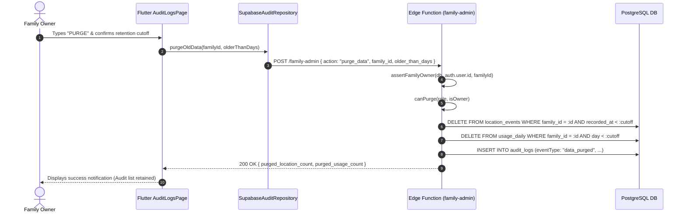
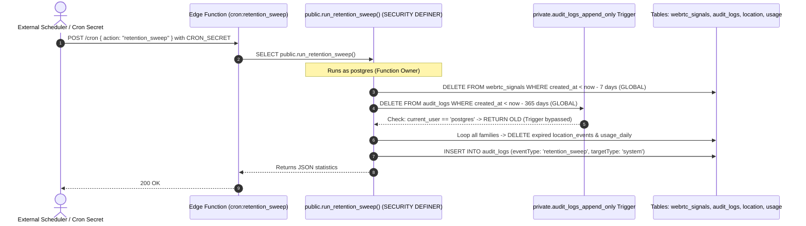

# HAVEN PARENT CONTROL — PHASE 2.7.7
## DELIVERABLE 05: AUD03 VS AUD04 DESTRUCTIVE OPERATION & AUTHORIZATION COMPARISON

**Document ID:** `HAVEN-GOV-PHASE2-7-7-DOC05`  
**Phase:** Phase 2.7.7 — Final Inventory Arithmetic, Environment Classification & Audit Log Integrity Reconciliation  
**Workspace:** `D:\parentcontrol_app`  
**Git Branch:** `main`  
**Git HEAD:** `e5022531beeb7393a7a5585351af891180630216`  
**Parent Commit:** `0101c16d161824fd726018f1188e1a2b17c653d3`  
**Execution Posture:** STRICTLY READ-ONLY  
**Audit Standard:** Comparative Architectural & Security Governance Analysis  

---

### 1. MISSION & ARCHITECTURAL CONTEXT

In earlier audit phases (Phase 2.3 through 2.7.4), features `AUD03` (Manual Purge) and `AUD04` (Automated Retention Sweep) were frequently conflated due to both involving the keyword *"purge"* or *"retention"*.

This deliverable provides the definitive, side-by-side architectural comparison proving that `AUD03` and `AUD04` represent completely orthogonal operational tiers, different target tables, distinct permission boundaries, and opposing environmental requirements.

---

### 2. AUTHORITATIVE 10-DIMENSION COMPARISON MATRIX

```
+---------------------------------------------------------------------------------------------------------------------------------+
|                                         AUD03 VS AUD04 COMPLETE COMPARATIVE MATRIX                                              |
+--------------------------+--------------------------------------------------+---------------------------------------------------+
| Dimension                | AUD03: Manual Telemetry Purge (TC-EXP-47)         | AUD04: Retention Sweep Function (TC-EXP-48)       |
+--------------------------+--------------------------------------------------+---------------------------------------------------+
| 1. Primary Purpose       | Parent-initiated deletion of historical child    | System-automated data lifecycle compliance        |
|                          | location and usage telemetry for their family.   | sweep across all platform tenants.                |
|                          |                                                  |                                                   |
| 2. Invocation Entry Point| Flutter UI (Audit Logs Page) -> Riverpod ->      | Scheduled Cron / HTTPS Edge Function with secret  |
|                          | Supabase Edge Function `family-admin:purge_data`.| or direct PostgreSQL `SELECT run_retention_sweep()|
|                          |                                                  |                                                   |
| 3. Affected Tables       | • public.location_events                         | • public.webrtc_signals (> 7 days)                |
|                          | • public.usage_daily                             | • public.audit_logs (> 365 days)                  |
|                          | (Zero rows deleted from audit_logs)              | • public.location_events (per family setting)     |
|                          |                                                  | • public.usage_daily (per family setting)         |
|                          |                                                  |                                                   |
| 4. Audit Log Behavior    | STRICTLY APPEND-ONLY: Preserves all audit logs.  | ACTIVE DELETION: Permanently deletes all audit    |
|                          | Appends new `data_purged` compliance event.      | logs older than 365 days across all families.     |
|                          |                                                  | Appends `retention_sweep` summary event.          |
|                          |                                                  |                                                   |
| 5. Multi-Tenant Scoping  | TENANT-ISOLATED: Enforces `WHERE family_id = id`.| MULTI-TENANT GLOBAL: Un-scoped deletions on       |
|                          | Blast radius strictly confined to caller family. | audit_logs and webrtc_signals across all tenants. |
|                          |                                                  |                                                   |
| 6. Execution Role        | Authenticated Parent (verified Family Owner via  | PostgreSQL `postgres` superuser via               |
|                          | `assertFamilyOwner()` check). Non-owners 403.    | `SECURITY DEFINER` context; granted to service_role|
|                          |                                                  |                                                   |
| 7. Trigger Interaction   | Never attempts delete on audit_logs; trigger is  | Bypasses `private.audit_logs_append_only` trigger |
|                          | not invoked. Only executes SQL INSERT.           | via privileged role (`postgres`) exception.       |
|                          |                                                  |                                                   |
| 8. Environment Tier      | E2: Requires Disposable Tenant Test Fixture.     | E3: Requires Dedicated Isolated DB Sandbox (Live) |
|                          | (Safe on shared backend within disposable tenant)| E0: Static SQL Inspection only (Read-Only Audit)  |
|                          |                                                  |                                                   |
| 9. Destructive Risk      | HIGH for single family (irreversible telemetry   | CRITICAL FOR ENTIRE PLATFORM (deletes audit and   |
|                          | loss); ZERO risk to other tenants or audit trail.| telemetry data across all customer families).     |
|                          |                                                  |                                                   |
| 10. Current Status       | PROPOSED CONTROLLED TEST — NOT AUTHORIZED FOR     | PROHIBITED FOR TEST EXECUTION ON SHARED BACKEND   |
|                          | EXECUTION UNDER CURRENT GOVERNANCE BASELINE      | Static SQL review permitted as M2 + E0.           |
+--------------------------+--------------------------------------------------+---------------------------------------------------+
```

---

### 3. OPERATIONAL CALL-CHAIN FORENSICS

#### 3.1 AUD03 Call Chain (Flutter Client to Edge Function)


#### 3.2 AUD04 Call Chain (System Cron / Administrative Maintenance)


---

### 4. GOVERNANCE & ISOLATION REQUIREMENTS

1. **AUD03 Testing Isolation (`E2`):**
   - Testing `AUD03` cannot be performed in a shared production family because historical telemetry is permanently wiped.
   - It can, however, be safely executed in a **disposable tenant fixture (`E2`)** on a shared staging database, because multi-tenant row-level boundaries (`family_id`) completely prevent data leakage or destruction in neighboring families.
2. **AUD04 Testing Isolation (`E3`):**
   - Testing `AUD04` at runtime **CANNOT be executed on any shared or multi-tenant staging backend**.
   - Because `run_retention_sweep()` deletes rows globally across all tenants without a `family_id` predicate on `webrtc_signals` and `audit_logs`, runtime execution requires a **dedicated, throwaway database instance (`E3`)**.
   - Under the current repository baseline, `TC-EXP-48` is evaluated strictly via **Static SQL Review (`M2 + E0`)**. Runtime execution is strictly **PROHIBITED**.
