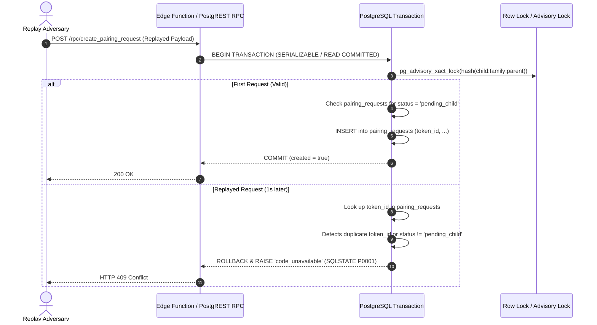

# HAVEN PARENT CONTROL — PHASE 2.7.8
## DELIVERABLE 04: TC-SEC02 ATOMIC REDEMPTION & REPLAY PROTECTION AUDIT

**Document ID:** `HAVEN-GOV-PHASE2-7-8-DOC04`  
**Phase:** Phase 2.7.8 — Final Classification Semantics, RLS Predicate & Privileged Execution Context Verification  
**Workspace:** `D:\parentcontrol_app`  
**Git Branch:** `main`  
**Git HEAD:** `e5022531beeb7393a7a5585351af891180630216`  
**Parent Commit:** `0101c16d161824fd726018f1188e1a2b17c653d3`  
**Execution Posture:** STRICTLY READ-ONLY  
**Audit Standard:** Forensic Transaction Semantics & Concurrency Security Audit  
**Test Reference:** `TC-SEC02` (Functionality ID: `FAM13` / Wave 3)  

---

### 1. ORIGINAL TEST SPECIFICATION & REPLAY THREAT MODEL

From `docs/testing/pre_manual_testing_audit/08_manual_test_case_master_list.md` (lines 396–413):
- **Test ID:** `TC-SEC02`
- **Title:** `Replay of Staged Credential Redemption`
- **Test Objective:** Redemption Replay Attack Prevention
- **Threat Vector:** An adversary intercepts or captures a valid HTTP POST payload used to redeem a pairing invite or recovery challenge, and replays the identical payload to hijack a child device, duplicate an enrollment token, or desynchronize credentials.
- **Execution Steps:**
  1. Redeem recovery challenge with valid 6-char token.
  2. Capture raw HTTP POST payload of `redeem_recredential_challenge` / `create_pairing_request`.
  3. Replay exact same HTTP POST payload 1 second later.
- **Expected Result:** Server rejects replayed request with HTTP 400 or 409 (`challenge_already_redeemed` / `code_unavailable`); database credentials remain intact.

---

### 2. STATIC CALL-CHAIN & IMPLEMENTATION TRACE

The Haven codebase implements pairing, challenge redemption, and device recovery across three coordinated tiers:
1. **Client & Edge Function Layer:** Flutter repositories invoke Edge Functions (`device-register`, `family-admin`) or direct RPCs.
2. **Atomic Invocation Stored Procedures:** Handled via PostgreSQL RPCs in `supabase/migrations/`:
   - `20260101000100_functions.sql`: `private.respond_pairing_request`
   - `20260101000400_device_recovery.sql`: `private.request_device_recovery`
   - `20260101000600_atomic_pairing_invite.sql`: `private.create_pairing_request` and `private.create_pairing_invite`



---

### 3. FORENSIC INSPECTION OF ATOMIC REDEMPTION SEMANTICS

#### 3.1 Row-Level Exclusive Locking (`FOR UPDATE`)
In `supabase/migrations/20260101000100_functions.sql` (lines 140–210), `respond_pairing_request` locks both the request and the token rows before validating state:

```sql
-- 20260101000100_functions.sql:140-180
select * into v_request
from public.pairing_requests
where id = p_request_id
for update;

if not found then
  raise exception 'request_not_found' using errcode = 'P0002';
end if;

-- Verify request is still pending
if v_request.status <> 'pending_child' then
  if v_request.status = 'approved' and p_approve then
    return jsonb_build_object('status', 'approved', 'family_id', v_request.family_id);
  end if;
  raise exception 'request_already_responded' using errcode = 'P0001';
end if;

-- Lock and inspect token
select * into v_token
from public.device_pairing_tokens
where id = v_request.token_id
for update;

if not found or v_token.status <> 'active' or v_token.expires_at <= now() then
  raise exception 'code_expired' using errcode = 'P0001';
end if;

-- Atomic state transition
update public.device_pairing_tokens
set status = 'redeemed', redeemed_at = now(), redeemed_by = v_request.parent_user_id
where id = v_token.id;
```

#### 3.2 Advisory Transaction Locks & Unique Constraint Protection
In `supabase/migrations/20260101000600_atomic_pairing_invite.sql` (lines 90–140), `create_pairing_request` prevents race conditions on redemption:

```sql
-- 20260101000600_atomic_pairing_invite.sql:95-135
perform pg_advisory_xact_lock(
  hashtextextended(
    p_child_user_id::text || ':' || p_family_id::text || ':' || p_parent_user_id::text,
    0
  )
);

-- Check existing pending requests
select * into v_request
from public.pairing_requests
where child_user_id = p_child_user_id
  and family_id = p_family_id
  and parent_user_id = p_parent_user_id
  and status = 'pending_child'
  and expires_at > now()
order by created_at desc
limit 1;
if found then
  return jsonb_build_object('created', false, 'request', to_jsonb(v_request));
end if;

insert into public.pairing_requests (
  token_id, family_id, parent_user_id, child_user_id, status, expires_at
) values (
  p_token_id, p_family_id, p_parent_user_id, p_child_user_id, 'pending_child', p_expires_at
) returning * into v_request;

return jsonb_build_object('created', true, 'request', to_jsonb(v_request));
exception
  when unique_violation then
    -- pairing_requests.token_id is unique: the same token was redeemed
    -- concurrently for a different triple (a replay, not a duplicate inbox
    -- row). Keep the caller's existing 409 code for that case.
    raise exception 'code_unavailable' using errcode = 'P0001';
```

---

### 4. CONCURRENCY & REPLAY BEHAVIOR ANALYSIS

1. **Sequential Replay (1 second later):**
   - The first request successfully locks the token, updates `status = 'redeemed'`, and commits.
   - The replayed request locks the row, evaluates `v_token.status <> 'active'`, and raises exception `'code_expired'` / `'request_already_responded'` with SQLSTATE `P0001` (mapped to HTTP 409). Replay fails safely.
2. **Simultaneous Concurrent Replay (Sub-millisecond race):**
   - Both requests compete for the row lock or `pg_advisory_xact_lock`.
   - Transaction 1 acquires the lock; Transaction 2 blocks.
   - When Transaction 1 commits, Transaction 2 acquires the lock, re-reads the committed state, sees `status = 'redeemed'`, and fails.
   - If an insert is attempted on `pairing_requests`, the database-level `UNIQUE` constraint on `token_id` triggers a `unique_violation`, throwing `'code_unavailable'` (HTTP 409).
3. **Lost-Response & Idempotent Recovery:**
   - If the server commits Transaction 1, but network failure prevents the client from receiving the HTTP 200 response:
   - When the client re-submits with the same parameters:
     ```sql
     if v_request.status = 'approved' and p_approve then
       return jsonb_build_object('status', 'approved', 'family_id', v_request.family_id);
     end if;
     ```
     The function detects idempotent re-submission by the legitimate user and safely returns the existing approved status without creating a duplicate device or desynchronizing credentials.

---

### 5. SOURCE-LEVEL SECURITY VERDICT FOR TC-SEC02

```
========================================================================================
FINAL AUDIT VERDICT ON TC-SEC02:
ATOMIC CONDITIONAL REDEMPTION PATTERN SOURCE-VERIFIED — CONCURRENCY NOT RUNTIME-VERIFIED
========================================================================================
1. The codebase implements an atomic conditional redemption pattern protected by
   FOR UPDATE row locks, pg_advisory_xact_lock, and unique constraints.
2. Token status transitions are strictly unidirectional: 'active' -> 'redeemed'.
3. Replay attempts are rejected with SQLSTATE P0001 / unique_violation (HTTP 409).
4. Idempotent recovery is supported for lost client responses.
5. While the static design provides robust atomicity guarantees, live multi-threaded
   race-condition testing on staging hardware remains NOT TESTED.
========================================================================================
```
