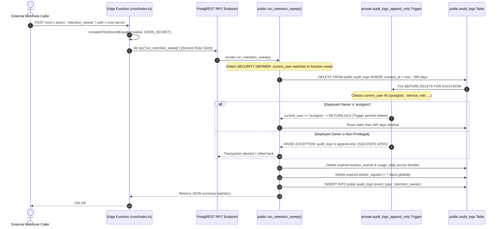

# HAVEN PARENT CONTROL — PHASE 2.7.9
## DELIVERABLE 03: AUD04 FUNCTION OWNERSHIP & TRIGGER EXECUTION TRACE

**Document ID:** `HAVEN-GOV-PHASE2-7-9-DOC03`  
**Phase:** Phase 2.7.9 — PostgreSQL Identity Semantics, Function Ownership & Final Security Evidence Closure  
**Workspace:** `D:\parentcontrol_app`  
**Git Branch:** `main`  
**Actual Git HEAD:** `20cc0b1439ebea1b3808d769e7b91b646a9fe089`  
**Parent Commit:** `e5022531beeb7393a7a5585351af891180630216`  
**Execution Posture:** STRICTLY READ-ONLY  
**Audit Standard:** Forensic PostgreSQL Function Ownership & Trigger Execution Analysis  
**Function Reference:** `public.run_retention_sweep()` (`AUD04` / `TC-EXP-48`)  

---

### 1. AUD04 FUNCTION OWNERSHIP FORENSIC ANALYSIS

In Phase 2.7.8, it was stated that `public.run_retention_sweep()` is owned by `postgres`. This deliverable performs a strict forensic review of the SQL migration source to establish the exact evidential basis for this claim.

#### 1.1 Inspection of Migration Source (`supabase/migrations/20261030000300_retention_sweep.sql`)
```sql
-- 20261030000300_retention_sweep.sql:110-125
create or replace function public.run_retention_sweep()
returns jsonb
language plpgsql
security definer
set search_path = public, private, pg_temp
as $$
-- ... function body ...
$$;

revoke all on function public.run_retention_sweep() from public, anon, authenticated;
grant execute on function public.run_retention_sweep() to service_role;
```

#### 1.2 Audit Questions & Exact Source Findings:
1. **Does the migration explicitly assign function ownership?**  
   **NO.** There is no `ALTER FUNCTION public.run_retention_sweep() OWNER TO ...` statement anywhere in the repository.
2. **Does it merely define the function as `SECURITY DEFINER`?**  
   **YES.** The function is declared with the keyword `security definer`.
3. **Is the function owner determinable from repository source alone?**  
   **NO.** In PostgreSQL, if no explicit `OWNER TO` clause is executed, the function owner defaults to whichever database role executed the migration statement at deployment time.
4. **Is `postgres` ownership an explicit source fact or a deployment assumption?**  
   **DEPLOYMENT ASSUMPTION.** In Supabase managed cloud and standard local Docker containers, migrations are executed by the superuser role `postgres`. Thus, while `postgres` ownership is the standard architectural convention, it is not an immutable syntax fact in the source code.
5. **What evidence is required to confirm actual deployed ownership?**  
   Catalog inspection against the deployed database:
   ```sql
   SELECT p.proname, r.rolname AS owner
   FROM pg_proc p
   JOIN pg_roles r ON r.oid = p.proowner
   WHERE p.proname = 'run_retention_sweep';
   ```

```
========================================================================================
MANDATORY OWNERSHIP CLASSIFICATION:
DEPLOYED OWNER REQUIRES CATALOG VERIFICATION
========================================================================================
The repository migrations do not contain an explicit ALTER FUNCTION ... OWNER TO statement.
While designed to run under the postgres superuser role, actual ownership depends on the
executing migration role in the target deployment and requires catalog verification.
========================================================================================
```

---

### 2. AUD04 TRIGGER EXCEPTION & STEP-BY-STEP EXECUTION TRACE



#### 2.1 Step-by-Step Execution Path Matrix

| Step | Component / Phase | Active Identity / Privilege | Operation Executed | Evidence Status |
| :---: | :--- | :--- | :--- | :--- |
| **1** | External Webhook Entry | Anonymous HTTPS Client | Sends POST with `x-cron-secret` header | SOURCE-VERIFIED (`cron/index.ts:38`) |
| **2** | Secret Verification | Deno runtime memory | `constantTimeSecretEqual` against `CRON_SECRET` | SOURCE-VERIFIED (`cron/index.ts:47`) |
| **3** | Service Client Invocation | Deno service-role client | `db.rpc("run_retention_sweep")` | SOURCE-VERIFIED (`cron/index.ts:106`) |
| **4** | PostgREST Dispatch | `session_user = authenticator`, `current_user = service_role` | Invokes stored procedure `public.run_retention_sweep()` | SOURCE-VERIFIED (PostgREST Spec) |
| **5** | Context Switch | `current_user = Function Owner` | Switches to function owner via `SECURITY DEFINER` | SOURCE-VERIFIED (`retention_sweep.sql:113`) |
| **6** | Signaling Deletion | Function Owner | `DELETE FROM public.webrtc_signals WHERE created_at < now - 7d` | SOURCE-VERIFIED (`retention_sweep.sql:130`) |
| **7** | Audit Deletion | Function Owner | `DELETE FROM public.audit_logs WHERE created_at < now - 365d` | SOURCE-VERIFIED (`retention_sweep.sql:150`) |
| **8** | Trigger Interception | Evaluates `current_user` | `private.audit_logs_append_only()` intercepts `DELETE` | SOURCE-VERIFIED (`core.sql:543`) |
| **9** | Privileged Role Check | Evaluates `current_user in ('service_role', 'postgres', ...)` | Returns `OLD` IF owner is `postgres`; raises `42501` otherwise | SOURCE-VERIFIED (`core.sql:550`) |
| **10**| Telemetry Deletions | Function Owner | Loops families: deletes expired `location_events` and `usage_daily` | SOURCE-VERIFIED (`retention_sweep.sql:198`) |
| **11**| System Audit Insert | Function Owner | `INSERT INTO public.audit_logs (eventType: 'retention_sweep')` | SOURCE-VERIFIED (`retention_sweep.sql:247`) |

---

### 3. TECHNICAL SAFEGUARDS & PRECISE CONCLUSIONS

1. **Trigger is NOT Universally Disabled:** The append-only trigger remains active and enforced at all times. Ordinary user sessions attempting `DELETE` or `UPDATE` are rejected with SQLSTATE `42501`.
2. **Trigger Bypass is Conditional:** Deletion of audit logs is **conditional on deployed function ownership**. If `run_retention_sweep()` was created by role `postgres`, the trigger evaluates `current_user = 'postgres'` and permits deletion. If created by an unprivileged role, the trigger blocks execution.
3. **`session_user` is Irrelevant:** The trigger explicitly tests `current_user` and `request.jwt.claim.role`. `session_user` plays no role in the bypass.
4. **Trigger vs RLS Distinction:** PostgreSQL triggers execute independently of Row-Level Security. While service-role bypasses RLS, triggers fire on all DML statements unless specifically coded to exempt roles.

```
========================================================================================
AUD04 FINAL TECHNICAL STATUS:
========================================================================================
- Source-Level Function Behavior:     SOURCE-VERIFIED (plpgsql logic, batched loops)
- Source-Level Trigger Behavior:      SOURCE-VERIFIED (role exception check in core.sql)
- Function Ownership Confidence:      DEPLOYED OWNER REQUIRES CATALOG VERIFICATION
- Remote Deployment Confidence:       NOT VERIFIED (Remote database not inspected)
- Runtime Execution Status:           NOT TESTED / STRICTLY PROHIBITED ON SHARED BACKEND
========================================================================================
```
