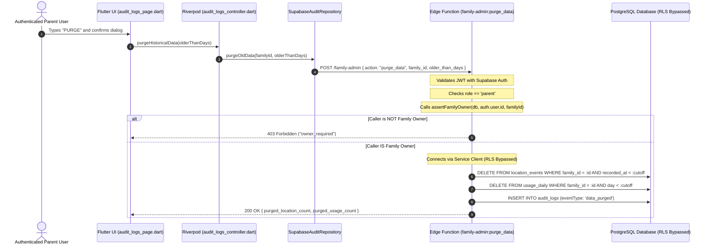

# HAVEN PARENT CONTROL — PHASE 2.7.9
## DELIVERABLE 06: AUD03 SERVICE-ROLE & FAMILY AUTHORIZATION BOUNDARY AUDIT

**Document ID:** `HAVEN-GOV-PHASE2-7-9-DOC06`  
**Phase:** Phase 2.7.9 — PostgreSQL Identity Semantics, Function Ownership & Final Security Evidence Closure  
**Workspace:** `D:\parentcontrol_app`  
**Git Branch:** `main`  
**Actual Git HEAD:** `20cc0b1439ebea1b3808d769e7b91b646a9fe089`  
**Parent Commit:** `e5022531beeb7393a7a5585351af891180630216`  
**Execution Posture:** STRICTLY READ-ONLY  
**Audit Standard:** Application Authorization & Service-Role Boundary Security Forensics  
**Feature Reference:** `AUD03` / `TC-EXP-47` (`family-admin` `purge_data`)  

---

### 1. AUDIT OBJECTIVE & ARCHITECTURAL MOTIVATION

In Phase 2.7.8, it was established that the manual telemetry purge operation (`AUD03`) connects to PostgreSQL using the Supabase `service_role` key via `getServiceClient()`. 

Because Supabase service-role credentials completely bypass PostgreSQL Row-Level Security (RLS), tenant isolation for `AUD03` is **not enforced by the database engine**. Instead, tenant boundary security rests entirely upon the application-level logic executed within the `family-admin` Edge Function.

This deliverable provides an adversarial forensic audit of the end-to-end call chain, caller authentication, ownership assertion, query filtering, and partial-failure semantics.

---

### 2. END-TO-END AUD03 CALL CHAIN



---

### 3. STEP-BY-STEP FORENSIC BOUNDARY VERIFICATION

#### 3.1 Step 1: Parent Authentication & User Extraction
- **Code Reference:** `supabase/functions/family-admin/index.ts:265`
  ```typescript
  const auth = await requireUser(req, db, { requireVerifiedEmail: true });
  requireRole(auth.profile, "parent");
  ```
- **Security Check:** Evaluates incoming `Authorization: Bearer <JWT>` header using `db.auth.getUser()`. If invalid or unverified, execution aborts with HTTP 401. Rejects child profiles with HTTP 403.

#### 3.2 Step 2: Family ID Derivation & Ownership Assertion
- **Code Reference:** `supabase/functions/family-admin/index.ts:267-284`
  ```typescript
  const familyId = readUuid(body.family_id, "family_id");
  const family = await assertFamilyOwner(db, auth.user.id, familyId);
  if (!canPurge(auth.profile.role, family.owner_id === auth.user.id)) {
    throw new ApiError("owner_required", "Only the family owner can purge family history.", 403);
  }
  ```
- **Tenant Validation:** `family_id` is supplied in the client JSON body, but **it is never trusted implicitly**. The server immediately queries `public.families` to assert that `family.owner_id === auth.user.id`. If a parent attempts to purge another family's ID, the assertion fails and rejects the request with HTTP 403.

#### 3.3 Step 3: Service-Role Client & RLS Bypass
- **Code Reference:** `supabase/functions/family-admin/index.ts:111`
  ```typescript
  const db = getServiceClient();
  ```
- **Critical Architectural Consequence:** `getServiceClient()` passes `SUPABASE_SERVICE_ROLE_KEY`. Queries executed via this client run with PostgreSQL superuser/service-role bypass privileges. **Row-Level Security policies do not evaluate on these queries**.

#### 3.4 Step 4: Explicit SQL Query Filtering (The True Boundary)
- **Code Reference:** `supabase/functions/family-admin/index.ts:304-316`
  ```typescript
  const locationDelete = await db
    .from("location_events")
    .delete({ count: "exact" })
    .eq("family_id", familyId)
    .lt("recorded_at", locationCutoff);
  ensureNoError(locationDelete);

  const usageDelete = await db
    .from("usage_daily")
    .delete({ count: "exact" })
    .eq("family_id", familyId)
    .lt("day", usageCutoff);
  ensureNoError(usageDelete);
  ```
- **Isolation Mechanism:** Because RLS is bypassed, tenant isolation rests **100% on the presence of `.eq("family_id", familyId)`**.
- **Audit Finding:** Both statements strictly include `.eq("family_id", familyId)`. Neither statement can execute as an un-scoped full-table delete.

#### 3.5 Step 5: Audit Log Preservation & Insertion
- **Code Reference:** `supabase/functions/family-admin/index.ts:322-334`
  ```typescript
  await recordAudit(db, {
    familyId,
    actorUserId: auth.user.id,
    eventType: "data_purged",
    // metadata with counts ...
  });
  ```
- **Audit Finding:** **Zero deletions are executed against `public.audit_logs`**. The code exclusively executes an `INSERT`.

#### 3.6 Step 6: Partial-Failure Semantics
- **Forensic Observation:** The two `delete()` operations execute sequentially over separate HTTP round-trips to the Supabase PostgREST API without an enveloping database transaction.
- **Consequence:** If `locationDelete` succeeds and `usageDelete` encounters a database timeout or network disconnect, the Edge Function throws an unhandled error, returning HTTP 500 to the client. However, **the location events already deleted remain deleted**. The operation is not transactional across both tables (at-least-once partial telemetry purge).

---

### 4. AUTHORITATIVE SECURITY BOUNDARY MATRIX

```
+-----------------------------------+-----------------------------------+-----------------------------------+-----------------------------------+
| Security Boundary                 | Enforcement Mechanism             | Source Evidence Reference         | Operational Limitation            |
+-----------------------------------+-----------------------------------+-----------------------------------+-----------------------------------+
| 1. Parent Authentication          | Supabase Auth JWT verification    | family-admin/index.ts:265         | Relies on JWT signature validity. |
| 2. Family-Owner Authorization     | assertFamilyOwner() DB check      | family-admin/index.ts:277         | Non-owner parents blocked (403).  |
| 3. Family ID Derivation           | Client-supplied, server-verified  | family-admin/index.ts:267         | Mismatched IDs rejected with 403. |
| 4. Service-Role Execution         | getServiceClient() service key    | _shared/auth.ts:51                | Bypasses database RLS entirely.   |
| 5. Tenant-Scoped Deletion         | Explicit .eq("family_id", id)     | family-admin/index.ts:307, 314    | Deletions rely on app query filter|
| 6. Telemetry vs Audit Scope       | DELETE on telemetry; INSERT audit | family-admin/index.ts:304, 322    | Audit logs are never deleted.     |
| 7. Transactional Atomicity        | Sequential PostgREST calls        | family-admin/index.ts:304-316     | Partial failure leaves loc purged.|
+-----------------------------------+-----------------------------------+-----------------------------------+-----------------------------------+
```

---

### 5. SOURCE-LEVEL SECURITY VERDICT FOR AUD03

```
========================================================================================
FINAL AUDIT VERDICT ON AUD03 BOUNDARY:
APPLICATION-LEVEL TENANT ISOLATION SOURCE-VERIFIED —
SERVICE-ROLE RLS BYPASS ACKNOWLEDGED — RUNTIME VALIDATION REQUIRED
========================================================================================
1. AUD03 connects using service-role credentials, completely bypassing PostgreSQL RLS.
2. Tenant isolation is enforced exclusively by application-level ownership verification
   (assertFamilyOwner) and explicit SQL filters (.eq("family_id", familyId)).
3. Both telemetry tables (location_events and usage_daily) are strictly scoped to the
   caller's family. Zero rows are deleted from public.audit_logs.
4. AUD03 does not support multi-table distributed transactions; partial failure may leave
   location records deleted while usage records remain.
5. While source code enforces correct family boundaries, live penetration testing on
   staging infrastructure remains NOT TESTED.
========================================================================================
```
