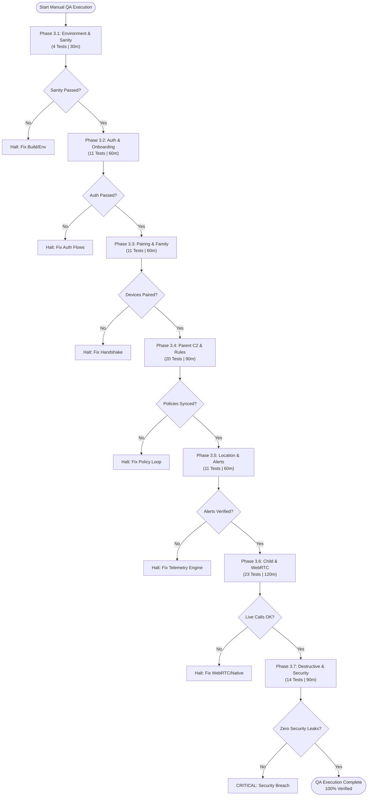

# 11 — Final Testing Execution Roadmap

**Document ID:** `HAVEN-GAP-011`  
**Phase:** Phase 2 — Testing Coverage & Test Case Gap Audit  
**Workspace:** `D:\parentcontrol_app`  
**Scope:** Priority-Ordered, Dependency-Aware Manual Testing Execution Sequence with Workflow Diagram  
**Execution Posture:** STRICTLY READ-ONLY — ALL TESTS `NOT TESTED`  

---

## 1. Roadmap Strategy & Architectural Dependencies

Manual testing cannot be executed at random. A child device cannot receive policy updates until it has been paired; a parent cannot configure safe zones until a family account has been created; and destructive tests (such as unlinking or account deletion) will prematurely terminate subsequent testing if executed too early.

This **Final Testing Execution Roadmap** structures the complete consolidated suite of **85 Master Manual Test Cases** into a logical, 7-phase sequence. Each phase acts as a verified prerequisite gate for the next, ensuring maximum testing efficiency, clean state transitions, and absolute protection against test-induced lockouts.

---

## 2. Seven-Phase Manual Testing Execution Sequence

```
====================================================================================================
                        HAVEN MANUAL TESTING EXECUTION ROADMAP
====================================================================================================
[Phase 3.1: Environment & Sanity] ─────> [Phase 3.2: Auth & Onboarding] ─────> [Phase 3.3: Pairing]
       (4 Tests | 30 Mins)                     (11 Tests | 60 Mins)                  (11 Tests | 60 Mins)
                                                                                       │
                                                                                       ▼
[Phase 3.6: Child & Remote Call]  <───── [Phase 3.5: Location & Alerts]  <───── [Phase 3.4: Parent C2]
       (23 Tests | 120 Mins)                   (11 Tests | 60 Mins)                  (20 Tests | 90 Mins)
               │
               ▼
[Phase 3.7: Destructive & Security Quarantine]  ====>  [FINAL AUDIT SIGN-OFF]
       (16 Tests | 90 Mins)
====================================================================================================
```

---

### Phase 3.1: Environment Sanity & Pre-Flight Checks
- **Objective**: Verify application build integrity, offline detection, configuration fallback, and version metadata prior to account creation.
- **Prerequisites**: Clean test devices; staging backend reachable.
- **Test Case Sequence**:
  1. `TC-A10`: Missing Configuration Fallback Screen (`A10`)
  2. `TC-SYS01`: Offline Mode Detection & Warning Banner (`SYS01`)
  3. `TC-EXP-51`: App Version and Build Information Display (`SET03`)
  4. `TC-EXP-11`: Real-Time Form Validation Feedback on Auth Forms (`A12`)
- **Estimated Duration**: 30 minutes.
- **Gating Criteria**: App launches cleanly, warns on network loss, and renders valid build version.

---

### Phase 3.2: Authentication & Account Lifecycle
- **Objective**: Validate the full user onboarding journey, from registration to role selection, token persistence, and sign-out.
- **Prerequisites**: Phase 3.1 Passed. Fresh disposable test email accounts.
- **Test Case Sequence**:
  1. `TC-EXP-03`: Registration Duplicate Email Rejection (`A02`, `A12`)
  2. `TC-A02`: Account Registration Flow (`A02`)
  3. `TC-EXP-09`: Email Verification Resend Throttling (`A03`)
  4. `TC-EXP-02`: Login Invalid Password and Rate Limiting (`A01`)
  5. `TC-A11`: Password Reveal & Masking Toggle (`A11`)
  6. `TC-A01`: Parent & Child Email Sign-In (`A01`)
  7. `TC-A04`: Cold App Launch Session Restoration (`A04`)
  8. `TC-A06`: Role Selection Screen Options (`A06`)
  9. `TC-EXP-01`: Role Assignment Persistence and Immutability (`A06`)
  10. `TC-EXP-10`: Account Profile Display and Display Name Update (`A07`)
  11. `TC-A05`: Sign Out & Token Revocation (`A05`)
- **Estimated Duration**: 60 minutes.
- **Gating Criteria**: Authenticated Parent and Child sessions can be created, persisted, and role-locked.

---

### Phase 3.3: Family Foundation & Device Pairing Handshake
- **Objective**: Establish the family group and execute the distributed pairing handshake between Parent and Child devices.
- **Prerequisites**: Phase 3.2 Passed. One Parent device and one Child test phone.
- **Test Case Sequence**:
  1. `TC-FAM08`: Family Group Creation (`FAM08`)
  2. `TC-FAM06`: Child Linking Code & QR Code Generation (`FAM06`)
  3. `TC-EXP-12`: Outgoing Pairing Requests List Rendering (`FAM03`)
  4. `TC-EXP-13`: Cancel Outgoing Pairing Request (`FAM04`)
  5. `TC-EXP-14`: Child Pairing Enrollment Consent and Cancellation (`FAM05`)
  6. `TC-FAM01`: Link Child via Camera QR Code Scanning (`FAM01`)
  7. `TC-FAM02`: Link Child via Manual 6-Digit Code Entry (`FAM02`)
  8. `TC-FAM07`: Child Device Hardware Registration & Keystore Binding (`FAM07`)
  9. `TC-EXP-05`: Child Device Model and OS Metadata Registration (`FAM07`)
  10. `TC-SET05`: Android Device Administrator Activation (`SET05`)
  11. `TC-EXP-15`: Family Roster and Role Hierarchy View (`FAM09`)
- **Estimated Duration**: 60 minutes.
- **Gating Criteria**: Child device successfully enrolled, Keystore keys active, Device Admin granted, visible in parent dashboard.

---

### Phase 3.4: Parent Monitoring, Screen Time & Application Rules
- **Objective**: Verify parent command and control: telemetry dashboards, screen time limits, bedtime schedules, and app restrictions.
- **Prerequisites**: Phase 3.3 Passed. Child device actively enrolled and online.
- **Test Case Sequence**:
  1. `TC-MON01`: Parent Dashboard Summary Cards Rendering (`MON01`)
  2. `TC-EXP-24`: Parent Dashboard Pull-to-Refresh (`MON08`)
  3. `TC-EXP-20`: Connected Devices List and Status Cards (`MON02`)
  4. `TC-MON03`: Device Detail Technical Telemetry (`MON03`)
  5. `TC-EXP-21`: Child Permission Diagnostics Remote View (`MON05`)
  6. `TC-EXP-22`: Command Delivery and ACK History Log (`MON06`)
  7. `TC-USE01`: Daily Screen Time 7-Day Usage Chart (`USE01`)
  8. `TC-USE02`: Per-Application Daily Usage Breakdown (`USE02`)
  9. `TC-USE05`: Daily Screen Time Quota Limit Setting (`USE05`)
  10. `TC-EXP-29`: Bedtime Schedule Setup and Nightly Boundary Enforcement (`USE06`)
  11. `TC-APP01`: Blocking Individual Target Application (`APP01`)
  12. `TC-APP02`: Whitelist Mode (Block All Except Allowed) (`APP02`)
  13. `TC-EXP-06`: Whitelist Mode Emergency Phone Bypass Verification (`APP02`, `CHD09`)
  14. `TC-EXP-32`: App Whitelist Selection and Category Filtering (`APP03`)
  15. `TC-APP04`: Per-App Allowed Schedule Windows (`APP04`)
  16. `TC-APP05`: Policy Command Delivery & Acknowledgment Loop (`APP05`)
  17. `TC-EXP-25`: Policy Sync Health Badge Transitions (`MON09`)
  18. `TC-EXP-33`: Manual Policy Force-Sync Command (`APP06`)
  19. `TC-EXP-34`: App Restrictions Search and Package Filtering (`APP08`)
  20. `TC-EXP-26`: Device Filter Toggle: Active vs Revoked (`MON10`)
- **Estimated Duration**: 90 minutes.
- **Gating Criteria**: Parent rules successfully deliver to child device and update sync badge to Green.

---

### Phase 3.5: Geospatial Safe Zones, Telemetry & Alerts Subsystem
- **Objective**: Verify location tracking, safe zone creation, route history, and automated safety alert triggers.
- **Prerequisites**: Phase 3.4 Passed. GPS permissions granted on child device.
- **Test Case Sequence**:
  1. `TC-LOC01`: Child Real-Time Map Location Display (`LOC01`)
  2. `TC-LOC05`: Safe Zone Geofence Creation (`LOC05`)
  3. `TC-EXP-42`: Safe Zone Radius Live Preview Slider (`LOC11`)
  4. `TC-EXP-35`: 24-Hour Location History Route Playback (`LOC02`)
  5. `TC-EXP-36`: Child Location Sharing Privacy Toggle (`LOC03`)
  6. `TC-EXP-37`: Continuous Background Location Daemon Tracking (`LOC04`)
  7. `TC-EXP-38`: Safe Zone Geofence Breach Alert Dispatch (`LOC06`)
  8. `TC-EXP-39`: Low-Battery Warning Alert Under 15% (`LOC07`)
  9. `TC-EXP-40`: Child Device Offline Detection Alert (`LOC08`)
  10. `TC-EXP-41`: Tamper Alert on OS Permission Revocation (`LOC09`, `SET08`)
  11. `TC-LOC10`: Safety Alerts Inbox & Acknowledgment (`LOC10`)
- **Estimated Duration**: 60 minutes.
- **Gating Criteria**: Location telemetry renders accurately; simulated safety events produce instant inbox alerts.

---

### Phase 3.6: Child Native Safeguards & Remote Assistance Live Sessions
- **Objective**: Verify child client UX, emergency quick-dialer, native daemons, and two-way WebRTC video assistance.
- **Prerequisites**: Phase 3.5 Passed. Camera and Mic hardware available on both devices.
- **Test Case Sequence**:
  1. `TC-CHD01`: Child Home Protection Status Overview (`CHD01`)
  2. `TC-CHD09`: Emergency Parent Quick-Call Dialer Action (`CHD09`)
  3. `TC-CHD02`: Child Rules & Policy Oversight View (`CHD02`)
  4. `TC-EXP-57`: Child Rules Real-Time Manual Refresh (`CHD08`)
  5. `TC-CHD03`: Child Requests Inbox & Notifications Badge (`CHD03`)
  6. `TC-EXP-30`: Child Home Remaining Time Live Calculation (`USE07`)
  7. `TC-EXP-31`: Daily Quota Expiry Full-Screen Lock Overlay (`USE08`)
  8. `TC-CHD04`: Guardian Foreground Service Persistent Notification (`CHD04`)
  9. `TC-CHD05`: Camera & Microphone Hardware Self-Test (`CHD05`)
  10. `TC-EXP-52`: Runtime Permission Launcher Bridge (`SET04`)
  11. `TC-EXP-53`: Background Location Launcher Bridge (`SET06`)
  12. `TC-EXP-54`: Permission Status Tile Visual Indicator (`SET07`)
  13. `TC-EXP-27`: Child Usage Access Permission Guidance Banner (`USE03`)
  14. `TC-EXP-28`: Native Usage Stats Collection and Background Upload (`USE04`)
  15. `TC-APP07`: Native OS App Suspension Under Device Owner (`APP07`, `CHD06`)
  16. `TC-REM01`: Initiating Remote Assistance Call (`REM01`)
  17. `TC-EXP-07`: Child Incoming Remote Call Notification & Dialog (`REM02`)
  18. `TC-EXP-08`: WebRTC Two-Way Audio and Video Streaming (`REM03`)
  19. `TC-EXP-45`: In-Call Media Toggle Controls (`REM06`)
  20. `TC-EXP-44`: Remote Call Termination and Hardware Teardown (`REM05`)
  21. `TC-EXP-43`: Remote Assistance Call Log Audit Trail (`REM04`)
  22. `TC-EXP-56`: Child Daemon Sync Network Reconnect (`CHD07`)
  23. `TC-EXP-58`: Periodic Heartbeat Polling Fallback (`SYS02`)
- **Estimated Duration**: 120 minutes.
- **Gating Criteria**: Child daemon remains resilient, emergency dialer bypasses limits, WebRTC video stream functions smoothly.

---

### Phase 3.7: Destructive Quarantined Operations & Security Boundaries
- **Objective**: Execute destructive, cleanup, and adversarial tenant boundary tests under strict quarantine.
- **Prerequisites**: Phase 3.6 Passed. All non-destructive testing completed. Staging backend verified.
- **Test Case Sequence**:
  1. `TC-AUD01`: Administrative Audit Log Viewer (`AUD01`)
  2. `TC-EXP-46`: Set Audit Log Retention Period in Settings (`AUD02`)
  3. `TC-EXP-47`: On-Demand Historical Audit Log Purge (`AUD03`)
  4. `TC-EXP-48`: Database Scheduled Retention Sweep RPC (`AUD04`)
  5. `TC-FAM11` / `TC-EXP-16`: Child Self-Unlink Prevention and Parent PIN Challenge (`FAM11`)
  6. `TC-EXP-55`: Device Admin Revocation Tamper Warning Dialog (`SET08`)
  7. `TC-FAM10`: Unlink Child Account from Parent Dashboard (`FAM10`)
  8. `TC-EXP-17`: Revoke Child Device from Dashboard (`FAM12`)
  9. `TC-EXP-18`: Re-Credential Child Device via Recovery Challenge (`FAM13`)
  10. `TC-EXP-19`: Family Settings API Configuration Update (`FAM14`)
  11. `TC-A08` / `TC-EXP-04`: Account Data Export (GDPR) (`A08`)
  12. `TC-A09`: Account Deletion with Confirmation Cascade (`A09`)
  13. `TC-SEC01`: Cross-Family Unauthorized Data Access Boundary (RLS) (`A01` / RLS)
  14. `TC-SEC02`: Replay of Staged Credential Redemption (`FAM13` / Wave 3)
- **Estimated Duration**: 90 minutes.
- **Gating Criteria**: Zero cross-tenant data leakage; replayed tokens rejected; account and device unlinking execute safely.

---

## 3. Mermaid Execution Workflow Diagram



---

## 4. Execution Logistics & Resource Planning

- **Total Execution Effort**: Approximately **8.5 hours** of focused testing across two physical devices and staging backend.
- **Recommended Staffing**:
  - **Primary Tester (Parent Role)**: Operates Parent Android app or tablet.
  - **Secondary Tester (Child Role)**: Operates Child Android phone.
  - **QA Lead / Auditor**: Logs step results, records evidence screenshots, and verifies database state.
- **Ready for Immediate Owner Approval**: This roadmap provides a clear, risk-controlled pathway to full production verification.
