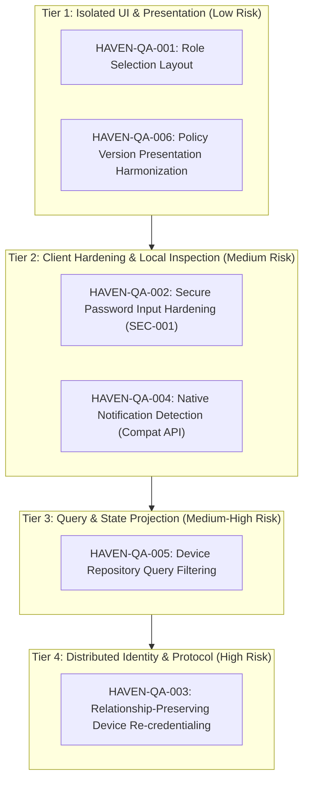

# 01 — Six Defects Remediation Master Plan

**Document ID:** HAVEN-REM-001  
**Phase:** Phase 1 — Remediation Planning (Strictly Planning-Only)  
**Date:** 2026-11-23  
**Status:** DRAFT FOR OWNER REVIEW & APPROVAL  
**Workspace:** `D:\parentcontrol_app`  
**Git Baseline HEAD:** `5ffc5c170add4bfafd236beb633f00b6fe86243b` (verified direct descendant of approved baseline `80375f518139bf922bc1b66c998691bee912af44`)  
**Package:** `com.parentcontrol.parent_control`  

---

## 1. Executive Summary

This Master Plan establishes the engineering, architectural, and governance blueprint to remediate the **six independently confirmed application defects** discovered during Phase 6 Comprehensive QA Execution and verified by the Fourth-Party Independent QA Audit.

Every defect in this register has been verified against actual source code, native Android Kotlin bridges, UIAutomator dumps, screenshots, or prior run logcats. The remediation effort is designed to restore complete operational integrity to HAVEN Parent Control without breaking existing family relationships, invalidating active QA sessions, or violating architectural boundaries.

### Summary of Defects Under Remediation

| Issue ID | Defect Title | Severity | Affected Role | Subsystem | Target Fix Component |
|---|---|---|---|---|---|
| **HAVEN-QA-001** | Action button label truncated ("Create acc...") on Role Selection screen | **Low** | Shared | UI / Responsive Layout | `RoleSelectionPage` (`lib/features/role_selection/role_selection_page.dart`) |
| **HAVEN-QA-002** | Password input exposes plaintext and predictive text suggestions (`SEC-001`) | **High** | Shared | Core Security / Auth | `AppTextField` (`lib/core/widgets/app_text_field.dart`), `LoginPage`, `RegisterPage` |
| **HAVEN-QA-003** | Device re-credentialing failure breaks heartbeat, usage & location telemetry (`DEF-601` / `MON04`) | **High** | Child / Interconnected | Native Identity / Edge RPC | `SecureStore.kt`, `GuardianService.kt`, `device-register`, new `rotate_device_secret` RPC |
| **HAVEN-QA-004** | Notification permission reports false-positive "Granted" on Android 12 (`DEF-604` / `MON05`) | **Medium** | Child / Interconnected | Native Android Permissions | `NativePermissions.kt` (`android/.../NativePermissions.kt`) |
| **HAVEN-QA-005** | Revoked devices duplicated in Parent dashboard and device list (`DEF-602`) | **High** | Parent | Repository / Query Filter | `SupabaseDeviceRepository` (`lib/data/repositories/supabase_device_repository.dart`) |
| **HAVEN-QA-006** | Policy version inconsistency between Dashboard and Devices tab (`DEF-603`) | **Medium** | Parent | State Model / Presentation | `DashboardController`, `DevicesController`, `device_presentation.dart` |

---

## 2. Operational Scope & Boundary Constraints

### 2.1 Strictly Planning-Only Phase
This document and its companion reports represent **Phase 1: Remediation Planning**.
- **NO SOURCE IMPLEMENTATION**: No Dart, Kotlin, Swift, SQL, Deno, or YAML files are edited during this phase.
- **NO TEST EXECUTION**: No Flutter test suites, Gradle unit tests, Deno test scripts, or live ADB instrumentation commands are run.
- **NO ACTIVE DEVICE INTERACTION**: The connected physical Child device (`Realme RMX2161`, `5HXWRGQ4IFU8WS4T`) and Parent emulator (`Pixel 9 emulator`, `emulator-5554`) remain untouched.
- **NO CREDENTIAL TOUCH**: No passwords, tokens, API keys, or session stores are queried, extracted, or entered.
- **NO GIT INDEX MUTATION**: The Git working tree and staging index remain strictly as found. New documents are written exclusively into `docs/testing/phase6_comprehensive_execution/remediation_planning/`.

### 2.2 Independent Owner Approval Gate
Implementation shall **NOT** commence until the application owner explicitly reviews and approves each defect remediation design in this package. Decisions are tracked formally in `10_owner_decision_and_approval_register.md`.

---

## 3. High-Level Architectural Remediation Strategy

The remediation of the six defects follows an isolated, risk-tiered approach to ensure that low-risk UI fixes cannot destabilize core backend transactions, and complex security/identity remediations are bounded by clear interfaces and database atomicity.



1. **HAVEN-QA-001 (Role Selection Button Truncation)**: Replace rigid 138dp button constraints in `RoleSelectionPage` with flexible/scaled text rendering (`FittedBox` / responsive padding) ensuring "Create account" is 100% visible across all screen densities (especially 480 dpi).
2. **HAVEN-QA-002 (Password Security / SEC-001)**: Hard-code security parameters in `AppTextField` when `obscureText: true`: force `enableSuggestions: false`, `autocorrect: false`, default `keyboardType` to `TextInputType.visiblePassword` or password-hardened variant, and wrap in `Semantics(password: true)`.
3. **HAVEN-QA-003 (Device Re-credentialing / MON04)**: Adopt **Option C** from the Phase 4 Architecture: A parent-authorized, child-authenticated, single-use, 10-minute challenge token that triggers an atomic `rotate_device_secret` RPC. This rotates the client cryptographic secret in `device_credentials` / `devices` without revoking the device UUID, destroying family membership, or wiping telemetry history.
4. **HAVEN-QA-004 (Notification Detection False-Positive)**: Refactor `NativePermissions.kt` to use `NotificationManagerCompat.from(context).areNotificationsEnabled()` instead of a blanket `Build.VERSION.SDK_INT < TIRAMISU` bypass, correctly reflecting notification enablement across Android 10, 11, 12, 13, and 14+.
5. **HAVEN-QA-005 (Revoked Devices Duplication)**: Add explicit `.neq('status', 'revoked')` filtering in `SupabaseDeviceRepository.fetchDevices()` by default, with an optional `includeRevoked: true` flag for historical/audit projections, preventing revoked rows from cluttering active dashboards.
6. **HAVEN-QA-006 (Policy Version Inconsistency)**: Harmonize `device_presentation.dart:policySummary()` so that both `DashboardController` and `DevicesController` display both the *Target Policy Version* (server desired) and *Device Applied Version* (device confirmed) whenever sync lag exists.

---

## 4. Governance Gate Framework

To ensure flawless execution, remediation must proceed across six formal governance gates:

| Gate | Name | Definition | Authority | Prerequisite |
|---|---|---|---|---|
| **Gate A** | **Remediation Plan Approval** | Approval of the 12 planning reports and technical architectures. | Product Owner | Completed Phase 1 Planning Package |
| **Gate B** | **Local Implementation (Client & Native)** | Code changes in Flutter Dart widgets and Android Kotlin bridges (Defects 001, 002, 004, 005, 006). | Engineering Lead | Gate A Approval |
| **Gate C** | **Backend Schema & RPC Migration** | SQL migration for `rotate_device_secret` RPC and challenge store (Defect 003). | Database / Security Owner | Gate A & B Clearance |
| **Gate D** | **Edge Function Deployment & Integration** | Edge Function updates for re-credentialing challenge issuance and verification. | DevOps / Backend Lead | Gate C Migration Verification |
| **Gate E** | **Controlled Device Verification** | Verification of fixes on dedicated QA emulator and physical hardware without session loss. | QA Lead | Gate B, C, D Deployed |
| **Gate F** | **Production Release Clearance** | Final sign-off for release build deployment. | Product Owner | Complete Regression Clearance |

---

## 5. Master Implementation Sequence

Remediation must be executed in strict sequence to minimize regression blast radius:

```
[Sequence 1: Low-Impact Client Fixes]
Step 1.1: HAVEN-QA-002 (SEC-001) — Secure AppTextField & Auth Screens
Step 1.2: HAVEN-QA-001 — Responsive Role Selection Button Layout
Step 1.3: HAVEN-QA-004 (DEF-604) — Android Notification Compat Detection

[Sequence 2: Repository & State Presentation]
Step 2.1: HAVEN-QA-005 (DEF-602) — Device Repository Active Filtering
Step 2.2: HAVEN-QA-006 (DEF-603) — Harmonized Policy Version Presentation

[Sequence 3: Distributed Re-credentialing Protocol]
Step 3.1: HAVEN-QA-003 Database Migration (Challenge store & atomic rotation RPC)
Step 3.2: HAVEN-QA-003 Edge Function Handlers (`device-register` / `family-admin`)
Step 3.3: HAVEN-QA-003 Child Native KeyStore & Shell Re-credentialing Flow
Step 3.4: HAVEN-QA-003 Parent Authorization UI & Challenge Dispatch
```

---

## 6. Deliverable Index for this Planning Phase

The remediation planning deliverables are organized across 12 companion reports:
- `01_remediation_master_plan.md`: Master Strategy, Boundaries, and Roadmap.
- `02_defect_root_cause_analysis.md`: Line-by-line Code Root Cause Analysis for all 6 Defects.
- `03_credential_lifecycle_remediation_design.md`: Deep Architecture for HAVEN-QA-003.
- `04_password_security_remediation_design.md`: Security Hardening Architecture for HAVEN-QA-002 (SEC-001).
- `05_device_repository_and_policy_consistency_design.md`: Architecture for HAVEN-QA-005 & HAVEN-QA-006.
- `06_notification_permission_and_ui_remediation_design.md`: Architecture for HAVEN-QA-004 & HAVEN-QA-001.
- `07_cross_defect_dependency_matrix.md`: Inter-defect Coupling, Shared Components, and Conflict Analysis.
- `08_implementation_order_and_rollback_plan.md`: Step-by-step Execution Sequencing & Rollback Runbooks.
- `09_fix_verification_and_regression_test_plan.md`: Unit, Widget, Integration, and Native Test Matrix.
- `10_owner_decision_and_approval_register.md`: Formal Decision Records Awaiting Owner Ruling.
- `11_remediation_risk_register.md`: Risk Severity, Blast Radius, Mitigations, and Residual Risk.
- `12_planning_execution_and_git_integrity_report.md`: Verification of Planning Execution & Git State Integrity.
