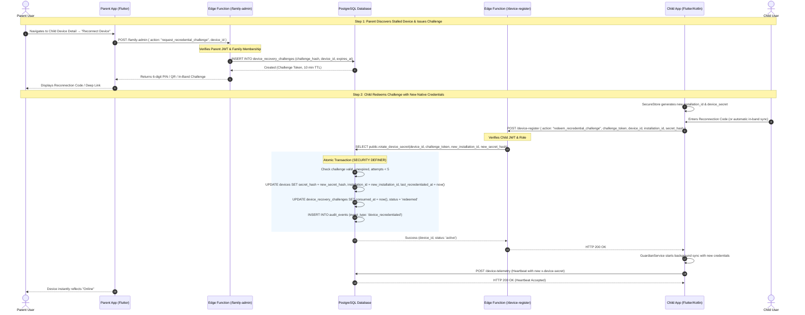

# 03 — Device Credential Lifecycle Remediation Design

**Document ID:** HAVEN-REM-003  
**Target Defect:** HAVEN-QA-003 (`DEF-601` / `MON04`)  
**Phase:** Phase 1 — Remediation Planning (Strictly Planning-Only)  
**Date:** 2026-11-23  
**Status:** DRAFT FOR OWNER REVIEW & APPROVAL  
**Workspace:** `D:\parentcontrol_app`  
**Git Baseline HEAD:** `5ffc5c170add4bfafd236beb633f00b6fe86243b`  

---

## 1. Context & Architectural Problem

When the HAVEN Child application is reinstalled or deployed with an updated signature on an enrolled device (such as the physical test device `Realme RMX2161`), the local Android KeyStore is reset, and `SecureStore.kt` generates a **new installation ID** and **new 32-byte cryptographic secret**.

On the backend, the `devices` table retains the existing row with `status = 'active'`, tied to the original `secret_hash`. When the reinstalled Child app authenticates with its Child user account and fetches its device profile, it acquires the original `devices.id` (UUID), but sends telemetry headers (`x-device-id` and `x-device-secret`) signed with the new secret. The Edge Function `device-telemetry` verifies this against `devices.secret_hash` using constant-time comparison. Because the hashes do not match, the server returns HTTP 401 `invalid_device_credentials`.

As a consequence:
1. Heartbeat fails to record `last_seen_at`.
2. Daily app usage and live location uploads are rejected.
3. The Parent dashboard renders the Child device as permanently "Offline".
4. The existing `family-admin` recovery endpoint (`request_device_recovery`) destroys the family relationship, revokes the device, and unlinks the child account, which is unacceptable for normal app updates or hardware reinstalls.

---

## 2. Evaluation of Architectural Options

The remediation evaluates four architectural alternatives previously analyzed in Phase 4:

| Option | Architecture | Relationship Preserved? | Device UUID Preserved? | Security Boundary | Recommendation |
|---|---|---|---|---|---|
| **Option A** | **Parent-Authorized Alone** | Yes | Yes | Parent approves rotation; server needs child secret | **Incomplete**: Parent cannot generate child's native key |
| **Option B** | **Child Session Alone** | Yes | Yes | Child JWT permits secret update | **REJECTED**: Stolen child JWT could hijack physical device |
| **Option C** | **Parent Approval + Child Auth + Single-Use Challenge** | **Yes** | **Yes** | **Two-factor binding: Parent authorizes, Child authenticates, RPC rotates atomically** | **RECOMMENDED (Phase 4 Gate A Approved)** |
| **Option D** | **Existing `recover_device` (Unlink & Re-pair)** | **No** | **No** | Destroys membership, revokes UUID, requires full re-pairing | **REJECTED (Destructive Fallback Only)** |

### Recommendation: Option C (Two-Factor Challenge Protocol)
Option C is the only relationship-preserving, zero-trust solution:
- **Parent Factor**: The Parent account (verified as active parent in the family) explicitly generates a time-bound recovery challenge for the specific `device_id`.
- **Child Factor**: The Child device (authenticated via Child JWT) claims the challenge, presenting its **new** `installation_id` and **new** `secret_hash`.
- **Database Factor**: An atomic database transaction verifies the challenge, rotates `secret_hash` on the **same** `devices.id`, marks the challenge consumed, and writes an immutable audit record.

---

## 3. Protocol Architecture & Sequence Flow



---

## 4. Database Schema Additions & Atomic RPC Design

### 4.1 Table: `device_recovery_challenges`
To support single-use, rate-limited recovery without polluting user tables:

```sql
-- Migration: 20261124000100_device_recredentialing.sql
create table if not exists public.device_recovery_challenges (
  id uuid primary key default gen_random_uuid(),
  family_id uuid not null references public.families(id) on delete cascade,
  device_id uuid not null references public.devices(id) on delete cascade,
  child_user_id uuid not null references auth.users(id) on delete cascade,
  challenge_hash text not null,
  attempts integer not null default 0,
  max_attempts integer not null default 5,
  expires_at timestamptz not null default (now() + interval '10 minutes'),
  consumed_at timestamptz,
  created_by uuid not null references auth.users(id),
  created_at timestamptz not null default now(),
  constraint challenge_hash_format check (challenge_hash ~ '^[0-9a-f]{64}$')
);

create index if not exists idx_device_recovery_challenges_active 
  on public.device_recovery_challenges (device_id, expires_at) 
  where consumed_at is null;

-- Revoke all direct client privileges; accessible only by service-role
revoke all on public.device_recovery_challenges from public, anon, authenticated;
grant select, insert, update on public.device_recovery_challenges to service_role;
```

### 4.2 Atomic RPC: `rotate_device_secret`
Executed with `SECURITY DEFINER` and restricted to `service_role`:

```sql
create or replace function public.rotate_device_secret(
  p_device_id uuid,
  p_challenge_token text,
  p_new_installation_id text,
  p_new_secret_hash text,
  p_actor_user_id uuid
) returns jsonb
language plpgsql
security definer
set search_path = public, pg_temp
as $$
declare
  v_challenge record;
  v_device record;
  v_token_hash text;
begin
  -- Hash incoming token using sha256 to compare with stored challenge_hash
  v_token_hash := encode(digest(p_challenge_token, 'sha256'), 'hex');

  -- Lock and fetch active challenge
  select * into v_challenge
  from public.device_recovery_challenges
  where device_id = p_device_id
    and consumed_at is null
  for update;

  if not found then
    raise exception 'No active re-credentialing challenge found for this device.'
      using errcode = 'P0002';
  end if;

  if v_challenge.expires_at < now() then
    raise exception 'Re-credentialing challenge has expired.'
      using errcode = 'P0003';
  end if;

  if v_challenge.attempts >= v_challenge.max_attempts then
    raise exception 'Maximum verification attempts exceeded.'
      using errcode = 'P0004';
  end if;

  -- Verify token hash constant-time
  if v_challenge.challenge_hash <> v_token_hash then
    update public.device_recovery_challenges
    set attempts = attempts + 1
    where id = v_challenge.id;
    raise exception 'Invalid re-credentialing challenge token.'
      using errcode = 'P0005';
  end if;

  -- Lock device row
  select * into v_device
  from public.devices
  where id = p_device_id and status = 'active'
  for update;

  if not found then
    raise exception 'Active device not found.'
      using errcode = 'P0006';
  end if;

  -- Ensure actor is the child assigned to this device
  if v_device.child_user_id <> p_actor_user_id then
    raise exception 'Authenticated user does not own this device.'
      using errcode = '42501';
  end if;

  -- Atomic update of device credentials
  update public.devices
  set secret_hash = p_new_secret_hash,
      installation_id = p_new_installation_id,
      credential_issued_at = now()
  where id = p_device_id;

  -- Mark challenge consumed
  update public.device_recovery_challenges
  set consumed_at = now()
  where id = v_challenge.id;

  -- Insert immutable audit log
  insert into public.audit_events (
    family_id,
    actor_user_id,
    device_id,
    event_type,
    target_type,
    target_id,
    metadata
  ) values (
    v_device.family_id,
    p_actor_user_id,
    p_device.id,
    'device_recredentialed',
    'device',
    p_device.id,
    jsonb_build_object(
      'challenge_id', v_challenge.id,
      'previous_issued_at', v_device.credential_issued_at,
      'recredentialed_at', now()
    )
  );

  return jsonb_build_object(
    'ok', true,
    'device_id', p_device_id,
    'status', 'active',
    'recredentialed_at', now()
  );
end;
$$;

revoke all on function public.rotate_device_secret(uuid, text, text, text, uuid) from public, anon, authenticated;
grant execute on function public.rotate_device_secret(uuid, text, text, text, uuid) to service_role;
```

---

## 5. Security & Threat Modeling

1. **Brute Force Protection**: Challenges enforce a strict limit of 5 failed attempts (`attempts < max_attempts`). Once 5 attempts fail, the challenge is immediately locked and cannot be retried.
2. **Replay Protection**: The challenge is flagged `consumed_at = now()` inside the same database transaction that updates `secret_hash`. Any subsequent redemption attempt fails immediately.
3. **Time-To-Live (TTL)**: Challenges expire 10 minutes from creation (`expires_at = now() + interval '10 minutes'`).
4. **Data Minimization**: The raw secret is generated locally on the Child device and sent as a SHA-256 hash. The plaintext secret is never transmitted to or stored on the server.
5. **Relationship Invariant**: `family_id` and `child_user_id` are immutable in this flow. The device cannot be reassigned to another child or family during re-credentialing.

---

## 6. Verification & Rollback Architecture

- **Verification Strategy**:
  - Deno unit tests simulating valid, expired, replay, and brute-forced challenge attempts.
  - SQL unit tests validating transaction rollback on partial failure.
  - End-to-end integration test validating successful telemetry upload immediately following rotation.
- **Rollback Strategy**:
  - If the migration needs reversal before deployment, the down-migration drops the `rotate_device_secret` RPC and drops `device_recovery_challenges` table. Existing `devices` table columns remain unmodified.
