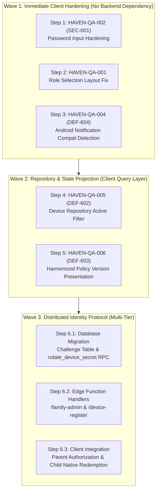

# 08 — Implementation Order & Rollback Plan

**Document ID:** HAVEN-REM-008  
**Phase:** Phase 1 — Remediation Planning (Strictly Planning-Only)  
**Date:** 2026-11-23  
**Status:** DRAFT FOR OWNER REVIEW & APPROVAL  
**Workspace:** `D:\parentcontrol_app`  
**Git Baseline HEAD:** `5ffc5c170add4bfafd236beb633f00b6fe86243b`  

---

## 1. Overview & Remediation Philosophy

The remediation plan follows a **Risk-Ascending, Dependency-Ordered Sequence**.
By resolving pure client-side security and UI defects first, the engineering team locks in quick wins and eliminates security vulnerabilities before introducing backend schema and distributed identity changes.

---

## 2. Master Implementation Sequencing



---

## 3. Step-by-Step Implementation & Prerequisite Catalog

### Step 1: HAVEN-QA-002 (`SEC-001`) — Password Input Hardening
- **Target Files**: `lib/core/widgets/app_text_field.dart`, `lib/features/auth/login_page.dart`, `lib/features/auth/register_page.dart`.
- **Prerequisites**: Gate A Owner Approval.
- **Scope**: Hardcode suggestions/autocorrect suppression when `obscureText: true`, default `keyboardType: TextInputType.visiblePassword`, add password accessibility semantics.
- **Verification**: Run `test/core/widgets/app_text_field_security_test.dart`.
- **Blast Radius**: Isolated to text input fields. Zero database or backend impact.

### Step 2: HAVEN-QA-001 — Role Selection Responsive Layout
- **Target Files**: `lib/core/widgets/app_button.dart`, `lib/features/role_selection/role_selection_page.dart`.
- **Prerequisites**: Step 1 complete.
- **Scope**: Add `FittedBox` label scaling to `AppButton` and adjust button spacing on `RoleSelectionPage`.
- **Verification**: Run `test/features/role_selection/role_selection_page_test.dart` at 360dp logical width.
- **Blast Radius**: Isolated to onboarding UI. Zero risk to existing sessions.

### Step 3: HAVEN-QA-004 (`DEF-604`) — Android Notification Compat Detection
- **Target File**: `android/app/src/main/kotlin/com/parentcontrol/parent_control/NativePermissions.kt`.
- **Prerequisites**: Step 2 complete.
- **Scope**: Replace `if (Build.VERSION.SDK_INT < TIRAMISU) return true` with `NotificationManagerCompat.from(context).areNotificationsEnabled()`.
- **Verification**: Run native JUnit/Robolectric test on API 31 and API 34.
- **Blast Radius**: Android-only native bridge method. No iOS or web regression potential.

### Step 4: HAVEN-QA-005 (`DEF-602`) — Device Repository Active Query Filter
- **Target Files**: `lib/data/repositories/repository_contracts.dart`, `lib/data/repositories/supabase_device_repository.dart`.
- **Prerequisites**: Step 3 complete.
- **Scope**: Add `neq('status', 'revoked')` filter to `fetchDevices()` by default, with optional `includeRevoked` flag.
- **Verification**: Run `test/data/repositories/supabase_device_repository_test.dart`.
- **Blast Radius**: Modifies device query return set in Parent Mode. Does not delete or mutate database rows.

### Step 5: HAVEN-QA-006 (`DEF-603`) — Policy Version Consistency Harmonization
- **Target Files**: `lib/features/devices/device_presentation.dart`, `lib/features/dashboard/dashboard_controller.dart`, `lib/features/devices/devices_controller.dart`.
- **Prerequisites**: Step 4 complete.
- **Scope**: Implement unified `policySummary()` distinguishing desired vs applied policy versions during sync transitions.
- **Verification**: Run `test/features/devices/device_presentation_test.dart`.
- **Blast Radius**: Presentation-only. No side effects on policy synchronization or enforcement.

### Step 6: HAVEN-QA-003 (`DEF-601`) — Device Re-credentialing Protocol
- **Target Files**:
  - Backend: `supabase/migrations/20261124000100_device_recredentialing.sql`.
  - Edge Functions: `supabase/functions/family-admin/index.ts`, `supabase/functions/device-register/index.ts`.
  - Client Native: `android/app/src/main/kotlin/com/parentcontrol/parent_control/SecureStore.kt`, `GuardianService.kt`.
  - Client Flutter: `lib/features/child/controllers/child_shell_controller.dart`, `lib/features/devices/parent_device_detail_page.dart`.
- **Prerequisites**: Gate A, B, C, D approvals; Steps 1–5 complete.
- **Scope**: Deploy recovery challenge table and `rotate_device_secret` RPC; wire Edge Function endpoints; integrate Parent challenge dispatch UI and Child challenge redemption flow.
- **Verification**: Full multi-stage Deno, SQL, and integration suite.
- **Blast Radius**: High. Modifies device authentication secrets and database credentials table.

---

## 4. Rollback Strategies by Tier

### 4.1 Client-Only Rollback (Steps 1, 2, 4, 5)
Because Steps 1, 2, 4, and 5 make no schema, configuration, or persistent state changes:
- **Rollback Mechanism**: Standard Git commit revert:
  ```powershell
  git revert <commit-hash> --no-edit
  ```
- **Time to Rollback**: Instantaneous (< 2 minutes).
- **Residual Risk**: Zero schema drift, zero orphaned data.

### 4.2 Native Android Rollback (Step 3)
- **Rollback Mechanism**: Git revert of `NativePermissions.kt`.
- **Time to Rollback**: Instantaneous code revert; requires APK rebuild.
- **Residual Risk**: Zero native state persistence.

### 4.3 Database & Edge Rollback (Step 6)
If Step 6 encounters an unexpected production issue after deployment:
1. **Edge Function Rollback**: Redeploy prior stable revisions of `/family-admin` and `/device-register`.
2. **Database Schema Rollback**: Execute down-migration `20261124000100_device_recredentialing_down.sql`:
   ```sql
   drop function if exists public.rotate_device_secret(uuid, text, text, text, uuid);
   drop table if exists public.device_recovery_challenges cascade;
   ```
3. **Data Integrity Guarantee**: Rolling back the migration drops the new challenge table and RPC. The core `devices` table retains all existing data, columns, and relationships without corruption.

---

## 5. Partial Fix Execution Analysis

| Partial Execution Scenario | Supported? | Operational Result & Risk Profile |
|---|---|---|
| **Steps 1 & 2 only (Client UI & Sec)** | **YES** | Resolves `SEC-001` and button truncation. Telemetry defect (`003`) and duplicate devices (`005`) remain open. Zero regression risk. |
| **Steps 1, 2, 3 only (+ Native)** | **YES** | Resolves security, UI, and notification false-positives. Device telemetry remains broken after reinstall. Safe. |
| **Steps 1 through 5 (+ Repository)** | **YES** | Cleanest client release without database migration. Resolves 5 of 6 defects. Only `HAVEN-QA-003` remains open. Highly recommended milestone. |
| **Step 6 without Step 5** | **NO** | Not recommended. Re-credentialing active devices while revoked rows are still duplicated in repository causes confusing UI states. |
| **Complete Steps 1 through 6** | **YES** | Full remediation of all six defects. Application reaches complete production integrity. |
