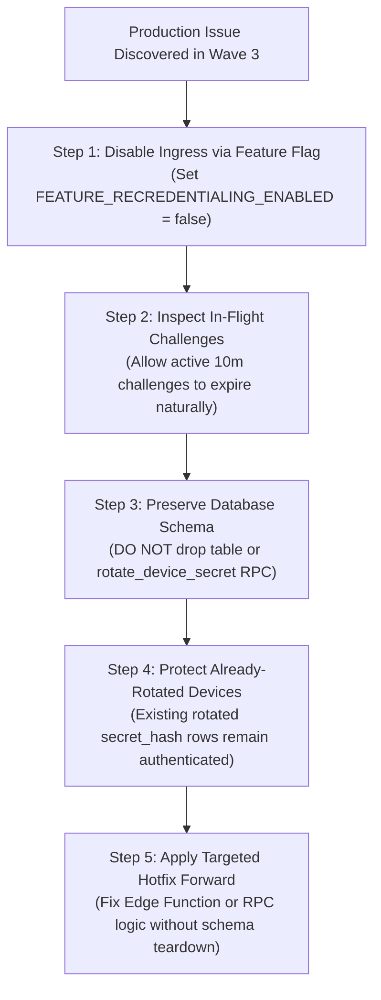

# 06 — Rollback & Recovery Independent Review

**Document ID:** HAVEN-REV-006  
**Phase:** Phase 1.1 — Remediation Plan Independent Review (Strictly Read-Only)  
**Date:** 2026-11-23  
**Status:** COMPLETE INDEPENDENT TECHNICAL REVIEW  
**Workspace:** `D:\parentcontrol_app`  
**Current HEAD:** `56636f62d5144610ae12c89d02d582feb48217fc`  

---

## 1. Overview & Rollback Philosophy

A remediation plan cannot be approved if its rollback procedures can destroy application data, brick enrolled devices, or create unrecoverable state drift between clients and servers.

This report independently evaluates the rollback and forward-recovery strategies proposed in `08_implementation_order_and_rollback_plan.md`.

---

## 2. Adversarial Challenge of Rollback Strategies by Tier

---

### 2.1 Wave 1 (Client-Only Rollbacks: QA-001, QA-002, QA-004)
- **Proposed Strategy**: Standard Git revert (`git revert <commit-hash>`).
- **Independent Evaluation**: **PASS (SAFE & REVERSIBLE)**.
- **Analysis**:
  - `HAVEN-QA-001` (button layout), `HAVEN-QA-002` (password text field), and `HAVEN-QA-004` (native notification check) do NOT write persistent state, modify schemas, or change the wire protocol.
  - Reverting any of these client commits returns the application to its exact baseline state without residual side effects.
  - Zero database drift, zero session invalidation risk.

---

### 2.2 Wave 2 (Repository & Presentation Rollbacks: QA-005, QA-006)
- **Proposed Strategy**: Git revert of Flutter repository and presentation code.
- **Independent Evaluation**: **PASS (SAFE & REVERSIBLE)**.
- **Analysis**:
  - `HAVEN-QA-005` alters the client's query filter on `devices`. It does not delete or alter database rows.
  - `HAVEN-QA-006` changes pure string formatting in `device_presentation.dart`.
  - Reverting these changes restores the previous behavior (including the previous duplicate display defect) without corrupting stored data.

---

### 2.3 Wave 3 (Distributed Credential Re-credentialing: QA-003)
- **Proposed Strategy**: Execute down-migration `drop function rotate_device_secret; drop table device_recovery_challenges cascade;`.
- **Independent Evaluation**: **CRITICAL FAILURE (REV-005: THE DOWN-MIGRATION FALLACY)**.

#### The Rollback Fallacy Exposed
The planning report states:
> *"The core devices table retains all existing data, columns, and relationships without corruption."*

This statement misleads the operator by conflating **schema rollback** with **data rollback**:
1. When `rotate_device_secret` runs in production, it updates `devices.secret_hash` to the new secret hash generated by the reinstalled Child device.
2. If the feature is deployed, 20 Child devices successfully re-credential, and an issue arises in Edge Function logging prompting an emergency rollback:
   - Executing the down-migration drops the `rotate_device_secret` RPC and drops `device_recovery_challenges`.
   - **HOWEVER, the 20 devices that already rotated their secret still have their new secret hash stored in `devices.secret_hash`!**
   - If the Edge Function or client code is reverted to pre-Wave-3 versions, those 20 devices will be rejected (HTTP 401) on every subsequent heartbeat!
   - Furthermore, because the down-migration drops the challenge table and RPC, those 20 devices **CAN NO LONGER BE RECONNECTED**!
   - They are permanently orphaned and can only be recovered by unpairing and re-pairing the family from scratch!

#### Conclusion on Wave 3 Rollback
**A database migration rollback cannot reverse rotated cryptographic secrets.** Once a credential has been rotated, schema reversal is destructive. Wave 3 requires an explicit **Forward Recovery & Feature Flag Strategy**.

---

## 3. Required Forward Recovery Architecture for Wave 3

To safely manage Wave 3 production deployment, the engineering team must adopt a forward-recovery protocol:

### Safe Operational Runbook for Wave 3 Anomalies:
1. **Disable Challenge Creation**: In Supabase Edge Function `/family-admin`, disable the `request_recredential_challenge` route via an environment variable or feature flag. This halts any new rotation attempts without breaking existing clients.
2. **Leave Existing Rotated Rows Intact**: Never attempt to "revert" `devices.secret_hash` to old values. Devices that have already rotated are functioning correctly with their new secrets.
3. **Allow In-Flight Challenges to Expire**: Active challenges will expire within 10 minutes.
4. **Fix Forward**: Deploy a hotfix to the Edge Function or RPC to resolve the underlying bug.

---

## 4. Multi-Version Skew Compatibility Matrix

In mobile applications, users update app stores at different times. A sound remediation must support multi-version client and server skew:

| Scenario | Parent App Version | Child App Version | Backend Version | System Behavior & Compatibility Assessment |
|---|---|---|---|---|
| **Skew 1** | **New (Wave 3)** | **Old (Pre-Wave 3)** | **New (Wave 3)** | **SAFE**. Parent sees "Reconnect Device" button. Child has no re-credentialing UI. Child cannot complete rotation, but existing active child functions normally. |
| **Skew 2** | **Old (Pre-Wave 3)** | **New (Wave 3)** | **New (Wave 3)** | **SAFE**. Child app supports re-credentialing, but parent cannot issue challenge. System remains in status quo offline state until parent updates. |
| **Skew 3** | **New (Wave 3)** | **New (Wave 3)** | **Old (Pre-Wave 3)** | **PREVENTED BY GATING**. Client release must never precede backend migration deployment (Gate C precedes Gate E). If client calls missing RPC, client catches HTTP 404/500 and surfaces clear error message. |
| **Skew 4** | **New (Wave 2)** | **Any** | **Any** | **SAFE**. Parent dashboard filters active devices. No dependency on child app version. |
| **Skew 5** | **New (Wave 1)** | **Any** | **Any** | **SAFE**. Localized UI and password security fixes are completely self-contained. |

---

## 5. Rollback Review Summary & Required Modifications

| Workstream | Proposed Rollback Mechanism | Independent Review Verdict | Mandatory Condition for Approval |
|---|---|---|---|
| `HAVEN-QA-001` | Git revert of `AppButton` / `RoleSelectionPage` | **PASS** | Localize changes to `RoleSelectionPage`. |
| `HAVEN-QA-002` | Git revert of `AppTextField` | **PASS** | Verify no regressions on non-password text inputs. |
| `HAVEN-QA-004` | Git revert of `NativePermissions.kt` | **PASS** | Standard native code revert. |
| `HAVEN-QA-005` | Git revert of `SupabaseDeviceRepository` | **PASS** | Reverts filter cleanly without data mutation. |
| `HAVEN-QA-006` | Git revert of `device_presentation.dart` | **PASS** | Reverts presentation helper cleanly. |
| `HAVEN-QA-003` | Schema down-migration (`DROP TABLE/RPC`) | **FAILED AS UNSAFE** | **MANDATORY CORRECTION**: Replace schema down-migration with feature-flag disablement and forward recovery runbook. |
