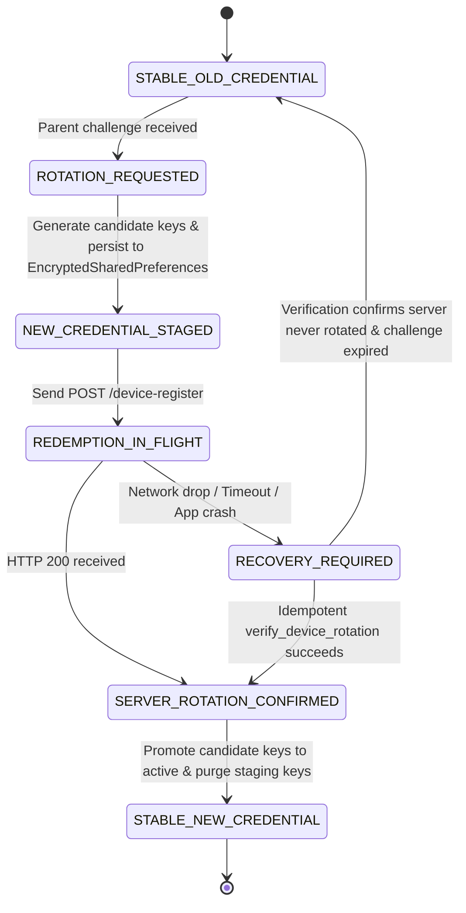

# 03 — Resolution of Finding REV-002: Client Credential Recovery State Machine

**Document ID:** HAVEN-COR-003  
**Target Finding:** REV-002 (CRITICAL)  
**Target Defect:** HAVEN-QA-003 (`DEF-601` / `MON04`)  
**Phase:** Phase 1.2 — Remediation Plan Correction & Closure (Strictly Planning-Only)  
**Date:** 2026-11-23  
**Status:** RESOLVED BY DESIGN CORRECTION  
**Workspace:** `D:\parentcontrol_app`  
**Current HEAD:** `56636f62d5144610ae12c89d02d582feb48217fc`  

---

## 1. Verified Technical Issue & Failure Mechanism

In mobile network environments, HTTP exchanges are subject to connection drops, socket timeouts, and operating system process termination (Android Low-Memory Killer).

### The "Lost Response" Deadlock
1. The Child client sends challenge redemption to `/device-register`.
2. The server successfully executes `rotate_device_secret`, commits `devices.secret_hash = new_hash`, and marks the recovery challenge consumed (`consumed_at = now()`).
3. **Before the HTTP 200 payload reaches the Child handset, the radio drops or the app process is killed.**
4. On the server, `new_hash` is active and the challenge is dead.
5. On the client, the Child app never received the HTTP 200 response.
   - If the client reverts to `secret_old`, the server rejects every heartbeat with HTTP 401 `invalid_device_credentials`.
   - If the client retries the redemption request, the server rejects it because the challenge is already consumed.
   - The device is permanently desynchronized from the server and cannot report telemetry without manual database intervention.

---

## 2. Crash-Safe Two-Phase Client State Machine

To eliminate this vulnerability, `SecureStore.kt` and the Child sync controller implement an explicit, crash-safe state machine.



### State Definitions

| State Name | Local KeyStore / Storage State | Wire State | Transition Condition |
|---|---|---|---|
| **`STABLE_OLD_CREDENTIAL`** | `installation_id`, `device_secret` active. Staging keys empty. | Normal telemetry using active secret. | Parent issues challenge. |
| **`ROTATION_REQUESTED`** | Challenge token loaded in memory. | None. | User initiates redemption. |
| **`NEW_CREDENTIAL_STAGED`** | `staged_installation_id`, `staged_device_secret`, `staged_challenge_token` written to `EncryptedSharedPreferences`. Active keys untouched. | None. | Staging write succeeds. |
| **`REDEMPTION_IN_FLIGHT`** | Staging keys persisted; active keys unchanged. | Outbound HTTP POST with `sha256(staged_secret)`. | Network request sent. |
| **`SERVER_ROTATION_CONFIRMED`** | HTTP 200 payload with `rotation_confirmed: true` received. | Server has updated `devices.secret_hash`. | Promote candidate keys. |
| **`STABLE_NEW_CREDENTIAL`** | `staged_*` promoted to primary `installation_id` and `device_secret`. Staging keys purged. | Telemetry heartbeats use new secret. | State committed. |
| **`RECOVERY_REQUIRED`** | Staging keys exist, but in-flight request was lost or app crashed. | Idempotent verification endpoint queried. | App reboot or timeout. |

---

## 3. Server/Client Protocol & Handshake Specification

### 3.1 Step 1: Pre-Staging in Native KeyStore
Before transmitting any network request, `SecureStore.kt` executes the following atomic write:
1. Generate `candidate_installation_id = UUID.randomUUID()`.
2. Generate `candidate_secret = SecureRandom(32 bytes)`.
3. Compute `candidate_hash = sha256(candidate_secret)`.
4. Persist to `EncryptedSharedPreferences`:
   - `staged_installation_id = candidate_installation_id`
   - `staged_device_secret = candidate_secret`
   - `staged_challenge_token = token`
   - `rotation_state = 'NEW_CREDENTIAL_STAGED'`
5. The existing active `installation_id` and `device_secret` remain **UNTOUCHED**. If the device crashes right now, it can still boot and authenticate with its old keys.

### 3.2 Step 2: In-Flight Redemption
The Child client sends:
```text
POST /device-register
Authorization: Bearer <child_jwt>
Payload: {
  action: "redeem_recredential_challenge",
  device_id: <device_uuid>,
  challenge_token: <token>,
  installation_id: <candidate_installation_id>,
  secret_hash: <candidate_hash>
}
```

### 3.3 Step 3: Happy-Path Promotion
Upon receiving HTTP 200 with `{ ok: true, recredentialed_at: ... }`:
1. `SecureStore.kt` updates:
   - `installation_id = staged_installation_id`
   - `device_secret = staged_device_secret`
   - `rotation_state = 'STABLE_NEW_CREDENTIAL'`
2. Purge `staged_*` keys.
3. Start `GuardianService` with new credentials.

### 3.4 Step 4: Crash-Recovery Handshake (`verify_device_rotation`)
If the network drops or the process crashes during Step 2:
1. On next app launch or sync tick, `SecureStore.kt` detects `rotation_state == 'NEW_CREDENTIAL_STAGED'`.
2. Client sends an idempotent verification query:
   ```text
   POST /device-register
   Authorization: Bearer <child_jwt>
   Payload: {
     action: "verify_device_rotation",
     device_id: <device_uuid>,
     candidate_installation_id: <staged_installation_id>,
     candidate_secret_hash: <sha256(staged_secret)>
   }
   ```
3. **Server Evaluation**:
   - The Edge Function queries `devices` for `device_id`:
   - **Case A (Server rotated, response was lost)**: If `devices.installation_id == candidate_installation_id` AND `devices.secret_hash == candidate_secret_hash`:
     - Server returns `{ confirmed: true, device_id: ... }`.
     - Client immediately executes **Step 3 (Happy-Path Promotion)**. The deadlock is resolved!
   - **Case B (Server never received request / rotation never happened)**:
     - Server checks `device_recovery_challenges` for the staged challenge token:
     - If challenge is still `active` and unexpired: Server returns `{ confirmed: false, retry_allowed: true }`. Client retries redemption.
     - If challenge is `exhausted` or `expired`: Server returns `{ confirmed: false, retry_allowed: false, reason: "challenge_expired" }`. Client discards staging keys and prompts Child to request a fresh challenge from Parent.

---

## 4. Failure Mode & Boundary Analysis

| Failure Scenario | Local Storage State | System Behavior & Recovery Path |
|---|---|---|
| **Server never receives request** | Staging keys intact. Active keys intact. | Client times out → calls `verify_device_rotation` → server reports `confirmed: false, retry_allowed: true` → client retries. |
| **Server rotates, response lost** | Staging keys intact. Active keys intact. | Client calls `verify_device_rotation` → server reports `confirmed: true` → client promotes candidate keys to active. **Deadlock prevented!** |
| **KeyStore write fails during staging** | Active keys intact. | Exception caught; staging aborted; rotation halted; zero server modification. |
| **Process crash before server call** | Staging keys intact. Active keys intact. | App restarts → sees staged keys → verifies with server → retries redemption. |
| **Process crash after promotion** | Candidate keys already active. | App restarts in `STABLE_NEW_CREDENTIAL`; telemetry continues with new keys. |
| **Concurrent rotation attempts** | Row lock in RPC serializes execution. | First succeeds; second is rejected with `challenge_exhausted` or `already_consumed`. |
| **Abandoned staging keys (user uninstalls)** | OS deletes app sandbox. | Android KeyStore and SharedPreferences deleted cleanly by OS. |

---

## 5. Security & Confidentiality Invariants

1. **Zero Plaintext Exposure**: Staging keys are written exclusively to `EncryptedSharedPreferences` using AES-256-GCM backed by the Android hardware KeyStore MasterKey.
2. **No Secret in Telemetry**: Only the SHA-256 hash is transmitted over TLS to the server. The raw secret never leaves the device.
3. **No Logging**: `SecureStore.kt` enforces a strict invariant that neither `device_secret` nor `staged_device_secret` may be passed to `Log.d/i/e` or exception messages.

---

## 6. Verification Test Matrix for REV-002

| Test ID | Scenario | Injected Fault | Expected Recovery Behavior |
|---|---|---|---|
| `TEST-REV002-01` | Normal Two-Phase Flow | None | Staged keys created → HTTP 200 received → Staged keys promoted to primary → Staging keys cleared. |
| `TEST-REV002-02` | Lost HTTP 200 Response | Network drops after DB commits | Client invokes `verify_device_rotation` → receives `confirmed: true` → promotes candidate secret. |
| `TEST-REV002-03` | Network Drop Before Ingress | Network drops before server receives request | Client invokes `verify_device_rotation` → receives `confirmed: false` → safely retries redemption. |
| `TEST-REV002-04` | App Process Crash During In-Flight | Kill app process after HTTP dispatch | App restarts → detects staged keys → executes verification handshake cleanly. |
| `TEST-REV002-05` | Staged Token Expired During Offline Gap | Handset offline for 24 hours while staged | App restarts → `verify_device_rotation` reports `retry_allowed: false` → staging keys purged. |

---

## 7. Resolution Status

**RESOLVED BY DESIGN CORRECTION**. The two-phase KeyStore pre-staging state machine and idempotent server verification handshake completely eliminate the asymmetric update deadlock, guaranteeing crash-safe re-credentialing under all network and process termination conditions.
