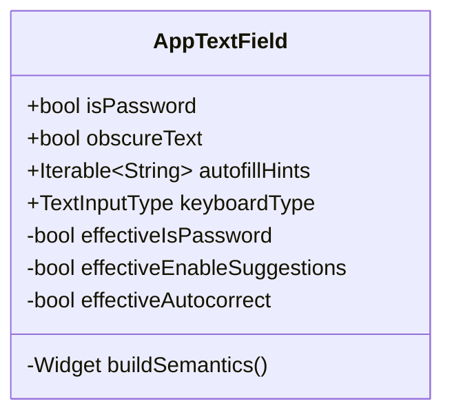

# 04 — Resolution of Finding REV-003: Password Security & Visibility Toggle Hardening

**Document ID:** HAVEN-COR-004  
**Target Finding:** REV-003 (HIGH)  
**Target Defect:** HAVEN-QA-002 (`SEC-001`)  
**Phase:** Phase 1.2 — Remediation Plan Correction & Closure (Strictly Planning-Only)  
**Date:** 2026-11-23  
**Status:** RESOLVED BY DESIGN CORRECTION  
**Workspace:** `D:\parentcontrol_app`  
**Current HEAD:** `56636f62d5144610ae12c89d02d582feb48217fc`  

---

## 1. Verified Technical Issue & Failure Mechanism

In Phase 1 report `04_password_security_remediation_design.md`, the hardening logic was coupled directly to `obscureText`:
```text
effectiveEnableSuggestions = obscureText ? false : true;
effectiveAutocorrect = obscureText ? false : true;
effectiveKeyboardType = obscureText ? visiblePassword : text;
Semantics(password: obscureText, obscured: obscureText)
```

### The Visibility Toggle Security Flaw
In `LoginPage` (`lib/features/auth/login_page.dart:129-146`) and `RegisterPage` (`lib/features/auth/register_page.dart:130-175`), an eyeball icon allows the user to toggle `_obscurePassword = !_obscurePassword` to review typed characters before submitting.

When the user taps the toggle:
1. `_obscurePassword` transitions from `true` to `false`.
2. Under the Phase 1 proposal, `effectiveEnableSuggestions` and `effectiveAutocorrect` immediately reverted to `true`!
3. If the user continues typing, editing, or correcting a character while the password is unmasked, the Android keyboard IME (Gboard, OEM keyboards) actively predicts words, buffers typed substrings into dictionary caches, and emits suggestion telemetry.
4. Furthermore, `Semantics(password: false)` removed the password classification from the accessibility tree, allowing third-party accessibility tools to treat the input as a general plaintext field.

---

## 2. Decoupled Architecture Design: Dedicated Password Classification

To permanently close this vulnerability, the system decouples the **intrinsic data classification** (whether the field contains sensitive credential data) from the **visual rendering state** (whether the glyphs are obscured).



### 2.1 The Two Distinct State Invariants

| Attribute | Meaning | Driven By | State During Masked Entry | State During Eyeball Reveal |
|---|---|---|---|---|
| **`isPassword` (Intrinsic)** | Data sensitivity & security classification | Explicit caller flag OR `autofillHints` containing password | **`true`** | **`true`** (PERMANENT) |
| **`obscureText` (Visual)** | Visual masking of character glyphs | Local controller state (`_obscurePassword`) | **`true`** (Dots `••••`) | **`false`** (Plain characters) |
| **`enableSuggestions`** | IME predictive text engine | Derived: `isPassword ? false : true` | **`false`** | **`false`** (PROTECTED) |
| **`autocorrect`** | IME word correction engine | Derived: `isPassword ? false : true` | **`false`** | **`false`** (PROTECTED) |
| **`Semantics.isPassword`** | Accessibility tree node classification | Derived: `isPassword` | **`true`** | **`true`** (PROTECTED) |
| **`Semantics.isObscured`** | Accessibility vocalization hinting | Derived: `obscureText` | **`true`** | **`false`** |

---

## 3. Revised `AppTextField` Component Specification

### 3.1 API Signature Enhancements
`AppTextField` in `lib/core/widgets/app_text_field.dart` is updated with a dedicated boolean property:
```text
class AppTextField:
  final bool isPassword; // defaults to false
  final bool obscureText; // defaults to false
```

### 3.2 Automated Classification Derivation
To prevent human error when instantiating `AppTextField`, `effectiveIsPassword` evaluates to `true` if:
1. `isPassword == true` is explicitly passed; **OR**
2. `autofillHints` contains `AutofillHints.password` or `AutofillHints.newPassword`; **OR**
3. `obscureText == true`.

### 3.3 Security Property Enforcement
Whenever `effectiveIsPassword == true`:
- `enableSuggestions` is strictly forced to `false` (cannot be overridden to true).
- `autocorrect` is strictly forced to `false` (cannot be overridden to true).
- `textCapitalization` is strictly forced to `TextCapitalization.none`.
- `keyboardType` defaults to `TextInputType.text` (avoiding OEM `visiblePassword` masking bugs, resolved in REV-010).

### 3.4 Accessibility Semantics Integration
The `TextFormField` is wrapped in:
```text
Semantics(
  password: effectiveIsPassword,
  obscured: obscureText,
  child: TextFormField(...)
)
```
- **When Masked**: Screen readers identify the field as "Password, obscured". Keystroke echoes are suppressed by the OS.
- **When Unmasked**: Screen readers identify the field as "Password, unmasked". The OS suppresses predictive caches and informs the assistive technology that sensitive credentials are being inspected.

---

## 4. Caller Audit & Autofill Compatibility

| Screen File | Field Label | Proposed Calling Configuration | Autofill Integration | Security State on Toggle |
|---|---|---|---|---|
| `login_page.dart:126-148` | "Password" | `isPassword: true`, `obscureText: _obscurePassword` | `[AutofillHints.password]` | Fully Protected |
| `register_page.dart:118-143` | "Password" | `isPassword: true`, `obscureText: _obscurePassword` | `[AutofillHints.newPassword]` | Fully Protected |
| `register_page.dart:145-175` | "Confirm password" | `isPassword: true`, `obscureText: _obscureConfirm` | `[AutofillHints.newPassword]` | Fully Protected |
| `role_selection_page.dart:240-270` | "Enter PIN" | `isPassword: true`, `obscureText: true`, `keyboardType: numberPassword` | `null` | Fully Protected |

### Autofill Manager Compatibility
Retaining `AutofillHints.password` and `AutofillHints.newPassword` guarantees that system credential managers (Google Autofill, 1Password, Bitwarden, iOS Keychain) recognize the fields and supply credentials safely via system APIs without requiring keyboard typing or clipboard pasting.

---

## 5. Verification Test Matrix for REV-003

All tests must be executed with synthetic test strings (e.g. `'TestPass123!'`); zero real credentials may be used.

| Test ID | Test Scenario | UI Action | Expected Accessibility Node | Expected EditableText Properties |
|---|---|---|---|---|
| `TEST-REV003-01` | Password Field Default State | Form rendered | `isPassword = true`, `isObscured = true` | `enableSuggestions: false`, `autocorrect: false`, `obscureText: true` |
| `TEST-REV003-02` | Eyeball Toggle to Visible | Tap visibility icon | `isPassword = true`, `isObscured = false` | `enableSuggestions: false`, `autocorrect: false`, `obscureText: false` |
| `TEST-REV003-03` | Typing in Visible State | Enter characters while visible | `isPassword = true`, `isObscured = false` | Predictive text and suggestion flags remain strictly `false` |
| `TEST-REV003-04` | Non-Password Field Invariant | Render "Email" field | `isPassword = false`, `isObscured = false` | `enableSuggestions: true`, `autocorrect: false` (email mode) |
| `TEST-REV003-05` | Autofill Inference | Pass `autofillHints: [AutofillHints.password]` without `isPassword` | `isPassword = true` automatically inferred | Suggestions suppressed automatically |

---

## 6. Resolution Status

**RESOLVED BY DESIGN CORRECTION**. Separating intrinsic password classification (`isPassword: true`) from visual masking (`obscureText`) guarantees that keyboard suggestion and autocorrect caching remain permanently disabled, even when the user unmasks their password using the visibility toggle.
