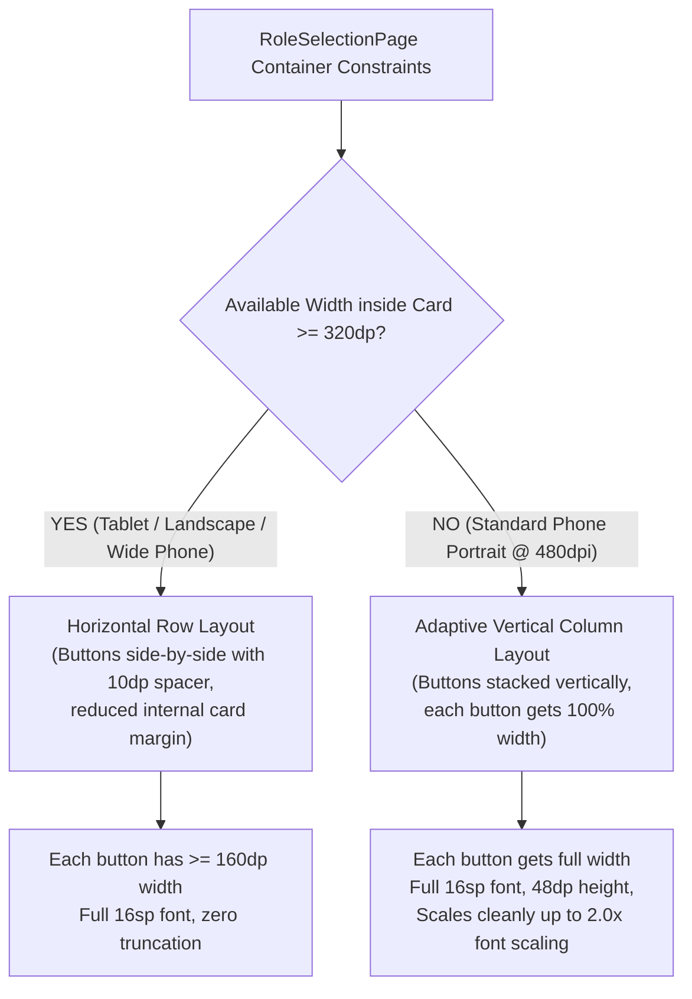

# 05 — Resolution of Finding REV-004: Localized Role Selection Layout Design

**Document ID:** HAVEN-COR-005  
**Target Finding:** REV-004 (HIGH)  
**Target Defect:** HAVEN-QA-001  
**Phase:** Phase 1.2 — Remediation Plan Correction & Closure (Strictly Planning-Only)  
**Date:** 2026-11-23  
**Status:** RESOLVED BY DESIGN CORRECTION  
**Workspace:** `D:\parentcontrol_app`  
**Current HEAD:** `56636f62d5144610ae12c89d02d582feb48217fc`  

---

## 1. Verified Technical Issue & Failure Mechanism

In Phase 1 report `06_notification_permission_and_ui_remediation_design.md`, the proposed fix for the button label clipping on `RoleSelectionPage` modified the core widget `AppButton` (`lib/core/widgets/app_button.dart`) to wrap its text in `FittedBox(fit: BoxFit.scaleDown)`.

### The Global Blast Radius & Accessibility Defeat
1. **Collateral Blast Radius**: `AppButton` is referenced in **88 distinct locations across 24 files**. Applying `FittedBox` globally means any button in the app that experiences narrow constraints will silently shrink its font rather than surfacing layout constraints.
2. **Accessibility Defeat**: When users enable Android or iOS Accessibility Large Text scaling (1.3x, 1.5x, 2.0x), `FittedBox` aggressively scales the font back down to fit the tight width, producing illegible micro-text (~8–10sp) and violating **WCAG 1.4.4 (Resize Text)**.
3. **Typography Inconsistency (REV-011)**: On the Parent Mode card, "Sign in" renders at 16sp while "Create account" scales down to ~13sp right next to it, producing an unbalanced visual hierarchy.
4. **Localization Fragility**: Translated strings in other languages (e.g. Spanish "Crear una cuenta", German "Konto erstellen") will scale down even further, rendering the button unreadable.

---

## 2. Quarantining `AppButton` & Architectural Strategy

### 2.1 The Quarantine Invariant
**`lib/core/widgets/app_button.dart` is strictly quarantined from this remediation.** Zero edits shall be made to `AppButton`. All 88 call sites across the application remain completely untouched.

### 2.2 Localizing the Solution to `RoleSelectionPage`
The root cause is localized exclusively to `_RoleOptionCard` in `lib/features/role_selection/role_selection_page.dart:151-172` and `:181-202`, where two full-text buttons are forced into a single horizontal `Row` within a heavily padded card container.

---

## 3. Corrected Adaptive Layout Specification for `RoleSelectionPage`

To resolve the defect across all display densities, screen geometries, and accessibility font scaling factors, `_RoleOptionCard` is refactored to use an **Adaptive Action Layout**.



### 3.1 Adaptive Layout Behavior

#### Mode A: Vertical Column Layout (Available Width < 320dp)
On standard phone displays in portrait orientation (including the test device `Realme RMX2161` at 360dp logical width):
- The action buttons in `_RoleOptionCard` are laid out in a `Column`:
  ```text
  Column(
    crossAxisAlignment: CrossAxisAlignment.stretch,
    children: [
      AppButton(
        label: 'Create account',
        onPressed: ...
      ),
      SizedBox(height: 8),
      AppButton(
        label: 'Sign in',
        outlined: true,
        onPressed: ...
      ),
    ],
  )
  ```
- **Geometry & Typography Advantages**:
  - Each button expands to 100% of the available card width (~288dp).
  - The label `"Create account"` easily fits within 288dp without clipping or ellipses.
  - Both buttons render in identical, primary 16sp typography, eliminating font size asymmetry (`REV-011`).
  - Both buttons maintain full 48dp height per WCAG 2.5.5 minimum touch target requirements.
  - When the user enables 1.5x accessibility font scaling, the text expands comfortably inside the full-width button without truncation.

#### Mode B: Horizontal Row Layout (Available Width $\ge$ 320dp)
On tablets, foldables, or phones in landscape:
- The buttons remain side-by-side in a `Row` separated by `SizedBox(width: 10)`.
- Because available width is $\ge 320\text{ dp}$, each button has $\ge 155\text{ dp}$ of space, comfortably accommodating `"Create account"` without clipping.

---

## 4. Measurable Acceptance Criteria

The corrected design must satisfy the following strict quantitative criteria:

1. **Zero Text Truncation**: Rendered text label `"Create account"` must report `didExceedMaxLines == false` on all screens between 320dp and 1200dp logical width.
2. **Touch Target Height**: Each button must measure $\ge 48\text{ dp}$ in physical vertical touch target.
3. **Accessibility Font Scaling Support**: At `textScaleFactor = 1.5`, the label `"Create account"` must render fully visible without text clipping or horizontal overflow.
4. **AppButton Quarantine**: `git diff main -- lib/core/widgets/app_button.dart` must be completely empty.

---

## 5. Verification Test Matrix for REV-004

| Test ID | Display Geometry / Configuration | Layout Expected | Assertion Criteria |
|---|---|---|---|
| `TEST-REV004-01` | Phone Portrait (360dp width, scale 3.0, 480dpi) | Vertical Column | `"Create account"` and `"Sign in"` both visible; zero ellipses; width = 100% of card. |
| `TEST-REV004-02` | Small Phone (320dp width, scale 2.0) | Vertical Column | Both buttons visible; full label rendered; zero overflow warnings. |
| `TEST-REV004-03` | Large Font Scaling (360dp width, fontScale = 1.5) | Vertical Column | Button height expands if necessary; text wraps cleanly; zero truncation. |
| `TEST-REV004-04` | Tablet / Landscape (600dp width) | Horizontal Row | Both buttons rendered side-by-side; full label visible. |
| `TEST-REV004-05` | AppButton Regression Check | 24 app screens | All other buttons across app maintain original padding and rendering behavior. |

---

## 6. Resolution Status

**RESOLVED BY DESIGN CORRECTION**. Quarantining `AppButton` and implementing an adaptive layout in `RoleSelectionPage` permanently eliminates label clipping, preserves user accessibility font scaling, and prevents regressions across the other 88 `AppButton` call sites.
