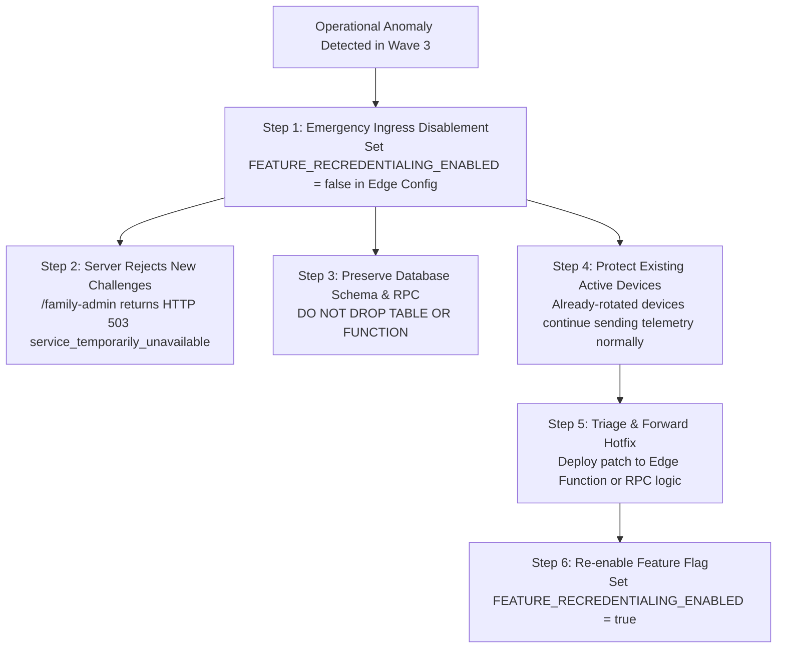

# 06 — Resolution of Finding REV-005: Forward Recovery & Rollout Strategy

**Document ID:** HAVEN-COR-006  
**Target Finding:** REV-005 (HIGH)  
**Target Defect:** HAVEN-QA-003 (`DEF-601` / `MON04`)  
**Phase:** Phase 1.2 — Remediation Plan Correction & Closure (Strictly Planning-Only)  
**Date:** 2026-11-23  
**Status:** RESOLVED BY DESIGN CORRECTION  
**Workspace:** `D:\parentcontrol_app`  
**Current HEAD:** `56636f62d5144610ae12c89d02d582feb48217fc`  

---

## 1. Verified Technical Issue & Failure Mechanism

In Phase 1 report `08_implementation_order_and_rollback_plan.md:104-118`, the proposed rollback procedure for Wave 3 (`HAVEN-QA-003`) stated that if an operational issue occurred post-deployment, operators should execute a schema down-migration:
```text
drop function if exists public.rotate_device_secret(uuid, text, text, text, uuid);
drop table if exists public.device_recovery_challenges cascade;
```

### The Down-Migration Fallacy
A database schema down-migration drops structural objects, but **it cannot reverse data mutations committed to persistent rows**:
1. When `rotate_device_secret` runs, it replaces `devices.secret_hash` with the new cryptographic hash.
2. If 50 devices successfully re-credential during the release window and an emergency rollback is executed by dropping the RPC and table:
   - Those 50 devices still have their **new** secrets stored in `devices.secret_hash`.
   - If the Edge Functions or mobile clients are reverted to old code, the old code will reject those devices or lack the endpoints required to communicate with them.
   - Dropping `device_recovery_challenges cascade` destroys the audit trail and in-flight challenge tokens.
   - Those 50 devices are now permanently bricked from telemetry and cannot be re-credentialed because the RPC and table no longer exist!
3. **Conclusion**: Cryptographic credential rotation is an irreversible state transition. Schema rollback is destructive and strictly forbidden.

---

## 2. Corrected Strategy: Feature Disablement & Forward Recovery

The system adopts **Feature-Flag Ingress Disablement** and **Forward Recovery**, ensuring that existing rotated credentials remain functional while in-flight recovery attempts can be safely throttled or paused.



### 2.1 Feature Flag Specification
- **Flag Name**: `FEATURE_RECREDENTIALING_ENABLED`
- **Ownership**: Managed via Supabase Vault / Edge Function Environment Variables.
- **Safe Default**: `false` (Disabled by default until explicitly enabled post-migration).
- **Server Enforcement**:
  - In `/family-admin`: If flag is `false`, requests to `request_recredential_challenge` immediately return HTTP 503 `service_temporarily_unavailable`.
  - In `/device-register`: If flag is `false`, requests to `redeem_recredential_challenge` return HTTP 503. However, `verify_device_rotation` remains **ENABLED** so in-flight devices can complete their verification handshake.

---

## 3. Mandatory Rollout & Skew Scenarios Analysis

| Scenario | System State | Client / Server Behavior | Recovery Action |
|---|---|---|---|
| **1. DB deployed, Client not deployed** | Schema & RPC exist in DB. Client lacks UI. | Clients continue normal telemetry. DB objects remain completely dormant. | Zero risk. Gated rollout safe. |
| **2. RPC deployed, Edge Function not deployed** | RPC exists; Edge Functions lack routes. | Existing Edge endpoints function normally. Re-credentialing cannot be invoked. | Safe. Deploy Edge Functions when ready. |
| **3. Edge deployed, Client not deployed** | Endpoints active behind feature flag. | Flag is `false`. Endpoints return 503 if called. Existing clients unaffected. | Safe. Release mobile clients. |
| **4. Parent client updated, Child client old** | Parent can issue challenge; Child lacks redemption UI. | Parent app displays 6-digit code. Child app lacks entry field. Challenge expires safely after 10 min. | Parent prompts Child to update app via App Store. |
| **5. Child client updated, Parent client old** | Child has redemption UI; Parent lacks issuance UI. | Child app waits for code. Parent has no "Reconnect" button. | Parent updates app to issue code. |
| **6. Feature enabled but RPC unavailable** | Edge Function calls missing RPC. | Edge Function catches DB error, logs alert, returns HTTP 500 cleanly without crashing. | Deploy missing RPC via migration. |
| **7. Feature disabled after devices rotated** | Feature flag toggled `false`. | Already-rotated devices continue sending heartbeats to `/device-telemetry` without interruption! | Existing devices protected; new challenges blocked. |
| **8. Rotation partially completed** | Network dropped during redemption. | Client state machine triggers `verify_device_rotation` on reboot (REV-002). | Handshake resolves status automatically. |
| **9. New secret stored, telemetry fails** | KeyStore has new secret, telemetry rejected. | Client detects HTTP 401 on heartbeat → transitions to `RECOVERY_REQUIRED` → prompts user. | Issue fresh challenge. |
| **10. Interrupted device requires recovery** | Child app wiped or KeyStore lost again. | Device is in standard offline state. | Parent issues fresh challenge; device re-credentiales cleanly. |

---

## 4. Emergency Disablement & Forward Recovery Runbook

### Phase 1: Immediate Triage (< 5 Minutes)
1. Navigate to Supabase Dashboard → Edge Functions → Environment Variables.
2. Set `FEATURE_RECREDENTIALING_ENABLED = false`.
3. Edge Functions immediately reject challenge creation without restarting the database.
4. **DO NOT run down-migrations. DO NOT drop database tables.**

### Phase 2: Root-Cause Investigation & In-Flight Protection
1. Inspect `device_recovery_challenges` for active challenges:
   - Challenges naturally expire within 10 minutes (`expires_at < now()`).
2. Devices that previously completed rotation continue using `/device-telemetry` unaffected.
3. Review audit logs (`audit_events` where `event_type in ('device_recredentialed', 'device_recredential_failed')`).

### Phase 3: Forward Hotfix & Re-enablement
1. Apply the software fix directly to the Edge Function or RPC logic.
2. Verify fix in staging environment using test fixtures.
3. Deploy forward patch to production.
4. Set `FEATURE_RECREDENTIALING_ENABLED = true`.

---

## 5. Audit Logging Requirements

Every phase of re-credentialing and recovery must generate an immutable record in `public.audit_events`:
- `device_recredential_challenge_issued`: Recorded when Parent requests challenge (includes `challenge_id`, `device_id`, `actor_user_id`).
- `device_recredential_failed`: Recorded on invalid token attempt (includes `challenge_id`, `attempt_number`).
- `device_recredential_exhausted`: Recorded when 5th attempt fails (includes `challenge_id`).
- `device_recredentialed`: Recorded on successful rotation (includes `device_id`, `previous_issued_at`, `new_issued_at`).
- `device_rotation_verified`: Recorded when client executes lost-response recovery handshake.

---

## 6. Resolution Status

**RESOLVED BY DESIGN CORRECTION**. Replacing schema down-migrations with server-side feature flag disablement, multi-version skew compatibility, and forward recovery runbooks eliminates the risk of bricking enrolled devices during operational anomalies.
