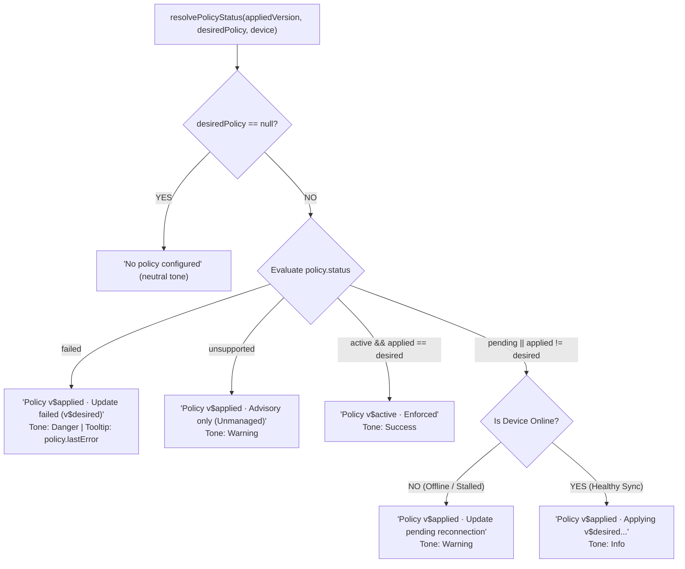

# 07 — Resolution of Findings REV-006 & REV-007: Repository Query & Policy Presentation Corrections

**Document ID:** HAVEN-COR-007  
**Target Findings:** REV-006 (MEDIUM) & REV-007 (MEDIUM)  
**Target Defects:** HAVEN-QA-005 (`DEF-602`) & HAVEN-QA-006 (`DEF-603`)  
**Phase:** Phase 1.2 — Remediation Plan Correction & Closure (Strictly Planning-Only)  
**Date:** 2026-11-23  
**Status:** RESOLVED BY DESIGN CORRECTION  
**Workspace:** `D:\parentcontrol_app`  
**Current HEAD:** `56636f62d5144610ae12c89d02d582feb48217fc`  

---

## 1. Overview & Scope

This report delivers the technical corrections for two interrelated Parent Mode data projection findings:
1. **REV-006**: Eliminating pending device leakage and query ambiguity in `SupabaseDeviceRepository` (`HAVEN-QA-005`).
2. **REV-007**: Expanding policy synchronization presentation to accurately map all backend enforcement and connectivity states (`HAVEN-QA-006`).

---

## 2. Part 1: Resolution of Finding REV-006 (Pending Device Leakage & Repository API)

### 2.1 The Domain Model & Status Constraints
In `supabase/migrations/20260101000000_core.sql:91-92`:
```sql
status text not null default 'pending'
  check (status in ('pending', 'active', 'revoked'))
```
The database schema strictly enforces three valid statuses:
- **`pending`**: Device pairing token redeemed or enrollment started, but initial device registration handshake is incomplete.
- **`active`**: Fully enrolled and actively monitored hardware. Exactly one active device allowed per child (`unique index devices_one_active_per_child`).
- **`revoked`**: Unlinked or retired device row. Kept for historical audit and usage retention. `secret_hash` is strictly NULL (`constraint devices_revoked_credential_consistency`).
- **`NULL` / `unknown`**: Forbidden by database constraints (`not null` and `check (status in (...))`).

### 2.2 Why `.neq('status', 'revoked')` Was Flawed
Filtering `.neq('status', 'revoked')` returns both `active` AND `pending` devices.
- If a child started an enrollment that was abandoned weeks ago, a `pending` device row sits in the database.
- Under `.neq('status', 'revoked')`, this ghost pending row appears as a device card on the Parent Dashboard alongside the child's actual phone, causing confusion and duplicate entries.
- Furthermore, `fetchMyDevice()` in `supabase_device_repository.dart:66` already queries `.eq('status', 'active')`. Parent and Child queries must align.

### 2.3 Corrected Repository Contract & Smallest Safe API Design
Rather than using a boolean parameter (`includeRevoked: false`, anti-pattern REV-012), the repository contract in `lib/data/repositories/repository_contracts.dart` provides explicit, intention-revealing methods:

```text
abstract class DeviceRepository {
  /// Fetches currently active, enrolled devices for the family.
  /// Consumed by DashboardController and DevicesController.
  Future<List<Device>> fetchActiveDevices(String familyId);

  /// Fetches pending enrollment rows awaiting initial handshake.
  /// Consumed by pairing/enrollment management workflows.
  Future<List<Device>> fetchPendingDevices(String familyId);

  /// Fetches all historical and revoked device records for audit retention.
  /// Consumed by historical audit log viewers.
  Future<List<Device>> fetchDeviceHistory(String familyId);

  // Existing methods preserved:
  Future<Device> fetchDevice(String deviceId);
  Future<Device?> fetchMyDevice();
  ...
}
```

### 2.4 Implementation Specification (`SupabaseDeviceRepository`)
In `lib/data/repositories/supabase_device_repository.dart`:
```text
@override
Future<List<Device>> fetchActiveDevices(String familyId) => _guard(() async {
  final rows = await _supabase.client
      .from('devices')
      .select(_deviceColumns)
      .eq('family_id', familyId)
      .eq('status', 'active')
      .order('created_at', ascending: true);
  return rows.map((r) => Device.fromJson(jsonMap(r))).toList(growable: false);
});
```
- **DashboardController & DevicesController**: Call `fetchActiveDevices(familyId)`. Only active devices render. Duplicate revoked cards and ghost pending cards are 100% eliminated.

---

## 3. Part 2: Resolution of Finding REV-007 (Incomplete Policy Enforcement Status Mapping)

### 3.1 Backend Policy Lifecycle Invariants
In `supabase/functions/device-command/handler.ts:385-432`, when a child device acknowledges an `apply_policy` command, `device_policies.enforcement_status` is updated based on quota and hardware verification:
- **`active`**: Policy downloaded, parsed, persisted, and confirmed enforced by Android Device Owner APIs.
- **`pending`**: Policy received, but quota reconciliation or initial enforcement check is pending.
- **`unsupported`**: Device lacks Device Owner capability (`enforcement_mode != 'device_owner'`). Rules are advisory only.
- **`failed`**: Android runtime threw an exception while applying policy (recorded in `device_policies.last_error`).

### 3.2 The Presentation Model Flaw
The Phase 1 proposal recommended `"Policy v2 · Updating to v4..."` whenever desired version exceeded applied version.
- If enforcement failed (`status == 'failed'`), this label falsely promised that an update was underway, hiding the failure from the parent.
- If the device was offline (`syncHealth == offline`), it failed to explain that synchronization was paused waiting for connectivity.

### 3.3 Corrected Comprehensive Presentation Model (`device_presentation.dart`)



### 3.4 Canonical Policy Display Status Table

| Applied Version | Desired Version | `policy.status` | Device Connectivity | Rendered UI String | Status Tone |
|---|---|---|---|---|---|
| `null` | `null` | N/A | Any | `"No policy configured"` | `neutral` |
| `null` | `4` | `pending` | Healthy | `"Policy v4 · Initial sync in progress..."` | `info` |
| `2` | `4` | `active` | Healthy | `"Policy v4 · Enforced"` | `success` |
| `2` | `4` | `pending` | Healthy | `"Policy v2 · Applying v4..."` | `info` |
| `2` | `4` | `pending` | **Offline** | `"Policy v2 · Update to v4 pending reconnection"` | `warning` |
| `2` | `4` | `failed` | Any | `"Policy v2 · Update failed (v4)"` | `danger` |
| `2` | `4` | `unsupported` | Any | `"Policy v2 · Advisory only (Device unmanaged)"` | `warning` |

---

## 4. Verification Test Matrix for REV-006 & REV-007

| Test ID | Target | Injected State / Input | Expected Assertion |
|---|---|---|---|
| `TEST-REV006-01` | Repository Query | DB contains 1 active, 1 pending, 1 revoked device | `fetchActiveDevices()` returns exactly 1 device (`status == 'active'`). |
| `TEST-REV006-02` | History Query | DB contains 1 active, 1 revoked device | `fetchDeviceHistory()` returns both rows; revoked row retains `status == 'revoked'`. |
| `TEST-REV007-01` | Presentation: Failed Policy | `applied: 2, desired: 4, status: 'failed'` | Label contains `"Update failed (v4)"`; tone is `StatusTone.danger`. |
| `TEST-REV007-02` | Presentation: Offline Lag | `applied: 2, desired: 4, isOnline: false` | Label contains `"pending reconnection"`; tone is `StatusTone.warning`. |
| `TEST-REV007-03` | Presentation: Unmanaged Device | `applied: 2, desired: 4, status: 'unsupported'` | Label contains `"Advisory only"`; tone is `StatusTone.warning`. |
| `TEST-REV007-04` | Presentation: Healthy Enforced | `applied: 4, desired: 4, status: 'active'` | Label contains `"Policy v4 · Enforced"`; tone is `StatusTone.success`. |

---

## 5. Resolution Status

**RESOLVED BY DESIGN CORRECTION**. Explicit repository queries (`fetchActiveDevices()`) eliminate pending and revoked leakage, while the comprehensive policy presentation model accurately surfaces failed, unsupported, offline, and in-flight enforcement states across all Parent screens.
