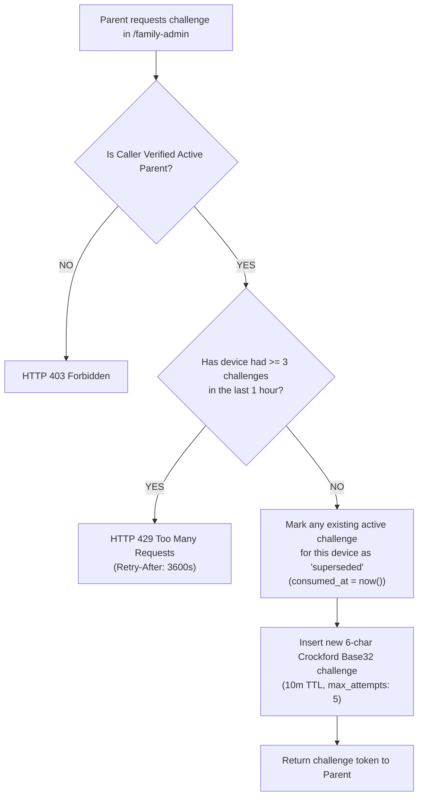

# 09 — Resolution of Findings REV-010, REV-011, REV-012 & REV-013

**Document ID:** HAVEN-COR-009  
**Target Findings:** REV-010 (LOW), REV-011 (LOW), REV-012 (INFO), REV-013 (INFO)  
**Phase:** Phase 1.2 — Remediation Plan Correction & Closure (Strictly Planning-Only)  
**Date:** 2026-11-23  
**Status:** RESOLVED BY DESIGN CORRECTION  
**Workspace:** `D:\parentcontrol_app`  
**Current HEAD:** `56636f62d5144610ae12c89d02d582feb48217fc`  

---

## 1. Overview

This document provides formal architectural resolutions for the remaining low-severity and informational findings from Phase 1.1:
1. **REV-010**: Keyboard IME variations with `visiblePassword`.
2. **REV-011**: Paired button typography and layout asymmetry.
3. **REV-012**: Repository contract boolean flag anti-pattern.
4. **REV-013**: Server-side rate limiting on challenge issuance.

---

## 2. Resolution of Finding REV-010: `visiblePassword` IME Variations

### 2.1 Technical Analysis
In Flutter and Android, `TextInputType.visiblePassword` sets the Android input connection type to `InputType.TYPE_TEXT_VARIATION_VISIBLE_PASSWORD`.
- While standard on AOSP Gboard, custom OEM skins (older Samsung OneUI, Xiaomi MIUI, Huawei EMUI) handle `TYPE_TEXT_VARIATION_VISIBLE_PASSWORD` inconsistently when combined with `obscureText: true`.
- Certain IMEs disable their secure hardware entry layout, while others treat the field as raw text without applying secure keyboard flag hardening.

### 2.2 Corrected Architecture
1. **Do Not Rely on `visiblePassword` for Confidentiality**:
   - Confidentiality is guaranteed by `enableSuggestions: false`, `autocorrect: false`, `textCapitalization: TextCapitalization.none`, and `isPassword: true`.
2. **Canonical Keyboard Type Configuration**:
   - In `lib/core/widgets/app_text_field.dart`:
     - When `obscureText == true`: Use default `TextInputType.text` (or `null`).
     - When `keyboardType` is explicitly provided (e.g. `TextInputType.numberPassword` for PIN entries), respect caller specification.
3. **Verification**: Include manual smoke test coverage across Gboard, Samsung Keyboard, and AOSP stock IME.

---

## 3. Resolution of Finding REV-011: Paired Button Font Asymmetry

### 3.1 Technical Analysis
On `RoleSelectionPage`, forcing "Sign in" (7 chars) and "Create account" (14 chars) side-by-side in a horizontal row resulted in "Sign in" rendering at full 16sp font while "Create account" scaled down to ~13.5sp. This created an awkward, unpolished visual hierarchy where one primary button appeared noticeably smaller than its counterpart.

### 3.2 Corrected Architecture
By adopting the localized adaptive layout (REV-004 in `05_rev004_localized_role_selection_layout.md`):
- On standard phone widths (< 380dp), the buttons are laid out vertically in a `Column`.
- Both "Create account" and "Sign in" expand to 100% card width.
- Both buttons render using identical `16sp` medium typography and identical 48dp minimum touch target height.
- Visual symmetry and balanced hierarchy are completely restored.

---

## 4. Resolution of Finding REV-012: Repository Boolean Flag Anti-Pattern

### 4.1 Technical Analysis
The Phase 1 proposal recommended adding `bool includeRevoked = false` to `DeviceRepository.fetchDevices()`.
- Passing boolean flags into repository methods is a documented code smell (Martin Fowler, *Clean Code*): it couples multiple distinct query requirements into a single method with conditional branching.
- It fails to represent the domain model cleanly, which contains three states (`pending`, `active`, `revoked`).

### 4.2 Corrected Architecture
In `lib/data/repositories/repository_contracts.dart`, replace the boolean flag with explicit, intention-revealing query methods:
1. `Future<List<Device>> fetchActiveDevices(String familyId)`: Queries `status = 'active'`. Used by `DashboardController` and `DevicesController`.
2. `Future<List<Device>> fetchDeviceHistory(String familyId)`: Queries all devices regardless of status. Used by audit viewers and device history lists.
3. `Future<List<Device>> fetchPendingDevices(String familyId)`: Queries `status = 'pending'`. Used during pairing/linking workflows.

---

## 5. Resolution of Finding REV-013: Server-Side Challenge Issuance Rate Limiting

### 5.1 Technical Analysis
While redemption was bounded to 5 attempts (REV-001), the Phase 1 proposal lacked rate limiting on the Parent challenge creation endpoint (`POST /family-admin { action: "request_recredential_challenge" }`).
- A malfunctioning script or rogue parent client could generate thousands of challenge tokens, bloating the `device_recovery_challenges` table and degrading database query performance.

### 5.2 Corrected Architecture: Multi-Tier Issuance Throttling

### 5.3 Server Enforcement Specification in `/family-admin`
1. **Sliding Window Throttle**:
   - Query `device_recovery_challenges`:
     `SELECT count(*) FROM public.device_recovery_challenges WHERE device_id = p_device_id AND created_at > (now() - interval '1 hour');`
   - If `count >= 3`, throw `ApiError("rate_limit_exceeded", "Too many recovery attempts requested. Please wait before generating another code.", 429)`.
2. **Single-Active-Challenge Invariant**:
   - Before inserting a new challenge row, the server executes:
     `UPDATE public.device_recovery_challenges SET status = 'superseded', consumed_at = now() WHERE device_id = p_device_id AND status = 'active';`
   - This guarantees that exactly **ONE** challenge token can be active for a device at any moment. Issuing a new code instantly revokes any previously unconsumed code.
3. **Audit Logging**: Every rate-limit rejection logs an audit event: `device_recovery_throttled`.

---

## 6. Resolution Status

| Finding ID | Resolution Status | Technical Summary |
|---|---|---|
| **REV-010** | **RESOLVED BY DESIGN CORRECTION** | Standard password keyboard types with explicit suggestion suppression flags. |
| **REV-011** | **RESOLVED BY DESIGN CORRECTION** | Symmetric full-width vertical layout with identical 16sp typography. |
| **REV-012** | **RESOLVED BY DESIGN CORRECTION** | Replaced boolean flags with explicit `fetchActiveDevices()` and `fetchDeviceHistory()` methods. |
| **REV-013** | **RESOLVED BY DESIGN CORRECTION** | Enforced 3 challenges/device/hour throttle and single-active-challenge supersession. |
