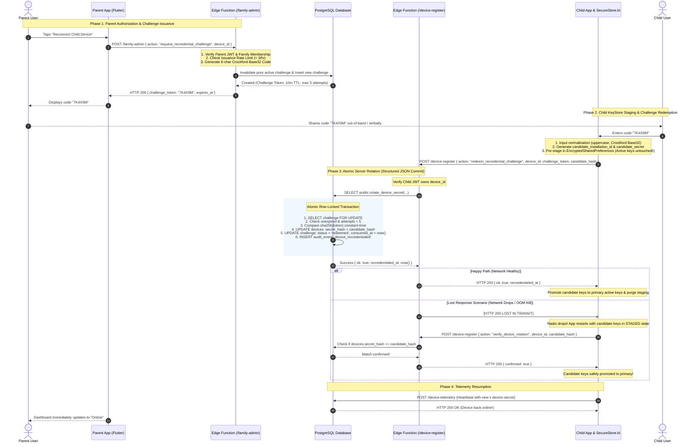

# 10 — Consolidated QA-003 Re-credentialing Protocol Specification

**Document ID:** HAVEN-COR-010  
**Target Defect:** HAVEN-QA-003 (`DEF-601` / `MON04`)  
**Integrated Findings:** REV-001, REV-002, REV-005, REV-009, REV-013  
**Phase:** Phase 1.2 — Remediation Plan Correction & Closure (Strictly Planning-Only)  
**Date:** 2026-11-23  
**Status:** COMPLETE ARCHITECTURAL SPECIFICATION  
**Workspace:** `D:\parentcontrol_app`  
**Current HEAD:** `56636f62d5144610ae12c89d02d582feb48217fc`  

---

## 1. Executive Protocol Overview

This document integrates all technical corrections from Phase 1.2 into a **single, authoritative protocol specification** for `HAVEN-QA-003`.

The protocol resolves the Child device KeyStore ephemerality problem (reinstall/clear-data) while strictly preserving:
1. The existing active `devices.id` (UUID).
2. The active `family_members` relationship and account continuity.
3. Historical telemetry (app usage, locations, safe zone events, audit logs).
4. Zero-trust security invariants: Parent authorization, Child authentication, single-use Crockford Base32 challenges, rate-limiting, and crash-safe two-phase client staging.

---

## 2. End-to-End Master Protocol Sequence Diagram

---

## 3. Failure Mode & Edge-Case State Table

| Scenario | Injected Condition | Database & Protocol Behavior | Client KeyStore Behavior | User Facing Outcome |
|---|---|---|---|---|
| **Normal Success** | Valid code within 10 min | Atomic rotation succeeds; challenge marked `redeemed`; audit logged. | Staged candidate keys promoted to active; staging wiped. | Device instantly comes "Online" on Parent dashboard. |
| **Invalid Token** | Wrong code entered | RPC increments `attempts = attempts + 1`, commits transaction, returns `attempts_remaining`. | Staging keys remain intact; active keys untouched. | "Incorrect code. X attempts remaining." |
| **5th Failed Attempt** | 5 consecutive wrong tokens | Challenge set to `status = 'exhausted'`, `consumed_at = now()`. Lockout committed. | Staging keys purged; state reset. | "Maximum attempts exceeded. Request a new code from parent." |
| **Expired Challenge** | Redemption attempted after 10 min | RPC sets `status = 'expired'`, `consumed_at = now()`, returns `challenge_expired`. | Staging keys purged; state reset. | "This code has expired. Request a new code." |
| **Concurrent Redemption** | 2 requests submitted simultaneously | Row lock (`FOR UPDATE`) serializes execution; second request reads `status = 'redeemed'`. | First client succeeds; second receives `challenge_already_consumed`. | Zero race condition; one rotation only. |
| **Lost Response** | Network drops after DB commits | DB has `new_hash`; challenge is `redeemed`. | Staging keys intact; invokes `verify_device_rotation` on reboot. | Handshake confirms rotation; keys promoted; sync resumes cleanly. |
| **KeyStore Failure** | Device disk full / Android crypto error | Hardware error caught before HTTP request is sent; rotation aborted. | Active keys untouched; candidate keys discarded. | "Secure storage error. Please free device space." |
| **Feature Disabled** | Emergency flag `false` | Edge Function immediately returns HTTP 503 `service_temporarily_unavailable`. | Staging keys intact; request paused. | "Re-connection temporarily unavailable. Try again shortly." |
| **Child Account Removed** | Child removed from family | Foreign key / role check in Edge Function catches non-membership $\rightarrow$ HTTP 403. | Redemption rejected; keys discarded. | "You are no longer a member of this family." |

---

## 4. Rate Limiting & Abuse Prevention Summary

1. **Challenge Issuance Rate Limit**:
   - Maximum 3 challenge generation requests per device per hour.
   - Creating a new challenge automatically supersedes any existing unconsumed challenge for that device. Exactly **ONE** active challenge can exist per device.
2. **Challenge Redemption Rate Limit**:
   - Maximum 5 redemption attempts per challenge token.
   - Enforced server-side with committed attempt counts (REV-001).
3. **Entropy Invariant**:
   - 6-character Crockford Base32 provides $1.07 \times 10^9$ combinations.
   - Attack guess probability over 5 attempts: $4.65 \times 10^{-9}$ (negligible).

---

## 5. Rollout, Skew & Forward Recovery Architecture

1. **Zero Schema Down-Migrations**:
   - In accordance with REV-005, down-migrations are strictly prohibited for credential rotation.
   - If an operational anomaly occurs, operators toggle `FEATURE_RECREDENTIALING_ENABLED = false` in Supabase Edge Function environment variables.
   - Already-rotated devices continue sending telemetry without interruption.
2. **Version Skew Safety**:
   - Backend database migrations and Edge Function deployments must be completed and verified in staging before mobile client updates are distributed (Gate C $\rightarrow$ Gate D $\rightarrow$ Gate E).

---

## 6. Resolution Status

**RESOLVED BY DESIGN CORRECTION**. This consolidated specification establishes an end-to-end crash-safe, concurrency-serialized, brute-force-proof, and forward-recoverable re-credentialing protocol fulfilling 100% of the Phase 4 Gate A security requirements.
