# 05 — REV-002 KeyStore Crash Recovery, 7-State Machine & Idempotent Verification

**Document ID:** `HAVEN-AUD-005-PHASE1.4`  
**Phase:** Phase 1.4 — Independent Security Clarification, Protocol Verification & Final Owner Approval Readiness  
**Date:** 2026-11-24  
**Target Workstream:** WORKSTREAM B3, B4 (Client KeyStore Staging, Recovery State Machine & Lost-Response Protocol)  
**Workspace:** `D:\parentcontrol_app`  
**Current HEAD:** `0101c16d161824fd726018f1188e1a2b17c653d3`  

---

## 1. Executive Summary

This report evaluates finding `REV-002`: the asymmetric update deadlock where the server commits new credentials but the client loses the HTTP 200 response (radio disconnect, OS low-memory killer, power failure).

The audit challenges the naive assumption that "atomic file write" in Android Jetpack Security solves all recovery edge cases, establishes a formal **7-State Client Recovery Machine**, and defines the exact authentication and idempotency invariants required for `verify_device_rotation`.

---

## 2. Hardware Keystore & EncryptedSharedPreferences Invariants (Workstream B3)

### 2.1 The Limits of "Atomic File Write"
Phase 1.2 and Phase 1.3 cited "atomic file writes in Android Jetpack Security" as proof of complete crash safety.
**Auditor Challenge**: This statement conflates file-level atomicity with application-level cryptographic state transitions:
1. `EncryptedSharedPreferences` uses Android's `AtomicFile` internally, which writes to a temporary file (`.xml.new`) and renames it over the target file.
2. While this protects against corrupting the XML file on sudden power loss, it does **NOT** guarantee atomicity across multiple distinct preference keys if an app process is terminated between two successive `.putString()` calls!
3. **Mandatory Design Invariant**: In `SecureStore.kt`, all staging values (`staged_installation_id`, `staged_device_secret`, `staged_challenge_token`, `rotation_state`) must be committed in a **SINGLE ATOMIC `apply()` / `commit()` TRANSACTION**:
   ```kotlin
   encryptedPrefs.edit()
       .putString("staged_installation_id", candidateId)
       .putString("staged_device_secret", candidateSecret)
       .putString("staged_challenge_token", token)
       .putString("rotation_state", "NEW_CREDENTIAL_STAGED")
       .commit() // Synchronous commit to disk
   ```

---

## 3. The Authoritative 7-State Client Recovery State Machine

The client state machine spans seven distinct lifecycle states:

```mermaid
stateDiagram-v2
    [*] --> STABLE_OLD
    STABLE_OLD --> NEW_CREDENTIAL_STAGED : User submits challenge; staging keys committed to disk
    NEW_CREDENTIAL_STAGED --> SERVER_ROTATION_UNKNOWN : HTTP POST /device-register dispatched in-flight
    SERVER_ROTATION_UNKNOWN --> SERVER_ROTATION_CONFIRMED : HTTP 200 OK received OR verify_device_rotation returns confirmed: true
    SERVER_ROTATION_UNKNOWN --> RECOVERY_REQUIRED : Radio drop / OOM kill / Timeout / App restart
    RECOVERY_REQUIRED --> SERVER_ROTATION_CONFIRMED : Idempotent verify_device_rotation succeeds
    RECOVERY_REQUIRED --> RECOVERY_FAILED : Server reports challenge expired & DB unrotated
    RECOVERY_FAILED --> STABLE_OLD : Staging wiped; user prompted for fresh challenge
    SERVER_ROTATION_CONFIRMED --> STABLE_NEW_CREDENTIAL : Promote candidate keys; purge staging slot
    STABLE_NEW_CREDENTIAL --> [*]
```



### Complete State Transition Table

| State Name | Local Durable State (EncryptedPrefs) | Server DB State | Valid Active Secret | Valid Candidate Secret | Telemetry Permitted? | User Action Required? | Trigger & Next Required Operation |
|---|---|---|---|---|---|---|---|
| **`STABLE_OLD`** | `installation_id`, `device_secret` active. Staging keys empty. | `devices.secret_hash` matches old secret. | **YES** | None | **YES** | No | Normal operation. Tapping "Reconnect" triggers transition to staging. |
| **`NEW_CREDENTIAL_STAGED`** | Staging keys written to disk. Active keys untouched. | DB unrotated. Challenge `active`. | **YES** | Staged (Not verified) | **YES (on old)** | No | Client prepares to dispatch HTTP POST `/device-register`. |
| **`SERVER_ROTATION_UNKNOWN`** | Staging keys on disk. HTTP request in-flight. | Rotated OR Unrotated (Unknown to client). | Unknown | Staged | **NO** (Paused) | No | Awaiting server response. Network drop transitions to `RECOVERY_REQUIRED`. |
| **`SERVER_ROTATION_CONFIRMED`**| Staging keys on disk. Server confirmed rotation. | `devices.secret_hash` matches candidate secret. | **NO** | **YES** | **YES (after promo)**| No | Immediate promotion: copy staged keys to active; wipe staging slot. |
| **`STABLE_NEW_CREDENTIAL`** | Primary keys hold new secret. Staging keys purged. | `devices.secret_hash` matches new secret. | **NO (Old dead)**| **YES (Now active)** | **YES** | No | Normal telemetry resumes with new `x-device-secret`. |
| **`RECOVERY_REQUIRED`** | Staging keys on disk. App rebooted after lost response. | Rotated OR Unrotated. | Unknown | Staged | **NO** (Paused) | No | Client invokes `verify_device_rotation` on app launch. |
| **`RECOVERY_FAILED`** | Staging keys on disk. Verification returned `challenge_expired`. | DB unrotated. Challenge dead. | **YES** | Dead | **NO** | **YES** | Client wipes staging keys; transitions to `STABLE_OLD`; prompts parent. |

---

## 4. Lost-Response Protocol & Idempotency Specification (Workstream B4)

### 4.1 Authentication & Binding Invariants for `verify_device_rotation`
1. **Authentication**: Must require a verified **Child JWT** (`Authorization: Bearer <child_jwt>`).
2. **Device Ownership Check**: Server asserts `devices.child_user_id == auth.uid()`.
3. **Operation Binding**: The request must pass `device_id`, `candidate_installation_id`, and `candidate_secret_hash`.
4. **Zero Credential Disclosure**: The endpoint is strictly read-only. It computes `devices.secret_hash == candidate_secret_hash` and returns a boolean `{ "confirmed": true/false }`. It never reveals stored secrets, hashes, or challenge states.

### 4.2 Handling Ambiguous Server Results
- **Case 1 (Server rotated, response lost)**: Server detects `devices.secret_hash == candidate_secret_hash`. Returns `{ "confirmed": true }`. Client immediately promotes candidate keys. Deadlock broken!
- **Case 2 (Server never rotated, challenge still active)**: Server detects hash mismatch, queries `device_recovery_challenges`, sees challenge unexpired. Returns `{ "confirmed": false, "retry_allowed": true }`. Client retries redemption.
- **Case 3 (Server never rotated, challenge expired/exhausted)**: Server returns `{ "confirmed": false, "retry_allowed": false, "reason": "challenge_expired" }`. Client discards staging keys.

**Workstream B Summary Verdict**: **DESIGN VERIFIED**. The 7-state recovery machine and idempotent verification protocol eliminate the lost-response deadlock.
