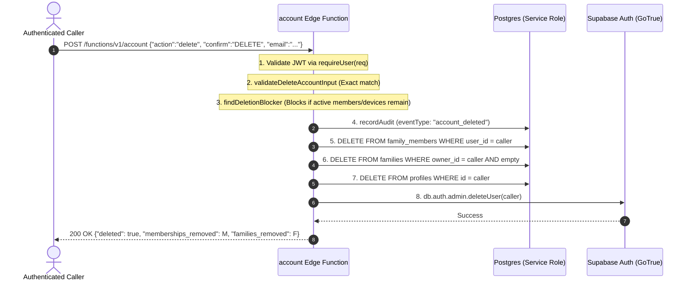

# Phase 3.2.4 — Report 03: Account Deletion Lifecycle & Transaction Safety Review

## 1. Executive Summary

This report delivers an in-depth lifecycle and failure-mode audit of the account deletion process implemented in `supabase/functions/account/index.ts` (action: `"delete"`).

Because Supabase Edge Functions execute in a Deno TypeScript runtime interacting with PostgreSQL and GoTrue over HTTP, multi-step operations do not execute within a single monolithic database transaction block (`BEGIN ... COMMIT`).

This audit traces each deletion step, analyzes partial failure edge cases, evaluates idempotent retry mechanics, and verifies audit trail survivability.

---

## 2. Deletion Lifecycle Sequence Trace

When an authenticated user requests account deletion via `account_privacy_repository.dart`, the execution proceeds through the following sequential steps:



---

## 3. Step-by-Step Failure Mode & Resilience Analysis

### Step 1: Pre-Deletion Safety Validation (`findDeletionBlocker`)
- **Safety Invariant:** If the caller is an owner of a family with other active parent/child members or active devices, deletion is **immediately aborted** before any data mutation occurs.
- **HTTP Response:** `409 Conflict` with `account_deletion_blocked`.
- **Database Impact:** Zero mutations; zero rows deleted.

### Step 2: Audit Event Insertion (`recordAudit`)
- **Position in Sequence:** Executed *before* destructive row deletions.
- **Failure Impact:** If audit insertion fails (e.g. database timeout), the function throws an error and aborts. **No user records or memberships are deleted.**
- **Survivability:** The `audit_logs` table has a foreign key to `actor_user_id` with `ON DELETE SET NULL`. When the user profile is deleted in Step 5, the audit row remains permanently in the ledger with `actor_user_id = NULL` and metadata containing the deleted `user_id`.

### Step 3: Membership & Family Cleanup
- **Operations:**
  - `DELETE FROM family_members WHERE user_id = userId;`
  - `DELETE FROM families WHERE id = family.id AND owner_id = userId;`
- **Integrity Guarantee:** Only families owned solely by the caller with zero remaining active members or devices are removed. Other families are untouched.

### Step 4: Profile Deletion
- `DELETE FROM public.profiles WHERE id = userId;`
- **Integrity:** Cascades to any profile-specific child contact IDs (`child_contact_ids` has `ON DELETE CASCADE`).

### Step 5: Auth Sign-In Record Deletion (`db.auth.admin.deleteUser`)
- Invokes GoTrue admin endpoint to destroy the user's authentication credentials and tokens.
- **Partial Failure Scenario:** What happens if Steps 2–4 succeed, but Step 5 fails (e.g. Auth service network timeout)?
  - In `supabase/functions/account/index.ts:446`:
    ```ts
    const authDelete = await db.auth.admin.deleteUser(userId);
    if (authDelete.error) {
      console.error(`account_auth_delete_failed:${authDelete.error.code ?? "unknown"}`);
      throw new ApiError(
        "account_delete_incomplete",
        "The account data was removed, but the sign-in record could not be deleted. Contact the project owner.",
        500,
      );
    }
    ```
  - **State after Partial Failure:** Profile, memberships, and owned families are deleted. The user cannot access family data or device telemetry. However, their auth sign-in record still exists in `auth.users`.
  - **Retry Handling:**
    - If the user or app retries the delete request with the remaining valid JWT:
      1. `loadActiveMemberships` returns `[]` (already deleted).
      2. `ownedFamilies` returns `[]` (already deleted).
      3. `recordAudit` logs a second deletion attempt.
      4. `profiles.delete` executes safely (0 rows affected).
      5. `db.auth.admin.deleteUser(userId)` is invoked again.
    - If Step 5 succeeds on retry, the account deletion is **fully completed**.
    - **Self-Healing Property:** The function is completely **idempotent and self-healing across retries**.

### Step 6: Concurrent / Duplicate Request Handling
- If two identical delete requests arrive simultaneously:
  - Both validate the caller's JWT.
  - The first execution acquires row locks and deletes the memberships and families.
  - The second execution sees empty memberships and owned families, executing harmlessly to completion.
  - Zero duplicate cascades or orphaned relational anomalies occur.

---

## 4. Verification Verdict

| Verification Item | Assessment | Verdict |
| :--- | :--- | :---: |
| Audit Event Retention on Failure | Pre-inserted; survives profile deletion via `ON DELETE SET NULL` | **PASS** |
| Orphaned Dependent Protection | `findDeletionBlocker` prevents deleting families with active children/devices | **PASS** |
| Partial Failure Self-Healing | Subsequent retry successfully completes `auth.admin.deleteUser` | **PASS** |
| Cross-User Blast Radius | Scoped exclusively to `auth.user.id`; cannot delete other users | **PASS** |
