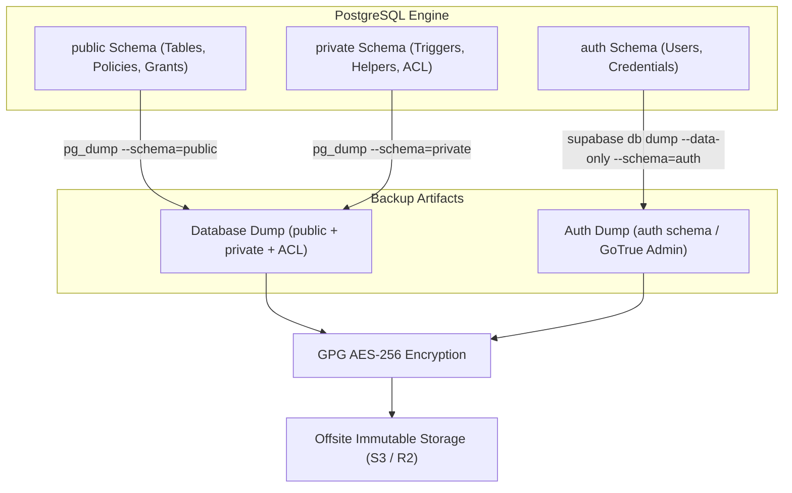

# Phase 3.2.5 — Report 01: Backup Command Correctness & Complete Recovery Architecture

## 1. Executive Summary

This report delivers a rigorous technical audit of the database backup and restore command proposed in Phase 3.2.4.

It exposes critical flaws in using `--no-privileges` and `--no-owner`, details the exact dependencies and Supabase-managed schemas that are excluded by standard dumps, and specifies the correct, production-safe backup and disaster recovery architecture.

---

## 2. Flaw Analysis of the Proposed Backup Command

In Phase 3.2.4 Report 04, the following candidate command was evaluated:
```bash
pg_dump ... --schema=public --schema=private --no-owner --no-privileges ...
```

### Critical Flaw 1: The `--no-privileges` (`--no-acl`) Catastrophe
According to official PostgreSQL documentation:
> `--no-privileges (-x)`: Prevent dumping of access privileges (GRANT/REVOKE commands).

**Impact on Parent Control Architecture:**
- The Parent Control security model relies heavily on explicit `REVOKE` and `GRANT` statements:
  1. `REVOKE ALL ON ALL TABLES IN SCHEMA public FROM anon, authenticated;`
  2. Column-level grants on `public.devices` that **strictly exclude** `secret_hash` and `installation_id`.
  3. `REVOKE ALL ON ALL FUNCTIONS IN SCHEMA public FROM public, anon, authenticated;`
  4. Complete privilege revocation on service-only tables (`device_pairing_tokens`, `child_contact_ids`, `safe_zone_states`, `pairing_attempts`).
- **If restored from a backup created with `--no-privileges`:**
  - PostgreSQL applies default privileges!
  - `PUBLIC` receives execution rights on all functions.
  - Column exclusions on `devices` are lost.
  - **The restored database suffers an immediate, catastrophic authorization regression, exposing sensitive device hashes and allowing unauthenticated function calls.**
- **Verdict:** `--no-privileges` **MUST NEVER BE USED**. All `GRANT` and `REVOKE` DDL must be preserved.

### Critical Flaw 2: The `--no-owner` (`-O`) Dilemma
> `--no-owner (-O)`: Do not output commands to set ownership of objects to match the original database.

**Impact on `SECURITY DEFINER` Functions:**
- In PostgreSQL, a `SECURITY DEFINER` function executes with the permissions of the role that *owns* the function.
- In Supabase, the function owner is `postgres` (which has `SUPERUSER` / `BYPASSRLS`).
- If `--no-owner` is specified and the dump is restored into an environment under an unprivileged role, the restored `SECURITY DEFINER` functions will execute under that unprivileged role instead of `postgres`, breaking internal trigger and service-role functions that bypass RLS.
- **Verdict:** For disaster recovery of the identical project or a replica, object ownership (`postgres`) should be preserved.

---

## 3. Scope Exclusions: The `auth` and Extension Boundary

A dump restricted to `--schema=public --schema=private` completely **omits the following critical components**:

| Excluded Component | Schema / Location | Critical Data Lost Upon Restore | Consequence |
| :--- | :---: | :--- | :--- |
| **User Sign-In Identities** | `auth.users` | Encrypted passwords, email addresses, `confirmed_at` timestamps, user UUIDs. | All parent and child sign-in credentials permanently lost. |
| **User Identities** | `auth.identities` | Identity provider mappings and refresh tokens. | Sessions invalidated; OAuth/password recovery impossible. |
| **Relational Integrity** | Foreign Keys | `public.profiles(id)` foreign key references `auth.users(id) ON DELETE CASCADE`. | Restoring `public.profiles` without `auth.users` causes immediate foreign key violations or deletes all profiles! |
| **PostgreSQL Extensions** | `extensions` schema | `uuid-ossp`, `pgcrypto`, `pg_net`. | Custom RPCs relying on `gen_random_uuid()` fail. |
| **Logical Publications** | `pg_publication` | `supabase_realtime` table configuration (ID: 16430). | Realtime notifications cease functioning. |

---

## 4. Recoverable Identity Backup Strategy

Because `auth.users` is managed by Supabase's internal GoTrue service, relying solely on `pg_dump` of application schemas is **insufficient**.

### Multi-Tier Backup Architecture:



1. **Database Schema & Data Dump:**
   - Dumps `public` and `private` schemas with full ACLs, triggers, and policies.
   - Command:
     ```bash
     pg_dump "$DATABASE_URL" \
       --schema=public \
       --schema=private \
       --clean \
       --if-exists \
       --quote-all-identifiers \
       --file=application_backup.sql
     ```
2. **Auth Identity Dump:**
   - Export authentication records using Supabase CLI:
     ```bash
     supabase db dump --data-only --schema auth --project-ref hhqgreaoqulmfwfwarhc -f auth_backup.sql
     ```
3. **At-Rest Encryption:**
   - Pipe both files into GPG with symmetric AES-256 encryption before persisting to disk.

---

## 5. Destructive Hazard Affirmation

> [!CAUTION]
> **RESTORE TESTING RULE:**
> Dumps generated with `--clean --if-exists` issue `DROP TABLE ... CASCADE;` statements.
> **Testing a restore against the production connection string will immediately wipe all active production data.**
> Restore verification drills must be executed **exclusively** on a local, disposable Docker container (`127.0.0.1:54322`).
