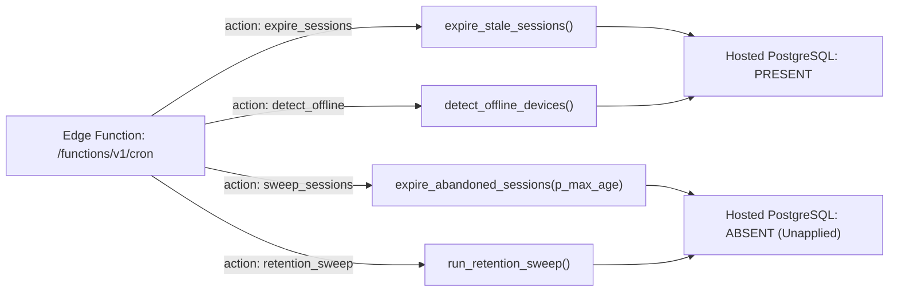

# Phase 3.2.5 — Report 04: Cron RPC Dependency & Retention Operational Review

## 1. Executive Summary

This report delivers a technical audit of the scheduled maintenance and data retention subsystems in `parent-control-prod`.

It investigates the gap between the deployed `cron` Edge Function (`supabase/functions/cron/index.ts`) and the live PostgreSQL database state, evaluating the operational risks of missing RPC dependencies and silent execution skipping.

---

## 2. Exhaustive RPC Dependency Analysis

The `cron` Edge Function router exposes four actions, each invoking a specific database procedure:



### Detailed RPC Specification & Parity Matrix:

| Action | Function Signature | Migration Origin | Return Type | Hosted DB Status |
| :--- | :--- | :--- | :---: | :---: |
| `expire_sessions` | `public.expire_stale_sessions()` | `20260101000100_functions.sql:773` | `integer` | **PRESENT** |
| `detect_offline` | `public.detect_offline_devices()` | `20260101000100_functions.sql:782` | `integer` | **PRESENT** |
| `sweep_sessions` | `public.expire_abandoned_sessions(p_max_age interval)` | `20261030000100_abandoned_session_sweep.sql:87` | `integer` | **ABSENT (UNAPPLIED)** |
| `retention_sweep`| `public.run_retention_sweep()` | `20261030000300_retention_sweep.sql:113` | `jsonb` | **ABSENT (UNAPPLIED)** |

---

## 3. The `isMissingFunction` Masking Vulnerability

In `supabase/functions/cron/index.ts` lines 14–25 and 70–120:

```ts
function isMissingFunction(error: { code?: string | null; message?: string | null }): boolean {
  const code = (error.code ?? "").toUpperCase();
  const message = (error.message ?? "").toLowerCase();
  return code === "PGRST202" || code === "42883" ||
    message.includes("could not find the function") || message.includes("does not exist");
}
```

When an external runner calls `/functions/v1/cron` with action `retention_sweep`:
1. The Edge Function executes `db.rpc("run_retention_sweep")`.
2. PostgREST returns error `PGRST202` (function not found in schema cache).
3. `isMissingFunction` evaluates to `true`.
4. The Edge Function logs `console.warn("retention_sweep_function_missing")` and returns:
   ```json
   HTTP 200 OK
   {
     "skipped": true,
     "reason": "function_missing"
   }
   ```

### Operational Risk:
- **Silent Degradation:** Standard HTTP uptime and monitoring tools (Pingdom, Datadog, UptimeKuma, Cloudflare) check for `HTTP 200 OK`.
- Because the endpoint returns 200 OK, monitoring dashboards report **GREEN (Success)**, while **zero rows are pruned and retention enforcement is completely dormant**.
- Telemetry rows in `location_events` and `usage_daily` accumulate indefinitely.

---

## 4. Alternative Telemetry Pruning Mechanism Audit

Does any other component prune historical telemetry?

1. **Flutter Mobile Client:** Contains zero deletion queries for `location_events` or `usage_daily` (clients only perform `INSERT` and `SELECT`).
2. **Native Android Service (`GuardianService.kt`):** Only uploads location coordinates and heartbeat telemetry; contains no cleanup logic.
3. **Database Triggers:** None of the 7 triggers perform background pruning.
4. **Conclusion:** Telemetry retention relies **100% on the unapplied `run_retention_sweep` RPC**. Until migration `20261030000300` is deployed and an external scheduler is configured, database retention is non-operational.

---

## 5. Finding Summary & Action Items

| Item | Finding | Risk Level | Remediation |
| :--- | :--- | :---: | :--- |
| **Missing Migrations** | `expire_abandoned_sessions` and `run_retention_sweep` not in hosted database | **P2 (Medium)** | Apply migrations `20261030000100` and `20261030000300` upon owner authorization. |
| **Silent 200 Skipping** | `isMissingFunction` masks absent database RPCs as successful HTTP 200 responses | **P2 (Medium)** | Update monitoring to inspect JSON response body for `"skipped": true`. |
| **Scheduler Inactivity** | `pg_cron` uninstalled; no active external runner configured | **P2 (Medium)** | Set up daily HTTPS webhook runner with `x-cron-secret`. |
