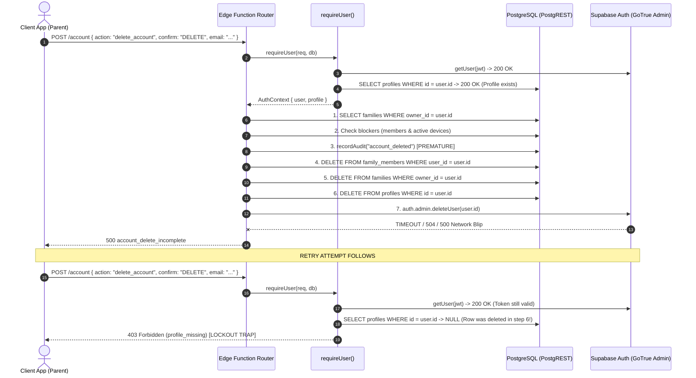

# Phase 3.3 — Report 01: Current Account Deletion Failure & Retry Lockout Analysis

**Project:** Parent Control App  
**Workspace:** `D:\parentcontrol_app`  
**Target Function:** `account` (`supabase/functions/account/`)  
**Associated Audit Findings:** Phase 3.2.5 Report 03 (`03_account_deletion_concurrency_review.md`), Defect E-15

---

## 1. Executive Summary

During Phase 3.2.5 Report 03, an architectural flaw was uncovered in the account deletion workflow implemented in `supabase/functions/account/index.ts` (`deleteAccount`). 

Because account deletion involves multiple independent, non-atomic HTTP operations (database mutations followed by Supabase Auth GoTrue admin deletion), a failure or timeout at the final step leaves the user in an unrecoverable "limbo" state. When the client or user subsequently retries account deletion using the still-valid JWT, the global authentication gatekeeper (`requireUser` in `_shared/auth.ts`) rejects the request with HTTP `403 Forbidden` (`profile_missing`). The user is permanently locked out from completing the deletion or retrying via the application.

---

## 2. Step-by-Step Anatomy of the Failure Scenario

Prior to this remediation, `deleteAccount` and the request dispatcher in `supabase/functions/account/index.ts` executed the following linear sequence:



### Detailed Breakdown of the Defect Points:

1. **Non-Atomic Multi-System Deletion:**
   - Steps 4, 5, and 6 modify relational tables in PostgreSQL via PostgREST.
   - Step 7 executes an external HTTP call to the GoTrue Auth admin service (`/admin/users/{id}`).
   - PostgreSQL transactions cannot span external network calls to GoTrue. If Step 7 fails, Steps 4, 5, and 6 remain committed in PostgreSQL.

2. **Premature Audit Logging (Invariant 8 Violation):**
   - In the legacy code, `recordAudit(db, { eventType: "account_deleted", ... })` was inserted at Step 3 *before* database records and Auth records were actually deleted.
   - If Step 7 failed, the database permanently recorded that the account was deleted, even though the user still existed in `auth.users`.

3. **Indiscriminate Global Profile Requirement (`profile_missing` Lockout):**
   - The top-level `Deno.serve` dispatcher invoked `const auth = await requireUser(req, db);` unconditionally for *all* actions.
   - Inside `_shared/auth.ts`:
     ```ts
     const profileResult = await db.from("profiles").select(...).eq("id", user.id).maybeSingle();
     const row = profileResult.data;
     if (!row) {
       throw new ApiError("profile_missing", "The account profile is not ready yet. Try again shortly.", 403);
     }
     ```
   - Because Step 6 succeeded on the first attempt, the user's `profiles` record was already gone.
   - On retry, `requireUser` blocked the request with `403 profile_missing` before `deleteAccount` was ever reached.

---

## 3. Impact Assessment

| Risk Vector | Severity | Impact Description |
| :--- | :---: | :--- |
| **User Lockout / Abandonment** | **P1 (High)** | A transient network drop during deletion leaves the parent or child account permanently broken. The user cannot log in (profile missing) and cannot delete (profile missing). |
| **GDPR / Privacy Compliance Violation** | **P1 (High)** | When a user requests "Right to Erasure" (account deletion), a transient error prevents erasure of `auth.users` credentials, and the automated client cannot retry without manual database administrator intervention. |
| **Audit Falsification** | **P2 (Medium)** | Compliance logs stated `account_deleted` occurred when the account was in fact partially stranded. |
| **Post-Cascade Dangling Auth Record** | **P2 (Medium)** | `auth.users` contained an orphaned identity with no associated `public.profiles` row. |

---

## 4. Remediation Requirements

To completely eliminate this failure mode, the remediation must:
1. Factor out caller token verification (`requireAuthUser`) from mandatory profile lookup (`requireUser`).
2. Restrict missing-profile tolerance strictly to `action: "delete_account"` (and alias `"delete"`).
3. Ensure exact confirmation `"DELETE"` and matching caller email are validated before attempting any retry.
4. Postpone `account_deleted` audit logging until `auth.admin.deleteUser` has actually succeeded.
5. Provide graceful idempotent recovery if the auth user is already removed.
