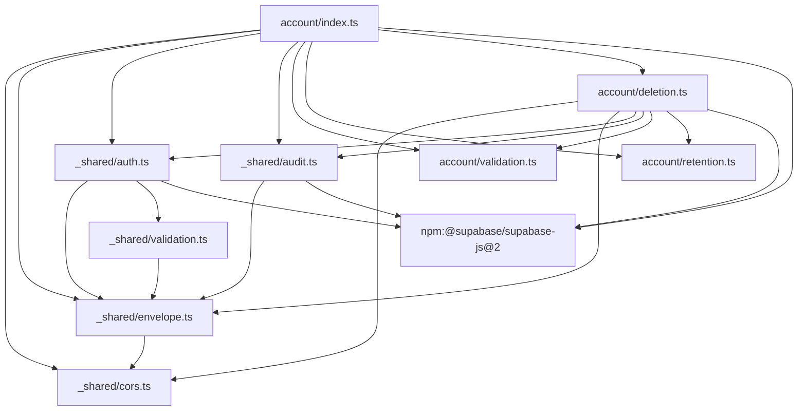
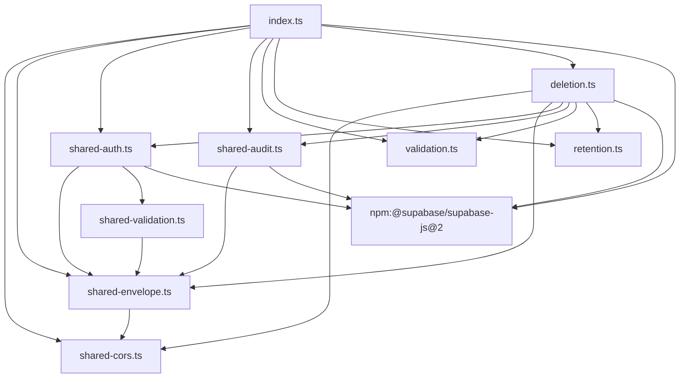

# Phase 3.4.3 — Report 02: Dependency Graph & Import Topology Analysis

**Project:** Parent Control App  
**Workspace:** `D:\parentcontrol_app`  
**Target Function:** `account`  
**Runtime:** Deno 2.x / Supabase Edge Runtime  
**Package Mode:** Flat Root-Level Browser Package  

---

## 1. Original Import Graph (Nested `_shared/` Layout)

In the original repository structure, modules in `supabase/functions/account/` use parent directory navigation (`../_shared/`) to access shared modules:

---

## 2. Staged Flat-Root Import Graph

To enable seamless browser editor compatibility without folder nesting, shared modules are prefixed with `shared-` and located in the function root alongside the handler:

---

## 3. Detailed Per-Module Import Resolution Matrix

| Staged File | Import Statement | Target Module | Dependency Type | Circularity Risk |
| :--- | :--- | :--- | :--- | :---: |
| `index.ts` | `import { preflightResponse, corsHeaders } from "./shared-cors.ts"` | `shared-cors.ts` | Internal Sibling | None (DAG leaf) |
| `index.ts` | `import { ApiError, errorResponse, jsonResponse } from "./shared-envelope.ts"` | `shared-envelope.ts` | Internal Sibling | None (DAG leaf) |
| `index.ts` | `import { getServiceClient, requireAuthUser, requireUser } from "./shared-auth.ts"` | `shared-auth.ts` | Internal Sibling | None |
| `index.ts` | `import { recordAudit } from "./shared-audit.ts"` | `shared-audit.ts` | Internal Sibling | None |
| `index.ts` | `import { validateDeleteAccountInput } from "./validation.ts"` | `validation.ts` | Internal Sibling | None (DAG leaf) |
| `index.ts` | `import { buildFamilyRetentionReport, ... } from "./retention.ts"` | `retention.ts` | Internal Sibling | None (DAG leaf) |
| `index.ts` | `import { executeAccountDeletion, ... } from "./deletion.ts"` | `deletion.ts` | Internal Sibling | None |
| `index.ts` | `import type { SupabaseClient } from "npm:@supabase/supabase-js@2"` | `@supabase/supabase-js` | External NPM Specifier | None (Standard) |
| `deletion.ts` | `import { preflightResponse, corsHeaders } from "./shared-cors.ts"` | `shared-cors.ts` | Internal Sibling | None (DAG leaf) |
| `deletion.ts` | `import { ApiError, errorResponse, jsonResponse } from "./shared-envelope.ts"` | `shared-envelope.ts` | Internal Sibling | None (DAG leaf) |
| `deletion.ts` | `import { recordAudit } from "./shared-audit.ts"` | `shared-audit.ts` | Internal Sibling | None |
| `deletion.ts` | `import { getServiceClient, requireAuthUser, ... } from "./shared-auth.ts"` | `shared-auth.ts` | Internal Sibling | None |
| `deletion.ts` | `import { validateDeleteAccountInput } from "./validation.ts"` | `validation.ts` | Internal Sibling | None (DAG leaf) |
| `deletion.ts` | `import { buildFamilyRetentionReport, ... } from "./retention.ts"` | `retention.ts` | Internal Sibling | None (DAG leaf) |
| `shared-auth.ts` | `import { ApiError, ensureNoError } from "./shared-envelope.ts"` | `shared-envelope.ts` | Internal Sibling | None |
| `shared-auth.ts` | `import { constantTimeEqualHex, isUuid, sha256Hex } from "./shared-validation.ts"` | `shared-validation.ts` | Internal Sibling | None |
| `shared-audit.ts` | `import { ApiError } from "./shared-envelope.ts"` | `shared-envelope.ts` | Internal Sibling | None |
| `shared-envelope.ts` | `import { corsHeaders } from "./shared-cors.ts"` | `shared-cors.ts` | Internal Sibling | None |
| `shared-validation.ts` | `import { ApiError } from "./shared-envelope.ts"` | `shared-envelope.ts` | Internal Sibling | None |
| `shared-cors.ts` | *(Zero imports)* | *(None)* | Pure constants | None |
| `retention.ts` | *(Zero imports)* | *(None)* | Pure functions | None |
| `validation.ts` | *(Zero imports)* | *(None)* | Pure validation | None |

---

## 4. Name Collision Prevention Audit

A critical security and architectural consideration is module naming:
- `account/validation.ts` provides request payload validation (`validateDeleteAccountInput`, `normalizeEmail`, etc.).
- `_shared/validation.ts` provides cryptographic and identifier validation (`sha256Hex`, `isUuid`, `constantTimeEqualHex`).

In the staged package, naming collision is explicitly prevented by staging `_shared/validation.ts` as **`shared-validation.ts`**, while `account/validation.ts` remains **`validation.ts`**.
All cross-references in `shared-auth.ts` accurately target `./shared-validation.ts`.

**Conclusion:** The dependency graph forms a clean, acyclic directed graph (DAG) fully compliant with standard Deno ES module resolution.
